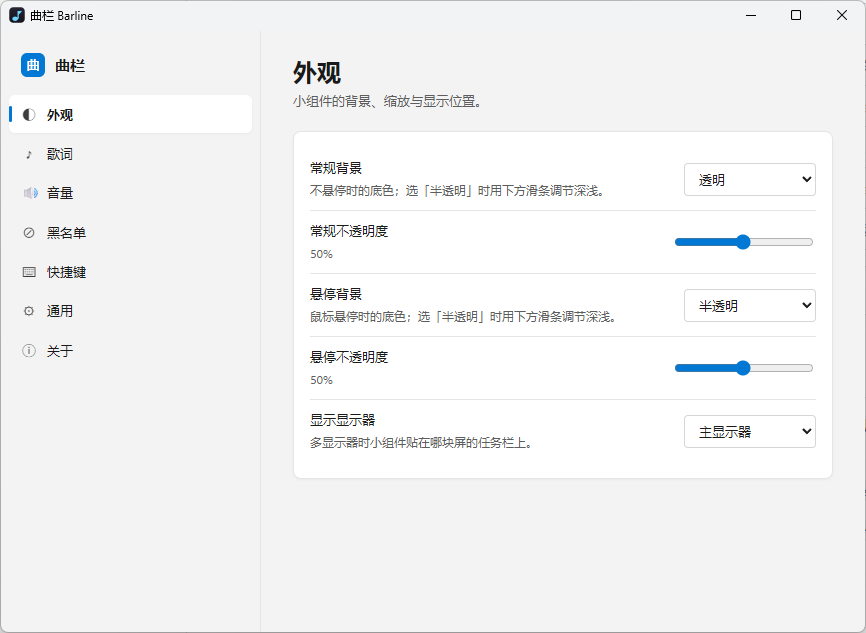

# 曲栏 Barline

**Windows 10/11 任务栏媒体播控小组件**：一条贴着托盘区左侧的内嵌任务栏条带，逐像素透明，用 Rust + Direct2D 直接绘制——不注入 Explorer、不弹独立悬浮窗。

> 界面示意如下（设置页 + 任务栏小组件）：

| 设置界面 | 任务栏小组件 |
| --- | --- |
|  |  |

**最新版本 [v1.13.0](https://github.com/Yi-One1/QuLan-Barline/releases/latest)** — 单文件绿色便携（约 1.1 MB，零运行时依赖），从 [Releases](https://github.com/Yi-One1/QuLan-Barline/releases) 下载 `Barline_v1.13.0.exe` 直接运行即可。

## 功能

- **任务栏条带**：内嵌任务栏（贴托盘区左侧 8px），四方位任务栏 / 多显示器 / DPI 缩放 / 自动隐藏 / Explorer 重启重挂全部自适应
- **媒体信息**：通过 SMTC 读取系统媒体会话——封面、歌名、歌手、播放状态
- **播控三键**：上一首 / 播放暂停 / 下一首，直接控制 SMTC 会话
- **进度条**：拖动跳转，Seeking 态有跟随时间气泡
- **音量 HUD**：滚轮调音量（系统主音量；「当前播放器」会话音量暂禁用，见 progress.md 待办 A），带百分比浮层
- **逐字卡拉OK歌词**：LRC / 增强 LRC，CJK 逐字、拉丁按词的扫光插值；长行跑马灯滚动（随演唱进度，唱完前滚到尾）；切歌淡出 + 上移转场
- **歌词来源**：内存 LRU → 磁盘缓存 → 本地目录 → lrclib.net 与 网易云音乐**并发**（自研 WinHTTP 客户端，无重依赖；标题自动去 `(Live)`/`(伴奏)` 等版本标记、多歌手取主），8 秒硬截止、换歌即时抢占（v1.4.0）
- **歌词落盘**：查到的歌词只要本地目录没有，自动存一份 `歌名 - 歌手.lrc`（保留原始大小写，只新建、绝不覆盖）——内存、磁盘缓存、在线三条命中路径都会落，不用再手动攒文件（v1.7.0/v1.8.0）
- **歌词优先序可切换**：默认「磁盘缓存优先」；设置里可切「**本地文件优先**」——手改 `.lrc` 立刻生效，连正在播放的那首都即时生效。设置页只读显示磁盘缓存的真实路径与占用，并支持**一键清空**（内存缓存、磁盘缓存与「查不到」记录一起清，只动缓存目录、不碰你自己的 `.lrc`；v1.8.0 / v1.11.0）
- **媒体筛选（黑名单 / 白名单，二选一生效）**：按进程名筛选媒体源，入口在设置页「媒体筛选」分区 + 托盘右键；支持手输、粘贴路径，或在「检测到的应用」里一键加入。**两种模式用一个切换控件二选一**，一次只有一种参与判定，另一份原样保留（切回来还在）——界面永远是「一份名单 + 一个切换」。**黑名单模式**：名单内的应用不渲染、不查歌词、不响应播控（v1.9.0）。**白名单模式**：留空 = 未启用（全部接管）；一旦加条目就**只接管名单内的**，适合「只听这几个」（v1.12.0）。两档下「空名单」都是放行全部，所以**切换本身不会让小组件消失**，只有往白名单加条目才收窄范围（v1.13.0）。托盘项随模式换口径（拉黑/恢复 ↔ 加入白名单/从白名单移除）。**多会话智能切换**：被排除的应用在播放时不再让整个小组件消失，会自动切换到其它可接管的播放器（全暂停时取系统顺序第一个）；只有确实一个都没有时才显示空态；正常运行零额外轮询开销（v1.9.1）
- **双击打开设置**：双击小组件的空白区 / 信息区（歌名+歌手）/ 歌词区即可打开设置页；封面、四按钮、进度条除外。可在设置「通用」页关闭；小组件不新增任何按钮（v1.10.0）
- **歌词钟稳定性**：网易云暂停→继续、切歌、跨应用返回，歌词进度均不再归零或滞后（v1.9.2 / v1.9.3）
- **悬停背景**：常规与悬停两态各自可选透明/半透明，半透明不透明度可调（滑条），可在设置中调整（v1.1.12）
- **壁纸自适应对比度**：采样壁纸亮度自动切黑 / 白文字，歌手名动态 alpha 保 WCAG 4.5:1；带迟滞与二次确认，壁纸切换约 1 秒响应、阈值附近的抖动不会翻色（v1.2.0）
- **系统托盘**：设置 / 显示隐藏小组件 / 拉黑当前应用（有播放时）/ 退出，语言随配置切换
- **全局快捷键**：6 组，录制改绑，冲突检测（首启气泡提示一次）
- **WebView2 设置页**：Mica 圆角窗口，明暗跟随系统，中英双语，配置写入即时生效；关窗再开回到上次停留的分区，进程重启后回到第一页（v1.12.0）；未装 WebView2 运行时时小组件本身不受影响

## 系统要求

- Windows 10 1903+ / Windows 11
- **Microsoft Edge WebView2 Runtime**（仅设置页需要；Win11 一般自带，缺了可从[微软官网](https://developer.microsoft.com/microsoft-edge/webview2/)安装，小组件本体不受影响）

## 构建方法

```powershell
powershell -ExecutionPolicy Bypass -File scripts\build.ps1              # release 构建
powershell -ExecutionPolicy Bypass -File scripts\build.ps1 -Task test   # 测试
powershell -ExecutionPolicy Bypass -File scripts\build.ps1 -Task clippy # lint
```

**必须经 `scripts/build.ps1`，不要裸跑 `cargo build`**：该脚本会把 MSVC 的 `link.exe` 与 Windows SDK 的 `LIB` / `INCLUDE` 注入环境。在 Git Bash / MSYS2 环境下裸跑时，PATH 里的 GNU coreutils `usr/bin/link.exe` 会抢占 MSVC 链接器，报 `link: extra operand` 之类的诡异错误。

依赖：Rust 1.82+（MSVC 工具链）+ Visual Studio BuildTools（「使用 C++ 的桌面开发」工作负载）+ Windows SDK。产出单文件 `target\release\barline.exe`（约 1 MB，零运行时依赖，绿色便携）。

## 默认快捷键

| 功能 | 默认键 |
|---|---|
| 播放 / 暂停 | `Ctrl+Alt+P` |
| 上一首 | `Ctrl+Alt+←` |
| 下一首 | `Ctrl+Alt+→` |
| 歌词开关 | `Ctrl+Alt+L` |
| 静音 | `Ctrl+Alt+M` |
| 显示 / 隐藏小组件 | `Ctrl+Alt+H` |

均可在设置页录制改绑；被其他程序占用时启动不受影响，仅气泡提示一次。

## 配置文件

- 配置 / 日志 / WebView2 用户数据：`%LOCALAPPDATA%\Barline\`
  - `config.json`（损坏时自动回退默认值）
  - `logs\barline.log`
  - `WebView2\`（设置页用户数据，便携不污染系统）

## 歌词缓存与来源

查询顺序：内存 LRU（8 首 / 512KB）→ 磁盘缓存（30 天）→ 本地歌词目录（设置页可添加）→ 负缓存（24h）→ [lrclib.net](https://lrclib.net) 与 网易云音乐 **并发查询**（谁先命中用谁；lrclib 精确未中时走模糊检索，按标题/歌手/时长差本地择优）。**8 秒硬截止**：到点必有结论，最坏也只等 8 秒；换歌立即抢占，旧查询结果直接丢弃，不会把新歌堵在队列里。网络失败最多重试 1 次（3 秒后），超时不重试。命中结果连同来源一起缓存。关闭「在线歌词」开关则只用本地来源。

> 宁可「暂无歌词」也不串歌：标题不沾边或时长差超过 10 秒的候选会被直接淘汰；缓存键只摘平台后缀与首尾装饰（`_哔哩哔哩_bilibili`、`【Hi-Res】`），`Live`/`伴奏`/`翻唱`/圆括号内的版本信息一律保留。

## 致谢

- [lrclib](https://lrclib.net) —— 开放歌词数据库
- [网易云音乐](https://music.163.com) —— 在线歌词兜底源
- Windows API · Direct2D · DirectWrite · SMTC · WebView2

## 许可

[MIT License](LICENSE)
