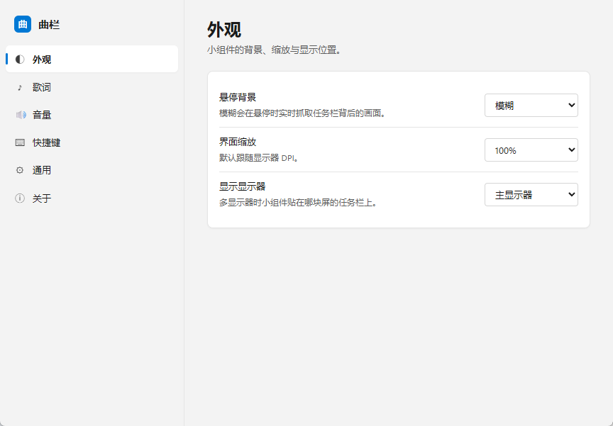

# 曲栏 Barline

**Windows 10/11 任务栏媒体播控小组件**：一条贴着托盘区左侧的内嵌任务栏条带，逐像素透明，用 Rust + Direct2D 直接绘制——不注入 Explorer、不弹独立悬浮窗。



## 功能

- **任务栏条带**：内嵌任务栏（贴托盘区左侧 8px），四方位任务栏 / 多显示器 / DPI 缩放 / 自动隐藏 / Explorer 重启重挂全部自适应
- **媒体信息**：通过 SMTC 读取系统媒体会话——封面、歌名、歌手、播放状态
- **播控三键**：上一首 / 播放暂停 / 下一首，直接控制 SMTC 会话
- **进度条**：拖动跳转，Seeking 态有跟随时间气泡
- **音量 HUD**：滚轮调音量（系统主音量；「当前播放器」会话音量暂禁用，见 progress.md 待办 A），带百分比浮层
- **逐字卡拉OK歌词**：LRC / 增强 LRC，CJK 逐字、拉丁按词的扫光插值；长行跑马灯滚动（随演唱进度，唱完前滚到尾）；切歌淡出 + 上移转场
- **歌词来源**：内存 LRU → 磁盘缓存 → 本地目录 → lrclib.net 在线查询（自研 WinHTTP 客户端，无重依赖）
- **悬停背景**：常规与悬停两态各自可选透明/半透明，半透明不透明度可调（滑条），可在设置中调整（v1.1.12）
- **壁纸自适应对比度**：采样壁纸亮度自动切黑 / 白文字，歌手名动态 alpha 保 WCAG 4.5:1；带迟滞与二次确认，壁纸切换约 1 秒响应、阈值附近的抖动不会翻色（v1.2.0）
- **系统托盘**：设置 / 显示隐藏小组件 / 退出，语言随配置切换
- **全局快捷键**：6 组，录制改绑，冲突检测（首启气泡提示一次）
- **WebView2 设置页**：Mica 圆角窗口，明暗跟随系统，中英双语，配置白名单写入即时生效；未装 WebView2 运行时时小组件本身不受影响

## 系统要求

- Windows 10 1903+ / Windows 11
- **Microsoft Edge WebView2 Runtime**（仅设置页需要；Win11 一般自带，缺了可从[微软官网](https://developer.microsoft.com/microsoft-edge/webview2/)安装，小组件本体不受影响）

## 构建方法

```powershell
powershell -ExecutionPolicy Bypass -File scripts\build.ps1              # release 构建
powershell -ExecutionPolicy Bypass -File scripts\build.ps1 -Task test   # 测试
powershell -ExecutionPolicy Bypass -File scripts\build.ps1 -Task clippy # lint
```

**必须经 `scripts/build.ps1`，不要裸跑 `cargo build`**：该脚本会把 MSVC 的 `link.exe` 与 Windows SDK 的 `LIB` / `INCLUDE` 注入环境。在 Git Bash / MSYS2 环境下裸跑时，PATH 里的 GNU coreutils `usr/bin/link.exe` 会抢占 MSVC 链接器，报 `link: extra operand` 之类的诡异错误。

依赖：Rust 1.82+（MSVC 工具链）+ Visual Studio BuildTools（「使用 C++ 的桌面开发」工作负载）+ Windows SDK。产出单文件 `target\release\barline.exe`（约 1 MB，零运行时依赖，绿色便携）。

## 默认快捷键

| 功能 | 默认键 |
|---|---|
| 播放 / 暂停 | `Ctrl+Alt+Shift+P` |
| 上一首 | `Ctrl+Alt+Shift+←` |
| 下一首 | `Ctrl+Alt+Shift+→` |
| 歌词开关 | `Ctrl+Alt+Shift+L` |
| 静音 | `Ctrl+Alt+Shift+M` |
| 显示 / 隐藏小组件 | `Ctrl+Alt+Shift+H` |

均可在设置页录制改绑；被其他程序占用时启动不受影响，仅气泡提示一次。

## 配置文件

- 配置 / 日志 / WebView2 用户数据：`%LOCALAPPDATA%\Barline\`
  - `config.json`（损坏时自动回退默认值）
  - `logs\barline.log`
  - `WebView2\`（设置页用户数据，便携不污染系统）

## 歌词缓存与来源

查询顺序：内存 LRU（8 首 / 512KB）→ 磁盘缓存（30 天）→ 本地歌词目录（设置页可添加）→ 负缓存（24h）→ [lrclib.net](https://lrclib.net) 在线（超时 12–15s，失败重试 1 次，总闸 25s）。关闭「在线歌词」开关则只用本地来源。

## 致谢

- [lrclib](https://lrclib.net) —— 开放歌词数据库
- Windows API · Direct2D · DirectWrite · SMTC · WebView2

## 许可

[MIT License](LICENSE)
