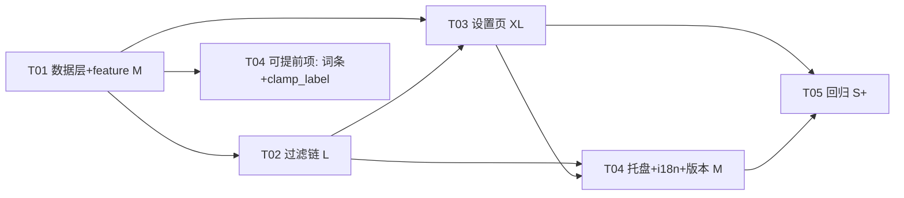

# G7 · ARCH-G7 × v1.8.1 代码对齐审计

- 审计对象：`docs/ARCH-G7-黑名单.md`（1627 行，写于 v1.7.0 时代）+ `docs/PRD-G7-黑名单.md` §5/§8（经 `docs/PRD-G7-现状复核.md` 复核）
- 对照基线：v1.8.1 工作树（515 `#[test]`、clippy 0、Cargo.toml version 1.8.1）
- 性质：**只审计、不成码**。不改 ARCH/PRD 原文、不改源码、不动 progress.md / ARCHITECTURE.md / deliverables/。
- 工具纪律：Bash 内 `rg` **不存在**（实测 `rg --version` → RG_NOT_FOUND），本次全部用 Grep/Read 工具逐条核对，无"全 0 假绿"风险。

---

## 1. 结论摘要

**ARCH-G7 的设计逻辑 ~95% 可直接使用，失效集中在三类：① 全文行号锚点漂移（约 20 处，v1.8.0 删死码 + app.rs/index.html 增量导致）；② 3 处内容级修正（`push_transient` → 复用既有 `post()`、§3.1 Config 片段仍含已被 G6 删除的 `window` 字段、`view.GetSession` 应为 `GetAt`）；③ 4 处版本基线过期（v1.8.0→v1.9.0、性能基线 v1.7.1→v1.8.1、测试数 390→515、`push_transient` 前置消失）。**

| 维度 | 数字 |
| --- | --- |
| 偏差条目 | **26 条**（主理人已确认 6 条采信 + 本次补全 20 条，见 §2） |
| 需前置工作 | **5 项**（见 §3），其中只有 1 项动 Cargo.toml |
| 内容级失效（设计要改） | **2 处**：`push_transient` 不新增（改用 `post()`）；§3.1 Config 片段的 `window` 行作废 |
| 纯行号漂移（设计不变，照锚点重定位） | ~18 处（见 §2 B 组） |
| 需用户拍板 | **0 条**（confirm 分歧已由主理人裁决采用 `window.confirm()`；`blacklist.hint.match` 采用 PRD 版，均已记录） |

---

## 2. 偏差表

### A 组 · 主理人已确认（本次复核复核性抽验，全部通过）

| # | 文档位置 | 原文/主张 | 现状（文件:行号） | 修正 | 影响 |
| --- | --- | --- | --- | --- | --- |
| A1 | ARCH 全文 | 引用 G6 已删符号 `SettingsPush`/`HostMsg`/`ToastLevel`/`Effect::MoveWindow`/`Effect::SetVisible`/`Effect::CloseSettings`/`Effect::RequestBackdrop`/`Config.window`/`accent_source`/`lyrics.mode`/`LyricModeSerde` | `src/` 全目录 grep 零命中（本次复验 `blacklist`/`mediaApps`/`MediaIndex`/`apply_blacklist` 亦零命中——G7 是净地） | 无需改 | 文档写作时已预判 G6 范围（ARCH:1554 `SettingsService::is_open()` 条），成立 |
| A2 | ARCH:755/906-907 | G7 枚举走 `mgr.GetSessions()` → `IVectorView` | **验证通过**：`smtc.rs` 现状只走 `GetCurrentSession()`（`smtc.rs:530` 主循环、`smtc.rs:1056` 播控），全文件零 `GetSessions`/`IVectorView`；`Cargo.toml:62-64` 仅剩 `Foundation`、`Foundation_Numerics` | **Cargo.toml 加回 `Foundation_Collections`**（见 §3-1） | G7 硬前置；不加则 `IVectorView::GetCount/GetAt` 编译不过 |
| A3 | ARCH:128/1085/1259 等 | 新增 `SettingsService::push_transient()` | **验证通过**：`src/settings/mod.rs:231-235` 的 `post()` 语义完全相同（只 post 不碰 `last_state`，注释即 R2 缺陷的成因说明）；`push()`（`mod.rs:215-220`）覆写 `last_state` 不可用 | **不新增方法**，G7 全部 `push_transient` 字样 → 用既有 `post()` | T03 不再动 `src/settings/mod.rs`（任务文件清单减一）；§6.4:1259 `self.settings.push_transient(&json)` → `self.settings.post(&json)` |
| A4 | ARCH:1277-1296 | `append` 现状四参、`show_menu(lang, widget_visible)` | **验证通过**：`src/ui/tray.rs:288` `fn append(menu: HMENU, label: &str, id: usize, checked: bool)`；`tray.rs:202` `show_menu(&self, lang, widget_visible)` | 扩五参 + `show_menu` 加 `IgnoreMenuItem` 方案照旧成立 | 无 |
| A5 | ARCH 差异表 #16 | `window.confirm()` vs PM「Rust 原生弹窗」 | `platform::confirm_dialog` 确实存在（`src/platform/mod.rs:69`，`app.rs:1904-1905` 在用） | **按主理人裁决：采用 ARCH 的 `window.confirm()`**（WebView2 默认 `AreDefaultScriptDialogsEnabled=true`，项目未改过）。`confirm_dialog` 仍用于数据目录等既有场景，不新增调用 | 仅记录，不再议 |
| A6 | PM 复核 §2 | 10 处界面稿调整；标题计数不能挂 `data-i18n`；刷新按钮挪卡片首行 | 采信（`docs/PRD-G7-现状复核.md` §2 表 10 条 + §3 映射表）；`blacklist.hint.match` 末句采用 PRD P0-06 版 | 进 T03 前端验收点（见 §4-T03） | 无 |

### B 组 · 本次补全核对（主理人未查部分）

#### B-1 §3.1 配置结构体兼容性

| # | 文档位置 | 原文/主张 | 现状（文件:行号） | 修正 | 影响 |
| --- | --- | --- | --- | --- | --- |
| B1 | ARCH:179-189 | §3.1 Config 片段含 `pub window: WindowStateConfig,` | `src/config/mod.rs:176-186`：`Config` 已**无** `window` 字段（G6 删除），现有字段为 version/appearance/lyrics/volume/hotkeys/general/storage | 片段里 `window` 行**作废**；实现时在现有结构末尾（`storage` 之后）追加 `pub media: MediaConfig,` 即可 | 设计本体（MediaConfig 两字段 + `#[serde(default)]`）仍成立 |
| B2 | ARCH:151 | 「追加到 Config（config/mod.rs:206-217）」 | `Config` 现在在 `config/mod.rs:175-186` | 行号漂移，锚点改为「`pub storage: StorageConfig,` 之后」 | 仅定位 |
| B3 | ARCH:153-161 | `MediaConfig` 兼容性：`#[serde(default)]`、无 `deny_unknown_fields` | **验证通过**：`Config` 带 `#[serde(default)]`（`config/mod.rs:175`），全 crate 无 `deny_unknown_fields`。旧 config.json 缺 `media` → 容器级 serde default 兜底；未来回滚老版本 → `media` 整组被老 serde 丢弃（与 PM 复核 §2-1 的回滚口径一致） | 无需改 | 兼容性判断成立 |
| B4 | ARCH:411 | `CURRENT_VERSION: u32 = 1` → 改 2 | `src/config/defaults.rs:341` 仍为 1；自适应测试在 `config/mod.rs:426`（`assert_eq!(cfg.version, defaults::CURRENT_VERSION)`） | 决策仍成立；锚点 411→341、413→366（`legacy_ui_scale_field_is_ignored` 现在在 `config/mod.rs:366`） | 仅定位 |
| B5 | ARCH:417 | 归一化插在「hotkeys.migrate()（config/mod.rs:259-264）之后」 | `hotkeys.migrate()` 现在在 `config/mod.rs:224`；`Config::save` 在 `245`；`backup_bad_config` 在 `261`（ARCH:1553 引 280-293/296-303 均漂移） | 锚点更新；「先 normalize 后 save」顺序约束不变 | 仅定位 |

#### B-2 §4 过滤插入点行号漂移（smtc.rs）

| # | 文档位置 | 原文锚点 | 现状（文件:行号） | 修正 | 影响 |
| --- | --- | --- | --- | --- | --- |
| B6 | ARCH:600（§4.2①） | `smtc.rs:566-575` 慢层读 AUMID | `if plan.props {` 在 **`smtc.rs:584`**；AUMID 读在 `timed("smtc.props")` 闭包**内** 586-589；`TryGetMediaPropertiesAsync` 590-592；封面 `self.cover.get` 612；controls 628-634 | 锚点更新 + **实现注意**：AUMID 与 props 在同一个 timed 闭包里（585-594），"读完 AUMID 早退"需先把 AUMID 读取提出闭包（或在闭包内短路），见 §5-① | 插入点语义成立，实现多一步小重构 |
| B7 | ARCH:601（§4.2②） | `smtc.rs:643-666` 发布点 | `parts_track_id` 652 → `let snapshot = self.parts.snapshot(anchor)` **662** → `sink.send(AppEvent::NowPlaying)` **685** | 锚点更新为 652-685；「①省成本 + ②保语义」双保险结论不变 | 仅定位 |
| B8 | ARCH:602-604（§4.2③） | `smtc.rs:952` `fn execute(...)` | `fn execute` 在 **`smtc.rs:1030`**；`MediaCommand::Quit => return` 1032、`Refresh` 分支 1033；`EnumerateApps` 新分支插在 Quit 之前 | 锚点更新；「命中整条丢弃 + log_debug、不发 CommandResult」结论不变（`app.rs` 的 ok:false 回滚日志链仍存在） | 仅定位 |
| B9 | ARCH:655（§4.3） | 主循环接线 `smtc.rs:717-725` `state.schedule(...)` | `let (plan, forced) = state.schedule(...)` 在 **`smtc.rs:796`** | 锚点更新 | 仅定位 |
| B10 | ARCH:675（§4.3） | 会话清零分支 `smtc.rs:511-527` | 现在在 **`smtc.rs:530-542`**（`GetCurrentSession` 530 → `parts = SessionParts::default()` 539 → `SessionCleared` 542）；「忽略态绝不清零」红线不变 | 锚点更新 | 仅定位 |
| B11 | ARCH:608 | `FORCED_FLOOR_MS`（smtc.rs:81）并列加 `IGNORE_RECHECK_MS` | **无漂移**：`smtc.rs:81` ✓ | 无 | — |
| B12 | ARCH:684-687（§4.4） | `parts_track_id` 333-340 / `anchor_of` 281-295 / `session_matches` media/mod.rs:215 | `smtc.rs:333` ✓、`smtc.rs:281` ✓；`session_matches` 漂移至 **`media/mod.rs:203`** | 仅 media/mod.rs 一处更新；「隔离四链一行不改」结论不变 | 仅定位 |
| B13 | ARCH:886-893（§5.3） | app.rs 全套锚点（1191/1326-1329/1373/1564/1565-1568/759/1193-1215/1908-1912）、event.rs:146-150 | 全部漂移：`reduce_settings_message` **app.rs:1598**、`run_settings_action` **1662**、`other =>` **1897**、`settings_state_json` **1981**、`on_tray_message` **1094**、`MediaService::spawn`（单参，无 index）**550**、`Effect::SaveConfig` 分支 **2218**、`TrayCommand` **event.rs:137-140**、`MediaCommand` **event.rs:214** | 锚点更新；「action 无注册表、`other =>` 只 log_debug、新分支必须真加 match」的坑描述仍准（1897 实证） | 仅定位 |
| B14 | ARCH:886/1156-1162/1198-1209（§5.3/§6.3） | index.html 锚点（512-519/281-312/315/550-552/599-630/809-814） | PM 复核 §6 已给新锚点，本次复验一致：导航按钮 **196-201**、nav 点击处理器 **596-599**（`requestCacheStats` 先例在 599）、`render()` **625**、`renderDirs` **687**、消息 if/else 链 **909-913** | 锚点更新；ARCH:1162「分区插在 volume 与 hotkeys 之间」对应现 306-337/340-357（PM 复核数据） | 仅定位 |
| B15 | ARCH:886（§5.3①） | `settings/webview.rs:194-207` 回调 | **无漂移**：`WebMessageReceivedEventHandler::create` 194、`add_WebMessageReceived` 207 ✓ | 无 | — |
| B16 | ARCH:917 | 复用 `media::session_matches()`（media/mod.rs:215） | 现在在 `media/mod.rs:203`；`process_image_name` 已存在（**`media/launch.rs:279`**，OpenProcess + QueryFullProcessImageNameW，`Win32_System_Threading` feature 已有） | 锚点更新 + **利好**：反查的两个最重函数都不用新写 | 仅定位 |

#### B-3 §5.4 枚举 API → Cargo feature 映射

| # | 文档位置 | 原文/主张 | 现状（文件:行号） | 修正 | 影响 |
| --- | --- | --- | --- | --- | --- |
| B17 | ARCH:906-908 | `mgr.GetSessions()` / `view.GetCount()` / `view.GetSession(i)` | `GetSessions()` 返回 `IVectorView<...>`，其方法归 **`Foundation_Collections`**（Cargo.toml 现缺）；`view` 的取元素方法名是 **`GetAt(i)`**（windows-rs 0.62 `IVectorView<T>`），ARCH:908 写的 `GetSession(i)` 是 IAudioSessionManager2 的方法名，属笔误（ARCH:755 写的是 GetAt，正确） | **唯一缺失的 feature 就是 `Foundation_Collections`**；方法名照 `GetAt` 实现 | T01 前置 |
| B18 | ARCH:909-918 | `SourceAppUserModelId()`（Media_Control）/ WASAPI 链（Win32_Media_Audio、Win32_Media_Audio_Endpoints、Win32_System_Com）/ `process_image_name`（Win32_System_Threading）/ `session_matches` | 全部已在 Cargo.toml:18-70（`Media_Control`:66、`Win32_Media_Audio`:53、`_Endpoints`:54、`Win32_System_Com`:30、`Win32_System_Threading`:23）；且 wasapi.rs:145-148 / 208-210 已有同款 `CoCreateInstance→GetDefaultAudioEndpoint→Activate(IAudioSessionManager2)→GetSessionEnumerator` 链路可照抄 | **除 `Foundation_Collections` 外无需任何新 feature** | T01 前置收敛为一项 |
| B19 | （主理人问题） | 加 `Foundation_Collections` 是否与 `webview2-com-sys` 冲突 | 不冲突：windows crate 的 feature 是 cargo 依赖图**统一叠加**（additive），多 crate 依赖同一 windows 只会取并集，不存在"重复声明/冲突"；`Foundation_Collections` 只是让该模块可命名，编译产物增量极小 | 无需处理 | — |

#### B-4 §6.1 mediaApps schema

| # | 文档位置 | 原文/主张 | 现状（文件:行号） | 修正 | 影响 |
| --- | --- | --- | --- | --- | --- |
| B20 | ARCH:1055-1085 | `apps[{process,displayName,playable,resolved,source}]` + `at`(epoch 毫秒) + `overBudget` | 与 §6.3 前端消费一一对应：`renderDetected` 用 `playable`(灰态)/`resolved`(unverified 小字)、`refreshDetectedAt` 用 `at`（`new Date(at)` 格 HH:MM）、`renderCandidates` 用 `process`；PM 复核 §2-8 补的两条（必须 `post()` 不 `push()`、不得用 setTimeout 置灰——`settings/assets.rs:219-223` 断言全页 setTimeout 仅 1 处）与 ARCH 前端设计零冲突 | **schema 无需改**；仅送达方式字样 `push_transient` → `post()`（A3） | 无 |
| B21 | ARCH:1151-1152 | 「`other =>` 只 log_debug，新 action 必须真加 match 分支」 | `app.rs:1897` `other => crate::log_debug!(...)` 实证成立；PM 复核 §2-8 要求新 action 字面量进 `assets.rs` 断言（先例 226-231） | 采纳，进 T03 验收点 | 无 |

#### B-5 §9 任务分解的版本/基线过期

| # | 文档位置 | 原文/主张 | 现状（文件:行号） | 修正 | 影响 |
| --- | --- | --- | --- | --- | --- |
| B22 | ARCH:1502/1555 | T04 版本 bump 到 **1.8.0** | G5.1 用掉 1.8.0、G6 是 1.8.1（Cargo.toml:3 `version = "1.8.1"`）；G7 = **v1.9.0**（PM 复核 §2-1，progress.md:216） | T04 版本 5 处统一 bump **1.9.0** | 仅数值 |
| B23 | ARCH:1513 | 「测试数从 390 涨上去」 | 当前基线 **515 个 `#[test]`**（514 passed / 1 ignored） | T05 口径改为「515 → 只增不减」 | 仅数值 |
| B24 | ARCH:1494/1504 | 「60s 轮询统计与 v1.7.1 基线 ±10%」 | 性能基线现为 **v1.8.1**（PM 复核 §2-2） | T03/T05 验收口径基线改 v1.8.1 | 仅数值 |
| B25 | ARCH:1468（T01-⑤） | 常量「共 8 个」放 `defaults::limits`（HIT_LOG_WINDOW_MS + 黑名单 3 + 枚举闸门 4）；§3.2 说数值唯一定义处 | 成立，无漂移；`blacklist.rs` 用 `limits::` 引用 | 无 | — |
| B26 | Cargo.toml:14 | 「windows feature 清单逐条照抄 docs/ARCHITECTURE.md §4.2」 | 加 `Foundation_Collections` 后该注释会失真 | 工程师在 T01 **同步更新 ARCHITECTURE.md §4.2**（本轮审计纪律不动该文件，故列为 T01 交付物） | 文档一致性 |

---

## 3. 前置工作清单（5 项，全部并入 T01–T03，无独立任务）

1. **Cargo.toml 加回 `Foundation_Collections`**（Cargo.toml:62-64 处，`Foundation_Numerics` 之后加一行 + 注释；B17/B19）——G7 唯一的依赖前置；同步更新 `docs/ARCHITECTURE.md §4.2` 清单（B26，工程师任务内完成）。
2. **`push_transient` → 复用既有 `post()`**（`src/settings/mod.rs:231-235`）：G7 不新增任何 settings 方法，`src/settings/mod.rs` 从 T03 文件清单中移除（A3/B20）。
3. **i18n 文案口径统一**：`blacklist.hint.match` 采用 PRD P0-06 版（含末句「从『检测到的应用』里加入最稳。」），ARCH §8.1:1397 表以 PRD 版为准；托盘 13 键照 ARCH §8.2，`t()` 未知键原样返回（`i18n.rs:128`），双语非空契约测试必须覆盖（PM 复核 §4）。
4. **所有行号以锚点定位**：本文 §2-B 给出修正后锚点表；ARCH:1461 已自带「行号是 v1.4.4 的，按锚点定位」声明，工程师照 §2 表执行即可。
5. **版本/基线口径**：G7 = v1.9.0（5 处同步：Cargo.toml + barline.rc×4）；性能基线 v1.8.1；测试数基线 515（B22/B23/B24）。

---

## 4. 修正后的 T01–T05

> 结构沿用 ARCH §9，只修正目标/文件/验收点；「并行性」为本轮新增。

### T01 · 数据层 + 依赖前置：feature、归一化、配置字段、版本

- **目标**：补 feature → 建 `src/media/blacklist.rs`（常量 8 个 + `NormError` + `normalize_entry/list/aumid/app_names` + `merge_learned` + 三级回退 `identity()` + `MediaIndex`）→ `MediaConfig` 进 `Config` → `CURRENT_VERSION=2` + 双表归一化接线（先 normalize 后 save）。
- **文件**：`Cargo.toml`（`Foundation_Collections`，Cargo.toml:64 后）、`docs/ARCHITECTURE.md §4.2`（feature 清单同步）、`src/media/blacklist.rs`（新建）、`src/media/mod.rs`（`pub mod blacklist;`）、`src/config/mod.rs`（`Config` 追加 `media` 于 storage 之后 `mod.rs:185` 后 + `load()` 归一化插在 `mod.rs:224` migrate 之后）、`src/config/defaults.rs`（`CURRENT_VERSION` `:341` 1→2、`Config::default()` 加 media、`limits` 加 8 常量）。
- **依赖**：无。
- **验收点**：`check`/`test` 全绿；ARCH T01 的 10 组单测全过（幂等 R12、落盘往返、65→64 裁切、缓存优先于表、表覆盖护栏）；config.json 出现 `"media":{"blacklist":[],"app_names":{}}`；手改坏 json 重启归一化 INFO 只出现一次。
- **并行性**：与 T02 可并行开工（T02 的 `MediaIndex` 消费以本任务的类型为准，接口先冻结）。

### T02 · 过滤链：三点拦截 + 忽略态轮次 + 播控门

- **目标**：`PollState` 加 index/ignored 字段；§4.2 三点拦截（新锚点：①`584-594` 块、②`652-685`、③`execute` 开头 `1030`）；`ignored_now`/`tick_ignored`/`Cadence::consume`/`IGNORE_RECHECK_MS=1000`；主循环接线（`796`）；状态转移三件事（绝不清 parts/cadence/session_events，`530-542` 是反例参照）；`App` 注入 `Arc<MediaIndex>`（`app.rs:550` spawn 改签名）+ `Effect::SaveConfig` 分支 `index.set`（`app.rs:2218`）。
- **文件**：`src/event.rs`（`AppEvent::MediaApps/IgnoredSession`、`MediaCommand::EnumerateApps`、`TrayCommand::ToggleIgnoreCurrent`，`event.rs:137-150/214` 区域）、`src/media/mod.rs`（`IgnoredSessionInfo`/`MediaAppsSnapshot`/spawn 签名）、`src/media/smtc.rs`、`src/app.rs`。
- **依赖**：T01。
- **验收点**：ARCH T02 验收全保留（拉黑后仅 1 条命中 INFO、无 smtc.props/封面/歌词查询/播控日志、解绑 ≤1s 恢复、60s 统计 props 计数下降）；补 `Cadence::consume` 不污染退避状态机的单测。
- **并行性**：与 T03 的 Rust 桥接侧并行（后者只依赖 T01 的类型）。

### T03 · 设置页链路：桥接 + 枚举反查 + 前端分区（XL，分两次提交）

- **目标**：Rust 侧 1~9（ARCH T03 原文）：`apply_blacklist`/`BlacklistOutcome`/`KeyRecognition`、`media_apps_json`、**送达用 `settings.post()`（不新增方法，settings/mod.rs 不动）**、`enumerate_apps` + `reverse_lookup_names`（复用 `process_image_name`（launch.rs:279）与 wasapi.rs:145-148 的链路样板）+ 三道闸门、`run_settings_action` 加 `blacklistEnumerate`（`app.rs:1662`，`other =>` 在 1897）、`reduce_media_apps` 顺序陷阱、`openSection`；前端 10~12 按 **PM 复核 §2 的 10 处调整** 实现：标题计数 JS `replace("{n}")`（不挂 data-i18n）、检测卡刷新在卡片首行 `.row`、行结构 `.label+.desc+.btn.danger`、清空走 `window.confirm()`（裁决 A5）、输入行 `.right` 布局、`[data-i18n-placeholder]` 循环补齐、导航插第 3/4 项之间（`index.html:198/199` 之间）。
- **文件**：`src/settings/bridge.rs`、`src/media/smtc.rs`（枚举 + execute 分支）、`src/app.rs`、`assets/ui/index.html`、`src/settings/assets.rs`（7 组断言 + 新 action 字面量 + setTimeout 断言不破坏）。**`src/settings/mod.rs` 从清单移除**（用 `post()`）。
- **依赖**：T01、T02（`reduce_media_apps` 需要 T02 的 `MediaIndex`/事件）。
- **验收点**：ARCH T03 验收全保留，基线改 v1.8.1；加 PM 复核 §5 的条 4/6/7 改写口径；`openSection` 直达黑名单分区列表不能空；重复刷新 config.json mtime 不变；**零新增 CSS 类**（P0-03）。
- **并行性**：Rust 侧与 T02 并行；前端（index.html）等 Rust 侧 check/test 绿后再动（ARCH:1487 原则）。

### T04 · 托盘入口 + i18n 词条 + 版本 bump（v1.9.0）

- **目标**：`append` 五参（`tray.rs:288`，3 处旧调用补 `true`）+ `CMD_IGNORE=104` + `IgnoreMenuItem` + `show_menu` 三参（`tray.rs:202`）+ `clamp_label` 按 char 截断；`ignore_menu_item()`（`app.rs:1094` on_tray_message 传参）；i18n 按 ARCH §8.2 全表 + 契约测试；版本 5 处 bump **1.9.0**（Cargo.toml:3 + barline.rc×4）。
- **文件**：`src/ui/tray.rs`、`src/i18n.rs`、`src/app.rs`、`Cargo.toml`、`assets/barline.rc`。
- **依赖**：T02（`App.ignored`）、T03（复用 `apply_blacklist` 归一化）。但 `clamp_label` + i18n 词条本身可提前写（只依赖 T01 的类型冻结）。
- **验收点**：ARCH T04 验收全保留（无会话灰显、拉黑 ≤1s 隐、恢复 ≤3s 显、English 无中文残留）；`about.text` 显示 v1.9.0。
- **并行性**：词条/`clamp_label` 可与 T03 并行；接线部分最后做。

### T05 · 回归与验收

- **目标**：ARCH T05 原文不变：四文件补边界测试、PRD 修订版 8 条验收映射、**W1/W2/W2b/W3 四条专有走查**、check/clippy(0)/test 全绿。
- **文件**：`src/media/smtc.rs`（tests）、`src/media/blacklist.rs`、`src/settings/bridge.rs`、`src/config/mod.rs`（tests）。
- **依赖**：T01–T04。
- **验收点**：测试数 515 → **只增不减**；真机清单交主理人；W1/W2/W3 结论写进交付说明；性能对照基线 **v1.8.1**。
- **并行性**：无（收尾任务）。

**依赖图**（与 ARCH:1520-1529 相同，仅 T03 不再依赖 settings/mod.rs 改动）：

---

## 5. 实现最易卡住的三处 + 规避方法

1. **①号拦截点的闭包结构（smtc.rs:584-594）**。ARCH 说「读完 AUMID 之后早退」，但现状 AUMID（586-589）和 `TryGetMediaPropertiesAsync`（590-592）在**同一个 `timed("smtc.props")` 闭包**里，且 `stats.props` 计数/`observe` 在闭包之后（595-596）。**规避**：把 AUMID 读取提到 `timed` 之前、先判黑名单再进 timed 闭包（闭包内只留 props），并把拦截放在 `self.stats.props += 1` 之前——命中时不计入 props 统计，`60s 轮询统计` 的 props 下降验收才成立。
2. **忽略态的状态机回归**：`tick_ignored` 必须「只发事件、不清零」（反例：`smtc.rs:539-542` 的 parts/cadence 清零），`Cadence::consume` 必须「只推时间戳、不碰 zero_streak/backoff」；`merge_learned → index.set → post → 条件 SaveConfig` 的顺序（§5.6）反了只在「重启后第一次枚举」显形。**规避**：这三条各写一条单测钉住（T02/T03 各自任务内），别指望真机走查兜底。
3. **T03 一次性贯通面太大 + 契约断言易漏**：Rust 桥接、WASAPI 反查、前端分区、`assets.rs` 断言（7 组 + 新 action 字面量 + `data-i18n-placeholder` 先补循环再验收）四个面一次交付。**规避**：严格按 ARCH:1486-1487 分两次提交（Rust 先行、check/test 绿后再动 index.html）；`assets.rs` 的断言更新放在前端提交的同一批，作为"契约测试先红后绿"的驱动。

---

## 6. 对 PRD 的反馈

1. **`window.confirm()` vs `confirm_dialog`（已裁决，记录在案）**：ARCH 差异表 #16 的专项分析成立（WebView2 默认脚本对话框未禁用；`confirm_dialog` 是同步 Win32 消息泵，在 WebView2 事件回调里嵌套有重入风险）。PRD §5.1 L357 实现时以 `window.confirm()` 为准；`platform::confirm_dialog`（platform/mod.rs:69）继续只服务既有数据目录/歌词目录场景。
2. **文案口径**：`blacklist.hint.match` 采用 PRD P0-06 版（含末句）。建议 PRD 侧未来修订时把该句同步进 ARCH §8.1 表，避免第三份数字漂移（本轮不改 ARCH 原文，已在 §3-3 记录执行口径）。
3. **PRD §8 验收条 7 的坑**：「placeholder 也是英文」在补 `[data-i18n-placeholder]` 循环前必红（现页面零该属性，`index.html:625` render 只刷 textContent）——按 PM 复核 §5 写成「先补循环、再验」，否则 QA 会误报文案缺失。
4. **无其他阻塞**：PRD 四项拍板口径、方案 B、三点拦截、「进入分区才枚举」与 v1.8.1 代码全部相容（PM 复核 §1 结论经本次抽查成立）。
