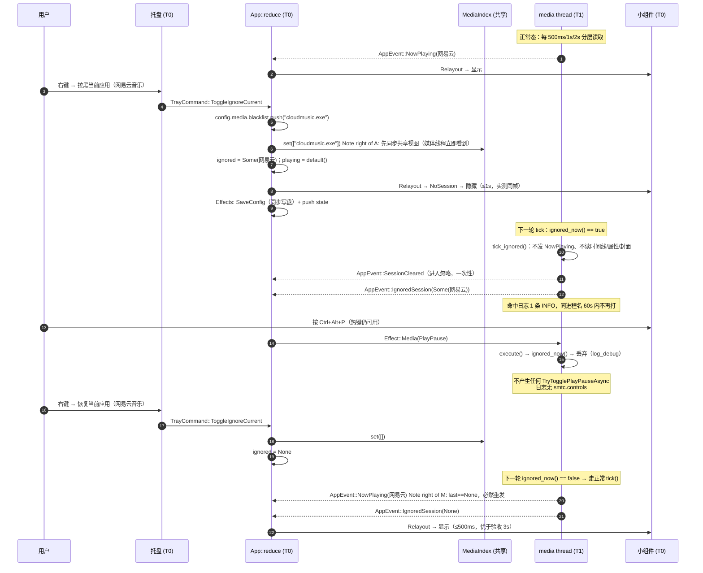
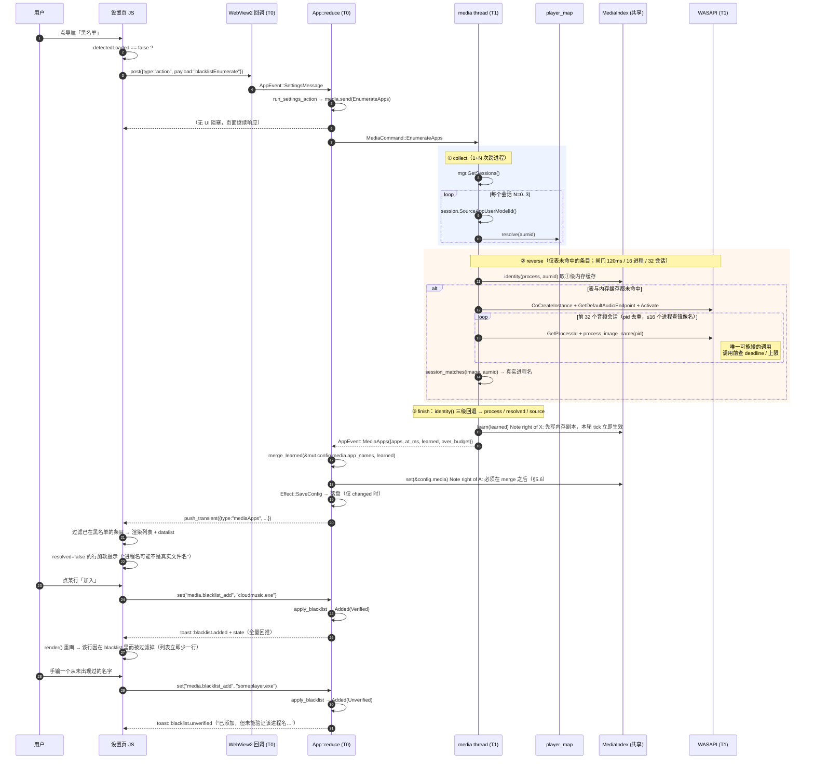
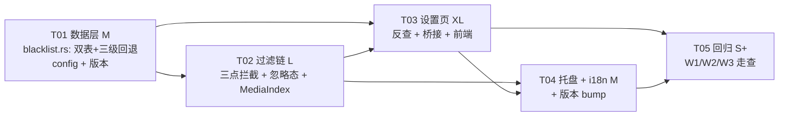

# 曲栏 Barline — G7 媒体会话黑名单 · 增量架构设计

| 项目 | 内容 |
| --- | --- |
| 文档 | `docs/ARCH-G7-黑名单.md`（**增量**架构，只覆盖本次新增与受影响部分） |
| 归属版本 | **G7 → v1.8.0**（排在 G3 v1.5.0 / G4 v1.6.0 / G5 v1.7.0 / G6 v1.7.1 之后） |
| 作者 | 高见远（架构师） |
| 上游输入 | `docs/PRD-G7-黑名单.md`（P0-01~06 / P1-01~03 / 8 条验收） |
| 下游产出 | 本文 §9 任务列表（5 个任务，可直接派给工程师） |
| 版次 | **v1.1**（v1.0 = U1=A 方案；v1.1 = 按用户裁决 **U1=B** 重写） |
| 代码基线 | **v1.4.4**（`Cargo.toml:3`、`assets/barline.rc:15-16/28/33`、`git log` HEAD=`4628930`） |
| 体例 | 沿用 `docs/ARCHITECTURE.md`：表格 + mermaid，所有 API 均给 file:line |

> **基线声明（必读）**
> 仓库当前实际版本是 **v1.4.4**，**G3~G6 尚未实现**（`progress.md` §3.2 仍列为待做）。
> 本文所有 `file:line` 都是 **v1.4.4 工作树的真实行号**。若工程师在 G3~G6 合入之后才做 G7，
> 行号必然漂移 → **一律以本表标注的"锚点"（函数名 / 注释关键词）定位，不要按行号硬跳**。
> 每处 file:line 后面都写了锚点，这是本表存在的意义。

---

## 目录

1. [结论摘要（30 秒版）](#1-结论摘要30-秒版)
2. [PRD 与实际代码的差异对照表](#2-prd-与实际代码的差异对照表)
3. [数据设计](#3-数据设计)
4. [过滤设计](#4-过滤设计)
5. [枚举设计（U1=B 后重写）](#5-枚举设计v11u1b-后重写)
   - [5.2 反查的时间预算](#52-反查的时间预算钉死数字这是-b-方案唯一的风险点) ← **U1=B 新增，先看这节**
6. [设置页接口](#6-设置页接口)
7. [托盘入口](#7-托盘入口)
8. [i18n 清单](#8-i18n-清单)
9. [任务列表（按依赖排序）](#9-任务列表按依赖排序)
10. [风险与回滚](#10-风险与回滚)
11. [待明确事项](#11-待明确事项)

---

## 1. 结论摘要（30 秒版）

> **U1 裁决 = B（枚举时反查 + 缓存），2026-11-03**
>
> **最终口径（v1.3，团队裁决：落盘）**：反查结果**持久化到 `config.json` 的 `media.app_names`**
> （`BTreeMap<String,String>`，64 条上限 + 字典序淘汰）；`MediaIndex` 持有的是它的**同源内存副本**。
> **判定阶段仍是纯内存**（副本 → 静态表 → AUMID 末段），运行时零新增跨进程调用——「落盘」与「判定纯内存」不矛盾：
> 前者是数据源，后者是读取方式。
>
> 反查只发生在**枚举时**（用户打开黑名单分区/点刷新）；**主循环零新增跨进程调用**。
> 改动集中：§1.1/§1.2（结论）、§2（+4 条差异）、§3（`Config.media` 双字段 + `MediaIndex` 副本）、§4（判定键三级）、
> **§5（整章重写，含预算与上限数字）**、§6（+`resolved`/`source`/`KeyRecognition`）、§8（+3 条词条）、
> §9（T01/T03/T05 范围与规模）、§10（+3 条风险）、§11（U1 已销项 + 重启后行为）。

### 1.1 四个技术假设核实（这是本次架构的核心结论）

| 编号 | PRD 假设 | 核实结论 | 关键证据（file:line + 锚点） |
| --- | --- | --- | --- |
| **A1** | 项目存在「AUMID → 进程名」反查能力 | **不成立（不存在现成"反查 API"）**：只有一张 **22 条静态映射表**做"AUMID 关键字 → 猜测的进程名"，表外 AUMID 的 `process_name` 是**空串**。真正能拿到真实进程名的，是"音频会话枚举 + 逐进程查镜像名"那一整段流程（`launch.rs:216-305`），成本 = 1 次 COM 激活 + K 次会话遍历 + **U 次 `OpenProcess`+`QueryFullProcessImageNameW`**。<br>**U1=B 之后**：这段流程**被复用到枚举阶段**（只在用户打开黑名单分区/点刷新时跑一次），结果写入 **`config.media.app_names`（落盘）**，`MediaIndex` 同步持有同源副本；**判定阶段绝不反查**。 | `player_map.rs:224-238` `resolve()`；`player_map.rs:21-24` `UNKNOWN{process_name:""}`；`smtc.rs:582-584`（唯一赋值点）；反查流程 `launch.rs:216-276` + `launch.rs:279-305`（`process_image_name`） |
| **A2** | 存在「WASAPI 兜底媒体链路」，兜底条也要过滤 | **不成立**：`wasapi.rs` 里**只有音量**（系统主音量 + 会话音量步进），**没有任何会话枚举 → 兜底媒体**的生产代码。`PlaybackState::Fallback` 永不产出，`AppEvent::FallbackSession` 全仓零发射点。 | `wasapi.rs:51-104`（系统音量）、`wasapi.rs:135-240`（会话音量）；`media/mod.rs:33`（枚举声明）；`smtc.rs:891-901` `playback_state_of`（只产 Playing/Paused）；`event.rs:33`（零发射）；`painter.rs:334`（死分支） |
| **A3** | `NowPlaying` 发布点唯一、判定插在它前面即可 | **成立但不够**：发布点唯一（`smtc.rs:666`），但只在那里拦**挡不住播控**——`execute()`（`smtc.rs:952-1024`）会重新 `GetCurrentSession()` 然后把 `TryTogglePlayPauseAsync` 打到被拉黑的应用上。**必须三点拦截**（见 §4.2）。 | 发布点 `smtc.rs:666`；命令执行 `smtc.rs:975-1001` |
| **A4** | 打开设置页就枚举 ≈ <50ms，可与"秒开"共存 | **成立但不必**：耗时确实是 <5ms 典型（1×`GetSessions` + N×`SourceAppUserModelId`，N=0..3），且枚举跑在**媒体线程**、UI 线程零参与，所以不会有卡顿。但默认分区是"外观"，`ready` 时枚举 90% 是白花 → **裁决：进入黑名单分区才枚举**。 | `smtc.rs:685-701`（`Manager` 在 T1/MTA 创建）；`index.html:196`（默认 `group-appearance` active） |

**A1 的直接后果（U1=B 后的定稿：判定键三级回退）**

判定键**不能**在判定时反查（会撞 §2.2 第 11 条），但**可以**用枚举时学到的真实名（存在内存里）。
所以身份解析固定为三级，**顺序即优先级**：

```
① 内存缓存命中  →  ② 静态表命中  →  ③ AUMID 末段兜底（可能是猜的）→ ④ 全空（永不可命中）
```

> **三级回退的实现口径（函数签名 / 边界 / 主干比较 / 空值处理）在 §3.2「`identity` 的精确语义」**——
> **全文只有那一处定义**，其他地方一律引用，不得复述第二套规则。

三级必须只有一个实现（`MediaIndex::identity()`），因为「枚举显示的值 = 判定用的值 = 用户手输可命中的值」
这三者同源是本需求的**正确性基石**——一旦出现第二套解析，症状是"列表里明明显示 `cloudmusic.exe`，
用户抄下来手输却不生效"，这是本需求最难排查的一类 bug。

**手输生效范围 = 三档**（对应 PRD 修订版口径）：

| 档 | 场景 | 是否保证命中 | UI 表现 |
| --- | --- | --- | --- |
| **保证** | 值来自**缓存**或静态表（枚举列表里显示的真实名） | ✅ 一定命中，**且重启后依然成立**（缓存落盘在 `config.media.app_names`） | 无提示 |
| **保证** | 从「检测到的应用」点「加入」 | ✅ 一定命中（同源） | 无提示 |
| **不保证** | 手输一个**从未在本机出现过**、又不在静态表里的进程名 | ⚠️ 该应用的 AUMID 末段恰好等于它才命中 | 添加成功，但 toast 温和提示「未能验证该进程名」（§6.2 `KeyRecognition::Unverified`） |

**"失败不静默"的落法**：第三档不是"悄悄加进去然后不生效"，而是**添加时就告诉用户"未能验证"**，
并在 toast 里指路"从「检测到的应用」里点加入"。要彻底消除第三档，只能接受在判定时反查（撞预算红线）——U1 已裁决不这么做。

**为什么必须落盘**（团队裁决依据，别再反复）：手输的第三档只在"从未出现过"时不确定；
一旦该应用被枚举过一次，名字就记在 `config.media.app_names` 里 → **重启后手输的那条依然命中**。
若缓存只活在进程内（重启即清空），用户会遇到"我明明拉黑过它、重启后又出来了"这种**不可解释**的失效，
而这正是 U1=B 要消灭的东西。落盘的代价（`config.json` 多一张 ≤64 条 ≈4KB 的表 + 手改写坏的归一化成本）
已由 §3.2 的上限/淘汰与 §3.3 的 `Config::load` 归一化兜住。

### 1.2 PRD §9 三问的架构裁决

| 问题 | 裁决 | 一句话依据 |
| --- | --- | --- |
| **Q1** 多会话并存时，当前会话被拉黑要不要自动改选下一个？ | **不改选，回落空态** | 改选需要在媒体主循环里引入 `GetSessions()` 枚举 + 会话重挂订阅（`smtc.rs:484-505` `ensure_session_events` 按 AUMID 重挂），每轮多 1 次 `GetSessions` + N 次属性读 → 直接撞 §2.2 第 11 条。且 `SessionsChanged` 事件（`smtc.rs:780-793`）会在会话增删时置脏位，改选逻辑必须与 dirty/forced（`FORCED_FLOOR_MS=60`）耦合，是 v1.4.2 卡顿的同款路径。**代价**：用户同时开两个播放器时要手动暂停一个。 |
| **Q2** 进程名解析成功率 | **表内 100%；表外靠枚举时的真实反查补齐（成功 100% / 失败末段兜底）** | 22 条表覆盖国内主流 + 国际主流 + 浏览器（`player_map.rs:29-221`）。表外条目在枚举时走 §5.1/§5.2 的 WASAPI 反查拿真实名，结果写进 `config.media.app_names`（**落盘**，64 条上限，§3.2），所以"曾经枚举过一次"之后**重启也仍有效**（§11.4）。反查失败（COM 不可用 / 音频会话里匹配不上）退到 AUMID 末段且 `resolved=false`，但**枚举列表里的值仍等于判定会用的值**，故从列表加入依然必命中。 |
| **Q3** 枚举时机 | **进入黑名单分区才枚举**（+ 刷新按钮 + P1-03 托盘直达） | 枚举跑在媒体线程（`Manager` 是 MTA 对象），UI 线程不参与 → 不存在"卡设置页"。仍不选"打开即枚举"的理由是**一次都不白花**：默认分区是外观。文案代价：卡片右上角改成「上次检测：HH:MM」/「尚未检测」。 |

### 1.3 次要项裁决（各一句）

| 项 | 裁决 |
| --- | --- |
| 非法字符 `* ? \| < >` | **拒绝**，且是最先判定的一条（早于补 `.exe`），toast 明确说"不支持通配符" |
| 命中日志限流窗口 | **60s**，且按**进程名**分桶（不是按段名）——`perf::RateLimiter::admit` 的 key 是 `&'static str`（`perf.rs:162`），表达不了动态进程名，所以用 `PollState.last_hit: Option<(String, Instant)>` 自己实现 |
| 托盘应用名是否翻译 | **不翻译**（`player_map` 给的是品牌名；英文界面下同样显示中文品牌名，与既有 `menu.*` 行为一致） |
| 托盘菜单项文字截断 | 截**应用名**到 ≤40 字符 + `…`，括号与"拉黑/恢复当前应用"字样完整保留 |
| 反查的范围裁剪 | **静态表已命中的会话不做反查**（值已经是真实名）。典型机器上反查次数 = 0，最坏 = 表外会话数（通常 ≤1）。这是把 §5.2 预算压到几乎不可能触发的关键取舍 |
| 反查硬上限（会话 / 进程） | **遍历前 32 个音频会话**（`ENUM_MAX_AUDIO_SESSIONS=32`）、其中最多 **16 个去重后的进程**做镜像名查询（`ENUM_MAX_LOOKUPS=16`）。超限即降级（`resolved=false`），理由见 §5.2 |
| 缓存上限 / 淘汰（落盘） | **64 条**（`APP_NAME_CACHE_MAX`）；满时淘汰 `BTreeMap` 字典序最小的键（确定性 + 自愈 + 零额外状态，见 §3.2）。**随 `Config` 一起落盘**（`config.media.app_names`），`MediaIndex` 持同源副本 |
| 反查结果是否落盘 | **落盘**（团队裁决，与 PRD 一致）：写进 `config.media.app_names`，`Config::load` 归一化 + 裁到 64。**判定阶段仍纯内存**（读副本），运行时零新增调用 |

---

## 2. PRD 与实际代码的差异对照表

> 凡与 PRD 不一致的，**以本表右列为准**。工程师照本表实现，不要照 PRD 的字面命名。

| # | PRD 原写 | 实际实现（真实代码） | 处置 |
| --- | --- | --- | --- |
| 1 | 配置写入走「既有 300ms 去抖」 | **没有去抖**。`Effect::SaveConfig` 在 `app.rs:1908-1912` 直接 `cfg.save()` 同步写盘；`event.rs:201` 的注释 `/// 保存配置（带 300ms 去抖）` 是**失实注释**（`progress.md` §2.3 第 22 条已登记，归 G6 修）。 | 复用既有路径，**不改写盘语义**。验收口径按"同步立即写盘"（比 500ms 更严），G6 若真加去抖，黑名单自动受益。**不要**在 G7 引入新的写盘路径。 |
| 2 | `Config.version` **1 → 2** | `CURRENT_VERSION: u32 = 1`（`defaults.rs:170`）。`version` 字段**当前无任何迁移分支**：只有 `config/mod.rs:248` 打日志、`defaults.rs:214` 赋值、测试里断言。 | **照 PRD 升到 2**（纯标记，零风险，为未来迁移留闸门）。⚠️ 见 §3.3 的回滚坑：老版本读 version=2 配置会**丢掉** `media` 字段。 |
| 3 | 新增配置分组 `media: { blacklist }` | 既有分组名：`appearance / lyrics / volume / hotkeys / general / window / storage`（`config/mod.rs:206-217`）。`storage` 就是"后加的独立分组"的先例（`config/mod.rs:184-201`）。 | **照 PRD 原样，只有一个字段**：`media: { blacklist: Vec<String> }`。反查缓存在**同一个 `media` 分组**里（`app_names: BTreeMap<String,String>`，§3.2），随 `Config` 一起落盘。独立结构体 + `#[serde(default)]`，与 `storage` 同款。 |
| 4 | 桥接新增白名单路径 `media.blacklist_add` / `media.blacklist_remove`，"不做整数组覆写" | `apply_set`（`bridge.rs:77-250`）是一个巨型 `match`，**先字面量精确匹配，再前缀兜底**（`hotkeys.reset.*` / `hotkeys.*`，`bridge.rs:231-248`）。`lyrics.local_dirs_add/remove` 是既有先例（`bridge.rs:137-151`）。 | **照 PRD 两条 + 我加第三条 `media.blacklist_clear`**（P1-01 需要，逐条 remove 是笨办法）。但**不走 `apply_set`**：黑名单需要区分"重复 / 非法 / 超限"三种失败给不同 toast，`apply_set` 只返回 `bool`。→ 新增 `bridge::apply_blacklist() -> BlacklistOutcome`，并在 `apply_set` 里**显式拒绝** `media.blacklist*` 三条（防止旧页面/注入脚本绕过归一化）。 |
| 5 | Rust→JS 新增 `{type:"mediaApps", payload:{apps:[{process, displayName, playable}], at}}` | 现有 Rust→JS 只有 `state`（`bridge.rs:51-67`）与 `toast`（`bridge.rs:70-72`）；`SettingsService::push` 会**覆盖 `last_state`**（`settings/mod.rs:219-224`），而 `last_state` 是窗口重建后补推用的。 | 字段名照 PRD **再加两个**：`process/displayName/playable/**resolved**/**source**`（§6.1）。理由：U1=B 引入"反查是否成功"，前端必须能区分"真实名"与"末段兜底名"（失败不静默）。`at` 定为 **epoch 毫秒整数**（JS 用 `new Date(at)` 格式化，Rust 侧不写时间格式化代码）。**必须新增 `SettingsService::push_transient()`**：只 post 不碰 `last_state`，否则一次 mediaApps 会把"配置快照"顶掉，重开窗口就补推错东西。 |
| 6 | 「已拉黑的应用不在检测列表里显示」（隐含 Rust 侧过滤） | 设置页每次配置变更都会收到全量 `state` 重推（`app.rs:1365-1366`）。 | **Rust 不过滤，JS 按 `state.config.media.blacklist` 过滤**。理由：点「加入」后配置回推即可让该行消失，**不需要重新枚举**；若 Rust 过滤，则"加入后行消失"必须重跑一次枚举（多一次跨进程）。这是对 PRD 的**修正**，功能表现一致。 |
| 7 | 托盘 `append` 只有 `(label, id, checked)` 三参 | 实际是 `fn append(menu: HMENU, label: &str, id: usize, checked: bool)`（`tray.rs:288-295`）——**四参，含 menu**，且未检查态用 `MF_UNCHECKED`。 | 扩展为 **五参** `append(menu, label, id, checked, enabled)`，`!enabled` 时叠 `MF_GRAYED`。3 处既有调用点（`tray.rs:206/207/215`）补 `true`。 |
| 8 | 菜单项位置「`显示/隐藏小组件` 之后、分隔线之前」；menu id | 托盘菜单实际结构：`设置(101)` / `显示/隐藏小组件(102)` / `───` / `退出(103)`（`tray.rs:206-215`）。小组件右键菜单是**另一套** `MenuCommand` 编号 **1..8**（`menu.rs:84-109`），不同 `HMENU`，**互不冲突**。 | 新 id **`CMD_IGNORE = 104`**（`tray.rs:41-43` 旁追加）。落位：`设置 / 显示隐藏 / 拉黑当前应用 / ─── / 退出`。 |
| 9 | 托盘新命令名未定 | `TrayCommand` 只有 3 个变体（`event.rs:146-150`）。 | 新增**单个** `TrayCommand::ToggleIgnoreCurrent`（拉黑/恢复由 `App` 按当前状态决定），这样菜单 id 恒定 104，不必为两个语义分配两个 id。 |
| 10 | 设置页 toast 文案走 HTML `I18N` 字典 | **toast 是 Rust 发的**：`bridge::toast_json(level, text)`（`bridge.rs:70-72`），文案由 `app.rs` 用 `self.lang` 的 `match` 就地写（例：`app.rs:1441-1455`、`1520-1535`）。HTML 字典只管静态标签。 | 黑名单 toast **走 `src/i18n.rs`**（`toast.blacklist.*` 一组），不在 `app.rs` 里写中英 `match`——现有 `app.rs` 那种写法每加一条要改两处，是维护债，本次不复制。 |
| 11 | 「卡片标题带计数：已加入黑名单（2）」 | 无既有计数样式。 | 标题文本由 JS 用模板拼 `已加入黑名单（{n}）`，`n=0` 时只显示「黑名单」。i18n 键 `blacklist.card.title` 带 `{n}` 占位。 |
| 12 | 「上次检测：打开本页时」 | 无既有实现。 | 改文案：**「上次检测：HH:MM」**，从未检测过显示**「尚未检测」**（因为 Q3 裁决改了枚举时机）。 |
| 13 | P1-03「托盘设置 → 无会话时直接落到黑名单分区」 | `state_json` 只有 fixed 字段（`bridge.rs:56-66`）；`index.html` 导航是纯前端 class 切换（`index.html:512-519`）。 | `state_json` 增加可选 `payload.openSection: "blacklist"`，仅当 `Effect::OpenSettings` 且当前 `state.playing.state == NoSession` 时置位；JS 只在**首次收到 state 时**应用一次（`navInitialized` 守卫）。 |
| 14 | 「拉黑后不查歌词」需要改歌词链 | `app.rs:1127-1130`：只有 `track_changed` 才 `Effect::Lyric`；拉黑后根本不产生 `NowPlaying` → 歌词链自然不触发。 | **歌词模块零改动**。验收断言"日志无 `歌词查询`"靠这条自动成立。 |
| 15 | 验收第 6 条「兜底链路也被过滤」 | **兜底链路不存在**（见 A2）。 | **作废**。在 PRD 上标注删除，验收由 8 条变 7 条（编号顺延或保留空号，由主理人定）。 |
| 16 | 「P1-01 二次确认弹 `confirm`」 | WebView2 默认 `AreDefaultScriptDialogsEnabled = true`，`window.confirm()` 可用；项目里未改过该设置（`settings/webview.rs` 全文无该选项）。 | 照 PRD 用 `window.confirm()`，**不新增原生 `MessageBox`**（原生弹窗在 STA 上会嵌套消息泵，与 `confirm_dialog`（`app.rs:1574`）同款风险，没必要）。 |
| **17** | **U1 建议 A**（不做反查，接受"手输可能永不命中"） | — | **已改为 B**：枚举时反查真实进程名 + 结果落盘到 `config.media.app_names` + 判定侧纯内存三级回退（读同源副本）。详见 §3.2 / §5。**PRD 需同步**：手输生效范围改成"三档"（§1.1 末表）。 |
| **18** | PRD 未提"反查结果为什么要落盘" | 缓存既是**枚举**用的（跳过反查），也是**判定**用的（`identity()` 的①级）。若缓存只活在进程内，重启后即清空 → 用户会遇到"我明明拉黑过它、重启后又出来了"这种**不可解释**的失效（U1=B 要消灭的正是这个） | 持久化在 `config.media.app_names`（`BTreeMap<String,String>`，64 上限 + 字典序淘汰）；`MediaIndex` 持同源副本供判定读。**键 = 小写 AUMID（`normalize_aumid`），值 = `normalize_entry()` 的输出**（与手输同一函数，只有一套小写规则）。 |
| **19** | PRD 未提"添加时如何告知用户该键可能永不命中" | `apply_set` 只返回 `bool`，`bridge` 无法表达"认不认识这个键" | `BlacklistOutcome::Added` 携带 `KeyRecognition::{Verified, Unverified}`（§6.2），`Unverified` 时多一条温和 toast（`toast.blacklist.unverified`）。**这就是"失败不静默"在桥接层的落点。** ⚠️ 该 enum 因此**不再是 `Copy`**（带 payload），实现时改 `Clone`。 |
| **20** | PRD 「`Config.version` 1→2」是否必要 | 版本号表达的是 **schema 代数**，不是字段计数；`media` 分组新增 `blacklist` 一个字段（缓存**不进**配置） | 仍为 **1→2**（照 PRD，纯标记零风险，为未来迁移留闸门）。⚠️ 回滚风险：v1.7.1 读 version=2 的配置会丢掉 `media.blacklist`（黑名单本身），见 R3。 |

---

## 3. 数据设计

### 3.1 Rust 结构体（`src/config/mod.rs`）

追加到 `Config`（`config/mod.rs:206-217`）末尾，紧接 `storage` 之后：

```rust
/// 媒体源过滤（v1.8.0 / G7，U1=B）。
///
/// 两个字段都只存**归一化后**的值。
/// * `blacklist` 是**用户资产**（顺序有意义：首次添加顺序，不排序）；
/// * `app_names` 是**实测缓存**（顺序无意义，用 `BTreeMap` 保证 JSON 输出稳定，
///   否则 `HashMap` 的随机迭代顺序会让 `config.json` 每次保存都字节级变化）。
#[derive(Debug, Clone, Serialize, Deserialize)]
#[serde(default)]
pub struct MediaConfig {
    /// 黑名单。上限 `BLACKLIST_MAX_ENTRIES`，单条 ≤ `BLACKLIST_MAX_LEN`。
    pub blacklist: Vec<String>,
    /// AUMID（**小写**）→ 真实进程名（小写、含 `.exe`）。**落盘**，重启后仍有效。
    ///
    /// 来源：设置页枚举时的 WASAPI 反查（§5）。用途：`identity()` 的**第①级**。
    /// 上限 `APP_NAME_CACHE_MAX`，满时淘汰字典序最小的键（§3.2）；
    /// `Config::load` 会做双表归一化（手改 json 写坏也不炸，§3.3）。
    pub app_names: std::collections::BTreeMap<String, String>,
}

impl Default for MediaConfig {
    fn default() -> Self {
        Self { blacklist: Vec::new(), app_names: std::collections::BTreeMap::new() }
    }
}

pub struct Config {
    pub version: u32,
    pub appearance: AppearanceConfig,
    pub lyrics: LyricsConfig,
    pub volume: VolumeConfig,
    pub hotkeys: HotkeyConfig,
    pub general: GeneralConfig,
    pub window: WindowStateConfig,
    pub storage: StorageConfig,
    pub media: MediaConfig,      // ← v1.8.0 新增
}
```

`Config::default()`（`defaults.rs:211-224`）追加 `media: crate::config::MediaConfig::default()`。

**JSON 落盘形态**（`config.json` 单行，实际内容示例）：

```json
{"version":2,"media":{"blacklist":["cloudmusic.exe","msedge.exe"],
 "app_names":{"com.sesame.qishui.desktop":"sodamusic.exe","汽水音乐":"sodamusic.exe"}}}
```

- `app_names` 的**键保持 AUMID 原样只做小写**（不改结构：`!`、`_`、`.`、中文都留着），因为键只用于查表，不参与用户输入；
  **值必须过 `normalize_entry()`**（与手输完全同一套小写/补 `.exe` 规则）——"缓存写入不许有两套小写规则"是硬约束。
- 体积：64 条 × ~60B ≈ **4KB**，加上既有 ~2KB 配置，总量仍 <10KB，与主 PRD 的 ≤8MB 包体预算无关。
- **手改 json 必须安全**：`Config::load` 会逐条剔坏键坏值 + 裁到 64 条（§3.3），不 panic、不弹窗。
  这是"落盘"这个承诺的**最高标准要求**——不许只做 happy path。

### 3.2 归一化与判定（新文件 `src/media/blacklist.rs`）

**为什么单独一个文件**：判定是"纯内存字符串运算"，必须能被单测穷举，而且**必须只有一个出处**——
UI 显示、配置写入、媒体线程过滤三处若各写一份，迟早漂移（"列表里显示 cloudmusic.exe，用户抄下来输入却不命中"）。

```rust
//! 黑名单 + 身份索引：归一化、三级回退身份解析、命中判定、真实名缓存。
//!
//! **硬约束（progress.md §2.2 第 11 条）**：本模块**只允许**做内存字符串运算。
//! 任何 `OpenProcess` / SMTC 属性读 / WASAPI 枚举都不许出现在这里——
//! `identity()` 与 `matches()` 跑在媒体主循环里，每轮都会调用。
//! 反查（WASAPI）在 `smtc::reverse_lookup_names`，只有枚举时才跑。

// ---------------- 常量（数值唯一定义处；`defaults::limits` 只 re-export）----------------
/// 黑名单列表上限（防手改 json 写坏配置拖慢启动）
pub const BLACKLIST_MAX_ENTRIES: usize = 200;
/// 单条上限（260 = Windows MAX_PATH 量级，足够任何进程名）
pub const BLACKLIST_MAX_LEN: usize = 260;
/// 真实名缓存上限。理由见 §3.2 末「容量与淘汰」
pub const APP_NAME_CACHE_MAX: usize = 64;
/// 命中日志的限流窗口（同一进程名）
pub const HIT_LOG_WINDOW_MS: u64 = 60_000;

/// 归一化失败原因（决定给用户哪条 toast）
#[derive(Debug, Clone, Copy, PartialEq, Eq)]
pub enum NormError {
    /// 空串 / 全空白 / 剥完路径后文件名为空（如 `.exe`）
    Empty,
    /// 含 `* ? | < > "` 等通配符或非法字符
    InvalidChar,
    /// 超过 BLACKLIST_MAX_LEN
    TooLong,
}

/// 单条归一化（用户输入 / 缓存写入的**唯一**入口）。纯函数。
///
/// 顺序很重要：① 非法字符 → ② trim/去引号/取文件名 → ③ 小写 → ④ 补 `.exe` → ⑤ 长度校验
/// 先判非法字符，是为了让 `a*b.exe` 得到"不支持通配符"而不是被当成合法文件名存进去。
pub fn normalize_entry(raw: &str) -> Result<String, NormError>;

/// 列表归一化（`Config::load` 的兜底：手改 json 也安全）。
/// 剔空、剔非法、剔超长、大小写不敏感去重、保序、截断到 BLACKLIST_MAX_ENTRIES。
/// **永不失败、永不 panic、永不弹窗**。
pub fn normalize_list(raw: &[String]) -> Vec<String>;

/// AUMID 归一化（**只给缓存的键用**，不参与用户输入）：
/// `trim()` + `to_ascii_lowercase()` + 剔控制字符 + 长度 ≤ BLACKLIST_MAX_LEN；非法返回 `None`。
/// 不改结构（`!` `_` `.` 中文都保留），因为键只用于查表。
pub fn normalize_aumid(raw: &str) -> Option<String>;

/// 缓存表归一化（**`Config::load` 必须调**，手改 json 兜底）：键走 `normalize_aumid`、
/// 值走 `normalize_entry`，任一非法即丢弃该条；超 `APP_NAME_CACHE_MAX` 时按本节末的淘汰规则裁切。
/// **永不失败、永不 panic、永不弹窗。**
pub fn normalize_app_names(
    raw: &std::collections::BTreeMap<String, String>,
) -> std::collections::BTreeMap<String, String>;

/// 把枚举学到的 `(aumid, process)` 合并进缓存（**同一个**归一化 + 容量 + 淘汰规则）。
/// 返回「真的有新增/变化」——调用方据此决定要不要落盘（`SaveConfig`）。
pub fn merge_learned(
    cache: &mut std::collections::BTreeMap<String, String>,
    learned: &[(String, String)],
) -> bool;

/// **身份解析的唯一实现**（三级回退，见 §1.1 末）。
/// 纯内存，无任何跨进程调用。
pub fn identity(
    cache: &std::collections::BTreeMap<String, String>,
    process_name: &str,   // player_map::resolve(aumid).process_name，可能空
    aumid: &str,
) -> Identity;

#[derive(Debug, Clone, PartialEq, Eq)]
pub struct Identity {
    /// 身份键（小写、含 `.exe`）；空串 = 完全无法解析 → 永不可命中
    pub key: String,
    /// 名字来源，决定 UI 是否要提示"这是猜的"
    pub source: IdentitySource,
}

#[derive(Debug, Clone, Copy, PartialEq, Eq)]
pub enum IdentitySource {
    /// ① 缓存（实测真实名；来自 `config.media.app_names` 的同源副本）
    Cache,
    /// ② player_map 静态表
    Table,
    /// ③ AUMID 末段兜底（可能是猜的）
    AumidSegment,
    /// ④ 无法解析
    None,
}

/// 一条黑名单是否命中该会话（比对"去 `.exe` 的主干"，所以 `msedge` 与 `msedge.exe` 等价）。
pub fn matches_entry(entry: &str, key: &str) -> bool;

/// UI 线程与媒体线程共享的索引：**`blacklist` 与 `app_names` 都属于 `Config.media`（一起落盘）**，
/// 本结构体是它们在内存里的**同源副本**，供判定阶段零跨进程读取。
///
/// **单读者（媒体线程）+ 写极少（配置变更）**，用 `Mutex` 足够。
/// 两张表放同一个结构体，是为了让媒体线程一次拿到"判定所需的全部数据"，
/// 也避免 App 要往 spawn 里塞两个 `Arc`。
pub struct MediaIndex {
    blacklist: std::sync::Mutex<Vec<String>>,
    /// AUMID（小写）→ 真实进程名。**数据源是 `Config.media.app_names`**（落盘），
    /// 这里只是副本；用 `BTreeMap` 与配置侧保持同一类型（迭代顺序确定，测试/日志可复现）。
    app_names: std::sync::Mutex<std::collections::BTreeMap<String, String>>,
}

impl MediaIndex {
    pub fn new(cfg: &crate::config::MediaConfig) -> std::sync::Arc<Self>;
    /// **整组同步**（两张表一起替换），写路径只有 `Effect::SaveConfig` 一处（见 §4.5 / §5.6）。
    /// ⚠️ 调用前必须先把 `merge_learned` 的结果写进 `cfg.media.app_names`，否则会用旧表把刚学到的名字盖掉。
    pub fn set(&self, cfg: &crate::config::MediaConfig);
    /// 三级身份解析。**每轮 tick 都会调**。
    /// 实现铁律：先取 app_names 快照（释放锁）→ 再算 → 绝不嵌套持锁（`progress.md` §2.3 第 21 条同款教训）。
    pub fn identity(&self, process_name: &str, aumid: &str) -> Identity;
    /// 命中判定 = `identity()` + `matches_entry()`。纯内存 + 早退。
    pub fn matches(&self, process_name: &str, aumid: &str) -> bool;
    /// 黑名单快照（设置页/托盘读）。
    pub fn blacklist_snapshot(&self) -> Vec<String>;
    pub fn blacklist_len(&self) -> usize;
    /// 媒体线程在枚举阶段**立即**写入新学到的名字（内存副本先行，配置落盘随后由 UI 线程做）。
    pub fn learn(&self, learned: &[(String, String)]);
    /// 缓存里是否存在这个真实名（`KeyRecognition::Verified` 的判据之一）。
    pub fn knows_process(&self, key: &str) -> bool;
}
```

**`normalize_entry` 的逐条规则**（与 PRD §P0-01 表格一一对应，此处是**实现口径**）：

| 步骤 | 处理 | 例 |
| --- | --- | --- |
| 1 | 扫非法字符 `* ? \| < > "`（含全角 `＊？｜＜＞`）→ `InvalidChar` | `a*b.exe` → 拒绝 |
| 2 | `trim()`，剥首尾 `"` `'` 与 `\`` | `  "C:\x\a.exe"  ` |
| 3 | 取最后一个 `\` 或 `/` **之后**的部分 | → `a.exe` |
| 4 | `to_ascii_lowercase()` | → `a.exe` |
| 5 | 无 `.exe` 后缀则补（`.com/.bat` 等**不含**后缀的一律补 `.exe`） | `cloudmusic` → `cloudmusic.exe` |
| 6 | 主干为空（`.exe` / 空串 / 全空白）→ `Empty` | `.exe` → 拒绝 |
| 7 | 长度 > `MAX_LEN` → `TooLong` | — |

> **命名对照（避免"两处定义"的误读）**：PRD 里称这套规则为 **`identity_key` 三级回退**；
> 实现里同一件事的名字是纯函数 `blacklist::identity()` + 共享视图方法 `MediaIndex::identity()`。
> **规则本身只在本节定义一次**，PRD 的 `identity_key` 是对本节规则的称呼，不是第二套实现。

**`identity` 的精确语义**（决定"能不能命中"，实现不许自由发挥）：

```
fn identity(cache, process_name, aumid) -> Identity {
    let a = normalize_aumid(aumid);
    // ① 内存缓存：本次会话内实测的真实名，最高优先（若与静态表冲突，以缓存为准）
    if let Some(name) = a.as_ref().and_then(|k| cache.get(k)) { return Identity{ name.clone(), Cache } }
    // ② 静态表：player_map 的权威值
    let p = process_name.trim().to_ascii_lowercase();
    if !p.is_empty() { return Identity{ with_exe(p), Table } }
    // ③ AUMID 末段：可能是猜的（'!' '|' '\' '/' 之后）
    let seg = with_exe(aumid_last_segment(aumid).trim().to_ascii_lowercase());
    if !seg.is_empty() { return Identity{ seg, AumidSegment } }
    // ④ 无法解析
    Identity{ String::new(), None }
}
// with_exe: 已以 ".exe" 结尾则原样，空串则原样（→ 空身份，永不命中），否则补 ".exe"
```

> **① 优先于 ②**：缓存是这台机器上的实测值，静态表是仓库里的硬编码。两者不一致时以实测为准，
> 并在**写入缓存那一刻**打一条 `WARN`（`静态表与实测不符：aumid=… 表=… 实测=…`）——
> 这条日志是"表该更新了"的唯一发现途径，成本为零（只在学新名字时打一次）。

**`matches_entry` 只比对主干（去 `.exe`）**：
`msedge` 与 `msedge.exe` 等价；`cloudmusic.exe` 命中身份键为 `cloudmusic.exe` 的会话。
**禁止子串匹配**（`entry` 含于 `aumid` 之类）——那等于隐式通配，PRD §2.2 明确不做。
> 主干比较是"缓存没学过 / 反查失败"时的兜底判据：身份退到 AUMID 末段后，
> 只要末段与该 exe 名主干相同就仍然命中。它**不是**落盘的替代品——落盘解决的是"重启后"，
> 主干比较解决的是"从未枚举过"（§11.4）。

**3.2.1 匹配规则的唯一表述**（手输撞上歧义时只看这一处）

> **规则一句话**：手输的键（进 `blacklist` 之前）与判定的键（`identity()` 的输出）
> **都必须先过 `normalize_entry()`，再按"去 `.exe` 的主干"比较**。
> 两边同一套归一化 + 同一套主干比较 = 用户抄下来的值与判定值永远可比。

**某条黑名单"稳不稳"的判据表**（工程师自测、用户答疑都用这张，别看别处）：

| 应用类型 | 不靠缓存也能命中？ | 依据 |
| --- | --- | --- |
| 在 `player_map` 表内（22 条：网易云 / QQ / Spotify / 汽水 / 酷狗 / 酷我 / foobar2000 / PotPlayer / 音乐(UWP) / **电影和电视** / Edge / Chrome / Firefox / Brave / VLC / AIMP / Groove） | ✅ **不依赖缓存** | ② 级静态表直接给真实 exe 名；`microsoft.zunevideo → video.ui.exe` 就是这类（`player_map.rs:149-155`），所以"电影和电视"重启后照样拦得住 |
| 表外 win32 应用，AUMID 就是 exe 名或含 exe 名（`Foo.exe`、`NeteaseCloudMusic!App`） | ✅ **不依赖缓存** | ③ 级 AUMID 末段 → 主干与真实 exe 名相同（"绝大多数 win32 播放器"属这类） |
| 表外 + 打包应用（`Publisher.App_hash!AppId`），且**曾枚举过一次** | ✅ 命中，**依赖缓存** | ① 级缓存（落盘，重启后仍在）——**这就是落盘的价值** |
| 表外 + 打包应用，且**从未枚举过** | ⚠️ **不保证** | 只有 AUMID 末段恰好等于用户输入的主干才命中；添加时给 `toast.blacklist.unverified` |

> 用途：**一眼判断"我这条黑名单到底稳不稳"**。前两行覆盖绝大多数情况（"主干比较"为什么值得写死的原因）；
> 第三行是落盘的收益；第四行是 U1=B 唯一承认的残留，且**添加时就提示**，不是事后静默失败。

**容量与淘汰（`APP_NAME_CACHE_MAX = 64`，落盘）**

| 项 | 取值 | 理由 |
| --- | --- | --- |
| 上限 | **64** | AUMID 的粒度是"每播放器 1~3 条 / 每浏览器 1 条 / 每 UWP 包 1 条"；一台日常机器出现过的播放器是个位数 → 64 ≈ 10 倍余量。**落盘体积**：64 × ~60B ≈ **4KB**（config 总量 <10KB）。不取 200：这是热点表不是用户资产，膨胀只说明 AUMID 在无意义增殖（见 R11） |
| 淘汰 | 满 64 时插入新键 → 删 `BTreeMap::keys().next()`（**字典序最小**） | ①确定性：同一份数据无论何时写都得到同一结果，单测可断言；②**自愈**：被淘汰的条目在该应用下次枚举时会被重新学到，所以淘汰策略的质量几乎不影响正确性；③零额外状态（不存时间戳/序号，手改 json 也不会写坏） |
| 不选 LRU | — | LRU 要在配置里多存一列时间戳：多一列就多一个被手改坏的面，而自愈特性让 LRU 的收益≈0 |
| 不做负缓存 | — | "反查失败"不写缓存（否则一次偶然失败会被永久记住）。失败只在本次枚举里降级，下次枚举重试 |
| 落盘的取舍 | **落盘** | 收益：重启后手输的那条**依然命中**（消灭"我明明拉黑过它、重启后又出来了"）；代价：`config.json` 多一张 ≤64 条 ≈4KB 的表 + 手改写坏的归一化成本（由本节上限/淘汰 + §3.3 归一化兜住） |

### 3.3 `Config.version` 决策

- `defaults.rs:170` `CURRENT_VERSION: u32 = 1` → **改为 `2`**。
- 现有测试 `defaults.rs:411` `empty_object_yields_full_defaults` 断言 `cfg.version == CURRENT_VERSION`，自适应，**不用改**。
- `config/mod.rs:365-386` 的 `legacy_ui_scale_field_is_ignored` 用手写 `"version": 1` 的 JSON → 加载路径**不看 version**，仍然通过，**不用改**。
- **必须新增**测试（`config/mod.rs` / `blacklist.rs` tests）：`media` 字段缺失 → 反序列化不报错且 `blacklist`/`app_names` 均空；`media.blacklist` 含 `["  CloudMusic  ", "", "CloudMusic.EXE", "a*b.exe"]` → `normalize_list` 后为 `["cloudmusic.exe"]`；`media.app_names` 含坏键坏值（空键 / `"a*b.exe"` / 超长 / 65 条）→ `normalize_app_names` 只留合法项且裁到 64。
  > ⚠️ 注意：`Config::load` 是 `crate::platform::barline_dir()` 的真实文件读，**单测不能直接调**。所以归一化测试要打在 `blacklist::normalize_list` / `normalize_app_names` 上，`Config::load` 里只做"调一次 + 变了就落盘"。
- **`version` 仍为 1 → 2**：版本号表达的是 **schema 代数**，不是字段计数——`media` 分组一次引入 `blacklist` + `app_names` 两个字段，提一次版本足够。不需要 3。
- `Config::load` 的插入位置（`config/mod.rs:259-264` 之后、`cfg` 返回之前），与 `hotkeys.migrate()` 同款。**注意这两个调用之间是"先 normalize 后 save"，顺序不能反**（先 save 会把未归一化的脏表写回磁盘）：

```rust
// v1.8.0（G7）：黑名单 + 真实名缓存归一化。手改 json 也安全——坏值静默丢弃，不 panic、不弹窗。
let bl = crate::media::blacklist::normalize_list(&cfg.media.blacklist);
let an = crate::media::blacklist::normalize_app_names(&cfg.media.app_names);
if bl != cfg.media.blacklist || an != cfg.media.app_names {
    crate::log_info!(
        "media 已归一化：blacklist {} → {} 条，app_names {} → {} 条",
        cfg.media.blacklist.len(), bl.len(),
        cfg.media.app_names.len(), an.len()
    );
    cfg.media.blacklist = bl;
    cfg.media.app_names = an;
    if let Err(e) = cfg.save() {          // 归一化结果立刻落盘，避免每次启动重复清洗
        crate::log_warn!("归一化后的 media 配置保存失败：{e}");
    }
}
```

> ⚠️ **回归红线（R12）**：归一化必须**幂等**——把归一化后的结果再喂一遍 `normalize_*` 必须得到同一份数据，
> 否则会出现"每次启动都判定为有变化、每次都写盘"，慢慢把配置写坏。
> 测试：`normalize(normalize(x)) == normalize(x)`，用一段"脏到极致"的 JSON 做 fixture。

### 3.4 类图（新增/受影响类型）

```mermaid
classDiagram
    class Config {
        +u32 version
        +AppearanceConfig appearance
        +LyricsConfig lyrics
        +VolumeConfig volume
        +HotkeyConfig hotkeys
        +GeneralConfig general
        +WindowStateConfig window
        +StorageConfig storage
        +MediaConfig media
        +load() Config
        +save() Result
    }

    class MediaConfig {
        +Vec~String~ blacklist
        +BTreeMap~String,String~ app_names
    }

    class MediaIndex {
        -Mutex~Vec~String~~ blacklist
        -Mutex~BTreeMap~String,String~~ app_names
        +new(cfg) Arc~MediaIndex~
        +set(cfg)
        +identity(process_name, aumid) Identity
        +matches(process_name, aumid) bool
        +blacklist_snapshot() Vec~String~
        +blacklist_len() usize
        +learn(learned)
        +knows_process(key) bool
    }

    class Identity {
        +String key
        +IdentitySource source
    }

    class IdentitySource {
        <<enumeration>>
        Cache
        Table
        AumidSegment
        None
    }

    class NormError {
        <<enumeration>>
        Empty
        InvalidChar
        TooLong
    }

    class PollState {
        -Option~NowPlaying~ last
        -SessionParts parts
        -Cadence cadence
        -Arc~MediaIndex~ index
        -Option~IgnoredSessionInfo~ last_ignored
        -Option~(String, Instant)~ last_hit
        -Instant last_ignore_probe
        +schedule(now, dirty) tuple
        +tick(mgr, sink, now, plan)
        +ignored_now() bool
        +tick_ignored(mgr, sink, now, plan, forced)
    }

    class MediaAppEntry {
        +String process
        +String display_name
        +bool playable
        +bool resolved
        +String source
    }

    class IgnoredSessionInfo {
        +String process_name
        +String aumid
        +String app_name
    }

    class Cadence {
        -Option~Instant~ last_playback
        -Option~Instant~ last_timeline
        -Option~Instant~ last_props
        +plan(now, forced) Plan
        +consume(now, plan)
    }

    class App {
        -Arc~MediaIndex~ index
        -Option~IgnoredSessionInfo~ ignored
        +reduce(evt) Vec~Effect~
        +ignore_menu_item() IgnoreMenuItem
        +reduce_blacklist_set(path, value) Vec~Effect~
    }

    class BlacklistOutcome {
        <<enumeration>>
        Added(KeyRecognition)
        Duplicate
        Invalid(NormError)
        Full
        Removed
        NotFound
        Cleared
        BadPath
    }

    class KeyRecognition {
        <<enumeration>>
        Verified
        Unverified
    }

    Config *-- MediaConfig
    MediaConfig ..> MediaIndex : 启动时注入
    MediaIndex *-- Identity
    Identity --> IdentitySource
    App --> MediaIndex : 写（Effect::SaveConfig / learn）
    PollState --> MediaIndex : 读（每轮 identity+matches，纯内存）
    PollState *-- IgnoredSessionInfo : last_ignored
    PollState *-- Cadence
    App ..> BlacklistOutcome : toast 分流
    BlacklistOutcome --> KeyRecognition
    MediaIndex ..> MediaAppEntry : 枚举结果填充
```

---

## 4. 过滤设计

### 4.1 判定函数（媒体线程，纯内存）

```rust
// src/media/blacklist.rs —— 纯函数（可单测）
pub fn identity(cache: &BTreeMap<String, String>, process_name: &str, aumid: &str) -> Identity;
pub fn matches_entry(entry: &str, key: &str) -> bool;

// 共享索引上的方法（媒体线程只会用这三个）
impl MediaIndex {
    pub fn identity(&self, process_name: &str, aumid: &str) -> Identity;   // 三级回退
    pub fn matches(&self, process_name: &str, aumid: &str) -> bool;        // identity + matches_entry
    pub fn blacklist_snapshot(&self) -> Vec<String>;
}
```

**调用成本**：`matches()` = 1 次 `Mutex` 取放（app_names）+ 1 次 `Mutex` 取放（blacklist）
+ 1 次 `BTreeMap` 查找（64 条以内，O(log n)）+ ≤200 次字符串主干比较（早退）。
量级 **纳秒~微秒**，与既有 `has_changed` 的快照比较同阶，可每 tick 调用。
**这里的每一次调用都不许出现 `OpenProcess` / COM / 文件 IO**——反查只在 §5 的枚举阶段。

### 4.2 插入点（**三处**，PRD 只写了一处）

| # | 位置（file:line + 锚点） | 拦截内容 | 为什么必须在这里 |
| --- | --- | --- | --- |
| **①** | `src/media/smtc.rs:566-575`，锚点：`if plan.props {` 里 `let (meta, ms) = timed("smtc.props", …)` 读完 AUMID 之后、`timed_join("TryGetMediaPropertiesAsync", …)` 之后 | **早退**：命中黑名单则跳过 `TryGetMediaPropertiesAsync` 结果处理、跳过封面解码（`smtc.rs:593` `self.cover.get(...)`）、跳过播控标志读取（`smtc.rs:609-623`） | 这是**成本最省**的点：AUMID 一读到就知道身份，能把最贵的三件事（跨进程拉属性 / WIC 全解码 / controls）全部省掉。PRD 只说"发布前拦"，那样封面已经解完了 |
| **②** | `src/media/smtc.rs:643-666`，锚点：`let snapshot = self.parts.snapshot(anchor);` … `sink.send(AppEvent::NowPlaying(...))` | **发布点**：命中则**不发** `NowPlaying`（双保险，防 AUMID 与 metadata 在轮次间不同步的窗口） | 这是 PRD 指定的位置。①与②同时存在不是冗余：①省成本、②保证语义（漏一处就是 bug） |
| **③** | `src/media/smtc.rs:952-1020`，锚点：`fn execute(cmd: MediaCommand, mgr, sink, state: &mut PollState)` 的**函数开头**（`MediaCommand::Refresh` 分支之前） | **播控命令**：命中则整条命令丢弃 + `log_debug`，**不发** `CommandResult` | PRD 完全没提。若不拦，热键（`Ctrl+Alt+P`）会把 `TryTogglePlayPauseAsync` 打到被拉黑的应用上，直接违反验收第 1 条"整个播放期间无 `smtc.controls`" |

**③ 的实现要点**：`execute` 已经拿到 `&mut PollState`（`smtc.rs:952`），而 `PollState.parts` 里就有身份（`parts.process_name` / `parts.aumid`）——**零新增调用**。不发 `CommandResult` 的理由：`app.rs:1166-1172` 收到 `ok:false` 会打"命令未被播放器接受，回滚乐观更新"，把"我们主动丢弃"说成"播放器拒绝"，会误导以后看日志的人。

### 4.3 忽略态（ignored）的专用轮次

新增常量与字段（`src/media/smtc.rs`，与 `FORCED_FLOOR_MS`（`smtc.rs:81`）并列）：

```rust
/// 忽略态下的**身份重查**下限（毫秒）。
///
/// 被拉黑的应用通常还在放歌 → 会话级事件（MediaPropertiesChanged 等）持续置脏位 →
/// `forced` 每 60ms 就来一次。若每次都重读 AUMID，忽略态反而比正常态更费。
/// 1s 一次足够：解绑后 ≤1s 内发现，仍远优于验收要求的 3s。
const IGNORE_RECHECK_MS: u64 = 1_000;
```

`PollState` 追加字段：

```rust
index: Arc<MediaIndex>,              // 由 App 在 spawn 时注入（Arc 共享；含黑名单 + 真实名缓存）
last_ignored: Option<IgnoredSessionInfo>, // 上一次广播给 UI 的"被忽略会话"（diff 用）
last_ignore_probe: Instant,          // 上次真正发起身份重查的时刻
last_hit: Option<(String, Instant)>, // 命中日志限流（按进程名分桶）
```

关键方法：

```rust
impl PollState {
    /// 当前会话是否被拉黑。**纯内存**：用上一轮缓存的 `parts` 身份，零跨进程调用。
    /// 每轮主循环（含 50ms 空转轮次被跳过前后）最多调 1 次。
    fn ignored_now(&self) -> bool;

    /// 忽略态轮次：不发 NowPlaying、不读时间线/属性/封面/controls。
    ///
    /// 唯一可能发生的跨进程调用：`forced || plan.props` 且距上次重查 ≥ IGNORE_RECHECK_MS
    /// 时，做 1 次 `GetCurrentSession()` + 1 次 `SourceAppUserModelId()`，
    /// 用来判断「身份变了 / 已解绑」。其余轮次直接 return（只推进节奏）。
    fn tick_ignored(&mut self, mgr: &Manager, sink: &EventSink<AppEvent>,
                    now: Instant, plan: Plan, forced: bool);
}

impl Cadence {
    /// **只推进三层时间戳**，不做任何分析（不碰 zero_streak / backoff / prev_timeline）。
    ///
    /// 为什么需要它：忽略态下我们跳过了所有读取，若不推进时间戳，`plan` 会永远
    /// "到点"，主循环每 50ms 就发一次 `GetCurrentSession`。用 `note_*` 代推不行——
    /// 它们会改退避状态机（例如喂 (0,0) 会把网易云式退避推到 5s），是副作用。
    fn consume(&mut self, now: Instant, plan: Plan);
}
```

主循环接线（`smtc.rs:717-725`，锚点：`let (plan, forced) = state.schedule(...)`）：

```rust
if plan.any() {
    if state.ignored_now() {
        state.tick_ignored(&mgr, &sink, now, plan, forced);
    } else {
        state.tick(&mgr, &sink, now, plan);
    }
}
```

**状态转移（这是"不渲染"和"能恢复"的关键）**

| 转移 | 动作 |
| --- | --- |
| 正常 → 忽略 | ① `self.last = None`（丢弃上一份快照，解绑后才可能重新广播）② `sink.send(AppEvent::SessionCleared)`（复用既有变体，UI 侧 `app.rs:1133-1140` 已经会把 `playing`/`lyrics` 复位并隐藏小组件）③ 一条 `INFO` 命中日志（按 `last_hit` 限流）④ `sink.send(AppEvent::IgnoredSession(Some(...)))` |
| 忽略 → 忽略（身份变了） | 更新 `last_ignored` + 再发一次 `IgnoredSession(Some(新))` + 命中日志（进程名变了必然过限流） |
| 忽略 → 正常（解绑 / 换会话） | 什么都不用做：主循环走正常 `tick()`，因 `last == None` 必然重新广播 `NowPlaying`，并 `sink.send(AppEvent::IgnoredSession(None))` |

> **为什么 `SessionCleared` 是安全的**：`tick` 里那个"会话真没了"的分支（`smtc.rs:511-527`）除了发事件，还会
> `parts = SessionParts::default()` + `cadence = default()` + `session_events = None`。
> **忽略态绝对不许做这三件清零**——`parts` 是我们唯一的身份来源，清了就永远认不出解绑。
> 所以 `tick_ignored` 里**只发事件，不复位任何状态**。

### 4.4 与 `TrackId` / `position_at` / 歌词链 / 播控链的隔离

| 链 | 隔离方式 | 证据 |
| --- | --- | --- |
| `TrackId` 代次（`parts_track_id`） | **一行不改**。忽略态不参与 `track_id` 计算，也不人为改 `track_id`；`self.last = None` 只在"进入忽略"这一瞬间发生一次 | `smtc.rs:333-340` |
| `position_at` 锚点（`anchor_of` 三规则） | **一行不改**。忽略态不产生快照 → 不产生锚点。退出忽略时 `self.last == None` → 走规则 3 的 `prev.unwrap_or(now)` = `now`，即"检测时刻"，语义正确（此时必然会全量读一次时间线，锚点随即被规则 1 覆盖） | `smtc.rs:281-295`；单测 `smtc.rs:1306-1374` 全部保持绿 |
| 歌词链 | **零改动**。`app.rs:1127-1130` 只在 `track_changed` 时发 `Effect::Lyric`；不进 `NowPlaying` 就没有新 `track_id` → 不发 `LyricRequest`。验收"日志无 `歌词查询`"自动成立 | `app.rs:1110-1131` |
| 播控链 | `execute()` 入口拦截（§4.2 ③）。UI 侧不额外拦：小组件已隐藏（`NoSession`）时按钮点不到，热键走 `AppEvent::Hotkey` → `Effect::Media` → 媒体线程 `execute` → 被拦 | `app.rs:1871-1874`；`smtc.rs:952` |

### 4.5 "保留会话身份但不渲染"的落法

- 媒体线程：`parts.process_name` / `parts.aumid` 照常更新（它们在忽略态由 `tick_ignored` 重查时刷新），但**不拼快照**。
  判定用的身份由 `index.identity(&parts.process_name, &parts.aumid)` 现算——**不改 `parts` 字段语义**，
  因为 `parts.process_name` 还被 `session_matches`（`media/mod.rs:215`）与 `has_changed`（`smtc.rs` 快照比较）消费，
  改动它会牵连会话匹配与事件去重。身份解析只发生在 `MediaIndex` 内部。
- UI 线程：新增 `App.ignored: Option<IgnoredSessionInfo>`（**不放 `AppState`**——渲染层不需要它，放进 `AppState` 只会让渲染/布局的阅读者以为要画点什么）。
- 托盘菜单用 `App.ignored` 决定"拉黑 / 恢复"文案与置灰。
- 设置页的"已忽略 N 个"用 `config.media.blacklist.len()`，**不需要**任何事件。

### 4.6 时序图（过滤 + 播控拦截 + 解绑恢复）



---

## 5. 枚举设计（v1.1：U1=B 后重写）

### 5.1 三步流程与函数签名

**必须跑在媒体线程**（`Manager` 是 MTA 创建的 COM 对象，`smtc.rs:685-701`；跨套间使用需要封送；
更重要的是：反查里含 `OpenProcess`，跑在 T1 才不会碰 UI 线程 —— 见 §5.2 的三重保证）。

```
enumerate_apps(mgr, index):
  ① collect     : GetSessions → N×(GetSession + SourceAppUserModelId) → player_map::resolve
                  得到 N 条 (aumid, display_name, 表是否命中)
  ② reverse     : 只对「表未命中」的条目做 WASAPI 反查（§5.2 预算内）
                  → 拿到真实进程名 + 学到 (aumid → process)
  ③ finish      : identity() 三级回退定 process / resolved / source；
                  学到的新条目**先写 MediaIndex（内存副本，立即生效）**，并把 `learned` 随事件发回 UI 线程落盘（§5.6）
```

```rust
// src/media/smtc.rs —— 全部跑在媒体线程（T1），UI 线程零参与
/// 检测到的应用（一条）。
#[derive(Debug, Clone)]
pub struct MediaAppEntry {
    /// 身份键（= `MediaIndex::identity().key`），小写含 `.exe`；解析失败为空串
    pub process: String,
    /// `player_map` 的显示名；未命中为 "未知播放器"
    pub display_name: String,
    /// 能否加入黑名单（`process` 非空 = 能）
    pub playable: bool,
    /// true = 名字是**真实进程名**（来自缓存或静态表）；false = AUMID 末段兜底（可能是猜的）
    pub resolved: bool,
    /// "cache" | "table" | "aumid"（诊断 + 前端软提示用）
    pub source: &'static str,
}

/// 枚举一次。**只读会话列表 + AUMID + 反查必需的音频会话信息**；
/// 禁止读元数据 / 时间线 / controls（§5.4 白名单）。
fn enumerate_apps(mgr: &Manager, index: &MediaIndex) -> MediaAppsSnapshot;

/// WASAPI 反查：**一次**遍历音频会话，把对得上的真实进程名填进 `apps`。
/// 返回本次新学到的 `(aumid, process)`，供写回缓存。
/// 单次成本上限与降级规则见 §5.2 / §5.5。
fn reverse_lookup_names(apps: &mut [MediaAppEntry], index: &MediaIndex) -> Vec<(String, String)>;
```

`execute()` 新增分支（`smtc.rs:953-965` 的 `match cmd` 里）：

```rust
MediaCommand::EnumerateApps => {
    let snap = enumerate_apps(mgr, &state.index);     // 内部自带预算与降级，不会 panic
    sink.send(AppEvent::MediaApps(Box::new(snap)));
    return;
}
```

新增事件（`src/event.rs`）：

```rust
/// 枚举结果（T1 → T0）。设置页"检测到的应用"的唯一数据来源。
/// `learned` 不随本事件回传：反查结果由媒体线程直接写进 MediaIndex（内存），
/// UI 线程收到后：`merge_learned` 进 `config.media.app_names` → `SaveConfig` 落盘（§5.6 顺序陷阱）。
MediaApps(Box<crate::media::MediaAppsSnapshot>),
/// 当前会话被拉黑 / 解除拉黑。`None` = 当前无被拉黑的会话。
/// 用途**只有**托盘菜单文案与置灰，不得据此恢复任何渲染/歌词/播控。
IgnoredSession(Option<Box<crate::media::IgnoredSessionInfo>>),
```

```rust
// src/media/mod.rs（与 `FallbackInfo` 并列）
pub struct IgnoredSessionInfo {
    pub process_name: String,
    pub aumid: String,
    pub app_name: String,      // player_map 显示名；可能 "未知播放器"
}
pub struct MediaAppsSnapshot {
    pub apps: Vec<smtc::MediaAppEntry>,
    pub at_ms: u64,                          // epoch 毫秒；JS 用 new Date(at_ms) 格式化 HH:MM
    pub learned: Vec<(String, String)>,      // (aumid, process) 本轮新学到的真实名 → UI 线程负责落盘
    pub over_budget: bool,                   // 是否因超上限/超预算被截断（前端可提示"结果可能不完整"）
}
```

> `learned` 是**落盘链路**的一部分：媒体线程先把新名字写进 `MediaIndex`（内存副本，立即生效），
> 同时随事件带回 UI 线程 → `merge_learned` 进 `config.media.app_names` → `SaveConfig` 落盘（§5.6）。

### 5.2 反查的时间预算（钉死数字，这是 B 方案唯一的风险点）

常量放 `config::defaults::limits`（本项目"魔法数不许散落"的规矩，`defaults.rs:3`）：

| 常量 | 值 | 依据 |
| --- | --- | --- |
| `ENUM_LOOKUP_BUDGET_MS` | **120** | 反查阶段总预算。仓库内已有单次成本证据：`process_image_name`（`OpenProcess` + `QueryFullProcessImageNameW`）**被安全软件挂钩时"随机几~几十 ms"**（`progress.md` §3.1 第 2 条原话）→ 120ms ≈ 忍 2~3 次被挂钩的调用 |
| `ENUM_TOTAL_BUDGET_MS` | **200** | 整个枚举（COM 激活 + 会话枚举 + 反查）。出口再查一次，超了照发结果 + `over_budget=true` |
| `ENUM_MAX_AUDIO_SESSIONS` | **32** | **会话级硬上限**（"只反查前 N 个会话"的 N = **32**）。每个会话的成本见下表 ≈ 4 次调用，但**同进程去重后**摊薄；32 够覆盖"Edge 多标签同时出声（~20 会话，但全是 `msedge.exe` → 去重成 1 次镜像名查询）+ 两个播放器"。>32 属病态机器，超出部分一律降级（`resolved=false`），不追求解析成功 |
| `ENUM_MAX_LOOKUPS` | **16** | **进程级硬上限**（真正贵的 `process_image_name` 次数）。去重后的进程数通常 ≤8 → 16 是 2× 保险丝。这里才是卡顿的源头，所以按"进程"而不是"会话"限 |

**每会话 / 每进程的成本账（回答"每会话约 4 次跨进程/内核调用"）**

| 调用 | 次数 | 性质 |
| --- | --- | --- |
| `sessions.GetSession(i)` | 1 / 会话 | 本地（聚合同进程对象） |
| `IAudioSessionControl2::GetProcessId()` | 1 / 会话 | 跨进程（→ 音频服务 `audiosrv`） |
| `OpenProcess(PROCESS_QUERY_LIMITED_INFORMATION)` | 1 / **去重后的进程** | 内核 |
| `QueryFullProcessImageNameW` | 1 / **去重后的进程** | 内核（可能是"跨界"，杀软挂钩点） |
| `CloseHandle` | 1 / **去重后的进程** | 内核（本地，可忽略） |

→ **每会话 ≈ 2 次本地 + 2 次跨进程/内核**（题述"约 4 次"取上限口径），
**且只在"该会话的进程是第一次出现"时才真正付那 2 次内核调用**（`HashSet<u32>` 按 pid 去重）。
硬上限组合：`32 会话 × 2 + 16 进程 × 2 ≈ 96 次`（其中 32 次内核），再被 `ENUM_LOOKUP_BUDGET_MS` 兜一层。

**硬上限与 deadline 检查点（精确到"在哪一步之前"）**：

1. `reverse_lookup_names` 入口：`let deadline = Instant::now() + ENUM_LOOKUP_BUDGET_MS;`
2. **遍历音频会话时**：`if visited >= ENUM_MAX_AUDIO_SESSIONS { over_budget = true; break; }`（会话级闸）
3. **每次调 `process_image_name(pid)` 之前**：
   `if Instant::now() >= deadline || lookups >= ENUM_MAX_LOOKUPS { over_budget = true; break; }`
   （pid 去重：`HashSet<u32>`，同一进程的多个音频会话只查一次——浏览器每标签一个会话，不去重会翻几倍）
4. `enumerate_apps` 出口：`if start.elapsed() > ENUM_TOTAL_BUDGET_MS { log_warn!("枚举超出总预算 {elapsed}ms"); }`，只记日志，**结果照发**。

**超限时的降级**：被截断的那些 AUMID **不回退成错误**，而是走 `identity()` 的 ③ 级（AUMID 末段）+
`resolved=false`，并置 `over_budget=true`。用户看到的是"这几行名字可能不真实"，而不是"检测失败"。

**为什么不是"单次调用超时中断"**：`OpenProcess` / `QueryFullProcessImageNameW` 是**同步系统调用、不可中断**，
杀线程是不安全操作，本项目不引入。所以兜底只能是"调用**前**查预算 + 失败即降级"。
**绝对不许**在实现里写 `try { … } with timeout 100ms { 放弃 }` 这种伪代码——那在 Rust/Win32 里根本不存在。

**"不冻结 UI"的三重保证**（风险 R9 的正面回答）：

| # | 保证 | 性质 |
| --- | --- | --- |
| 1 | 整个枚举在 **T1（媒体线程）**，UI 线程只等一条 `PostMessage` | **结构性**，与预算无关，是线程模型给的 |
| 2 | 120/200ms 两个 deadline，最坏 ≈ 一次被挂钩的 `process_image_name` + 已花预算 | 软预算，能覆盖"多进程都慢" |
| 3 | 承认单次调用不可控：若某机器单次 `OpenProcess` 卡 500ms，那一次枚举会卡 T1 约 500ms。后果：进度条靠 `position_at` 本地外推（`media/mod.rs:177-189`）**继续走**、画面不掉帧、播控命令最多排队 500ms、下一 tick 推迟 500ms | 兜底：日志留 `WARN 枚举超出总预算`，用户报"设置页点黑名单卡一下"时有据可查 |

> 一句话给验收：**"进入黑名单分区"最多让媒体线程停 200ms（典型 <5ms），永远不会让 UI 卡**。
> 这与"打开设置页就枚举"的差别只在"白花不白花"，不在"卡不卡"。

### 5.3 调用时机（精确到"哪个消息 → 哪一行"）

| # | 触发 | 链路（精确到行） |
| --- | --- | --- |
| ① | 用户**首次进入**黑名单分区 | `index.html` nav 点击处理器（`index.html:512-519`）→ 判 `btn.dataset.group === "group-blacklist"` 且 `!detectedLoaded` → `post({type:"action", payload:"blacklistEnumerate"})` → `settings/webview.rs:194-207` 回调 → `AppEvent::SettingsMessage` → `app.rs:1191` `reduce_settings_message` → `app.rs:1326-1329` `Incoming::Action` → `app.rs:1373` `run_settings_action("blacklistEnumerate")` → `self.media.send(MediaCommand::EnumerateApps)` → `smtc.rs:704-712` 命令分支 → `execute()` → `enumerate_apps()` → `AppEvent::MediaApps` → `app.rs` 新分支 → `bridge::media_apps_json()` → `SettingsService::push_transient()` → JS `mediaApps` 分支 |
| ② | 用户点「刷新」 | 同上，从 `#detected-refresh` 的 click 开始，跳过 `detectedLoaded` 守卫 |
| ③ | P1-03：托盘「设置」且当前无会话 | `tray.rs:206` `CMD_OPEN` → `TrayCommand::OpenSettings` → `app.rs:1193-1197` → `on_second_instance()` → `Effect::OpenSettings` → `apply` 里 `settings_state_json()` 带 `openSection:"blacklist"` → JS 首次渲染时激活该分区 → 该分区激活后走 ①（同一个 `detectedLoaded` 守卫） |

**硬约束（写进代码注释）**：

- **禁止** `setInterval` / `setTimeout` 轮询 / 后台线程枚举 / 切导航时枚举（每次切都枚举 = 用户在"外观↔黑名单"来回点就会反复跨进程）。
- **禁止**在 `ready`（`app.rs:1565-1568`）时枚举。
- **禁止**小组件侧枚举。
- **禁止在判定路径（每 tick）反查**——反查只允许出现在 `reverse_lookup_names` 里，而它只被 `enumerate_apps` 调用。
- 一次枚举的读取清单见 §5.4 白名单，**超出即 bug**。

### 5.4 读取属性清单（白名单，超出的都是 bug）

> **允许反查的位置：只有 `enumerate_apps` / `reverse_lookup_names` 内**（由用户动作触发，见 §5.3）。
> **主循环（`tick` / `tick_ignored` / `execute`）永远禁止** —— 主循环只允许 `MediaIndex` 的纯内存方法。
> 这条是 §2.2 第 11 条在本功能上的落地口径，写进 `reverse_lookup_names` 的函数头注释。

| 调用 | 次数 | 性质 | 允许 |
| --- | --- | --- | --- |
| `mgr.GetSessions()` | 1 | 跨进程（会话管理器在系统进程里） | ✅ 仅枚举 |
| `view.GetCount()` | 1 | 本地（IVectorView） | ✅ 仅枚举 |
| `view.GetSession(i)` | N ≤ 3 典型 | 本地（聚合同进程对象） | ✅ 仅枚举 |
| `session.SourceAppUserModelId()` | N | 跨进程（打到播放器） | ✅ 仅枚举 |
| `player_map::resolve()` | N | **纯内存** | ✅ 任何地方 |
| `CoCreateInstance(MMDeviceEnumerator)` | **0 或 1** | 本地 COM（仅当存在表未命中条目） | ✅ 仅枚举 |
| `GetDefaultAudioEndpoint(eRender, eMultimedia)` | **0 或 1** | 跨进程（音频服务） | ✅ 仅枚举 |
| `IMMDevice::Activate(IAudioSessionManager2)` | **0 或 1** | 本地 COM | ✅ 仅枚举 |
| `GetSessionEnumerator()` / `GetCount()` | **0 或 1** | 跨进程（音频服务） | ✅ 仅枚举 |
| `IAudioSessionControl2::GetProcessId()` | ≤ `ENUM_MAX_AUDIO_SESSIONS`(**32**) | 跨进程（→ `audiosrv`） | ✅ 仅枚举 |
| `launch::process_image_name(pid)` | ≤ `ENUM_MAX_LOOKUPS`(**16**)，**按 pid 去重** | 内核（`OpenProcess`+`Query`），**唯一可能慢的调用** | ✅ 仅枚举 |
| `media::session_matches()` | ≤ N×U | **纯内存**（复用 `media/mod.rs:215`） | ✅ 仅枚举 |
| `session.TryGetMediaPropertiesAsync()` | **0** | 最贵，且与"识别是谁"无关 | ❌ 禁止 |
| `session.GetTimelineProperties()` | **0** | — | ❌ 禁止 |
| `session.GetPlaybackInfo()` | **0** | — | ❌ 禁止 |
| `props.Thumbnail()` / 封面解码 | **0** | — | ❌ 禁止 |
| `Manager::RequestAsync().join()` | **0** | 会重新创建 manager（10~50ms）并重订阅 | ❌ 禁止（复用 `run()` 的 `mgr`） |
| 任何 `std::fs::write` / `Config::save` | **0** | 枚举结果只进内存（§5.6） | ❌ 禁止 |

### 5.5 失败降级（逐层，任何一层失败都不许抛给用户）

| 失败 | `process` / `resolved` / `source` | 其余条目 | 日志 |
| --- | --- | --- | --- |
| `GetSessions()` 返回 `Err`（COM 异常 / manager 失效） | 无条目 | 发 `MediaApps{apps:[], at_ms, over_budget:false}`（**空快照**，不是不发） | `WARN` `枚举媒体会话失败：{e}` |
| 某个 `SourceAppUserModelId()` 失败 | `""` / `false` / `"aumid"` | `playable=false` → UI 灰态行 | `debug` |
| 无默认渲染设备 / `IAudioSessionManager2` 激活失败（待办 A 的已知嫌疑面） | 退到 ②③ 级：表命中仍 `resolved=true`，其余 `resolved=false` | **照常返回**，不失败 | `WARN` `音频会话不可用，反查跳过：{e}` |
| 某 AUMID 在音频会话里**匹配不上**（`session_matches` 全 false） | 退到 ③ 级 | 该行 `resolved=false` + 前端软提示 | `debug` `反查未命中：aumid={aumid}` |
| `process_image_name` 返回空串（权限/进程已退出） | 同上一行 | 同上 | `debug` |
| 超 `ENUM_MAX_AUDIO_SESSIONS`(32) / `ENUM_MAX_LOOKUPS`(16) / `ENUM_LOOKUP_BUDGET_MS`(120) 任一 | 未轮到的条目退到 ③ 级 | 照常返回，`over_budget=true` | `WARN` `枚举反查超上限，{n} 条降级（会话={v} 进程={u} 耗时={ms}）` |
| `GetSessions` 返回 0 条 | 无条目 | 空快照 → UI 空态文案 | 不记（正常态） |
| 媒体线程未启动（`self.media.is_none()`） | — | toast「未检测到正在播放的应用」 | `WARN` `媒体服务未启动，枚举请求丢弃` |

**降级原则**：反查是**增强**不是必要条件。任何一层挂了，枚举结果都仍然满足
"**列表里显示的值 = 判定会用的值**"，所以从列表点「加入」永远有效——只是这些行的名字可能不是真实文件名（`resolved=false`）。

### 5.6 学到的名字：写回（内存立即 + 配置落盘）

三段式，**顺序不能变**：

```
① 媒体线程（T1）  反查成功 → index.learn(&learned)        写内存副本，本轮 tick 立即生效
                             → 同时把 learned 随 MediaApps 事件发回
② UI 线程（T0）   reduce(MediaApps) → merge_learned(&mut config.media.app_names, learned)
③ UI 线程（T0）   index.set(&config.media)  →  Effect::SaveConfig（既有唯一写盘路径）
```

⚠️ **顺序陷阱（必须 ②→③，否则刚学到的名字会被旧表盖掉）**：
`merge_learned` 必须**先**改 `self.config.media.app_names`，**再**调 `index.set(&self.config.media)`。
若反过来（先 `set` 再 `merge`），`set` 会用不含新条目的旧表整表替换 `MediaIndex`，
症状是"枚举里显示了真实名，但小组件仍认不出它"，而且只在**重启后第一次枚举**时才明显——极难复现。
**T03 必须为这个顺序写一条测试**，并扩展成"落盘往返"：`merge_learned → set → cfg.save() → serde roundtrip
→ MediaIndex::new(反序列化后的 cfg)` 之后 `identity()` 仍返回 `Cache` 源（等价于"重启后仍命中"）。

**为什么媒体线程也要写一次 `index`**：否则学到的名字要等 UI 线程处理完事件才生效（几十 ms），
而这段时间若用户立刻点「加入」，`apply_blacklist` 的 `KeyRecognition` 会误报 `Unverified`。

**落盘频率**：一次枚举最多触发一次 `SaveConfig`（仅当 `merge_learned` 返回 true）。
表未变则完全不写盘——**反复点「刷新」不会反复写 `config.json`**。

### 5.7 开销预估（A4 的量化回答 + B 的成本增量）

| 场景 | 调用次数 | 预估耗时 | 说明 |
| --- | --- | --- | --- |
| N=0（无会话） | 1 | <1ms | 只有 `GetSessions` |
| N=1，表命中 / 内存缓存命中 | 2 | ~1–2ms | **不做反查**（命中即跳过） |
| N=1，表未命中 → 反查成功 | 2 + 1(COM 激活) + 1(音频服务) + 2×会话 + 2×进程 | **~5–10ms**（含 COM 冷启动） | 典型浏览器/UWP 场景 |
| N=3，1 条需反查（浏览器多标签） | ≈ 8 + 2×会话(去重后 1 进程) | ~8–15ms | 与 `SMTC_SLOW_MS=8`（`perf.rs:52`）同量级，会留 `[perf]` 记录 |
| 极端：会话 >32 或进程 >16 | ≤ 96（其中 ≤32 次内核） | **被 120ms / 32 / 16 任一闸截断** | `over_budget=true`，被截断的行 `resolved=false` |
| **写盘次数** | **0** | 0ms | 枚举不写 `config.json`（§5.6），点刷新一次也不写 |
| **对 UI 线程的影响** | **0** | **0ms** | 枚举在 T1，UI 线程只等一条 `PostMessage` |
| **对媒体线程的影响** | 占用 T1 一个 `recv_timeout` 周期 | 典型 <15ms，最坏 200ms | 进度条靠 `position_at` 外推继续走，不掉帧 |
| 「打开设置页就枚举」versus「进入分区才枚举」 | 前者每次开页都花（含反查），后者只在看的时候花 | — | 选后者（§1.2 Q3） |

**建议加一条埋点**（可选，非必须）：`Span::with_threshold("smtc.enumerate", perf::SMTC_SLOW_MS)` +
`Span::with_threshold("smtc.lookup", perf::SMTC_SLOW_MS)`，让"某台机器上反查特别慢"能自证，
而不是等用户报"设置页卡"。

### 5.8 时序图（枚举）



---

## 6. 设置页接口

### 6.1 Rust → JS 消息 schema

```json
{
  "type": "mediaApps",
  "payload": {
    "apps": [
      { "process": "cloudmusic.exe", "displayName": "网易云音乐", "playable": true,
        "resolved": true,  "source": "cache" },
      { "process": "sodamusic.exe",  "displayName": "汽水音乐",   "playable": true,
        "resolved": true,  "source": "table" },
      { "process": "somestore.exe",  "displayName": "未知播放器", "playable": true,
        "resolved": false, "source": "aumid" },
      { "process": "",               "displayName": "未知播放器", "playable": false,
        "resolved": false, "source": "aumid" }
    ],
    "at": 1762222200000,
    "overBudget": false
  }
}
```

- `process`：`MediaIndex::identity().key` 的输出（**小写、含 `.exe`、无路径**）。空串 = 完全无法解析。
- `displayName`：`player_map::resolve()` 的显示名；未命中 = `未知播放器`。
- `playable`：`!process.is_empty()`（能否加入黑名单）。
- **`resolved`**：`true` = 真实进程名（缓存或静态表）；`false` = AUMID 末段兜底（**可能是猜的**）。
  前端对 `resolved=false` 的行加一行软提示（`blacklist.detected.unverified`），但**仍然可加入**
  ——因为「列表显示的值 = 判定用的值」，加入必生效。这就是"失败不静默"在枚举侧的落点。
- `source`：`"cache" | "table" | "aumid"`，诊断/测试断言用（前端可忽略）。
- `at`：epoch **毫秒**整数（`u64`）。JS 用 `new Date(at).toTimeString().slice(0,5)` 得 `HH:MM`。
- `overBudget`：本轮因超预算被截断过。前端可在「上次检测」旁加一个 `*`（可选，不强制）。
- **已拉黑的条目照常下发**（Rust 不过滤），JS 按 `state.config.media.blacklist` 渲染时过滤 —— 见 §2 第 6 条。
- 送达方式：**`SettingsService::push_transient()`**（新增），不覆盖 `last_state`。

### 6.2 JS → Rust 消息白名单新增项

Rust 侧有**两套**独立白名单，都要动：

**(a) `set` 的 path 白名单** —— 新增 `bridge::apply_blacklist`，并在 `apply_set` 里显式拒绝这三条：

```rust
// src/settings/bridge.rs
/// 黑名单写入的**唯一**入口（`apply_set` 不走这条路）。
///
/// 为什么不复用 `apply_set` 的 `bool`：黑名单要区分
/// 「重复 / 非法 / 超长 / 已满 / **未能验证**」五种结果给不同 toast，`bool` 表达不了。
pub fn apply_blacklist(cfg: &mut Config, path: &str, value: &Value) -> BlacklistOutcome;

/// ⚠️ 带 payload，**不再是 `Copy`**（改 `Clone`）。
#[derive(Debug, Clone, PartialEq, Eq)]
pub enum BlacklistOutcome {
    /// 加成功；`recognition` 决定要不要多一条"未能验证"的温和提示
    Added(KeyRecognition),
    Duplicate,
    Invalid(NormError),
    Full,
    Removed,
    NotFound,
    Cleared,
    BadPath,
}

/// 这个键"能不能被识别"——**这就是 U1=B 要求桥接层回传的状态，别只回 ok**。
#[derive(Debug, Clone, Copy, PartialEq, Eq)]
pub enum KeyRecognition {
    /// 该进程名在本机的**内存缓存**（`MediaIndex.app_names` 的值里）或 `player_map::TABLE` 里出现过
    /// → 下次它开播时**保证**命中
    Verified,
    /// 两处都查不到：可能有效（若它的 AUMID 末段恰好等于这个值），也可能永不命中
    /// → 添加成功，但必须温和提示用户"从「检测到的应用」点加入更稳"
    Unverified,
}

// apply_set 里（`bridge.rs:231` 的 `_ =>` 兜底之前）加三条显式拒绝：
"media.blacklist_add" | "media.blacklist_remove" | "media.blacklist_clear" => {
    // 黑名单必须走 apply_blacklist（归一化 + 分档 toast）。从 apply_set 进来的一律拒绝，
    // 保证旧页面/注入脚本无法绕过归一化写入原始字符串。
    crate::log_warn!("黑名单写入必须走 apply_blacklist，拒绝路径：{path}");
    false
}
```

`KeyRecognition` 的判据（**纯内存**，UI 线程可直接算）：
`Verified` ⟺ `index.knows_process(key)` **或** `player_map::TABLE` 的任一条 `process_name` 的主干等于该键的主干。
注意它**不查运行时 AUMID**（那要跨进程），所以 `Unverified` 不等于"一定不生效"，只是"不能保证"——文案必须这么写。

| path | value 类型 | 语义 |
| --- | --- | --- |
| `media.blacklist_add` | `string` | 归一化 → 去重 → 追加（超 `BLACKLIST_MAX_ENTRIES` 返回 `Full`；成功时带 `KeyRecognition`） |
| `media.blacklist_remove` | `string` | 归一化后精确删除（大小写不敏感），不做二次确认 |
| `media.blacklist_clear` | `bool`（truthy 即清空） | `blacklist.clear()`，返回 `Cleared`。**只清 `blacklist`，不动 `app_names`**（缓存是"AUMID → 真实名"的实测事实，与用户意图无关；清了只会让下次枚举白跑一遍反查） |

**(b) `action` 字符串白名单** —— `run_settings_action`（`app.rs:1373`）的 `match action` 里加一条：

| action | 语义 |
| --- | --- |
| `blacklistEnumerate` | 向媒体线程发 `MediaCommand::EnumerateApps` |

> 注意：`action` 这一层**没有注册表**，`match` 的 `other =>`（`app.rs:1564`）只 `log_debug`。所以新增 action
> 不需要"注册"，但**必须**在 `run_settings_action` 里真的加一条分支，否则请求会静默消失（这是本项目最容易漏的一步）。

### 6.3 前端渲染要点（给结构与键名，不写完整代码）

**导航**（`index.html:198` 与 `199` 之间插入）：

```html
<button data-group="group-blacklist"><span class="ico">⊘</span><span data-i18n="nav.blacklist">黑名单</span></button>
```

**分区**（放在 `#group-volume`（`index.html:281-312`）与 `#group-hotkeys`（`index.html:315`）之间）：

```
<section id="group-blacklist">
  <h1 data-i18n="nav.blacklist">
  <p class="sub" data-i18n="blacklist.sub">

  <div class="card" id="blacklist-card">
    <h2 id="blacklist-title">                    ← JS 写「已加入黑名单（N）」/「黑名单」
    <div class="list" id="blacklist-items"></div>   ← .list / .item / .item > span / .btn danger
    <div class="row" style="margin-top:8px">
      <input type="text" id="blacklist-input" list="blacklist-candidates"
             data-i18n-placeholder="blacklist.add.placeholder">
      <datalist id="blacklist-candidates"></datalist>     ← P1-02
      <button class="btn primary" id="blacklist-add" data-i18n="blacklist.add">
      <button class="btn danger"  id="blacklist-clear" data-i18n="blacklist.clear">  ← P1-01
    </div>
    <div class="desc" data-i18n="blacklist.hint.match"></div>
    <div class="desc" data-i18n="blacklist.hint.browser"></div>
  </div>

  <div class="card" id="detected-card">
    <h2><span data-i18n="blacklist.detected.title"></span>
        <span class="desc" id="detected-at"></span>        ← 「上次检测：HH:MM」/「尚未检测」
        <button class="btn" id="detected-refresh" data-i18n="blacklist.detected.refresh"></button></h2>
    <div class="list" id="detected-items"></div>
    <div class="desc" data-i18n="blacklist.detected.note"></div>
  </div>
</section>
```

**JS 结构与键名**（实现要点，逐条都是坑）：

| 函数 / 变量 | 职责 | 关键细节 |
| --- | --- | --- |
| `let detectedApps = []` / `let detectedAt = 0` / `let detectedLoaded = false` | 枚举快照缓存（**仅内存**，不落 localStorage） | 页面关闭即丢，符合"不做持久化记忆" |
| `renderBlacklist(list)` | 画卡片 A | 行结构照抄 `renderDirs`（`index.html:599-630`）：`.list > .item > span(进程名, 已有 Consolas 等宽) + button.btn.danger("×")`；空态用 `.list .empty`（`index.html:173`） |
| `renderDetected()` | 画卡片 B | **先过滤** `state.config.media.blacklist`，再画；`playable === false` → 行加 `.dimmed`（`index.html:108` 已有类）+ 按钮 `disabled` + `title = t("blacklist.detected.unparsed")`；**`resolved === false` → 行尾追加小字 `.desc` = `t("blacklist.detected.unverified")`，但按钮仍可点**（U1=B：失败不静默，但不阻止用户操作） |
| `refreshDetectedAt()` | 写 `#detected-at` | `detectedAt ? t("blacklist.detected.at") + HH:MM : t("blacklist.detected.never")` |
| `renderCandidates()` | 填 `#datalist` | = `detectedApps.map(a => a.process).filter(Boolean)`；没枚举过就是空 → 下拉为空、功能不受影响（P1-02） |
| nav click 处理器 | 首次进入触发枚举 | 在既有处理器（`index.html:512-519`）里加：`if (btn.dataset.group === "group-blacklist" && !detectedLoaded) requestDetect();` |
| `requestDetect()` | 发枚举请求 + 置灰刷新按钮 | `detectedLoaded = true; btn.disabled = true;` 收到 `mediaApps` 后 `btn.disabled = false`（PRD 要求 ≤500ms 防连点，实际等待时间就是这个往返） |
| `"mediaApps"` 消息分支 | 收快照 | 在 `index.html:809-814` 的 `if/else if` 链里追加一条；收到后 `detectedApps/detectedAt` 赋值 → `renderDetected()` + `renderCandidates()` + `refreshDetectedAt()` |
| `#blacklist-add` / 输入框回车 | 添加 | `set("media.blacklist_add", input.value.trim())`；**不做前端校验**（归一化只在 Rust 一处，前端校验是第二套规则，必然漂移） |
| `#blacklist-clear` | 清空 | `if (confirm(t("blacklist.clear.confirm"))) set("media.blacklist_clear", true)` |
| `#detected-refresh` | 刷新 | `detectedLoaded = false; requestDetect()`（或直接 `requestDetect()`，二选一，实现时固定一种） |
| `openSection` 一次性导航 | P1-03 | 在 `render()` 开头加 `if (!navInitialized) { navInitialized = true; if (state.openSection) activateNav(state.openSection); }`，`activateNav` 抽出既有 `index.html:513-518` 的三行逻辑 |
| `data-i18n-placeholder` | 占位符 | 现有 `render()` 只处理 `data-i18n` 的 `textContent`（`index.html:550-552`）；**需要补一个 `[data-i18n-placeholder]` 循环**，否则 placeholder 永远中文 |

> **样式纪律**：**不新增任何 CSS 类**。需要"灰态行"就用既有的 `.dimmed`（`index.html:108`），
> 需要"危险按钮"就用既有的 `.btn.danger`（`index.html:145`），需要等宽字体就用既有的
> `.list .item`（`index.html:164-169`）。这是 PRD P0-03 的验收要求，也是本项目的既有约定。

### 6.4 Rust 侧接线（`app.rs`）

```rust
// reduce_settings_message（app.rs:1330）之前加一个前置分流：
if path.starts_with("media.blacklist") {
    return self.reduce_blacklist_set(&path, &value);
}

fn reduce_blacklist_set(&mut self, path: &str, value: &Value) -> Vec<Effect> {
    use crate::settings::bridge::{apply_blacklist, toast_json, BlacklistOutcome as O, KeyRecognition};
    use crate::i18n::t;
    // 1) 归一化 + 改配置（唯一入口）
    let outcome = apply_blacklist(&mut self.config, path, value);
    // 2) 失败只 toast：不改状态、不写盘、不回推 state
    if let Some(key) = fail_toast_key(&outcome) {          // Duplicate/Invalid/Full/NotFound/BadPath
        let toast = toast_json("info", t(self.lang, key));
        self.settings.push(&toast);
        return Vec::new();
    }
    // 3) 同步共享索引（两张表一起替换，媒体线程立即看到；app_names 已在枚举路径里合并进 config）
    self.index.set(&self.config.media);
    // 4) 命中当前播放 → 立即回落空态（不必等媒体线程下一轮）
    self.sync_blacklist_now();
    // 5) toast：成功一条；**Added(Unverified) 再补一条温和提示**（U1=B 的"失败不静默"）
    let toast = toast_json("info", t(self.lang, ok_toast_key(&outcome)));
    self.settings.push(&toast);
    if let O::Added(KeyRecognition::Unverified) = outcome {
        let hint = toast_json("info", t(self.lang, "toast.blacklist.unverified"));
        self.settings.push(&hint);
    }
    // 6) 落盘 + 回推 state
    let json = self.settings_state_json();
    self.settings.push(&json);
    vec![
        Effect::SaveConfig(Box::new(self.config.clone())),
        Effect::Relayout,
    ]
}

// AppEvent::MediaApps 分支（**顺序不能变**，见 §5.6 顺序陷阱）
fn reduce_media_apps(&mut self, snap: &MediaAppsSnapshot) -> Vec<Effect> {
    let changed = crate::media::blacklist::merge_learned(&mut self.config.media.app_names, &snap.learned);
    self.index.set(&self.config.media);                    // merge 之后才 set
    let json = crate::settings::bridge::media_apps_json(snap);
    self.settings.push_transient(&json);
    if changed { vec![Effect::SaveConfig(Box::new(self.config.clone()))] } else { Vec::new() }
}
```

`sync_blacklist_now()`：若 `index.matches(当前 playing 的 (process_name, aumid))` 成立 →
`self.ignored = Some(...)` + `self.state.playing = NowPlaying::default()` + `self.state.lyrics = LyricView::default()`；
若不成立且 `self.ignored` 对应的条目已被移除 → `self.ignored = None`（媒体线程会在 ≤500ms 内重发 `NowPlaying`）。

---

## 7. 托盘入口

### 7.1 `append` 签名扩展（`src/ui/tray.rs:288-295`）

**现状**（真实签名，比 PRD 写的多一个 `menu` 参数）：

```rust
fn append(menu: windows::Win32::UI::WindowsAndMessaging::HMENU, label: &str, id: usize, checked: bool)
```

**目标**：

```rust
/// 追加一个菜单项。`checked` 为真时带勾；`enabled == false` 时置灰（`MF_GRAYED`）。
fn append(menu: HMENU, label: &str, id: usize, checked: bool, enabled: bool) {
    let flags = MF_STRING
        | if checked { MF_CHECKED } else { MF_UNCHECKED }
        | if enabled { MF_ENABLED } else { MF_GRAYED };
    // MF_UNCHECKED 与 MF_GRAYED 都是 0 值，直接 `|` 无副作用（既有实现已经在用 MF_UNCHECKED）。
}
```

3 处既有调用点（`tray.rs:206` / `207` / `215`）补 `true`。**新增的第 4 处**（`tray.rs` 内 `show_menu`）：

```rust
append(menu, &ignore.label, CMD_IGNORE, false, ignore.enabled);
```

### 7.2 menu id 分配

```rust
const CMD_OPEN:   usize = 101;   // 既有
const CMD_TOGGLE: usize = 102;   // 既有
const CMD_QUIT:   usize = 103;   // 既有
const CMD_IGNORE: usize = 104;   // v1.8.0 新增（拉黑/恢复共用一个 id）
```

**编号够不够用**：够。托盘菜单与服务菜单是两套独立命名空间：托盘用 `101/102/103(+104)`（`tray.rs:41-43`），
小组件右键菜单用 `MenuCommand::id()` 的 `1..8`（`menu.rs:84-109`）。两者各自 `CreatePopupMenu`，
`TrackPopupMenuEx` 互不可见，**不存在冲突**。

### 7.3 动态文案与置灰

`show_menu` 签名变更（`tray.rs:202`）：

```rust
/// 菜单项内容由 `App` 决定（文案 / 置灰），`tray` 只负责画。
/// 这样 `tray.rs` 不依赖 `i18n` 之外的任何业务状态，也不必认识"黑名单"。
pub struct IgnoreMenuItem {
    pub label: String,
    pub enabled: bool,
}

pub fn show_menu(&self, lang: Lang, widget_visible: bool, ignore: IgnoreMenuItem) -> Option<TrayCommand>
```

`App` 侧组装（`app.rs:759-782` `on_tray_message`）：

```rust
let ignore = self.ignore_menu_item();   // 纯函数：App 状态 → (label, enabled)
```

```rust
fn ignore_menu_item(&self) -> crate::ui::tray::IgnoreMenuItem {
    use crate::i18n::t;
    // ① 当前有被拉黑的会话 → 「恢复当前应用（名）」
    if let Some(ig) = self.ignored.as_ref() {
        let label = format!("{}（{}）", t(self.lang, "menu.unblacklist_current"),
                            clamp_label(&ig.app_name, 40));
        return IgnoreMenuItem { label, enabled: true };
    }
    // ② 正常会话且不是黑名单 → 「拉黑当前应用（名）」
    let s = &self.state.playing.session;
    let name = if s.app_name.is_empty() { t(self.lang, "menu.unknown_app") } else { &s.app_name };
    let resolvable = !self.index.identity(&s.process_name, &s.aumid).key.is_empty();
    let enabled = self.state.playing.state != PlaybackState::NoSession && resolvable;
    let label = if enabled {
        format!("{}（{}）", t(self.lang, "menu.blacklist_current"), clamp_label(name, 40))
    } else {
        t(self.lang, "menu.blacklist_current").to_string()   // 无会话：不带名字
    };
    IgnoreMenuItem { label, enabled }
}
```

`clamp_label(&str, max_chars) -> &str`：**按 `char` 计数**（不是字节），超长时截到 `max_chars` 并加 `…`。
放 `ui/tray.rs` 里 + 单测（`"网易云音乐".len()==15 bytes` 但 `chars().count()==5`，字节截断会切碎 UTF-8 → panic）。
这是"中文截断"必踩的坑，必须有测试钉住。

### 7.4 点击后的生效链路

```
托盘右键 → tray_proc (tray.rs:298) → App::on_tray_message (app.rs:759)
  → Tray::show_menu(...) 返回 TrayCommand::ToggleIgnoreCurrent
  → App::reduce(TrayCommand::ToggleIgnoreCurrent)         // 新增分支，紧邻 app.rs:1211
       ├─ 若 ignored.is_some()  → 恢复：从 config 移除该进程名
       └─ 否则                   → 拉黑：index.identity() 取值 → normalize_entry → 追加
                                    （已存在则移除，形成幂等 toggle）
  → index.set(&config.media)                                // 两张表一起同步（媒体线程立即看到）
  → sync_blacklist_now()                                   // UI 立即隐藏/保持
  → Effects: [SaveConfig, Relayout]                        // 不要 RefreshTrayMenu（那只刷 tooltip）
```

- 菜单**下次打开**才读状态（`show_menu` 每次 `CreatePopupMenu` 重建），所以不需要"实时刷新菜单"。
- `Effect::RefreshTrayMenu` 只刷新托盘**图标 tooltip**（`app.rs:1899-1903` → `Tray::refresh`），
  与菜单内容无关，**不要**为黑名单调用它。
- `TrayCommand` 保持不变（`event.rs:146-150` 加一个变体）；`reduce` 的 `match cmd`（`app.rs:1193-1215`）
  是新分支的落点，编译器会强制你补全（`match` 穷举，无 `_` 兜底）。

---

## 8. i18n 清单

### 8.1 设置页（`assets/ui/index.html` 的 `I18N.zh` / `I18N.en`，**两份都要加**）

| 键 | zh | en |
| --- | --- | --- |
| `nav.blacklist` | 黑名单 | Blacklist |
| `blacklist.sub` | 被加入黑名单的应用一律不当作媒体源：不显示信息、封面与进度，不查歌词，不响应播控。 | Apps on this list are never treated as a media source: no info, cover or progress, no lyrics, no playback control. |
| `blacklist.card.title` | 已加入黑名单（{n}） | Blacklisted ({n}) |
| `blacklist.card.title.empty` | 黑名单 | Blacklist |
| `blacklist.empty` | 黑名单为空，所有应用都会被识别为媒体源。 | The list is empty — every app can be used as a media source. |
| `blacklist.add` | 添加 | Add |
| `blacklist.add.placeholder` | 输入进程名，如 CloudMusic.exe | Process name, e.g. CloudMusic.exe |
| `blacklist.remove` | 移除 | Remove |
| `blacklist.clear` | 清空黑名单 | Clear all |
| `blacklist.clear.confirm` | 清空后所有应用都会重新被识别为媒体源，确定要清空吗？ | Clearing the list makes every app a media source again. Continue? |
| `blacklist.hint.match` | 只按进程名匹配，大小写不敏感；可不带 .exe；填完整路径只取文件名。 | Matched by process name only, case-insensitive. The .exe suffix is optional; a full path keeps just the file name. |
| `blacklist.hint.browser` | 提示：浏览器的进程名通常是 msedge.exe、chrome.exe，不是 edge.exe。 | Note: browsers are usually msedge.exe or chrome.exe — not edge.exe. |
| `blacklist.detected.title` | 检测到的应用 | Detected apps |
| `blacklist.detected.at` | 上次检测： | Last checked: |
| `blacklist.detected.never` | 尚未检测 | Not checked yet |
| `blacklist.detected.refresh` | 刷新 | Refresh |
| `blacklist.detected.empty` | 未检测到正在播放的应用。 | No playing apps detected. |
| `blacklist.detected.note` | 只能列出正在播放或最近有媒体会话的应用；当前没在播的应用请在上方手动输入进程名。 | Only apps that are playing or recently had a media session can be listed. For others, type the process name above. |
| `blacklist.detected.add` | 加入 | Add |
| `blacklist.detected.unparsed` | 无法解析进程名 | Process name unavailable |
| `blacklist.detected.unparsed.title` | 请在黑名单里手动输入进程名 | Type the process name manually in the blacklist |
| `blacklist.detected.unverified` | 进程名未能验证（可能不是真实文件名，但加入后仍会按此匹配） | Name unverified (may differ from the real file name; matching still uses this value) |
| `blacklist.detected.unknown` | 未知应用 | Unknown app |

> 与 PRD 的差异：PRD 列了 17 个键，我补了 `blacklist.card.title.empty` / `blacklist.clear` /
> `blacklist.clear.confirm` / `blacklist.detected.at` / `blacklist.detected.never` /
> `blacklist.detected.add` / `blacklist.detected.unparsed.title` / `blacklist.detected.unverified`
> （**键名与数量一律以上表逐条为准，正文不另计数字**；U1=B 追加的只有 `blacklist.detected.unverified`）。
> 原因：PRD 的 `blacklist.list` / `blacklist.invalid` / `blacklist.dup` 三个键**在本次设计里用不到**——
> 前者被 `card.title` 取代，后两者是 toast（由 Rust 发，见 §8.2）。
> 工程师按本表实现，不要照 PRD 的键名。

### 8.2 托盘菜单 + toast（`src/i18n.rs` 的 `t(lang, key)`）

| 键 | zh | en |
| --- | --- | --- |
| `menu.blacklist_current` | 拉黑当前应用 | Ignore this app |
| `menu.unblacklist_current` | 恢复当前应用 | Stop ignoring this app |
| `menu.unknown_app` | 未知应用 | Unknown app |
| `toast.blacklist.added` | 已加入黑名单 | Added to the blacklist |
| `toast.blacklist.dup` | 已在黑名单中 | Already in the blacklist |
| `toast.blacklist.empty` | 请输入进程名 | Enter a process name |
| `toast.blacklist.invalid` | 进程名不支持通配符或路径之外的特殊字符 | Process name cannot contain wildcards or special characters |
| `toast.blacklist.too_long` | 进程名过长（最多 260 字符） | Process name too long (max 260) |
| `toast.blacklist.full` | 黑名单已满（上限 200 条） | The blacklist is full (max 200) |
| `toast.blacklist.removed` | 已从黑名单移除 | Removed from the blacklist |
| `toast.blacklist.cleared` | 黑名单已清空 | Blacklist cleared |
| `toast.blacklist.unverified` | 已加入。这个进程名还没在这台机器上出现过；如果之后没生效，请到「检测到的应用」里点「加入」。 | Added. This process name hasn't been seen on this machine yet — if it doesn't take effect, use Add in "Detected apps" instead. |
| `toast.blacklist.enum_failed` | 未检测到正在播放的应用 | No playing apps detected |

**契约测试（必须加，写在 `i18n.rs` 的 `tests`）**：

```rust
#[test]
fn blacklist_keys_are_bilingual_and_non_empty() {
    for key in ["menu.blacklist_current", "menu.unblacklist_current", "menu.unknown_app",
                "toast.blacklist.added", /* ...§8.2 表内全部词条... */] {
        for lang in [Lang::Zh, Lang::En] {
            assert_ne!(t(lang, key), key, "{lang:?} 缺词条 {key}");   // 未知 key 会原样返回
        }
    }
}
```

> 注意 `t()` 的兜底是"未知 key 返回 key 本身"（`i18n.rs:147`），所以**没有测试就发现不了漏翻**——
> 界面上会直接显示 `menu.blacklist_current` 这样的裸键名。这条测试是必须品，不是可选项。

---

## 9. 任务列表（按依赖排序）

> **给工程师的话**：每个任务都自包含。工作目录 `E:\AI工作空间\曲栏Barline`。
> 构建只走 `powershell -ExecutionPolicy Bypass -File scripts\build.ps1 -Task check|clippy|test|build`，
> **禁止裸 cargo**（`progress.md` §2.1 铁律 1）；不启动 exe；不 commit；不动 `deliverables/`。
> 行号是 **v1.4.4** 的，若 G3~G6 已合入请按"锚点"定位。

### T01 · 数据层：归一化 + 配置字段（含真实名缓存）+ 版本

| 项 | 内容 |
| --- | --- |
| **涉及文件** | ① `src/media/blacklist.rs`（**新建**）<br>② `src/media/mod.rs`（`media/mod.rs:6-10` 的 `pub mod` 列表加 `pub mod blacklist;`）<br>③ `src/config/mod.rs`（`MediaConfig`（**两个字段**）+ `Config.media` + `Config::load` 双表归一化）<br>④ `src/config/defaults.rs`（`CURRENT_VERSION` 1→2、`Config::default()` 加 `media`、`limits` 加 **7 个**常量） |
| **具体改动** | 1) 按 §3.2 实现：常量 3 个（`BLACKLIST_MAX_ENTRIES=200` / `BLACKLIST_MAX_LEN=260` / `APP_NAME_CACHE_MAX=64`）+ `HIT_LOG_WINDOW_MS=60000`、`NormError`、`normalize_entry`、`normalize_list`、**`normalize_aumid`**、**`normalize_app_names`（含裁到 64 + 淘汰）**、**`merge_learned`（含容量 + 字典序淘汰）**、**`identity() -> Identity` + `IdentitySource`**、`matches_entry`、**`MediaIndex`（两张表 + `identity/matches/learn/knows_process/set/blacklist_*`）**。<br>2) `MediaConfig { blacklist: Vec<String>, app_names: BTreeMap<String,String> }` + `Config.media`，`#[serde(default)]`；**用 `BTreeMap` 不用 `HashMap`**（JSON 输出稳定，见 §3.1）。<br>3) `Config::load` 在 `hotkeys.migrate()`（`config/mod.rs:259`）之后插入**双表归一化 + 变更即落盘**（照 §3.3 代码块；**顺序必须"先 normalize 后 save"**）。<br>4) `CURRENT_VERSION = 2`。<br>5) 常量放 `defaults::limits`：`HIT_LOG_WINDOW_MS` + 黑名单 3 个 + 枚举闸门 4 个，**共 8 个**。**数值只在 `limits` 定义一次**（`defaults.rs:1-5` 的既有规矩），`blacklist.rs` 用 `limits::` 引用。<br>6) 单测（`blacklist.rs` 的 `#[cfg(test)]`，**本任务的重点，别省**）：<br>　a. PRD §P0-01 表格 7 种输入的归一化结果 + 去重 + 保序 + `BLACKLIST_MAX_ENTRIES` 截断；<br>　b. `normalize_list(["  CloudMusic ", "", "CloudMusic.EXE", "a*b.exe"])` → `["cloudmusic.exe"]`；<br>　b2. `normalize_app_names`：空键 / 坏值（`"a*b.exe"`）/ 超长 / **65 条溢出裁到 64**；<br>　b3. **归一化幂等（R12 红线）**：`normalize(normalize(x)) == normalize(x)`，脏 fixture 跑两遍结果相同且第二遍**不产生变化**（否则每次启动都写盘）；<br>　c. `identity()` **四条路径**全覆盖 + `source` 正确：缓存命中（`Cache`）/ 表命中（`Table`）/ 仅 AUMID 末段（`AumidSegment`）/ 全空（`None`）；<br>　d. **缓存优先于表**：同 AUMID 两处都有且不一致 → 返回 `Cache` 那个值；<br>　d2. **落盘往返**：`MediaConfig` serde roundtrip 后再建 `MediaIndex`，`identity()` 结果与 roundtrip 前一致（等价于"重启后仍命中"）；<br>　e. `merge_learned`：新增 / 更新 / 坏值丢弃 / 满 64 时淘汰字典序最小键；<br>　f. **主干比较护栏**：`matches_entry("cloudmusic.exe", "cloudmusic")` 为真（"从未枚举过"那档靠它兜底，§11.4）；<br>　g. `player_map::TABLE` 每条 `process_name` 都能被 `identity()` 的非 `None` 路径解析（表覆盖护栏）。 |
| **验收口径** | `build.ps1 -Task check` 与 `-Task test` 全绿；上述 10 组单测全过；`config.json` 里出现 `"media":{"blacklist":[],"app_names":{}}`；把 `config.json` 手动改成 `blacklist:["  CloudMusic ","","CloudMusic.EXE","a*b.exe"]` + `app_names:{"":"x","A!B":"CloudMusic","C!D":"a*b.exe"}` 后重启 → 内存与磁盘都是 `blacklist:["cloudmusic.exe"]`、`app_names:{"a!b":"cloudmusic.exe"}`，**且归一化 `INFO` 只出现一次**（第二次启动不再写盘 = 幂等成立，这条要在 T05 真机验）。 |
| **规模** | **M**（比 U1=A 版加约 40%：多一个缓存表 + 三级回退 + 淘汰 + `normalize_app_names` + 双表归一化 + 10 组单测） |
| **前置依赖** | 无 |

### T02 · 过滤链：媒体线程三点拦截 + 忽略态轮次 + 播控门

| 项 | 内容 |
| --- | --- |
| **涉及文件** | ① `src/event.rs`（`AppEvent` 加 `MediaApps` / `IgnoredSession`；`MediaCommand` 加 `EnumerateApps`；`TrayCommand` 加 `ToggleIgnoreCurrent`）<br>② `src/media/mod.rs`（`IgnoredSessionInfo` / `MediaAppsSnapshot`（含 `learned` + `over_budget`）；`MediaService::spawn` 签名加 `index: Arc<MediaIndex>`）<br>③ `src/media/smtc.rs`（`PollState` 字段 + `Cadence::consume` + `ignored_now` / `tick_ignored` + 三点拦截 + `IGNORE_RECHECK_MS`）<br>④ `src/app.rs`（`App` 加 `index` / `ignored` 字段；`bootstrap` 建 `Arc<MediaIndex>` 并注入 spawn；`reduce` 处理两个新事件；`Effect::SaveConfig` 分支里 `index.set(&cfg.media)`） |
| **具体改动** | 1) §4.2 的**三处**拦截：① `smtc.rs:566-575` 慢层读完 AUMID 后早退（跳过 `TryGetMediaPropertiesAsync` 结果处理 / 封面 / controls）；② `smtc.rs:643-666` 发布点前再判；③ `smtc.rs:952` `execute()` 开头整条丢弃。<br>2) `ignored_now()`（纯内存，`index.matches(&parts.process_name, &parts.aumid)`）。<br>3) `tick_ignored()` + `Cadence::consume()` + `IGNORE_RECHECK_MS=1000`（§4.3）。<br>4) 主循环接线（`smtc.rs:717-725`）：`if plan.any() { if state.ignored_now() { tick_ignored } else { tick } }`。<br>5) 状态转移三件事（§4.3 表）：进入忽略 → `self.last = None` + `SessionCleared` + 命中日志（`last_hit` 按进程名 60s 限流）+ `IgnoredSession(Some)`；解绑 → 正常 tick 自动重发 + `IgnoredSession(None)`。**绝不清 `parts` / `cadence` / `session_events`**。<br>6) `App::bootstrap`（`app.rs:477` 附近）先 `let index = MediaIndex::new(&config.media);` 再 `MediaService::spawn(sink.clone(), index.clone())`，并把 `index` 存进 `App`（`Config::load` 只归一化 `blacklist`，没有缓存表）。<br>7) `Effect::SaveConfig`（`app.rs:1908-1912`）分支里加 `self.index.set(&cfg.media);`——这是"所有写配置路径"的唯一收口（`apply_set` 成功、托盘、迁移、归一化都经过它）。**两张表一起替换**：`cfg.media.app_names` 已在上游（枚举路径的 `merge_learned`）合并好，所以这里直接同步即可；**不要**在这里再 `merge` 或清空缓存表。<br>8) `reduce` 加 `AppEvent::IgnoredSession(Some/None)` → 写/清 `self.ignored`（**只影响托盘菜单，不碰 `state`**）。<br>9) 单测：`ignored_now` 在 `parts` 空时不命中；`index.matches` 的三级路径（缓存/表/末段各一条）；`Cadence::consume` 之后 `plan.any()` 为假且 `zero_streak`/`timeline_backoff` **未被改动**（关键回归：证明它不污染退避状态机）。 |
| **验收口径** | 拉黑网易云并播放：日志有且仅有 1 条命中 `INFO`、**无**该会话的 `smtc.props` 记录、**无** `封面已解码`、**无** `歌词查询`；按 `Ctrl+Alt+P` 无 `smtc.controls`；解绑后 ≤1s 出现 `session changed` + 小组件恢复；`60s 轮询统计` 行在忽略态下 `props` 计数显著下降（证明省掉了属性读）。 |
| **规模** | **L** |
| **前置依赖** | T01 |

### T03 · 设置页链路：桥接（`apply_blacklist` + `KeyRecognition`）+ 枚举反查 + 前端分区

> **本任务是 G7 里最重的一个（XL）**，因为它同时含"媒体线程反查"和"前端分区"两块。
> 建议**分两次提交、同一个任务**：先 Rust 侧（1~9），跑通 `check/test`；再前端（10~12）。
> Rust 侧没跑通前不要动 `index.html`——否则调试时分不清是桥接错还是前端错。

| 项 | 内容 |
| --- | --- |
| **涉及文件** | ① `src/settings/bridge.rs`（`BlacklistOutcome` + `KeyRecognition` / `apply_blacklist` / `media_apps_json` / `apply_set` 三条显式拒绝 / `state_json` 加 `openSection`）<br>② `src/settings/mod.rs`（`SettingsService::push_transient`）<br>③ `src/media/smtc.rs`（`enumerate_apps()` + **`reverse_lookup_names()`** + `execute` 的 `EnumerateApps` 分支 + 两条埋点）<br>④ `src/app.rs`（`reduce_blacklist_set` / `reduce_media_apps` / `run_settings_action("blacklistEnumerate")` / `Effect::OpenSettings` 带 `openSection`）<br>⑤ `assets/ui/index.html`（导航项 + 两个分区 + **§8.1 表内全部 i18n 键** + JS 7 个函数）<br>⑥ `src/settings/assets.rs`（`html_has_all_six_groups` 改 7 组 + 新增黑名单契约测试） |
| **具体改动（Rust 侧 1~9）** | 1) `apply_blacklist` 四路（add/remove/clear/bad path）→ `BlacklistOutcome`；`Added` 时用 `index.knows_process()` + `player_map::TABLE` 算 `KeyRecognition`（§6.2）；`apply_set` 里 `media.blacklist*` 三条**显式 return false**。<br>2) `media_apps_json(snap)` → `{"type":"mediaApps", apps[{process,displayName,playable,resolved,source}], at, overBudget}`。<br>3) `push_transient(&self, json: &str)`：只 `post`，**不动 `last_state`**（否则重开窗口会把 mediaApps 当配置快照补推）。<br>4) **`enumerate_apps(mgr, &state.index)` 三步**（§5.1）：collect → reverse → finish。`exec` 分支直接 `return`，不许走 `GetCurrentSession` 之后的逻辑。<br>5) **`reverse_lookup_names`**（§5.2，本任务最需要小心的函数）：<br>　a. 只对 `player_map` 未命中 **且** 缓存未命中的条目执行；命中则不调 WASAPI（典型机器 0 次反查）；<br>　b. 一次 `CoCreateInstance` + `GetDefaultAudioEndpoint` + `Activate(IAudioSessionManager2)` + `GetSessionEnumerator`；<br>　c. 遍历音频会话 ≤ `ENUM_MAX_AUDIO_SESSIONS`(**32**)，`GetProcessId` 后 **`HashSet<u32>` 按 pid 去重**再调 `process_image_name`（浏览器每标签一个会话，不去重会翻几倍）；<br>　d. **每次调 `process_image_name` 之前**查 `deadline` 与 `lookups >= ENUM_MAX_LOOKUPS`(**16**)，超则 `over_budget=true; break;`；<br>　e. 用现成的 `media::session_matches(&image, want_process, want_aumid)`（`media/mod.rs:215`）匹配，命中即得真实名；<br>　f. 任何 COM 失败都 `log_warn!` + 返回**已解析到的**部分（**不许 `?` 提前返回整个枚举**——照 `wasapi.rs:132-134` 那条"单个会话失败只跳过"的既有教训）；<br>　g. 反查成功后**立刻** `index.learn(&learned)`（内存副本，本轮 tick 即生效），并把 `learned` 塞进事件回传 UI 落盘（§5.6）。<br>6) 两条埋点：`Span::with_threshold("smtc.enumerate" / "smtc.lookup", perf::SMTC_SLOW_MS)`。<br>7) `run_settings_action` 加 `"blacklistEnumerate"` 分支（`self.media.as_ref().map(|m| m.send(MediaCommand::EnumerateApps))`，None 时 `WARN` + toast `enum_failed`）。<br>8) `reduce` 的 `AppEvent::MediaApps` → **`reduce_media_apps`（§6.4）**；⚠️ **顺序陷阱**：`merge_learned` → `index.set(&config.media)` → `push_transient` → 仅 `changed` 时 `SaveConfig`（反了会静默丢刚学到的名字，§5.6）。<br>9) `Effect::OpenSettings`（`app.rs:1875-1891`）里：若 `self.state.playing.state == PlaybackState::NoSession` 则 `settings_state_json_with_section(Some("blacklist"))`。<br>10) 测试（Rust）：`apply_blacklist` 全 8 路（含 `Added(Verified)` / `Added(Unverified)`）+ `apply_set` 拒绝 `media.blacklist_add`；`learn()` 之后 `index.identity()` 必须返回 `Cache` 源（"反查→缓存→判定"闭环）；**顺序测试**（`merge_learned → index.set` 后 `identity()` 仍 `Cache`）+ **落盘往返**（`merge → set → cfg.save() → serde roundtrip → 新 MediaIndex` 后仍 `Cache`，等价于"重启后仍命中"）；`reverse_lookup_names` 的三条闸门（把 `deadline` / `max_sessions` / `max_lookups` 做成参数，单测断言"超上限即 break"而不真跑 COM）。 |
| **具体改动（前端 11~12）** | 11) 前端按 §6.3：导航项、两个 `card`、`detectedApps/detectedAt/detectedLoaded`、`renderBlacklist/renderDetected/renderCandidates/refreshDetectedAt/requestDetect`、`"mediaApps"` 消息分支、`[data-i18n-placeholder]` 循环、`openSection` 一次性导航、`confirm` 清空；**`resolved===false` 行加 `blacklist.detected.unverified` 小字（按钮仍可点）**。**不新增 CSS 类**。<br>12) `assets.rs`：`html_has_all_six_groups` 改 7 组 + 新增（7 个关键 id 存在、`nav.blacklist` 中英都有、`blacklist.detected.unverified` 存在、无新增 `<style>` 规则）。 |
| **验收口径** | 打开设置页 → 点「黑名单」→ 列表出现当前在播应用（显示名 + 进程名）；**表外应用（如某 UWP）显示真实进程名且 `resolved=true`（说明反查生效）**，且 `config.json` 的 `media.app_names` 出现该条目；点「加入」→ 该行立即消失并出现在上方列表、小组件 ≤1s 消失；点「刷新」重新枚举；**重复点「刷新」而应用没变 → `config.json` 的 mtime 不变**（`learned` 为空 → 不写盘）；**关闭设置页静置 5 分钟 → 日志零枚举记录、`60s 轮询统计` 与 v1.7.1 基线 ±10%**；输入 `a*b.exe` → toast 非法且配置不变；输入 `CloudMusic` 两次 → 第二次 toast「已在黑名单中」；输入一个从未出现过的名字 → toast「已加入。这个进程名还没在这台机器上出现过…」。<br>**另加一条（PM 提醒的坑，必须验）**：从托盘「设置」（无会话时）直达黑名单分区 → 列表**不能空着**——`openSection` 的一次性导航必须与 `detectedLoaded` 守卫走**同一条**"分区激活 → 触发首次枚举"路径；否则会出现"直达后列表空、必须手动点刷新"。 |
| **规模** | **XL**（比 U1=A 版加约 80%：WASAPI 反查 + 三道闸门 + `learned` 落盘链路 + 顺序/往返两组测试 + `KeyRecognition`） |
| **前置依赖** | T01、T02 |

### T04 · 托盘入口 + i18n 词条 + 版本 bump

| 项 | 内容 |
| --- | --- |
| **涉及文件** | ① `src/ui/tray.rs`（`append` 五参 + `CMD_IGNORE=104` + `IgnoreMenuItem` + `show_menu` 签名 + `clamp_label`）<br>② `src/i18n.rs`（**§8.2 表内全部词条** + 契约测试）<br>③ `src/app.rs`（`ignore_menu_item()` / `reduce(TrayCommand::ToggleIgnoreCurrent)` / `on_tray_message` 传参）<br>④ `Cargo.toml`（`version = "1.8.0"`）<br>⑤ `assets/barline.rc`（`FILEVERSION` / `PRODUCTVERSION` / `FileVersion` / `ProductVersion` **4 处**） |
| **具体改动** | 1) `append(menu, label, id, checked, enabled)`，`!enabled` 叠 `MF_GRAYED`；3 处既有调用补 `true`。<br>2) `IgnoreMenuItem { label: String, enabled: bool }` + `show_menu(lang, widget_visible, ignore)`；菜单位置在 `CMD_TOGGLE` 之后、分隔线之前。<br>3) `clamp_label(&str, 40)` 按 **char** 截断 + `…` + 单测（中英混排、UTF-8 边界、刚好 40）。<br>4) `App::ignore_menu_item()`（§7.3 代码，身份走 `self.index.identity(...)`）。<br>5) `reduce` 的 `TrayCommand` match 加 `ToggleIgnoreCurrent`：若有 `ignored` → 移除该项；否则 → `normalize_entry(self.index.identity(&s.process_name,&s.aumid).key)` 后追加（已存在则移除 → 幂等）；然后 `index.set(&config.media)` → `sync_blacklist_now()` → `SaveConfig` + `Relayout`。<br>6) i18n 按 **§8.2 表逐条**（含 `toast.blacklist.unverified`）+ `blacklist_keys_are_bilingual_and_non_empty` 测试。<br>7) 版本 bump **5 处**（`Cargo.toml` 1 + `barline.rc` 4），**必须同步**（`progress.md` §0 明确写了 5 处）。 |
| **验收口径** | 无会话时托盘菜单该项灰显、点击无反应；有会话时点击 → 小组件 ≤1s 消失，再开菜单显示「恢复当前应用（网易云音乐）」→ 点击 ≤3s 恢复；连续拉黑/恢复 3 次 `config.json` 无重复项无残留；English 界面下两处菜单项、设置页整个分区无中文残留、无截断；`about.text` 显示 v1.8.0。 |
| **规模** | M |
| **前置依赖** | T02（需要 `App.ignored`）、T03（需要 `apply_blacklist`，托盘复用同一归一化） |

### T05 · 回归与验收（不改实现，只补测试 + 跑真机清单）

| 项 | 内容 |
| --- | --- |
| **涉及文件** | ① `src/media/smtc.rs`（`tests` 补：忽略态不发布 / 不读 props / 播控被丢弃 / **反查超预算即降级** 四条纯逻辑等价测试）<br>② `src/media/blacklist.rs`（补齐边界测试）<br>③ `src/settings/bridge.rs`（`apply_blacklist` 全枚举覆盖 + `KeyRecognition` 两档）<br>④ `src/config/mod.rs`（`media` 缺失 / 双表归一化接线的 roundtrip 测试） |
| **具体改动** | 1) 逐条把 PRD 修订版的 8 条验收映射成"可执行检查"：每条写清"看哪行日志 / 看哪个文件 / 看哪个 UI 元素"。<br>2) **U1=B 的三条专有走查（必须单独跑，别混在别的条目里）**：<br>　**W1 反查真的拿到了真实名**：找一个 `player_map` 表外的应用（Store 包 / UWP 最典型）开播 → 打开黑名单分区 → 该行 `process` **不是** AUMID 末段、`resolved=true`、`source` 是 `aumid` 之外的值（`cache`）；**并且 `config.json` 的 `media.app_names` 里出现了这条 `aumid → 真实进程名` 映射**（落盘验收点）。<br>　**W2 缓存跨重启有效**（落盘的核心验收，别省）：W1 之后**重启程序** → **不打开配置页**直接播放该应用 → 日志里该会话的身份是**真实进程名**（`source=cache`），且小组件按黑名单把它拦住（证明①级走了落盘的缓存，没等枚举）；<br>　**W2b 手改 json 不炸**：把 `config.json` 的 `app_names` 改成 `{"":"x","A!B":"CloudMusic","C!D":"a*b.exe"}` 并塞 70 条假键 → 重启 → 程序正常起、黑名单仍生效、`app_names` 被裁到 64 条且只剩 `{"a!b":"cloudmusic.exe"}` 这类合法项（对应 R10/R12）。<br>　**W3 失败不静默**：手动输入一个本机从未出现过的名字（如 `zzz-test.exe`）→ toast 出现「已加入。这个进程名还没在这台机器上出现过…」；再手动输入 `cloudmusic.exe` → **没有**这条提示（`Verified`）。<br>3) 跑 `check` / `clippy`（**0 警告**是硬要求）/ `test`，把测试数从 390 涨上去（预计 **+40~55 条**）。<br>4) 真机清单交给主理人（工程师不启动 exe，`progress.md` §2.1 铁律 3）。 |
| **验收口径** | `check`/`clippy`/`test` 全绿、clippy 0 警告；测试数只增不减；**W1/W2/W3 三条走查结论写进交付说明**；`cargo` 之外的产物（`target/`）不入库。 |
| **规模** | **S+**（多了 W1~W3 三条专有走查 + 反查预算测试） |
| **前置依赖** | T01~T04 |

### 依赖图



**总规模（U1=B + 缓存落盘 = 最终版）**：**M + L + XL + M + S+ ≈ 9~10 个"人·天"量级**（按本仓库既有节奏，含自测）。
对照：U1=A 版 6.5；净增约 3 天，全是"反查 + 三道闸门 + 落盘链路 + 桥接状态"。

| 任务 | U1=A 版 | **最终版（落盘）** | 说明 |
| --- | --- | --- | --- | --- |
| T01 数据层 | M | **M**（偏重） | `app_names` 字段 + `normalize_aumid`/`normalize_app_names`/`merge_learned` + 三级回退 + 淘汰 + 双表归一化 + 10 组单测（含幂等与落盘往返） |
| T02 过滤链 | L | **L** | 仅 `Blacklist`→`MediaIndex` 改名与注入，逻辑不变 |
| T03 设置页 | L | **XL** | WASAPI 反查 + 三道闸门 + `learned` 落盘链路（含顺序陷阱）+ 顺序/往返两组测试 + `KeyRecognition` |
| T04 托盘+i18n | M | **M** | 托盘五参 `append` + §8.2 表内全部词条 + 版本 5 处 |
| T05 回归 | S | **S+** | W1/W2（含 W2b 手改 json）/W3 三条走查 |

**关键路径**：T01 → T02 → T03 → T04 → T05（T02 与 T03 的 Rust 侧可并行开工，但 T03 的 `reduce_media_apps` 要用 T02 的 `MediaIndex`）。
**若工期紧**：唯一可安全砍的是 P1-02（`<datalist>` 候选）与 P1-03（`openSection` 直达），都在 T03 里各约 0.3 天；**T03 的反查与预算不许砍**（那是 U1=B 的全部意义）。

---

## 10. 风险与回滚

| # | 风险 | 触发条件 | 影响 | 缓解 / 回滚 |
| --- | --- | --- | --- | --- |
| **R1** | **拉黑后小组件持续不出现**（用户把唯一的播放器拉黑了） | 用户误操作，或拉了浏览器导致 B 站/YouTube 全被屏蔽 | 小组件"永远消失"，用户以为程序坏了 | ①**托盘菜单就是恢复入口**：无会话时该行置灰但**显示的是「恢复当前应用（名）」**（只要 `ignored.is_some()` 就 `enabled=true`，见 §7.3 —— 这一条是 R1 的**主要防线**，实现时不许把 `enabled` 写成"必须有会话"）②设置页「清空黑名单」（P1-01）；③手改/删 `config.json` 的 `media.blacklist` 为 `[]` 重启；④日志里有 `黑名单命中，忽略会话：xxx` 一行，排查时第一眼能看到。<br>**文档**：设置页静态小字必须写明"填完整路径只取文件名"与"浏览器会屏蔽该浏览器全部网页媒体"。 |
| **R2** | **日志刷屏** | 全拉黑场景 / 被拉黑应用高频发事件 → `forced` 每 60ms 一次 | 日志文件 10MB 轮转加速，`[perf]` 统计失真 | 三层防线：①命中日志按**进程名** 60s 限流（`last_hit`；`perf::RateLimiter::admit` 的 key 是 `&'static str`（`perf.rs:162`），**表达不了**动态进程名，所以不能直接复用）；②忽略态的身份重查下限 `IGNORE_RECHECK_MS=1000`（否则每 60ms 读一次 AUMID，比正常态更费）；③忽略态**不到点就整轮 return**，连 `GetCurrentSession` 都不发。**回归验证**：全拉黑后运行 10 分钟，日志增长应 ≈ 空转态。 |
| **R3** | **配置写坏** | 手改 json 塞 10 万条 / 塞超长串 / 塞通配符 / 塞非字符串 | 启动变慢、判定变慢、UI 卡 | ①`normalize_list` 在 `Config::load` 后兜底（剔空/剔非法/截断 200/去重），**永不 panic**；②`apply_blacklist` 是唯一写入口，`apply_set` 显式拒绝绕过；③`Config::save` 已是 `.tmp` + `rename` 原子替换（`config/mod.rs:280-293`），断电不坏；④`Config::load` 解析失败会 `backup_bad_config`（`config/mod.rs:296-303`）→ 最坏情况是"黑名单丢了，其余配置备份后重置"。<br>**额外坑（必须知道）**：**从 v1.8.0 回滚到 v1.7.1 并写过任何配置 → `media` 字段会被老版本 serde 丢掉**（老结构体没有该字段），即**黑名单清单与 `app_names` 缓存一起消失**。缓解：回滚前让用户手工备份 `config.json`；或回滚后重新拉黑。这条写进 release note。 |
| **R4** | **枚举卡顿** | 有人图省事在 UI 线程调 `mgr.GetSessions()`；或 `execute` 里重新 `Manager::RequestAsync().join()`；或把枚举塞进 `ready`/导航切换；或反查没加 deadline | 设置页首开掉帧、媒体线程重订阅、`smtc.*` 慢日志暴增 | ①枚举**只**在 `enumerate_apps(&mgr, &index)` 里，`mgr` 是 `run()` 已持有的（`smtc.rs:689-701`）；②`execute` 的 `EnumerateApps` 分支**直接** `return`，不许走 `GetCurrentSession` 之后的任何逻辑；③`detectedLoaded` 守卫保证"来回切导航不重复枚举"；④**反查必须有 `ENUM_LOOKUP_BUDGET_MS` + `ENUM_MAX_LOOKUPS` 双闸**（§5.2），否则"多进程 + 杀软挂钩"会线性叠加；⑤`Span::with_threshold("smtc.enumerate"/"smtc.lookup", SMTC_SLOW_MS)` 埋点让慢机自证；⑥`SettingsService::is_open()`（`settings/mod.rs:93`）**不参与**本设计（不靠"页面是否可见"驱动），所以 G6 删它不影响 G7。 |
| **R5** | **与 G3~G6 的冲突** | G3 改 `render/layout.rs`+`ui/hit.rs`+窗口宽度（`progress.md` §3.2）→ `app.rs`/`painter.rs` 行号漂移；G4 改 `painter.rs`/`interaction.rs`；G5 改歌词落盘；G6 删死码 + 修 `event.rs:201` 的去抖注释 | 行号对不上、merge 冲突、测试被误删 | ①**所有定位以"锚点"为准**（本文每处 file:line 都带函数名/注释关键词）；②G7 与 G3 的交集只有 `app.rs`（G3 加 `HitTarget::Dismiss`，G7 加 `index`/`ignored` 字段与 `reduce` 分支），**不同区域，冲突可控**；③**G6 的 `event.rs:201` 若真加了 300ms 去抖**：`Effect::SaveConfig` 变成延迟写盘 → **黑名单**落盘从"同帧"变"300ms 后"，但 `index.set()` 是**内存立即生效**（§4.5），所以**行为不变**，验收口径无需改（黑名单落盘延后 300ms 不影响"拉黑立刻生效"的观感）；④G5 与 G7 无交集（拉黑后不产生 `LyricRequest`，落盘链根本不启动）；⑤版本号：G7 出包时 `Cargo.toml`+`barline.rc` **5 处**必须一起到 1.8.0。 |
| **R6** | **判定键与显示键漂移** | 有人给"枚举列表"另写一套进程名解析（例如在 `enumerate_apps` 里就地再写一遍小写/取文件名），与 `MediaIndex::identity()` 不一致 | 用户在列表里看到 `music.ui.exe`，点「加入」后不生效——**这是本需求最难排查的 bug** | ①硬规定：**枚举、判定、UI 显示三处只能通过 `MediaIndex::identity()`**，禁止任何第二处解析；反查只负责**产出真实名并写缓存**，不负责拼身份键；②`reverse_lookup_names` 里**只许**调 `process_image_name` + `session_matches`（§5.4 白名单），不许自己造比较规则；③T01/T03 各一条测试：`identity()` 对 `player_map::TABLE` 每条都返回非 `None`；反查写缓存后 `identity()` 的 `source` 变 `Cache`。 |
| **R7** | **播控漏拦** | 只在发布点拦（PRD 的原始设计），`execute()` 没拦 | 拉黑后热键仍能控制被拉黑的应用 → 验收第 1 条直接失败 | §4.2 ③ 是**必做项**，不是优化。T02 的验收里明确写"按 `Ctrl+Alt+P` 后日志无 `smtc.controls`"。 |
| **R8** | **`mediaApps` 顶掉 `last_state`** | 用了 `SettingsService::push()`（会写 `last_state`，`settings/mod.rs:219-224`） | 关掉设置页再打开 → 补推的是 `mediaApps` 而不是配置 → **整个设置页空白/错乱** | 必须用新增的 `push_transient()`。T03 加一条断言：`push_transient` 后 `last_state` 不变（纯逻辑可测：把 `last_state` 暴露一个 `#[cfg(test)]` 只读访问器，或直接测 `push` vs `push_transient` 的行为差异）。 |
| **R9** | **反查被安全软件挂钩，枚举卡住**（U1=B 特有 #1） | 某台机器上 `OpenProcess`/`QueryFullProcessImageNameW` 被 AV 挂钩（`progress.md` §3.1 第 2 条已实证"随机几~几十 ms"）；一次枚举有多个进程要查 | 媒体线程被占用（单次调用不可中断，最长不可控）；用户报"点黑名单卡一下" | **UI 永不冻结**是结构性的：整个枚举在 T1，UI 只等一条 `PostMessage`（§5.2 三重保证第 1 条）。在此之上：①`ENUM_LOOKUP_BUDGET_MS=120` 每次 `process_image_name` **之前**查 deadline；②`ENUM_MAX_LOOKUPS=16` 保险丝；③`ENUM_TOTAL_BUDGET_MS=200` 出口复核；④超预算的条目**降级为末段兜底**（`resolved=false`）而不是失败；⑤`WARN 枚举超出总预算 {ms}` 日志留证。<br>**明确不做**：单次调用超时中断（`OpenProcess` 不可中断，杀线程不安全）——实现里出现"timeout 100ms 放弃"的伪代码就是理解错了。 |
| **R10** | **`app_names` 被手改 json 写坏**（U1=B 特有 #2 · **落盘后成为必须处理项**） | 用户手改 `config.json`：给键塞空串/超长、给值塞 `"a*b.exe"`、塞成数组而不是对象、塞 5000 条 | 启动慢；`identity()` 命中脏值 → 黑名单对某些应用永不生效 | **不许只做 happy path**，四层都要有：①`#[serde(default)]` 兜住"字段缺失/类型错"（serde 整体回落默认值，最坏是缓存清空，不影响黑名单）；②`normalize_app_names` 逐条剔非法（键走 `normalize_aumid`、值走 `normalize_entry`）+ 裁到 64 + 按淘汰规则处理溢出；③**归一化幂等**（见 R12）；④缓存**只影响"名字是否真实"**，不参与黑名单列表本身的正确性——最坏后果是"某些行 `resolved=false`"，不会让已拉黑的应用复活。 |
| **R11** | **应用升级换 AUMID → 缓存失效 / 膨胀**（U1=B 特有 #3） | 播放器/UWP 每次大版本更新常换 AUMID（如 `..._8wekyb3d8bbwe` 后缀变体），旧条目永远不再命中 | 缓存被历史 AUMID 占满 → 新 AUMID 学不进来（若不做淘汰）；`identity()` 查表变慢（若不做上限）；`config.json` 缓慢膨胀 | ①`APP_NAME_CACHE_MAX=64` + 满时淘汰字典序最小键 → 新名字总有位置（§3.2）；②**自愈**：被淘汰的条目在该应用下次枚举时重新学到；③缓存**只做加速不做判定唯一依据**：即使缓存全失效，②③级回退仍然工作，功能不退化（只是名字不真实）；④诊断：写入缓存时若发现"同一进程名对应多个 AUMID"，`log_debug` 一条（便于排查膨胀来源）；⑤用户无感：**不需要任何"清缓存"按钮**（`media.blacklist_clear` 也只清名单）；⑥体积上限被 64 条钉死（≈4KB）。 |
| **R12** | **`Config::load` 归一化不当 → 每次启动都判定"有变化"并写盘**（落盘特有） | `normalize_*` 不幂等（例如每次都补一次 `.exe`、或淘汰时随机丢键），导致 `normalized != cfg.media` 永远为真 | 启动时必写一次 `config.json`；若归一化与写盘互相追赶，可能把用户配置**逐步写坏**（最坏：黑名单被裁掉） | ①**幂等是硬要求**：`normalize(normalize(x)) == normalize(x)`，用"脏到极致"的 fixture 做单测；②淘汰必须**确定性**（字典序最小，不用随机 / 时间戳）；③`Config::load` 里**先 normalize 后 save**（顺序反了会把脏表写回）；④归一化只在"真的变了"时 save，且只记一条 `INFO`；⑤T01 必须包含"脏 fixture 跑两遍结果相同 + 第二遍不触发 save"的测试。 |

---

## 11. 待明确事项

> 原则：**能被专业判断消化的一律自己定**。下面只列真正需要用户/主理人点头的。

### 11.1 必须拍板（**0 条**）

**U1 已销项**：用户 2026-11-03 拍板 **方案 B**（枚举时反查真实进程名 + 结果缓存）。
缓存形态最终裁决 = **落盘到 `config.media.app_names`**（团队裁决，2026-11-03；理由见 §1.1 末与 §3.2「落盘的取舍」）。
本文 v1.3 已按此全量统一。原 U1 的"接受限制 / 追加反查"二选一已经用 B 回答，**不再需要用户决策**。

### 11.2 我已自决、但需要主理人知情（不改也可上线）

| # | 事项 | 裁决 | 依据 |
| --- | --- | --- | --- |
| D1 | 多会话时是否自动改选下一个未拉黑会话 | **不改选** | §1.2 Q1 |
| D2 | 枚举时机：`ready` vs 进入分区 | **进入分区 + 刷新 + 托盘直达** | §1.2 Q3 |
| D3 | 非法字符：拒绝 vs 存而不命中 | **拒绝**（归一化第 1 步就判） | §3.2 步骤表 |
| D4 | 命中日志限流 60s vs 300s | **60s**（`HIT_LOG_WINDOW_MS`） | 与既有 60s 统计窗口/`RateLimiter` 窗口同口径 |
| D5 | 托盘应用名是否翻译 | **不翻译** | `player_map` 给的是品牌名；英文界面下保持一致，与既有 `menu.*` 同款 |
| D6 | 托盘菜单项文案 | **中英都带全角/半角括号 + 应用名**，应用名截到 40 char | PRD §P0-06 |
| D7 | 「P1-03 托盘设置落黑名单分区」的判定条件 | **当前 `PlaybackState::NoSession`** 时带 `openSection` | 与 PRD "无会话时" 一致，且无需新增持久化 |
| D8 | 验收第 6 条（WASAPI 兜底过滤） | **作废**（兜底链路不存在） | A2 |
| **D9** | 反查范围 | **静态表已命中的会话不反查**（值已是真实名）→ 典型机器反查 0 次，把 §5.2 预算压到几乎不触发 | §1.3 表；代价：静态表若写错，实测无法纠正它（只在"写入缓存时打 WARN"提示该更新表） |
| **D10** | 缓存上限与淘汰（落盘） | **64 条；满时淘汰 `BTreeMap` 字典序最小键**；`Config::load` 裁切 | §3.2「容量与淘汰」：确定性 + 自愈 + 零额外状态；不选 LRU 因为要多存时间戳列（多一个被手改坏的面），而自愈让 LRU 收益≈0 |
| **D11** | 反查的三个硬上限 + 总预算 | **32 会话 / 16 进程 / 120ms 反查 / 200ms 总**（§5.2） | 单次成本有仓库内证据（`progress.md` §3.1：`process_image_name` 被挂钩时"几~几十 ms"）。**这四个数可调，但必须只在 `defaults::limits` 定义一处** |
| **D12** | 清空黑名单是否连带清缓存 | **不清**（`media.blacklist_clear` 只清 `blacklist`） | 缓存是"这个 AUMID 的真实名"，与用户意图无关；清了只会让下次枚举白跑一遍反查 |
| **D13** | 缓存落盘（团队裁决） | **落盘**到 `config.media.app_names`；判定阶段读同源内存副本 | 消灭"重启后手输失效"这个用户可解释不了的问题；膨胀风险由 64 上限 + 淘汰 + `Config::load` 归一化关住 |

### 11.3 PRD ↔ ARCH 一致性状态

| 对齐项 | 状态 |
| --- | --- |
| 兜底链路（P0-02 第二行 + 验收第 6 条） | ✅ PRD 已删（该链路不存在，见 A2） |
| U1=B（枚举时反查） | ✅ PRD 已写进 P0-01 / P0-04 / §7 / 验收 |
| **反查缓存形态** | ✅ **两文档一致 = 落盘到 `config.media.app_names`**（PRD 已全量改为落盘；ARCH 侧实现口径见 §3.2 / §5.6 / §11.4） |
| i18n 键 | ✅ PRD 引用本文件 §8.1 / §8.2 的表格（**以表格逐条为准，正文不写计数**） |
| 写盘口径 | ✅ 已改为**同步写盘**（非 300ms 去抖，`event.rs:201` 注释失实归 G6） |
| 验收条数 | ✅ 8 条（删兜底第 6 条后 PRD 侧重新编号为 8 条，含 W1/W2/W3 三条走查） |

> **权威划分**：需求与文案以 PRD 为准；**实现口径（字段名/函数名/常量值/预算数字/降级规则）以本文件为准**。
> 任何一侧改了另一方必须同步改，不允许"两份口径并存"。

### 11.4 重启后的行为（原「损失边界」一节作废，改写为正向描述）

> **结论先行**：缓存落盘 → **重启后手输三档里的前两档依然成立**；
> 只有第三档（"从未出现过 + 不在静态表"）仍然不保证，与是否重启无关。

| 场景 | 重启后是否仍被拉黑拦下 | 说明 |
| --- | --- | --- |
| 表内应用（网易云 / QQ / Edge / Chrome / VLC…22 条） | ✅ | ② 级静态表，与缓存无关 |
| 表外应用，**曾枚举过一次**（缓存里有它） | ✅ | ① 级缓存命中（**落盘的核心收益**）。手输的真实名与缓存值一致 → 一定命中 |
| 表外 win32 应用，**从未枚举过**，但 AUMID 含 exe 名 | ✅ | ③ 级 AUMID 末段，**主干**与手输值相同（§3.2 主干比较） |
| 表外**打包应用**，**从未枚举过**，AUMID 末段与真实 exe 名无关 | ⚠️ 不保证 | 这是 U1=B 的**唯一残留**，添加时就会用 `toast.blacklist.unverified` 告知；一旦枚举过一次即转为 ✅ |

**已知残留（唯一一档）**：手动输入一个「本机从未出现过 + 不在静态表」的进程名时无法验证（判定侧不许反查）。
缓解：①添加时即时温和提示 + 指路「检测到的应用」；②设置页静态小字"从列表加入最稳"；③该应用只要被枚举过一次，就永久 `Verified`。

---

*文档结束（ARCH v1.3 / U1=B，缓存落盘 `config.media.app_names`，判定侧读同源内存副本）。
本文所有结论均可由 §1.1 的 file:line 复核；单测不得删改既有断言（尤其 `smtc.rs` 锚点三规则与 `has_changed` 的 6 条）。*
