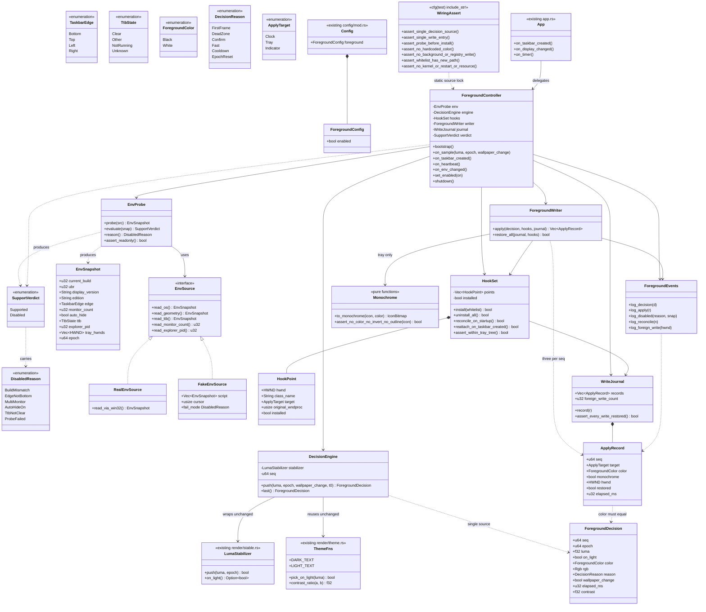
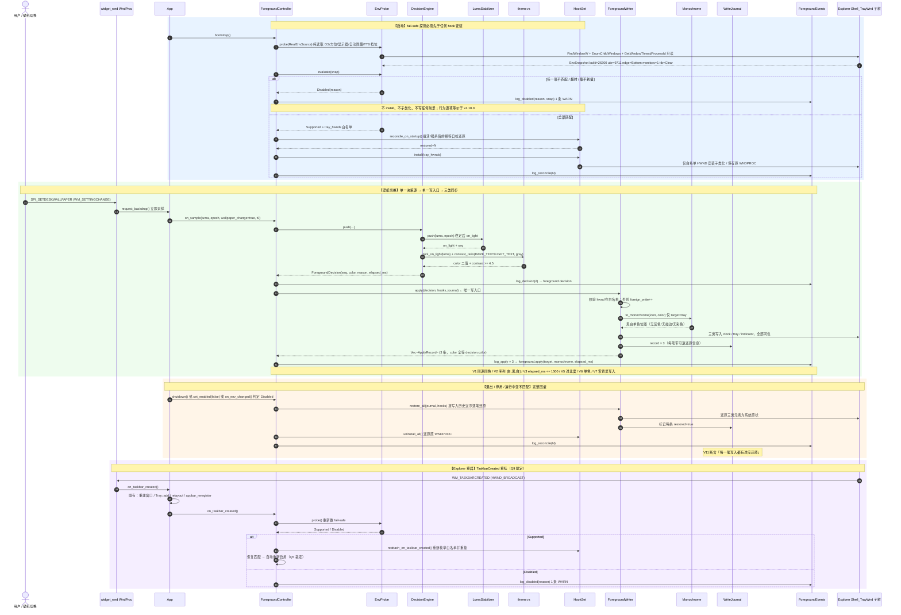
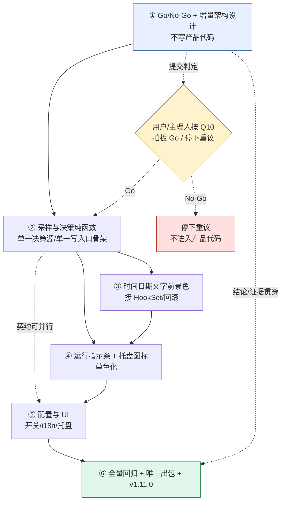

# G9 任务栏前景自适应 · 组① Go/No-Go 可行性验证 + 增量架构设计

> **文档性质**：增量架构设计（不重复主 `docs/ARCHITECTURE.md`）。基线 **v1.10.0**（636 测试：635 passed + 1 ignored，clippy 0），目标 **v1.11.0**。
> **上游**：`docs/PRD-G9-任务栏前景自适应.md`（PM 许清楚，2026-11-10 22:27）。§3 九项拍板、§4 六组节奏、§6 支持矩阵/fail-safe 真值表、§7 V1~V13、§8 public API、§10 待确认项均已完整读入。
> **本组纪律**：不写产品代码、不改系统、不提交 git、不升版本、不出包、不启动 GUI 程序、不运行 CTM 的 exe、不装驱动、不注入任何进程。所有探测均为**只读**。
> **本组定位**：PRD P0-01。产出四项独立结论 + 条件性增量架构设计。**总 Go/No-Go 判定不由本组下**（Q10 归主理人/用户拍板）。
> **写作口径**：全文严格区分 **【观察】**（本机只读命令实测输出 / 源码行号 / 文件存在性）、**【推断】**（由观察经技术推理得出）、**【未知】**（无证据，不作结论）。
> **输出约束**：本组只写本文件 + 允许的两张 `docs/G9-*.mermaid` 图；**绝不覆盖** `docs/ARCHITECTURE.md`、`docs/sequence-diagram.mermaid`、`docs/class-diagram.mermaid`。

---

## 0. 一句话结论（供主理人转呈）

> **① No-Go**（PRD 指定的「经典 `SetWindowSubclass` / `WM_PAINT` 子类化 Explorer 任务栏窗口树」在本机 Win11 26H2 上**没有可 hook 的绘制入口**：时钟窗口类名全桌面零命中、`TrayNotifyWnd` 是零子窗口的叶子 HWND、三类元素都在 XAML/Composition 视觉树里且无独立 HWND）；**② 存疑**；**③ Go（有条件）**；**④ Go（有条件）**。
> 按用户拍板 #2「组① 是 Go/No-Go，验不通就停下重议」，① 的结论会触发重议流程；**是否据此判总 No-Go，请主理人按 Q10 交用户拍板**。下文 §4 的架构设计是**条件性设计**（仅在技术路线被重新批准后启用），不是"验通了可以开工"的意思。

---

## 1. 事实基线：本机环境只读核对（全部【观察】）

### 1.1 命令与输出

| # | 只读命令 | 输出（摘要） | 证据意义 |
|---|---|---|---|
| E1 | `Get-CimInstance Win32_OperatingSystem` | `Caption = Microsoft Windows 11 专业版`；`Version = 10.0.26300`；`BuildNumber = 26300`；`OSArchitecture = 64 位` | PRD §6.1 的 OS 项匹配 |
| E2 | `Get-ItemProperty HKLM:\SOFTWARE\Microsoft\Windows NT\CurrentVersion` | `DisplayVersion = 26H2`；`CurrentBuild = 26300`；`UBR = 9711`；`EditionID = Professional`；**`ProductName = Windows 10 Pro`** | **Build 26300.9711 精确匹配**；`ProductName` 是微软遗留字段，**不能用作 OS 判据**（R3 误判源） |
| E3 | `Get-Process TranslucentTB` | `TranslucentTB  Id=14792  Path=C:\Program Files\WindowsApps\28017CharlesMilette.Translu...` | Store 版在跑；pid 14792 |
| E4 | `Get-Process explorer` | `explorer  Id=22040  C:\WINDOWS\Explorer.EXE` | 任务栏宿主进程 pid 22040 |
| E5 | `Get-ItemProperty HKCU:\...\Themes\Personalize` | `AppsUseLightTheme=1`；`SystemUsesLightTheme=1`；`ColorPrevalence=0` | 系统**浅色主题** → 任务栏系统文字当前是深色；纯透明 + 深色壁纸即"看不清"，正是需求来源；同时说明**改前景的已知系统开关就是全局主题**（用户拍板 #3 已否决） |
| E6 | `Get-ItemProperty HKCU:\Software\Microsoft\Windows\DWM` | `ColorPrevalence=0`；`AccentColor=4285952626`；`ColorizationColor=3295834742` | 强调色未启用在标题栏/任务栏 |
| E7 | `user32.GetSystemMetrics(80/0/1)`（Python ctypes 只读） | `SM_CMONITORS = 1`；`2560 x 1440` | 单显示器、主屏 2560×1440 |
| E8 | `FindWindowW("Shell_TrayWnd")` + `EnumChildWindows` | `hwnd=0x10166 pid=22040 rect=[0,1392,2560,1440] visible=true` | 底部任务栏，条带厚 48px；与 PRD §6.1「底部」一致 |
| E9 | `scripts/g9_taskbar_probe.py --self-test` | `9 项，通过 9，失败 0`，含 2 条反向验证 | 分类逻辑锁得住接线（G8 血泪教训） |
| E10 | `scripts/g9_taskbar_probe.py`（live-readonly） | 见 §1.2 | 决定性证据 |
| E11 | 补充 `EnumWindows` + 全桌面 `EnumChildWindows` | 见 §1.3 | 决定性证据 |
| E12 | 精确 `FindWindowExW` + `EnumChildWindows` | 见 §1.4 | 决定性证据 |

> 注：`scripts/g9_taskbar_probe.py` 是工作区**既有**的组① 只读探针（`git status` 显示 `?? scripts/g9_taskbar_probe.py`，未纳入提交），本组沿用并复跑，未修改它；其 `environment_note` 里提到的 `docs/G9-可行性结论.md` 并不存在（§1.3 已核），**本文件 §2 即为该结论的落点**，避免另建同名文件覆盖风险。

### 1.2 `Shell_TrayWnd` 子树（E10 完整输出，全部【观察】）

```
tray_root: Shell_TrayWnd  hwnd=0x10166  pid=22040  visible=true  rect=[0,1392,2560,1440]
descendant_count = 9

 1  Windows.UI.Composition.DesktopWindowContentBridge  0x10290  visible=true
    title="DesktopWindowXamlSource"  rect=[0,1392,2560,1440]   parent=Shell_TrayWnd   ← 整条任务栏的 XAML 岛
 2  Windows.UI.Input.InputSite.WindowClass              0x10292  visible=true   parent=DesktopWindowContentBridge
 3  Windows.UI.Core.CoreWindow                         0x10270  visible=false  parent=Shell_TrayWnd
    title="DesktopWindowXamlSource"
 4  Start                                              0x1016C  visible=false  parent=Shell_TrayWnd   rect=[0,1392,55,1440]
 5  TrayDummySearchControl                           0x1016E  visible=true   parent=Shell_TrayWnd
 6  TrayNotifyWnd                                    0x10170  visible=true   parent=Shell_TrayWnd   rect=[2187,1392,2560,1440]
 7  ReBarWindow32                                    0x10176  visible=true   parent=Shell_TrayWnd   rect=[55,1392,143,1440]
 8  MSTaskSwWClass                                   0x1017A  visible=true   parent=ReBarWindow32  title="运行中的应用程序"
 9  MSTaskListWClass                                 0x20124  visible=false  parent=MSTaskSwWClass  title="运行中的应用程序"

classification.verdict = "mixed"
  classic_clock_windows = ["TrayNotifyWnd"]     （注意：只是判定表的宽匹配，并非真有经典时钟窗口）
  xaml_windows = ["Windows.UI.Composition.DesktopWindowContentBridge", "Windows.UI.Core.CoreWindow"]
```

### 1.3 全桌面关键类名扫描（E11，全部【观察】）

| 类名 | 全桌面命中 | 说明 |
|---|---|---|
| `TrayClockWClass` | **【无命中】** | 经典时钟窗口在 26H2 上不存在 |
| `ClockButton` | **【无命中】** | 经典时钟按钮不存在 |
| `SysPager` | **【无命中】** | 托盘图标分页宿主不存在 |
| `ToolbarWindow32` | **【无命中】** | 托盘图标工具栏不存在 |
| `TrayNotifyWnd` | `0x10170 (pid=22040, vis=True)` | 仅 1 个，且是**叶子** |
| `Shell_SecondaryTrayWnd` | **【无命中】** | 无副任务栏（佐证单显示器） |
| `XamlExplorerHostIslandWindow` | **【无命中】** | — |
| `TopLevelWindowForOverflowXamlIsland` | `0x10740 (pid=22040, vis=False)` | 托盘溢出窗口也是 XAML 岛 |
| `Windows.UI.Composition.DesktopWindowContentBridge` | `0x10290 (pid=22040, vis=True)`、`0x10742 (pid=22040, vis=False)`、`0x10A06 (pid=14792, vis=False)` | 第三个属于 **TranslucentTB 自己的 XAML 岛**（pid 14792），不在任务栏树里 |
| `Windows.UI.Core.CoreWindow` | 7 个（含 pid 22040 / 14792 / 3272 / 11152 / 22440 / 24384） | 多个进程各有 XAML CoreWindow |
| `MSTaskListWClass` | `0x20124 (pid=22040, vis=False)` | **不可见**，是遗留桩，不是绘制面 |
| `MSTaskSwWClass` | `0x1017A (pid=22040, vis=True)` | 可见，仅 88px 宽 |

同 pid=22040 的其它顶层窗口（E11 节选，**佐证 R2 风险**）：`CabinetWClass`（"deliverables - 文件资源管理器"，可见）、`Xaml_WindowedPopupClass` ×2、`SystemTray_Main`、`BluetoothNotificationAreaIconWindowClass`、`Progman`、多个 `WorkerW` / `tooltips_class32` / `IME`。

> **【观察】** `docs/` 下当时只有 `PRD-G9-任务栏前景自适应.md` 一个 G9 文件，无 `G9-可行性结论.md`。

### 1.4 精确子窗口枚举（E12，全部【观察】）

```
Shell_TrayWnd=0x10166   TrayNotifyWnd=0x10170
  TrayNotifyWnd        hwnd=0x10170   children=[]          ← 零子窗口（叶子 HWND）
  ReBarWindow32        hwnd=0x10176   children=['0x1017A MSTaskSwWClass', '0x20124 MSTaskListWClass']
```
（`MSTaskSwWClass` / `DesktopWindowContentBridge` 的 `FindWindowExW(root, …)` 因它们是二级后代而返回 None；其层级已由 E10 的 `EnumChildWindows` 完整给出。此处不改结论。）

### 1.5 既有源码基线（全部【观察】，行号可直接核对）

| 文件:行 | 内容 | 对 G9 的意义 |
|---|---|---|
| `src/render/theme.rs:135,137` | `DARK_TEXT=Rgb(0x0A,0x0A,0x0A)` / `LIGHT_TEXT=Rgb(0xFA,0xFA,0xFA)` | Q3 已裁定复用，**零新阈值** |
| `src/render/theme.rs:285-288` | `pick_on_light(luma)` 用 `contrast_ratio` 择优，交叉点 ≈0.179 | 黑白二值判据 |
| `src/render/theme.rs:368-373` | `contrast_ratio(a,b)` WCAG `(L1+0.05)/(L2+0.05)` | V5 判据 |
| `src/render/theme.rs:173-221` | `Theme::from_backdrop_on` | 可复用 |
| `src/render/stable.rs:82-93` | `LumaStabilizer{on_light,confirm,epoch,seq,last_fast_seq}` | 稳定器状态 |
| `src/render/stable.rs:129-182` | `push(luma, epoch) -> bool`，纯状态机，无 EMA | 决策单一源的宿主 |
| `src/render/stable.rs:235-506` | 12 条既有测试（死区 / 确认区 / 快速通道 / 冷却 / epoch / 确定性） | V4「既有 12 条全绿」口径 |
| `src/config/defaults.rs:61,325,329,332,334,344,352` | `SAMPLE_THROTTLE_MS=300`；`MIN_CONTRAST=4.5`；`LUMA_LIGHT_MIN=0.25`；`LUMA_DARK_MAX=0.12`；`LUMA_CONFIRM_SAMPLES=2`；`LUMA_FAST_MARGIN=0.05`；`LUMA_FAST_COOLDOWN_SAMPLES=2` | 阈值常量唯一出处 |
| `src/taskbar/geometry.rs:139-248` | `probe()`：`FindWindowW(Shell_TrayWnd)` → `FindWindowExW(TrayNotifyWnd)` → `SHAppBarMessage(ABM_GETTASKBARPOS/ABM_GETSTATE)` → `MonitorFromWindow` → `GetDpiForWindow` → `epoch` | **纯读取**，fail-safe 探测可直接复用；产出 `edge / auto_hide / monitor_rect / dpi / epoch` |
| `src/taskbar/geometry.rs:152-160` | 找不到 `TrayNotifyWnd` 时退化为整条任务栏 | 已有容错 |
| `src/taskbar/host.rs:3-10` | "为什么必须是 **top-level** 窗口而不是 `SetParent(taskbar)` 的子窗口……deskband 是 IE 时代的 `IBandSite` COM 组件，**Win11 已完全移除**，且需要注册 COM、**由 Explorer 加载 DLL**。本方案**零注册、零安装**" | **既有架构明确拒绝让 Explorer 加载 DLL**，R6/Q1 张力的技术根源 |
| `src/platform/appbar.rs:1-10,32-61` | 纯通知型 appbar（`ABM_NEW`/`ABM_REMOVE`），不发 `ABM_QUERYPOS/ABM_SETPOS`；失败靠 `TaskbarCreated` 重注册 | 恢复路径已有 |
| `src/app.rs:1053-1080` | `on_taskbar_created()`：重建窗口、`Tray::add`、relayout、`ensure_on_top`、`appbar_reregister`、`reconcile_fullscreen`、`reassert_z_order` | Q9「Explorer 重启走 TaskbarCreated 重挂」的现成挂点 |
| `src/ui/widget_wnd.rs:112,292,409` | `RegisterWindowMessageW("TaskbarCreated")` 注册与两处分派 | 同上 |
| `src/config/mod.rs:202-217` | `Config` + 容器级 `#[serde(default)]`；`load()` 226-294 容错；`save()` 297-310 tmp+rename 原子写 | §8 兼容承诺的现成机制 |
| `src/settings/bridge.rs:235-430` | `apply_set` **白名单 match**，兜底 `_ =>` 记 WARN 返回 false | §8 载体 2；G9 新 path 必须显式入表 |
| `src/log.rs:131-139` | `tag_of()` 取 `module_path!()` **第二段** → `barline::foreground::events` → `[foreground]` | 结构化日志天然按模块分标签 |
| `src/log.rs:274-300` | `log_debug!/log_info!/log_warn!/log_err!` | 结构化事件落点，无需新增日志框架 |
| `src/platform/perf.rs:144-210` | `RateLimiter`（同段 60s 限流 ≤10 条） | P1-01 / `progress.md §2.2.15` 复用 |
| `src/main.rs:3-11,27,29-42` | 启动顺序固定；`#![windows_subsystem="windows"]`；13 个 `mod` | 新模块挂 `mod foreground;` 一行 |
| `README.md:3` | "**不注入 Explorer**、不弹独立悬浮窗" | R6 / Q1 |
| `docs/ARCHITECTURE.md:2051-2073`（§10.5） | "本项目**从未使用 WinEvent 钩子**"；Explorer 重启 500ms×60 次重试 | 恢复机制基线 |
| `docs/ARCHITECTURE.md:2192-2240`（§11.2） | `WM_SETTINGCHANGE wParam=SPI_SETDESKWALLPAPER` 立即采样；300ms 最新覆盖槽；3s 静止心跳（`progress.md §2.2.16`） | Q2「换壁纸即时采样 + 大幅跳变快速通道」的现成节奏 |
| `Cargo.toml:3,18-73` | `version="1.10.0"`；`windows 0.62.2` 已开 `Win32_UI_Shell` / `Win32_UI_WindowsAndMessaging` / `Win32_Graphics_Dwm` / `Win32_System_Registry` / `Win32_System_Threading` / `Win32_System_Diagnostics_ToolHelp` | 依赖包无新增（见 §4.11） |
| `progress.md:121-129`（§2.1 铁律） | 构建只走 `scripts/build.ps1`；禁 `reg.exe`/`Add-Type`/`cmd.exe`；工程师不启动 exe、不截屏；反向验证在副本里做；禁 `git add -A` | 本组全部遵守 |

---

## 2. P0-01 四项结论与证据

> 判定术语：**Go** = 有可核对证据支持"能做且边界可保证"；**No-Go** = 有可核对证据证明"按指定手段做不到"；**存疑** = 证据不足/依赖未决前提，需要额外实测或用户重议。**本组不下总判定**。

---

### 2.1 ① 能否稳定定位三类元素的绘制入口 → **No-Go**

> 限定语：针对 **PRD §3 第 2 项 + §9.1 R1 指定的「用户态 hook / 子类化 Explorer 任务栏窗口树」+ 经典 `SetWindowSubclass` / `WM_PAINT` 路线**。这是 PRD 字面要求的技术手段。

#### 【观察】证据

| 元素 | 预期经典 hook 点 | 本机实测 | 结论 |
|---|---|---|---|
| 右下角时间日期文字 | `TrayClockWClass` / `ClockButton` | **全桌面零命中**（E11）；`TrayNotifyWnd` 是**零子窗口叶子**（E12）；整条任务栏唯一可见的满幅绘制面是 `Windows.UI.Composition.DesktopWindowContentBridge`（0x10290，`title=DesktopWindowXamlSource`，rect 覆盖整条 `[0,1392,2560,1440]`） | 无经典 HWND 可挂 `WM_PAINT` / `WM_CTLCOLOR`；时钟文字是 XAML `TextBlock` 视觉节点 |
| 右下角托盘图标 | `SysPager` → `ToolbarWindow32` → 每图标 `TB_*` / `WM_DRAWITEM` | `SysPager` / `ToolbarWindow32` **全桌面零命中**；`TrayNotifyWnd` **children=[]**；`TopLevelWindowForOverflowXamlIsland`(0x10740) 与 `Xaml_WindowedPopupClass` 均属 XAML 岛 | 图标不是窗口、不是工具栏按钮；无 per-icon HDC / `WM_DRAWITEM` / `TB_SETIMAGELIST` 可拦截 |
| 左下角 Win11 运行指示条 | `MSTaskListWClass` 的绘制消息 | `MSTaskListWClass`(0x20124) **`visible=false`**；`MSTaskSwWClass` 可见但仅 88px 宽；两者都是遗留桩 | 指示线不是经典 HWND 绘制，是 XAML 任务按钮下的视觉元素 |

补充【观察】：
- 任务栏 9 个后代中 `Windows.UI.Composition.*` / `Windows.UI.Core.CoreWindow` / `Windows.UI.Input.InputSite.*` 共 3 个，且 `DesktopWindowContentBridge` 覆盖整条任务栏 → 现代任务是 **XAML/Composition 合成**，不是 GDI `WM_PAINT`。
- `scripts/g9_taskbar_probe.py:167-171` 自身 `limits` 已写明："窗口类名不能直接证明绘制路径：存在经典 HWND 不等于 WM_PAINT 会经过它"、"XAML/Composition 视觉树内的文字与图标**没有独立 HWND**，本探针无法枚举"。
- 全桌面 `Windows.UI.Composition.DesktopWindowContentBridge` 命中 3 个，其中 `0x10A06` 属于 **pid 14792 = TranslucentTB**（E3/E11）：连 TranslucentTB 自己也是 XAML 岛应用，并未给任务栏造出经典绘制面。

#### 【推断】技术推论（附公开资料）

1. **跨进程 `WNDPROC` 子类化在本机不成立**：
   - Microsoft Learn `SetWindowSubclass` 明确警告 **"You cannot use the subclassing helper functions to subclass a window across threads."** → <https://learn.microsoft.com/en-us/windows/win32/api/commctrl/nf-commctrl-setwindowsubclass>
   - Microsoft Learn `SetWindowLongPtrW` 的 Remarks：**"An application can subclass a system class, but should not subclass a window class created by another process."**，并注明 UIPI 特权限制 → <https://learn.microsoft.com/en-us/windows/win32/api/winuser/nf-winuser-setwindowlongptrw>
   - `WNDPROC` 是**目标进程地址空间**里的函数指针；要替换 explorer.exe 拥有的 HWND 的过程，代码必须驻留在 explorer.exe 内。因此"用户态子类化任务栏窗口树"**必然意味着向 Explorer 注入 DLL**（`SetWindowsHookEx` 线程钩子由系统自动把 DLL 映射进目标线程，同样属于注入）。
   - **这与 `README.md:3`「不注入 Explorer」及 `src/taskbar/host.rs:9-10`「零注册、零安装（拒绝由 Explorer 加载 DLL）」直接冲突**。⚠️ **Q1 拟采用的措辞「区分『不向 Explorer 进程注入代码』与『用户态子类化任务栏窗口树』」在技术上无法成立**——这两件事不是可区分的两条路线，而是同一条路线的两个描述。这一点必须回传主理人并列入待明确事项（§8 A1）。
2. **「稳定」不成立（R1）**：XAML 视觉树没有公开、版本化的元素标识契约；即使注入后用 `IXamlDiagnostics` / UIAutomation 遍历，节点名/模板结构随累积更新漂移。PRD §6.1 把支持面钉死到 `26300.9711` 正说明这一点。
3. **托盘图标「各应用注册 HICON、无统一重着色接口」在本机窗口树的具体体现**（PRD 点名要求说明）：
   - 【观察】`TrayNotifyWnd` 是叶子、`SysPager`/`ToolbarWindow32` 零命中 → **没有任何窗口级/工具栏级的统一图标容器**。
   - 【推断】每个图标是各应用通过 `Shell_NotifyIcon(NIM_ADD/NIM_MODIFY)` 交给 Explorer 的 `HICON` 位图句柄，存于 Explorer 内部托盘数据表，最终作为 `ImageSource` / Composition surface 合成进 0x10290 这个 XAML 岛。Windows **没有** "把所有托盘图标统一染成黑/白" 的公开 API。
   - **单色化只能落在以下三层之一**：
     - **(a) 注册前**：hook 每个来源进程的 `Shell_NotifyIcon` → 需注入**所有**应用，直接违反拍板 #3「零其它 HWND 前景写入」与 §6.2 契约；**不可行**。
     - **(b) Explorer 内合成前**：在 explorer.exe 内截获图标位图/`ImageSource`，按 alpha 生成黑白 mask → 需注入 Explorer（回到推论 1 的冲突）。
     - **(c) 覆盖层**：用自己的 `WS_EX_LAYERED` 分层窗口（`TaskbarHost` 已有此能力）盖上去 → 必须先**隐藏**系统原图标/原时钟，否则黑白文字会与深色原文字叠在一起；隐藏原元素仍需改 Explorer XAML 树。
   - 【观察·佐证】CTM 的 `配置/任务栏.json` 里存在 `"隐藏托盘区域系统图标内容"` 列表（网络图标 / 音量图标 / 输入法 / **日期时间** / 显示桌面），并同时存在 `"时间颜色"` `"日期颜色"` `"图标文字颜色"` `"图标状态条正常颜色"` `"图标状态条选中颜色"` → **第三方工具的做法是「隐藏系统原元素 + 自绘替代品」，而不是「给原元素重着色」**（详见 §3）。这从侧面印证"无统一重着色接口"。

4. **本组未执行任何 `SetWindowSubclass` / `SetWindowsHookEx` / `CreateRemoteThread` / `WriteProcessMemory` 验证**：这些属于"改系统/注入"，被本组纪律禁止；因此以上跨进程结论为**基于公开文档 + 窗口树观察的推断**，不是本机注入实测。若主理人决定重议并批准一次受控注入实验，需用户单独授权（§8 A2）。

#### 【未知】
- 0x10290 XAML 岛内部视觉树的真实节点类型与 `TextBlock.Foreground` 是否可跨进程写：**未知**（需注入后才能观测，本组不做）。
- `SetWindowTheme(hwnd, L"DarkMode_Explorer", ...)` 之类 per-HWND uxtheme 调用对 XAML 岛是否生效：**未知**（CTM 的 DLL 静态串里含 `uxtheme`，见 §3.3，但无证据表明对 XAML 有效）。
- 累积更新后窗口树是否漂移：**未知**（PRD R1 已识别）。

#### 条件分支（供重议，不改变本项 No-Go 判定）
> 若把「用户态 hook」放宽为 **「向 Explorer 注入 DLL 后操作 XAML 视觉树」或「隐藏原元素 + 自绘覆盖层」**，则 ① 降为 **存疑**：CTM 的静态证据显示该路线**存在**（§3），但它与拍板 #1「自研不照抄 CTM」、拍板 #3「其它窗口视觉不变」、`README.md` 承诺、R2（同进程其它窗口）冲突，且 R1 稳定性无保证。**是否放宽须用户重新拍板，本组不自行优化。**

---

### 2.2 ② 能否只改前景、不改背景 → **存疑**

#### 【观察】
- TranslucentTB（pid 14792）在跑，桌面态 clear（`accent=clear`, `color=#00000000`）由主理人给出；本机 `ColorPrevalence=0`、`SystemUsesLightTheme=1`（E5/E6）。
- 任务栏树里**唯一**与"背景/合成"相关的实体是 `Shell_TrayWnd` 本身 + 0x10290 XAML 岛；我们未观测到任何由本组写入的 ACCENT/合成属性（本组只读）。
- 公开资料一致指出 TranslucentTB 的 clear 走 **未文档化 `SetWindowCompositionAttribute` + `WCA_ACCENT_POLICY (Attribute=19)` + `ACCENT_STATE`（透明/透明渐变）+ `GradientColor=0x00000000`**，作用在 `Shell_TrayWnd`（HWND）上：
  - <https://github.com/saadmahboob/TranslucentTB/blob/develop/TranslucentTB/main.cpp>（`(ACCENTPOLICY)` / `WCA_ACCENT_POLICY=19` / `SetWindowCompositionAttribute(hWnd, &data)`）
  - <https://blog.csdn.net/gitblog_00436/article/details/161178349>（`ACCENT_STATE` 枚举、`ACCENT_POLICY`）
  - <https://blog.csdn.net/weixin_35797963/article/details/153718018>（`nAccentState=3` 透明背景、`Attribute=19`、`GetProcAddress` 动态取）
- 【观察·CTM 静态串】`CTMExplorerBackground.dll` **同时**含 `SetWindowCompositionAttribute`、`DwmSetWindowAttribute`、`SetTextColor`、`SetWindowLongPtr`、`uxtheme`、`dwmapi`、`Windows.UI.Composition`、`Xaml`（§3.3）→ 一个改任务栏的工具**同时具备改背景与改前景的能力**，"误伤背景"不是理论风险。

#### 【推断】
- **通道可分离**：`WCA_ACCENT_POLICY` / DWM 合成属性（背景）与文字/图标前景色是两个不同写入面。若 G9 的实现**严格不调用** `SetWindowCompositionAttribute` / `DwmSetWindowAttribute` / `SetLayeredWindowAttributes` / alpha 写入、也不改 `SystemUsesLightTheme`，则与 TranslucentTB 的 clear **无必然冲突**；TranslucentTB 也无需重启。
- **但无法给 Go**，三条硬缺口：
  1. ① 已是 No-Go → **目前不存在任何已验证的"前景写入口"**，因而"只改前景"这一命题在本机**不可验证**（不能拿一个不存在的写入口去证明它不碰背景）。
  2. 已知唯一能改变 Win11 任务栏时钟文字色的系统级开关是 **`SystemUsesLightTheme` / `AppsUseLightTheme` 全局主题**（E5 + <https://sspai.com/post/103225>、<https://www.php.cn/faq/2458159.html>），而用户拍板 #3 已明确否决全局注册表主题/强调色路线 → 剩下的只有"注入后改 XAML 画刷"，落入 ① 的条件分支。
  3. 若最终走注入路线，注入 DLL 里一旦顺带挂了 `SetWindowCompositionAttribute`（CTM 就是这么做的），就会**覆盖 TranslucentTB 的 ACCENT 状态**；且 TranslucentTB 会在 `TaskbarCreated` / 档位变化时重设属性，两边会互相覆盖 → 透明效果抖动。这需要一条 V7 红线静态断言钉死（§4.9），而不是靠"设计时小心"。

#### 【未知】
- TranslucentTB 在本机重设 ACCENT 的确切周期 / 触发点：**未知**（未读其进程内存、未挂钩子）。
- 0x10A06（TranslucentTB 自有 XAML 岛）是否参与任务栏绘制：**未知**（`vis=False`，推测是其设置/托盘 UI，不参与）。

#### 判 Go 的前置条件（供主理人）
> 需同时满足：(a) ① 的技术路线经用户重议并批准；(b) 真机受控实验证明"黑/白切换前后 `Shell_TrayWnd` 的 ACCENT 属性值与透明像素不变"；(c) `foreground.*` 模块经 V7/V13 静态断言零 `SetWindowCompositionAttribute` / 零 `DwmSetWindowAttribute` / 零 alpha 写入 / 零主题注册表写入。

---

### 2.3 ③ 能否完整回滚 → **Go（有条件）**

> 条件：**G9 保持「零跨进程持久写入」**——不写系统注册表、不替换系统资源、不重启 Explorer、不注入常驻 DLL、不在 Explorer 进程内留下任何状态。在此前提下"完整回滚"退化为"本进程停止写入 + 每笔写入有对应还原"，是结构上可证明的。

#### 【观察】既有设施已覆盖大部分恢复路径
- `src/app.rs:1053-1080` `on_taskbar_created()`：Explorer 重启后重建窗口、`Tray::add` 重新 `NIM_ADD`、relayout、`ensure_on_top`、`appbar_reregister()`、`reconcile_fullscreen`、`reassert_z_order`。
- `src/ui/widget_wnd.rs:112,292,409`：`RegisterWindowMessageW("TaskbarCreated")` 注册与两处分派。
- `src/platform/appbar.rs:32-61`：`ABM_NEW` 注册 / `ABM_REMOVE` 注销，失败只记 WARN，靠 `TaskbarCreated` 重注册。
- `src/taskbar/geometry.rs:139-148`：`probe()` 找不到 `Shell_TrayWnd` 返回 `None`（Explorer 正在重启的识别）。
- `docs/ARCHITECTURE.md:2071-2073`：Explorer 未起来时 500ms×60 次重试、期间窗口隐藏。
- `src/ui/tray.rs:191` 注释：`NIM_DELETE` 退出前必须调，否则留死图标。
- `src/taskbar/host.rs:313-319`：`TaskbarHost::destroy()` 退出路径销毁窗口。
- `src/config/mod.rs:297-310`：`config.json` 只写**自己的**数据目录、tmp+rename 原子写；`src/log.rs` 同理。
- **`git status` 显示工作区只有两个未跟踪文档/脚本，无任何系统状态被本组改动。**

#### 【推断】四条路径的设计（Q5/Q9 主理人已裁定，直接采用）
| 路径 | 设计 | 证据 / 挂点 |
|---|---|---|
| 正常退出 / 用户停用 | `ForegroundController::shutdown()` → `ForegroundWriter::restore_all(journal, hooks)` 按 `WriteJournal` 逆序逐笔还原 → `HookSet::uninstall_all()` 还原原始 `WNDPROC` → 记 `foreground.reconcile`；`Drop` 兜底 | V11「每一笔写入都有对应还原」用测试替身的写入历史断言；`TaskbarHost::destroy` / `NIM_DELETE` / `ABM_REMOVE` 是现成范式 |
| 崩溃 / 被强杀 | **下次启动幂等自检还原**（Q9 裁定）：`HookSet::reconcile_on_startup()` 只读自检——若发现有未还原的写入/残留子类化，按 journal 逆序还原；**自检本身幂等**（重复执行同一结果），日志只记 1 条 | 依赖"零跨进程持久写入"：崩溃时我们进程一死，所有 hook/画刷随之失效，最坏只剩"上次写过的颜色"，由启动自检抹回系统原状 |
| Explorer 崩溃 / 重启 | `TaskbarCreated` 广播 → `App::on_taskbar_created()` 内追加 `ForegroundController::reattach_on_taskbar_created()`：先 `EnvProbe::probe()` 重做 fail-safe、再重新枚举白名单 HWND、再重挂；**绝不主动重启 Explorer** | `app.rs:1054` / `widget_wnd.rs:112` / `appbar.rs:8-10`；Q9 裁定 |
| 运行中变不匹配 | 1s 心跳 + `TaskbarCreated` + `ABN_POSCHANGED/ABN_STATECHANGE` + `WM_DISPLAYCHANGE` 触发重新探测 → `Disabled` 即 `restore_all` + `uninstall_all` + 1 条 WARN，无需用户操作 | V10；`app.rs:1082-1090` `on_display_changed`；`geometry.rs:235` epoch |
| 恢复匹配 | **自动重新启用**（Q5 裁定），靠 `TaskbarCreated` + 心跳；状态机 `Disabled → Probing → Supported → Active`，`Active → Disabled` 必须先 `restore_all` | §6.2 第 5 条 |

#### 【推断】跨进程子类化/注入的卸载路径（若技术路线被放宽）
- 卸载顺序必须严格：`RemoveWindowSubclass` / `SetWindowLongPtr(GWLP_WNDPROC, 原值)` → 确认窗口树无残留引用 → **再**考虑 `FreeLibrary`。**不建议 `FreeLibrary`**：只要还有窗口的 WndProc 指向注入 DLL，卸载即 Explorer 崩溃；实践上应"还原 WndProc + 置模块为 inactive + 等 Explorer 自然重启时随进程消亡"，而**强制重启 Explorer 是红线**。
- **因此：一旦走注入路线，③ 立即从 Go 降为「存疑」**——"完整回滚"无法在不重启 Explorer 的前提下保证注入 DLL 被彻底移除。这是 ① 与 ③ 的强耦合，必须回传主理人。
- 公开参照：<https://blog.csdn.net/John_ToStr/article/details/159240673> 讨论 Win10→Win11 22H2 后 XAML 任务栏的"双轨制"注入与"低版本可随用随插、用完即拔，高版本卸载难"的问题（社区资料，仅作旁证，不作为本机结论）。

#### 【未知】
- 若未来需要注入，Explorer 对注入 DLL 的引用计数与卸载时机：**未知**。

---

### 2.4 ④ 是否影响其它窗口 → **Go（有条件）**

#### 【观察】
- 任务栏 9 个后代 **全部 `pid=22040`**（E10），`Shell_TrayWnd`(0x10166) 与其后代构成一个封闭、可枚举的 HWND 集合；`tray_rect=[2187,1392,2560,1440]`，`bar_rect=[0,1392,2560,1440]`（几何边界明确）。
- `SM_CMONITORS=1`、无 `Shell_SecondaryTrayWnd`（E7/E11）。
- 同 pid 22040 还有 `CabinetWClass`（文件资源管理器窗口，可见）、`Xaml_WindowedPopupClass`、`SystemTray_Main` 等 → **R2 风险真实存在**：进程级/全局钩子会覆盖 explorer.exe 的其它窗口。
- 现存的唯一注册表写入是 `src/config/autostart.rs`（开机自启，`apply_set` 的 `general.autostart` 分支，`bridge.rs:346-355`），G9 **不新增**任何注册表写入。

#### 【推断】可形式化保证的四道闸
1. **HWND 白名单**：`HookSet::install(whitelist)` 只接受"启动时由只读枚举得到的 `Shell_TrayWnd` + 其后代"集合，并校验 `GetWindowThreadProcessId(hwnd) == explorer_pid` 与类名在允许表内；任何白名单外 HWND → 拒绝 + WARN + 记 `foreign_write` 计数。
2. **单一写入口**：所有前景写入只经 `ForegroundWriter::apply`，其它模块不得调用任何设色 API（由 §4.10 源码静态断言钉死）。
3. **零全局注册表**：`foreground.*` 模块静态断言无 `RegSetValue*` / `SystemUsesLightTheme` / `AppsUseLightTheme` / `ColorPrevalence` / `AccentColor` 写入串。
4. **钩子作用域**：必须 **线程级** `SetWindowsHookEx(dwThreadId = 任务栏 UI 线程)**，禁止 `WH_*` 全局钩子（`dwThreadId=0`），否则会映射进所有 GUI 进程 → 直接违反 R2/Q12。

#### 证据口径（Q12 主理人裁定）
- **主证据**：`foreground.apply` 日志断言 `foreign_write=0` + `target ∈ {clock,tray,indicator}` + `hwnd ∈ whitelist`；配合 V7「零背景色/alpha 写入、零全局注册表主题/强调色写入、零其它 HWND 前景写入」与 V13 源码 grep。
- **辅证据**：`%TEMP%\barline-g9\` 下 G9 前后同场景真机对照截图（人工抽样），Q8 已定命名 `G{组号}_{时刻}_{黑|白}.png`、主理人收尾清理。
- 【推断】"日志断言零写入"能证明**我们没写**，不能证明系统没被别人改；故截图辅证不可省略，但**不得作为唯一依据**（PRD §7.5）。

#### 【未知】
- 线程级钩子是否仍会被 Explorer 内部其它 XAML 岛（开始菜单/通知中心，同线程）接收：`TaskbarCreated` 之外的关联面**未知**，列 R2 残留风险。

---

### 2.5 四项汇总（本组不下总判定）

| 项 | 结论 | 一句话依据 | 主要证据 |
|---|---|---|---|
| ① 定位三类绘制入口 | **No-Go** | 经典时钟/托盘/工具栏类名全桌面零命中，`TrayNotifyWnd` 是叶子，三类都在无独立 HWND 的 XAML 岛里；跨进程 WndProc 子类化被 MS 文档禁止 | E10/E11/E12；MS Learn ×2 |
| ② 只改前景不改背景 | **存疑** | 前景/背景通道可分离、无必然冲突；但 ① 未提供可验证的前景写入口，且唯一已知系统开关是被否决的全局主题 | E3/E5/E6；TranslucentTB main.cpp；CTM 静态串 |
| ③ 完整回滚 | **Go（有条件）** | 「零跨进程持久写入」+ 既有 `TaskbarCreated`/appbar/托盘/`NIM_DELETE` 恢复设施 + 启动幂等自检，可覆盖退出/崩溃/强杀/重启/禁用五路径 | `app.rs:1053-1080`、`appbar.rs`、`host.rs:313-319`、`ARCHITECTURE.md:2051-2073` |
| ④ 不影响其它窗口 | **Go（有条件）** | HWND 白名单 + 单一写入口 + 零注册表写 + 线程级钩子，可由日志断言与源码静态断言证明 | E10/E11/E7；`bridge.rs:235-430`；`src/log.rs:131-139` |

> **⚠️ 流程提示（非判定）**：用户拍板 #2「验不通就停下重议」+ §9.1 红线 5「组① No-Go 即停下重议，不得带疑点进入产品代码」。① 为 No-Go，**建议主理人按 Q10 把「四项证据 + 条件分支」交用户拍板，本组不自行给出总 Go/No-Go**。③/④ 的 "Go" 是**设计不变量层面**的 Go，不构成"① 可以通过"的支撑。

---

## 3. CTM 线索：静态只读调查（严格区分能力 / 路线）

> **纪律执行声明**：本节全部操作为 `ls` / `cat` / 文本 `grep` / Python **只读** `open(...,'rb').read()` 二进制串匹配。**未启动 CTM、未运行任何 `.exe`/`.dll`、未装驱动、未 `LoadLibrary`、未附加进程**。`log.txt` 为乱码二进制，仅作存在性记录，不解读内容。

### 3.1 【观察】它具备哪些能力

| 证据 | 位置 | 观察结论 |
|---|---|---|
| `配置/任务栏.json` | `D:\APP\CTM工具\配置\任务栏.json` | 大量任务栏外观配置项：`背景模式=透明`、`背景颜色`、`细线颜色`、`时间颜色`、`日期颜色`、`时间字体/大小`、`图标文字颜色`、`图标状态条正常颜色 = rgba(233,233,233,0.5)`、`图标状态条选中颜色 = rgba(0,255,103,1.00)`、`图标背景*颜色`、`托盘图标列数=8`、`隐藏托盘区域系统图标内容`（网络/音量/输入法/日期时间/显示桌面）、`自定义开始/搜索/任务视图按钮图片路径` → **它确实能改（或替换）时间日期文字、托盘图标、运行指示条三类元素**，与 G9 目标高度重叠 |
| `Resource/CTM/*.dll` | 15 个 DLL：`CTMExplorerBackground.dll`(3.9MB)、`CTMTMTAP.dll`(7.9MB)、`CTMTMWIN11.dll`(1.6MB)、`CTMTMWIN10.dll`(205KB)、`global-inject-lib.dll`(2.6MB) 等 | 存在按 Win10/Win11 分版的模块与一个名字直白的"全局注入库" |
| `Resource/PS/xzsdb.ps1` | 全文 34 行 | **与任务栏颜色无关**：`Get-AppxPackage` 找 `PackageFamilyName=7A928D97.3513037AF8B27` → `Remove-AppxPackage` 卸载某个 Appx 包。是一个"卸载系统包"脚本 |
| `Resource/PS/cxyjcd.ps1` | 全文 228 行 | **与任务栏颜色无关**：`Add-Type` 声明 `shlwapi!SHLoadIndirectString`；读 `HKCU\...\Shell Extensions\Blocked` 与 `HKLM\SOFTWARE\Classes\PackagedCom\Package`，枚举 `SurrogateAppId` / `Class`，输出 JSON（标识/状态/程序）。是一个"打包 COM / Shell 扩展清点"脚本 |
| `Resource/YY/` | `ViVeTool-v0.3.3/ViVeTool.exe` + `Albacore.ViVe.dll`、`PawnIO_setup.exe`(5.2MB)、`RTSSSetup737.exe`(18MB)、`7zr.exe`、`aria2c.exe` | ViVeTool = Windows 功能开关（Feature Management）CLI；PawnIO = 可加载**签名内核模块**的用户态框架（安装器）；RTSS = RivaTuner Statistics Server（OSD 叠加层，自带驱动）；7zr/aria2 = 解包/下载。**这些是"随包提供的第三方工具"，不等于 CTM 改任务栏用了它们** |
| `libcef.dll`(246MB) / `FBrowserCEF3lib.dll` / `*.pak` / `vulkan-1.dll` / `dxcompiler.dll` | 顶层 | 主体是 CEF/Chromium + Vite 前端（`APP/index.html`、`APP_ZM/index.html`）+ 小组件预设 `预设_*.txt`（时间/频谱/硬件监控/音乐控制等）→ **CTM 是一个"桌面小组件/美化套件"，任务栏美化只是其一** |
| `log.txt` / `data/log.txt` | 顶层 / data | 存在但为乱码/二进制，本组不解读 |
| `配置/设置.json` | | `"系统版本不匹配时不创建":false`、`"任务栏重试次数":10` → 它自己也有版本门控与重试，但**不是** G9 的 fail-safe 契约 |

### 3.2 【观察】二进制静态串扫描（不加载不执行）

对 `Resource/CTM/*.dll` 做 ASCII + UTF-16LE 关键字匹配（`python` 纯 `read`，无 `LoadLibrary`）：

| DLL | 命中的 API/名字串 |
|---|---|
| `CTMExplorerBackground.dll` | `SetWindowCompositionAttribute`、`DwmSetWindowAttribute`、`SetTextColor`、`SetWindowLongPtr`、`SetWindowsHookEx`、`Windows.UI.Composition`、`Xaml`、`uxtheme`、`dwmapi`、`ntdll`、`user32` |
| `global-inject-lib.dll` | **`CreateRemoteThread`、`WriteProcessMemory`、`VirtualAllocEx`**、`LoadLibrary`、`Shell_TrayWnd`、`ntdll`、`user32` |
| `CTMTMWIN11.dll` | `LoadLibrary`、`Shell_TrayWnd`、`Windows.UI.Composition`、`Xaml` |
| `CTMTMWIN10.dll` | `SetWindowCompositionAttribute`、`SetWindowsHookEx`、`VirtualAllocEx`、`WriteProcessMemory`、`LoadLibrary`、`ntdll`、`user32` |
| `CTMTMTAP.dll` | `DwmSetWindowAttribute`、`SetWindowLongPtr`、`SetWindowsHookEx`、`Shell_TrayWnd`、**`TrayNotifyWnd`**、`Windows.UI.Composition`、`Xaml`、`dwmapi` |
| `CTMKSCDTAP.dll` | `LoadLibrary`、`Windows.UI.Composition`、`Xaml` |

> 注：`SetWindowSubclass` / `Shell_NotifyIcon` / `NIM_MODIFY` / `TrayClockWClass` / `DesktopWindowContentBridge` / `SystemUsesLightTheme` / `WM_PAINT` 在上述 6 个 DLL 的**明文字串中均未命中**（可能是动态 `GetProcAddress` + 加密/拼接字符串，也可能确实未用；本组不下结论）。

### 3.3 【推断 / 未知】它到底走哪条路线改任务栏颜色

- **【推断·较强】** `global-inject-lib.dll` 同时含 `CreateRemoteThread + WriteProcessMemory + VirtualAllocEx + LoadLibrary + Shell_TrayWnd` → CTM **至少具备「向 Explorer 进程远程注入 DLL」的用户态能力**；`CTMTMWIN11.dll` 含 `Windows.UI.Composition` / `Xaml` / `Shell_TrayWnd` → Win11 分支针对 XAML 岛。`CTMTMTAP.dll` 含 `TrayNotifyWnd` + `DwmSetWindowAttribute` + `SetWindowLongPtr` → 托盘区与窗口过程/合成属性都被触及。
- **【推断·较强】** 结合 `任务栏.json` 的 `"隐藏托盘区域系统图标内容"` + 自绘 `时间/日期/图标文字/图标状态条颜色` + 自定义按钮图片 → CTM 的路线更可能是 **「注入 Explorer → 隐藏/替换系统原元素 → 用自绘（CEF/XAML/Composition）重画一套」**，而**不是**「给系统原元素统一重着色」。这与 §2.1 推论 4 互相印证。
- **【推断·弱】** `CTMExplorerBackground.dll` 含 `SetWindowCompositionAttribute` + `DwmSetWindowAttribute` + `uxtheme` → 它也改**背景/合成**（这正是 §2.2 "误伤背景"风险的现实样本）。
- **【未知】** PawnIO / RTSS / ViVeTool 是否**参与**任务栏颜色：无证据。PawnIO 是"具备加载内核模块能力"的安装器，ViVeTool 是功能开关，RTSS 是 OSD；目录存在 ≠ 被调用。本组**不推断 CTM 用了内核驱动改任务栏颜色**，也**不推断它没用**。
- **【未知】** 它是否写全局主题注册表、是否强制重启 Explorer、卸载时是否 `FreeLibrary`：**未知**（静态串不足以下结论）。
- **红线对照**：用户拍板 #1「自研不照抄 CTM」、#2「禁止内核驱动 / 系统资源替换 / 强制重启 Explorer」、`README.md`「不注入 Explorer」。**CTM 的注入 + 隐藏替换 + 改合成属性路线与 G9 红线不同**，因此 CTM 只能作为"该需求在业界可实现"的旁证，**不能作为 G9 的实现蓝本**。

---

## 4. 增量架构设计（**条件性**：仅在技术路线经用户重议批准后启用）

> 本节按主理人要求完整产出，便于 Go 之后直接开工；但**不代表组① 已通过**。所有模块名、接口、文件均为设计，不含任何产品代码。

### 4.1 实现方案与选型

**核心难点（按风险降序）**
1. **H1（已由 ① 证实）**：Win11 26H2 三类元素在 XAML/Composition 视觉树内，无经典 HWND 绘制入口 → 用户态 hook 点选择是全局最高风险，非框架问题而是**技术路线问题**。
2. **H2**：单一决策源与单一写入口的**接线可证明性**（PRD R9「测试全绿但功能没做」）→ 用源码静态断言锁接线，而非只靠行为测试。
3. **H3**：fail-safe 探测必须**在 hook 安装之前**、且探测本身纯读取（§6.2 契约 2）→ 用类型状态 + 静态断言双重保证。
4. **H4**：完整回滚覆盖崩溃/强杀/Explorer 重启/运行中变不匹配/恢复匹配五路径 → 复用既有 `TaskbarCreated` 设施 + `WriteJournal` 逐笔还原 + 启动幂等自检。
5. **H5**：作用范围精确到任务栏窗口树，零其它 HWND / 零注册表写入 → HWND 白名单 + 线程级钩子 + 单一写入口 + `foreign_write` 日志断言。
6. **H6**：约 1 秒生效且不抖 → 复用 `WM_SETTINGCHANGE(SPI_SETDESKWALLPAPER)` 即时采样 + `LumaStabilizer` 大幅跳变快速通道（Q2 裁定，V3 ≤1500ms）。

**选型（沿用既有栈，零新增依赖）**

| 层 | 选型 | 理由 |
|---|---|---|
| 语言 / 运行时 | Rust 1.99.1 MSVC，`edition 2021`，`#![deny(warnings)]`，`panic=abort` | 与 v1.10.0 完全一致；不引入异步运行时 |
| Win32 绑定 | `windows 0.62.2`（已开 `Win32_UI_Shell`、`Win32_UI_WindowsAndMessaging`、`Win32_Graphics_Dwm`、`Win32_System_Registry`、`Win32_System_Threading`、`Win32_System_Diagnostics_ToolHelp`） | 探测/枚举/进程 pid 校验都够用；`reg.exe`/`Add-Type` 被铁律禁用，注册表读走 Rust API |
| 颜色判据 | **直接复用** `theme.rs::pick_on_light` / `contrast_ratio` / `DARK_TEXT` / `LIGHT_TEXT`（Q3 裁定） | 不另立阈值，`MIN_CONTRAST=4.5` 来自 `defaults.rs:325` |
| 抗抖 | **直接复用** `stable.rs::LumaStabilizer`（12 条测试一条不改） | 死区 0.12..0.25 / 确认 2 样本 / 快速通道 / 冷却 2 帧 / epoch |
| 采样触发 | **复用** `WidgetWnd` 的 `WM_SETTINGCHANGE(SPI_SETDESKWALLPAPER)` 即时采样与 300ms 最新覆盖槽（`ARCHITECTURE.md §11.2`），静止心跳维持 3s（`progress.md §2.2.16`） | Q2 裁定"沿用既有节奏"，V3 窗口 ≤1500ms |
| 日志 | **复用** `log.rs` 的 `log_*` 宏；`foreground.*` 模块天然得到 `[foreground]` 标签（`tag_of` 取第二段）；`RateLimiter` 复用 `platform::perf` | P1-01 同段限流；不引入 `tracing`/`log` crate |
| 配置 | **复用** `Config` 的容器级 `#[serde(default)]` + `settings/bridge.rs` 白名单 `apply_set` | §8 SemVer 兼容承诺 |
| 架构模式 | **分层 + 类型状态机 + 单一写入口（Single Writer）**：`EnvProbe`（纯读取）→ `DecisionEngine`（纯函数/状态机）→ `ForegroundController`（编排）→ `ForegroundWriter`（唯一副作用出口）→ `HookSet`（唯一系统接触面）；`WriteJournal` 记录每笔写入及其逆操作 | 与既有 `App`/`AppEvent`/`Effect` 的"UI 线程单一编排"一致；纯逻辑全可注入测试替身 |
| 测试 | `#[cfg(test)]` 同文件测试 + `include_str!` 源码静态断言 + `testkit` 测试替身 + 反向验证（在副本里改坏） | PRD §7.4、`progress.md §2.1.6` |
| 探针 | **一律放 `scripts/`，不进 `src/`**：`scripts/g9_taskbar_probe.py`（既有）、`scripts/g9_env_probe.py`、`scripts/g9_acceptance.py` | 主理人明确要求；本机禁 `Add-Type`，故用零依赖 `ctypes` 的 Python 脚本 |

**明确不引入**：Detours / `windows-sys` 二次绑定 / 内核驱动 / 系统资源替换 / 全局注册表主题写入 / `SetWindowCompositionAttribute` / `SetParent` / 任何新 crate。

### 4.2 完整文件清单（相对路径，标新增/修改/不改动/仅组⑥）

#### 新增（产品代码，组② 起；组① 不写）

| 路径 | 职责 | 主要组 |
|---|---|---|
| `src/foreground/mod.rs` | 模块入口：`pub mod …` + `ForegroundController` 生命周期总装 | ② |
| `src/foreground/env_probe.rs` | **纯读取**环境探测：`EnvSnapshot` / `SupportVerdict` / `DisabledReason` / `EnvSource` trait / `RealEnvSource` / `EnvProbe::probe()` / `evaluate()`；判据 = `CurrentBuild+UBR`（**不用 `ProductName`**）、`WMI/Registry EditionID`、`edge=Bottom`、`SM_CMONITORS=1`、`auto_hide=off`、TranslucentTB 桌面态 clear、进程存在性 | ② |
| `src/foreground/decision.rs` | **单一决策源**：`ForegroundDecision` / `DecisionEngine`（包装 `LumaStabilizer` + `pick_on_light` + `contrast_ratio`）；输出 `{seq, epoch, luma, on_light, color, reason, wallpaper_change, elapsed_ms, contrast}`；`reason` 枚举对齐 §7.1 | ② |
| `src/foreground/events.rs` | **结构化日志唯一出口**：`log_decision` / `log_apply` / `log_disabled` / `log_reconcile` / `log_foreign_write`；字段名固定，可 grep/解析；`RateLimiter` 限流 | ② |
| `src/foreground/writer.rs` | **三类元素共享的唯一写入口**：`ForegroundWriter::apply(decision, hooks, journal) -> Vec<ApplyRecord>`；`restore_all(journal, hooks)`；target 白名单 `{clock, tray, indicator}`；HWND 白名单校验；**禁止**任何背景/alpha/注册表写入 | ③ |
| `src/foreground/hooks.rs` | `HookSet` / `HookPoint` / `WriteJournal` / `ApplyRecord`：install / uninstall_all / reconcile_on_startup（幂等自检还原）/ reattach_on_taskbar_created / assert_within_tray_tree | ③ |
| `src/foreground/monochrome.rs` | 托盘 HICON → 黑白单色位图的**纯函数**：`to_monochrome(icon, color)`（按 alpha 生成 mask，不反色/不描边/不留彩色）；`assert_no_color_no_invert_no_outline()` | ④ |
| `src/foreground/wiring_assert.rs` | `#[cfg(test)]` **源码静态断言**（`include_str!` 生产文件，见 §4.10） | ② |
| `src/foreground/testkit.rs` | 测试替身：`FakeEnvSource`（可注入六类不匹配）、`FakeHookSet`、`RecordingWriter`、`WallpaperFeed`（纯黑≈0.02→纯白≈0.98→纯黑）、`ReplayLog`；**零真机 Explorer 依赖** | ② |
| `scripts/g9_env_probe.py` | 只读环境探针（ctypes + WMI/注册表只读），输出 JSON；**放 scripts/ 不进 src/**。**本组仅规划、未创建**（本组输出只有本文 + 两张 G9 图）；由组② 补齐 | ②（规划） |
| `scripts/g9_acceptance.py` | 验收脚本：解析结构化日志、跑 §6.2 真值表、V1~V13 自动断言、反向验证报告、截图命名 `G{组号}_{时刻}_{黑|白}.png`（`%TEMP%\barline-g9\`） | ② |
| `docs/G9-class-diagram.mermaid` | 单独存的类图（**新文件名，不覆盖既有图**） | ① |
| `docs/G9-sequence-diagram.mermaid` | 单独存的时序图（**新文件名，不覆盖既有图**） | ① |
| **`docs/ARCH-G9-任务栏前景自适应.md`** | **本文件（组① 唯一主产出）** | ① |

> `scripts/g9_taskbar_probe.py` 为**工作区既有**只读探针（组① 沿用），非本组新建；建议随组① 一并纳入提交清单由主理人决定。

#### 修改（既有文件，最小侵入）

| 路径 | 改动 | 主要组 |
|---|---|---|
| `src/main.rs` | 仅加 `mod foreground;`（模块列表 29-42 行），**不动启动顺序** | ③ |
| `src/app.rs` | `bootstrap` 追加 `ForegroundController::bootstrap()`；`on_taskbar_created()`(1053) 追加 `reattach_on_taskbar_created()`；`on_display_changed()`(1082) 与 `on_timer` 心跳追加 `on_env_changed()` / `on_heartbeat()`；退出路径追加 `shutdown()`；`AppEvent::BackdropReady`(1499) 旁追加 `ForegroundDecisionReady` 分派 | ③⑤ |
| `src/event.rs` | 新增 `AppEvent::ForegroundDecisionReady { decision }`、`AppEvent::ForegroundEnvChanged`；**不新增 `Effect` 变体**（避免绕过单一写入口） | ③ |
| `src/config/mod.rs` | 新增 `ForegroundConfig { enabled: bool }`（容器级 `#[serde(default)]`）+ `Config.foreground` 字段；补 3 条兼容单测（缺字段/整段缺失/坏值静默） | ⑤ |
| `src/config/defaults.rs` | 新增 `FOREGROUND_*` 常量：`V3_ELAPSED_MS_MAX=1500`、事件名、白名单 path 常量；**不改任何既有 LUMA_* 值** | ② |
| `src/settings/bridge.rs` | `apply_set` 白名单**显式新增** `foreground.enabled`（`as_bool()` 校验）；`state_json` 增加 `foregroundStatus`（P1-02 只读状态行）；单测断言白名单含新 path | ⑤ |
| `src/settings/assets.rs` | 设置页新增 1 开关 + 1 只读状态行（禁用态置灰 + 「探测不匹配，未启用」）；HTML `I18N` 字典中英双份 | ⑤ |
| `src/i18n.rs` | 新增托盘快捷开关 / toast / 状态行词条（中英）；**逐键遍历双语非空契约测试** | ⑤ |
| `src/ui/tray.rs` | `show_menu`(234) 新增 1 个互斥两态快捷开关项（新 CMD id + 勾选态）；既有 4 项语义/位置**只增不改**（Q4 裁定：无二次确认、不新增全局快捷键） | ⑤ |
| `README.md` | 组③ 验收通过后同步「不注入 Explorer」承诺措辞（**Q1 延后**；且 §2.1 推论 1 指出 Q1 原拟措辞技术上不成立，须重议） | ③ |
| `scripts/g9_taskbar_probe.py` | 建议不改动；若需补 `DesktopWindowContentBridge` 判定表再改 | ① |

#### **不改动（明确保护）**

`src/render/theme.rs`、`src/render/stable.rs`（12 条测试一条不改）、`src/render/sampler.rs` 的采样节奏、`src/taskbar/geometry.rs` 的 `probe()` 纯读取语义、`src/taskbar/host.rs`、`src/platform/appbar.rs`、`src/log.rs`、`src/platform/perf.rs`、`src/hotkey.rs` 的 6 组默认与 `HOTKEYS_VERSION=2`、`src/media/*`、`src/lyric/*`、`src/ui/widget_wnd.rs` 的既有消息分派。

#### 仅组⑥ 一次性改动（中间组零改动）

`Cargo.toml` 1 处版本 + `assets/barline.rc` 4 处版本 + `Cargo.lock` 1 行 → `1.11.0`；`progress.md`（铁律重写 + 进度）、`docs/PRD.md`、`docs/ARCHITECTURE.md`（Q11 增补 G9 章节）、`README.md`；`deliverables/曲栏_Barline_v1.11.0.exe`（**唯一一次出包**，只增不删）。

### 4.3 数据结构与接口（Mermaid classDiagram）

> 单独存图：`docs/G9-class-diagram.mermaid`。



**关系说明（文字版，避免图被截断）**
- `EnvSource` 由 `RealEnvSource`（Win32 只读）与 `FakeEnvSource`（测试替身）实现 → 六类不匹配可注入（V9）。
- `DecisionEngine` **只**包 `LumaStabilizer` 与 `ThemeFns`，是**唯一**产出 `ForegroundDecision` 的地方；三类 `ApplyRecord` 的 `color` 必须等于同 `seq` 的 `ForegroundDecision.color`（V1）。
- `ForegroundWriter::apply` 是**唯一**系统副作用出口；`HookSet` 是**唯一**接触 HWND 的地方；`WriteJournal` 是**唯一**写入历史（V11）。
- `WiringAssert` 通过 `include_str!` 读生产源码，锁接线（§4.10）。

### 4.4 关键调用流程（Mermaid sequenceDiagram）

> 单独存图：`docs/G9-sequence-diagram.mermaid`。覆盖：启动/fail-safe、壁纸切换（V1/V2/V3）、退出回滚、Explorer 重启。



### 4.5 三条硬不变量如何落地（主理人点名要求）

| 不变量 | 落地机制 | 静态断言 / 测试 |
|---|---|---|
| **采样与决策单一数据源** | `DecisionEngine::push` 是**唯一**产出 `ForegroundDecision` 的函数；`clock/tray/indicator` 三条 `ApplyRecord` 都由同一个 `&ForegroundDecision` 派生，`color` 字段直接拷贝，不重算 | `wiring_assert::assert_single_decision_source()`：`include_str!("decision.rs")` 中 `ForegroundDecision {` 只出现 1 处；`writer.rs` 中不得出现 `pick_on_light` / `contrast_ratio` / `luma >` / 硬编码 `0x0A0A0A|0xFAFAFA|#000|#FFF`；V1/V2 用 `WallpaperFeed` 重放断言 |
| **三类元素共享单一写入口** | `ForegroundWriter::apply` 唯一调用 `HookSet` 的设色动作；`src/app.rs` / `src/event.rs` / `src/ui/*` / `src/settings/*` **不得**直接调用任何设色 Win32 API | `assert_single_write_entry()`：全 `src/**/*.rs` grep 设色 API 只允许出现在 `writer.rs`；`apply` 内 target 迭代必须恰好 `{Clock, Tray, Indicator}` 三个且每个 `seq` 各 1 条 |
| **fail-safe 探测在 hook 安装之前** | `ForegroundController::bootstrap()` 顺序写死：`let snap = env.probe(...)` → `let verdict = env.evaluate(snap)` → **`if verdict == Supported`** 才调 `hooks.install(...)`；`HookSet::install` 的签名强制接收 `&SupportVerdict::Supported` 的证据类型（类型状态，编译期挡住绕过）；且 `EnvProbe` 只能读、不能写 | `assert_probe_before_install()`：读 `mod.rs` / `hooks.rs` 源码，断言 `evaluate` 文本位置先于 `install`，且 `install` 调用点被 `Supported` 分支包裹；V9 六类替身 + V13 红线 grep |

补充：**探针脚本一律在 `scripts/`**（`g9_taskbar_probe.py` / `g9_env_probe.py` / `g9_acceptance.py`），`src/` 内零 Python、零 ctypes、零 `Add-Type`；`assert_no_kernel_or_restart_or_resource()` 会扫描 `src/` 禁止出现 `CreateRemoteThread` / `WriteProcessMemory` / `VirtualAllocEx` / `TerminateProcess` + explorer / `MoveFileEx` 系统资源路径。

### 4.6 结构化日志字段（§7.1 / P1-01 逐字落地）

**事件名与载体**：沿用 `log.rs` 行格式 `2026-11-10 22:30:01.123 [INFO ] [foreground] event=foreground.decision …`；`[foreground]` 由 `module_path!()` 第二段自动产生（`src/log.rs:131-139`）。所有字段 `key=value` 空格分隔、值不含空格，便于 grep / 解析。

**`foreground.decision`（每次亮度决策 1 条，`events.rs::log_decision`）**
```
event=foreground.decision seq=<u64> epoch=<u64> luma=<f32 3位> on_light=<bool>
color=<black|white> rgb=<0x0A0A0A|0xFAFAFA> contrast=<f32 2位>
reason=<first_frame|dead_zone|confirm|fast|cooldown|epoch_reset>
wallpaper_change=<bool> elapsed_ms=<u32> env=<supported|disabled>
```
**`foreground.apply`（每次应用 1 条 × 3 类，`events.rs::log_apply`）**
```
event=foreground.apply seq=<u64> epoch=<u64> target=<clock|tray|indicator>
color=<black|white> rgb=<...> monochrome=<bool> hwnd=<0x...> pid=<u32>
class=<白名单类名> elapsed_ms=<u32> foreign_write=<u32 恒为0>
```
**禁用路径（只记 1 条 WARN）**
```
event=foreground.disabled disabled_reason=<BuildMismatch|EdgeNotBottom|MultiMonitor|AutoHideOn|TtbNotClear|ProbeFailed>
measured=<实测值> env=<快照摘要> hook_installed=false writes=0
```
**回滚/自检**
```
event=foreground.reconcile restored=<u32> path=<startup|shutdown|disable|taskbar_created|heartbeat>
```
**限流**：`RateLimiter`（`src/platform/perf.rs:144-210`），同段 60s ≤10 条（`progress.md §2.2.15`）；`decision/apply` 每次翻色必记，不受限流吞掉（V1~V3 依赖它）。

### 4.7 fail-safe 探测契约与真值表（§6.2）

**探测项 → 只读手段（全部不写）**

| 项 | 支持值 | 只读手段 | 失败即 |
|---|---|---|---|
| OS Build | `CurrentBuild=26300` + `UBR=9711` + `DisplayVersion=26H2` + `EditionID=Professional` | `Win32_System_Registry`（Rust API）读 `HKLM\...\CurrentVersion`；**禁用 `ProductName`**（E2 实测为遗留 `Windows 10 Pro`） | `BuildMismatch` |
| 任务栏方位 | `Bottom` | `SHAppBarMessage(ABM_GETTASKBARPOS)`，`geometry.rs:183` 现成 | `EdgeNotBottom` |
| 显示器数量 | `1` | `GetSystemMetrics(SM_CMONITORS)`；并断言无 `Shell_SecondaryTrayWnd` | `MultiMonitor` |
| 自动隐藏 | 关 | `SHAppBarMessage(ABM_GETSTATE) & ABS_AUTOHIDE`，`geometry.rs:198` 现成 | `AutoHideOn` |
| TranslucentTB 桌面态 | `clear` 且进程在跑 | `CreateToolhelp32Snapshot` 进程枚举（已开 `Win32_System_Diagnostics_ToolHelp`）+ 档位只读探测；**探测不到/超时按不匹配** | `TtbNotClear` |
| 窗口树 | `Shell_TrayWnd` 存在且后代可枚举、pid 一致 | `FindWindowW` + `EnumChildWindows` + `GetWindowThreadProcessId`（E10 范式） | `ProbeFailed` |

**真值表（V9）**：六类各构造一个 `FakeEnvSource` → 断言 `evaluate()` 返回 `Disabled(reason)`、`HookSet::install` **零调用**、`foreground.disabled` 恰好 1 条 WARN、三类元素 `ApplyRecord` 长度为 0；**唯一匹配组合**才允许 `Supported`。任一探测失败/超时/取不到值一律按不匹配（安全方向）。

**状态机（Q5/Q9 裁定）**
```
Boot → Probing ──Supported──→ Reconciling(幂等自检还原) ──→ Active
      └─Disabled(reason)──→ Disabled（等价 v1.10.0，1 条 WARN）
Active ──运行中变不匹配──→ Restoring(restore_all) ──→ Disabled（V10）
Disabled ──TaskbarCreated/心跳 且重新 Supported──→ Active（自动重新启用，Q5）
Active/Disabled ──shutdown──→ Restoring ──→ Terminated（V11）
```

### 4.8 回滚与恢复（③ 的工程化）

- `WriteJournal` 每条 `ApplyRecord` 携带 `original_color` / `original_icon` / `original_wndproc` 的**可逆快照**（测试替身里是可比较的值；真机上是还原动作），`restore_all` 按 `seq` 逆序执行并把 `restored=true`。
- **幂等自检还原**（Q9）：`HookSet::reconcile_on_startup()` 只读自检 → 若发现残留，按 journal 逆序还原；重复调用结果一致；`foreground.reconcile` 只记 1 条。
- **崩溃/强杀**：本进程消亡即无后续写入；下次启动走上面的自检。不依赖任何持久化"已启用"标记来推断系统状态。
- **Explorer 重启**：`TaskbarCreated` → `App::on_taskbar_created()` 内追加 `reattach_on_taskbar_created()`，先重做 fail-safe 再重挂；**零强制重启 Explorer**。
- **禁用态等价**（V12）：`Disabled` 分支不触碰 `Theme` / `Sampler` / `AppEvent::BackdropReady` 既有链路，v1.10.0 全量回归（≥636 口径）逐项一致。

### 4.9 作用范围与红线（V7 / V8 / V13）

| 红线 | 断言方式 | 落点 |
|---|---|---|
| 零背景色 / alpha 写入 | `assert_no_background_or_registry_write()`：`foreground/*` 源码禁 `SetWindowCompositionAttribute` / `DwmSetWindowAttribute` / `SetLayeredWindowAttributes` / `AccentPolicy` / `alpha=` 写入 | `wiring_assert.rs` |
| 零全局注册表主题/强调色写入 | 同上，禁 `RegSetValue*` + `SystemUsesLightTheme` / `AppsUseLightTheme` / `ColorPrevalence` / `AccentColor` / `DWM` 写 | `wiring_assert.rs` |
| 零其它 HWND 前景写入 | `HookSet::assert_within_tray_tree()` 运行时白名单 + 日志 `foreign_write=0`；Q12 以日志断言为主、真机对照截图为辅 | `hooks.rs` / `events.rs` |
| 零内核驱动 / 资源替换 / 强制重启 Explorer / `SetParent` | V13 源码 grep：禁 `CreateRemoteThread` / `WriteProcessMemory` / `VirtualAllocEx` / `.sys` / `TerminateProcess`+explorer / `SetParent` / 系统资源路径 `MoveFile` | `wiring_assert.rs`（与 §2.1 的 ① No-Go 直接相关：**若批准注入路线，这条断言必须重议**） |
| 零 `deliverables/` / 零版本号变更（组①~⑤） | `scripts/g9_acceptance.py` 比对 `git status` + 5 处版本号 + `Cargo.lock` | §7.6 |

### 4.10 PRD §7.4 的源码静态断言 / 测试替身 / 反向验证 → 具体模块

**A. 源码静态断言锁接线（`src/foreground/wiring_assert.rs`，`#[cfg(test)]` + `include_str!`）**

| 断言 | 实现（读哪些源码、断言什么） | 对应判据 |
|---|---|---|
| `assert_single_decision_source` | `include_str!("decision.rs")` 中 `pub struct ForegroundDecision` 恰好 1 处；`include_str!("../app.rs")` / `../event.rs` / `../ui/*.rs` 中**零** `pick_on_light` / `contrast_ratio` / `LumaStabilizer::new` | V1 / §7.4 |
| `assert_single_write_entry` | 扫描 `src/**/*.rs`（用 `include_str!` 逐文件）断言设色 Win32 API **只**出现在 `writer.rs`；`include_str!("writer.rs")` 中 `ApplyTarget::Clock/Tray/Indicator` 各出现且仅出现于 `apply` 的同一迭代 | V1 / V6 / §7.4 |
| `assert_probe_before_install` | `include_str!("mod.rs")` 里 `evaluate(` 的文本下标 < `install(`；且 `install(` 所在行位于 `Supported` 分支内；`include_str!("env_probe.rs")` 零 `RegSetValue`/`SetWindow*` 写 | V9 / V13 / §7.4 |
| `assert_whitelist_has_new_path` | `include_str!("../settings/bridge.rs")` 含 `"foreground.enabled"` 字面量，且位于 `apply_set` 的 `match` 分支内（不是注释） | §8 载体 2 / §7.4 |
| `assert_no_hardcoded_color` | `writer.rs` / `hooks.rs` / `monochrome.rs` 中零 `0x0A0A0A` / `0xFAFAFA` / `#000000` / `#FFFFFF` / `luma > 0.5` | V5 / §7.4 |
| `assert_no_background_or_registry_write` / `assert_no_kernel_or_restart_or_resource` | 见 §4.9 | V7 / V8 / V13 |

> 采用 G8-②/③ 的既有做法：断言直接读生产源码文本，因此**"测试全绿但接线没接"会变红**（R9 唯一防线）。

**B. 测试替身（`src/foreground/testkit.rs`）**
- `FakeEnvSource`：六类不匹配 + 唯一匹配组合，全部纯内存。
- `FakeHookSet`：记录 `install`/`uninstall`/`reattach` 调用次数与 HWND 集合，**零真机 Explorer 依赖**。
- `RecordingWriter` / `WriteJournal`：写入历史可比较，`assert_every_write_restored()` 支撑 V11。
- `WallpaperFeed`：纯黑 `0.02` → 纯白 `0.98` → 纯黑，可重放、输出逐帧一致（V2）。
- 同一输入序列跑两遍输出必须逐帧一致（沿用 `stable.rs:496-505` 的确定性范式）。

**C. 反向验证（故意改坏必须变红；**在副本里做**，`progress.md §2.1.6`）**

| 改坏动作 | 必须变红的断言 | 落到哪个模块/测试 |
|---|---|---|
| 三类改成各自独立决策 | V1 + `assert_single_decision_source` | `decision.rs` 测试 / `wiring_assert.rs` |
| 二值改成保留托盘原彩色 / 反色 / 描边 | V6 | `monochrome.rs` 测试 `assert_no_color_no_invert_no_outline` |
| 择优换成 `luma > 0.5` 硬切 | V5（中灰 0.216 用例）+ `assert_no_hardcoded_color` | `decision.rs` 中灰用例 |
| 关掉 `LumaStabilizer` 迟滞 / 死区 / 冷却 | V4（既有 12 条 stable.rs 测试） | `stable.rs`（不改，仅调用） |
| 关掉 fail-safe 探测（不匹配也 hook） | V9 + V13 + `assert_probe_before_install` | `env_probe.rs` / `wiring_assert.rs` |
| 去掉回滚（退出不还原） | V11 | `hooks.rs` 测试 `assert_every_write_restored` |
| 改成全局注册表主题 / 强调色路线 | V7 / V8 / V13 | `wiring_assert.rs` |
| 中间组也出包 / 提前升版本 | §7.6 交付断言 | `scripts/g9_acceptance.py` |
| **组① 专项**：把 `XAML_MARKERS` 判定表清空 | 探针 `--self-test` 反向验证①②必须变红 | `scripts/g9_taskbar_probe.py:199-213`（E9 已实测 9/9 通过） |

### 4.11 依赖包

**无。**

- 全部能力由既有 `windows 0.62.2` 的已开 feature 覆盖（`Win32_UI_Shell`、`Win32_UI_WindowsAndMessaging`、`Win32_Graphics_Dwm`、`Win32_Graphics_Gdi`、`Win32_System_Registry`、`Win32_System_Threading`、`Win32_System_Diagnostics_ToolHelp`、`Win32_System_SystemInformation`）。
- `serde` / `serde_json` 已用于 `Config`；`windows-numerics`、`webview2-com` 无新增用途。
- 若技术路线被放宽为"注入 + 操作 XAML 视觉树"，可能需要评估 `Win32_UI_Controls`（comctl32 的 `SetWindowSubclass`）等 feature；**但 §2.1 已判定该路线与红线冲突，组① 不新增任何依赖**。
- 探针脚本为 Python 3.13.14 + 标准库 `ctypes`/`json`（零第三方），与 `scripts/probe-widgets.py` 的既有做法一致；本机禁 `Add-Type`（`progress.md §2.1.3`）。

---

## 5. 六组实现任务分解（按依赖顺序；**不受 5 任务上限约束**，用户已定六组）

> 每组含：涉及文件 → 实现内容 → 验收映射 → 门槛。**组① 不写产品代码**。中间组只提交源码、不出包、不升版本。

| 组 | 依赖 | 涉及文件（新增★/修改△） | 实现内容 | 验收映射 | 出包/版本 |
|---|---|---|---|---|---|
| **① Go/No-Go 可行性验证 + 增量架构设计** | — | ★`docs/ARCH-G9-任务栏前景自适应.md`、★`docs/G9-class-diagram.mermaid`、★`docs/G9-sequence-diagram.mermaid`；沿用既有 `scripts/g9_taskbar_probe.py`（只读复跑）；**零 `src/` 改动、零新脚本** | 四项结论 + 证据（本文 §2）、CTM 静态只读调查（§3）、条件性增量设计（§4）、六组分解、共享知识、待明确事项 | **P0-01**；V13 红线基线；Q10 输入；§7.4 反向验证口径确定 | 否 / 保持 1.10.0 |
| **② 采样与决策纯函数** | ① | ★`src/foreground/{mod,env_probe,decision,events,wiring_assert,testkit}.rs`、△`src/config/defaults.rs`、★`scripts/g9_acceptance.py` | 单一决策源、单一写入口骨架、`foreground.decision/apply` 日志、六类真值表、测试替身、源码静态断言、反向验证；**不接任何真机 hook** | **P0-02/P0-03/P1-01**；V1/V2/V3(≤1500ms)/V4/V5/V9/V12；§7.4 全表；Q2/Q3 裁定落地 | 否 |
| **③ 时间日期文字前景色** | ② | ★`src/foreground/{writer,hooks}.rs`、△`src/main.rs`（`mod foreground;`）、△`src/app.rs`、△`src/event.rs`、△`README.md`（Q1 待定） | 接入 `ForegroundController` 生命周期、`HookSet`/`WriteJournal` 回滚、clock target 应用；退出/异常/禁用三路径还原 | **P0-04/P0-06/P0-07**；V1/V2/V3/V5/V7/V11/V13；**验收通过后同步 README 承诺**（Q1 需重议，见 §8 A1） | 否 |
| **④ 运行指示条 + 托盘图标** | ②③ | ★`src/foreground/monochrome.rs`、△`src/foreground/{writer,hooks,wiring_assert}.rs`、△`src/app.rs` | indicator target + tray 统一单色化（不反色/不描边/不保留彩色）；三类同 `seq` 同色 | **P0-05**；V1/V2/V3/V6/V7/V11；**hook 点差异大时按 §4 表走拆组流程（Q6，需用户同意）** | 否 |
| **⑤ 配置与 UI** | ②③④ | △`src/config/mod.rs`、△`src/config/defaults.rs`、△`src/settings/bridge.rs`、△`src/settings/assets.rs`、△`src/i18n.rs`、△`src/ui/tray.rs`、△`src/app.rs` | `ForegroundConfig` + 白名单 path + 设置页开关/只读状态行 + 中英 i18n + 托盘互斥两态快捷开关 + 退出恢复；**零新增全局快捷键**（Q4） | **P0-08/P1-02/P1-03/P1-04**；V9/V10/V11/V12；§8 四类 public API 兼容契约 | 否 |
| **⑥ 全量回归 + 唯一一次出包 + v1.11.0 + 铁律文档重写 + 总验收** | ①②③④⑤ | △`Cargo.toml`、`assets/barline.rc`、`Cargo.lock`（5 处 + 1 行，一次完成）、△`progress.md`、△`docs/PRD.md`、△`docs/ARCHITECTURE.md`（Q11 增补 G9 章节）、△`README.md`、★`deliverables/曲栏_Barline_v1.11.0.exe` | `scripts/build.ps1 -Task check|clippy|test` 全绿、clippy 0、既有断言零删改零放宽、铁律永久改写、SemVer MINOR+PATCH 归零、截图收尾清理 | **P0-09/P0-10**；V1~V13 全表；§7.6；用户真人总验收 | **是（仅此一次）** / **1.11.0（仅此一次）** |

**并行提示**：⑤ 的配置/UI 层只依赖 ② 的 `ForegroundConfig` 契约，可与 ③④ 并行开发但**提交仍按组序**；③④ 共享 `writer.rs` 与 `hooks.rs`，必须串行以免冲突。

### 5.1 任务依赖图



---

## 6. 共享知识 / 跨文件约定（工程师必读）

1. **单一决策源**：`ForegroundDecision` **只**由 `src/foreground/decision.rs::DecisionEngine::push` 产出；其它模块一律只读它，不得自行算颜色。
2. **单一写入口**：`src/foreground/writer.rs::ForegroundWriter::apply` 是**唯一**允许产生系统副作用的入口；三类 target 在同一 `seq` 内各写 1 次，`color` 直接取 `decision.color`（V1）。
3. **fail-safe 先行**：`EnvProbe::probe()`（纯读取）→ `evaluate()` → 只有 `Supported` 才 `HookSet::install()`；探测失败/超时/取不到值一律按不匹配；不匹配只记 **1 条 WARN**，不 hook、不写、三类保持系统原状（§6.2 契约 1/2/3）。
4. **颜色口径**（Q3 裁定）：黑 = `Theme::DARK_TEXT` (0x0A0A0A)、白 = `Theme::LIGHT_TEXT` (0xFAFAFA)；择优 = `pick_on_light` + `contrast_ratio ≥ 4.5`；**不另立阈值、不取壁纸主色、不做灰度中间色**。
5. **抗抖口径**（Q2 裁定）：沿用 `LumaStabilizer` 既有死区/确认/快速通道/冷却；换壁纸 `WM_SETTINGCHANGE(SPI_SETDESKWALLPAPER)` 即时采样 + 大幅跳变快速通道 1 样本；**V3 断言窗口 `elapsed_ms ≤ 1500ms`**；静止心跳仍 3s（`progress.md §2.2.16`）。
6. **日志口径**：`foreground.decision` / `foreground.apply` / `foreground.disabled` / `foreground.reconcile` 四类事件，字段见 §4.6；`key=value`、值不含空格；`[foreground]` 标签由模块路径第二段自动得出；同段限流复用 `RateLimiter`（60s ≤10 条）。
7. **结构化日志 ≠ 行为正确**：V1~V13 以真值表 / 源码静态断言 / 测试替身 / 反向验证为主，截图为辅（`%TEMP%\barline-g9\`，命名 `G{组号}_{时刻}_{黑|白}.png`，主理人收尾清理；不进仓库、不进 `deliverables/`）。**不以"测试全绿"代替"行为正确"**（`progress.md §2.1.5`）。
8. **回滚口径**（Q5/Q9 裁定）：崩溃/强杀 → 下次启动幂等自检还原；Explorer 重启 → `TaskbarCreated` 重挂并自动重新启用；运行中变不匹配 → 自动 `restore_all` + `uninstall_all` + 禁用；退出/停用 → 逐笔还原；每笔写入必须有对应还原（V11）。**零全局注册表写入、零系统资源替换、零强制重启 Explorer、零 `SetParent`**。
9. **作用范围**：HWND 白名单 = 启动时只读枚举的 `Shell_TrayWnd` + 其后代，且校验 `pid == explorer_pid`；钩子必须**线程级**，禁止全局 `WH_*`；日志 `foreign_write` 恒为 0（Q12 主证据）。
10. **探针脚本放 `scripts/`**：`g9_taskbar_probe.py` / `g9_env_probe.py` / `g9_acceptance.py` 一律不进 `src/`；本机禁 `Add-Type` / `reg.exe` / `cmd.exe`（`progress.md §2.1.3`）；注册表读走 Rust `Win32_System_Registry` API。
11. **配置契约**（§8）：新增 `foreground` 分组 + `#[serde(default)]`；`apply_set` 白名单**显式**加新 path（漏加会被 `_ =>` 静默拒绝，是历史坑）；`state_json` 增只读状态；**既有 7 个分组字段语义一字不改**。
12. **i18n 契约**：托盘/toast 走 `src/i18n.rs`，静态标签走设置页 HTML `I18N` 字典；逐键 × 中英两语言遍历，故意删一条必须变红（P1-03）。
13. **托盘菜单**（Q4 裁定）：新增 1 个互斥两态快捷开关、无二次确认、**不新增全局快捷键**；既有 4 项（设置 / 显示隐藏 / 拉黑或恢复 / 退出）语义、位置、勾选态只增不改；6 组默认热键与 `HOTKEYS_VERSION=2` 逐字不变。
14. **版本与交付**（铁律，用户拍板 #9）：SemVer 2.0.0 永久；**每轮只在最后出一次包 + 升一次版本**；`deliverables/` 不逐组累加、只增不删保留；中间组只提交源码、用户用 `启动曲栏.bat` 验收；组⑥ 一次性同步 `Cargo.toml`(1) + `assets/barline.rc`(4) + `Cargo.lock`(1) 到 `1.11.0`。
15. **构建纪律**：只走 `scripts/build.ps1 -Task check|clippy|test|build`，**禁裸 cargo**；测试汇总需直跑 `target\<profile>\deps\barline-*.exe`（`windows_subsystem` 吞 stdout）；`#![deny(warnings)]`，clippy 0 警告；既有断言零删改零放宽，新增测试只增不减。
16. **Git 纪律**：禁 `git add -A` / `git add --renormalize`，只显式 add 目标文件（`.gitattributes` 对 `*.ps1` 的 CRLF+BOM 约束）；反向验证**在副本里做**，禁止把工作区留在改坏态。
17. **文档纪律**：组⑥ 验收后同步 `progress.md` + 受影响 PRD / README / ARCHITECTURE（Q11 增补 G9 章节）；**不要覆盖** `docs/ARCHITECTURE.md` / `docs/sequence-diagram.mermaid` / `docs/class-diagram.mermaid`，单独图用 `docs/G9-*.mermaid`。
18. **本组未改动任何 `src/`、系统状态、git 索引**；`git status` 仅两个未跟踪文件（`docs/PRD-G9-*.md`、`scripts/g9_taskbar_probe.py`），本组新增文件为本文 + 两张 G9 图。

---

## 7. 待明确事项（本组不自行决定）

### 7.1 PRD §10 中主理人已裁定、直接采用（不再问）
Q2 ≤1500ms + 快速通道；Q3 复用 `DARK_TEXT/LIGHT_TEXT` + `pick_on_light`/`contrast_ratio`；Q4 托盘互斥两态、无二次确认、不新增热键；Q5 自动重新启用靠 `TaskbarCreated`+心跳；Q8 `%TEMP%\barline-g9\` + `G{组号}_{时刻}_{黑|白}.png` + 主理人收尾清理；Q9 崩溃/强杀后启动幂等自检还原、Explorer 重启走 `TaskbarCreated`；Q11 组⑥ 给主 PRD 与 ARCHITECTURE 增补 G9 章节；Q12 零其它 HWND 写入日志断言为主 + 真机对照截图为辅；**Q10 由主理人等用户拍板，本组不下总判定**。

### 7.2 按 PRD 延后到对应组前再定
- **Q1（组③ 验收通过后、组④ 开工前）**：`README.md`「不注入 Explorer」新措辞。⚠️ **本组新增关键输入**：§2.1 推论 1 表明「不向 Explorer 注入代码」与「用户态子类化任务栏窗口树」**技术上不可区分**（跨进程 WNDPROC 必须驻留目标进程）；Q1 原拟的"区分二者"措辞**不成立**，需与 ① 的重议一并重新拍板。
- **Q6（拆组时）**：组④ 若拆成 7 组，「最后一组」/唯一出包/升版本归属。
- **Q7（组⑤ 设计前）**：新配置分组命名、默认值（启用/停用哪个为默认）、设置页所属分区。**默认值直接决定 §8 MINOR 兼容承诺的"v1.10.0 用户升级后行为"**，本组设计里用占位 `foreground.enabled`，未定默认值。

### 7.3 本组新提出、需主理人/用户拍板（A 类，均因 ① No-Go 而起）

| # | 待明确事项 | 影响面 | 建议时点 |
|---|---|---|---|
| **A1** | **技术路线重议**：① 已证明经典子类化路线不成立。可选：(a) 停下重议、G9 暂缓；(b) 用户明确批准「向 Explorer 注入 DLL 并操作 XAML 视觉树」（需同步改 README 承诺、重审 R2/V13）；(c) 改为「隐藏原元素 + 自绘覆盖层」（仍需注入 Explorer 才能隐藏，且会改变"只改前景"的语义）；(d) 用户接受"仅小组件本体内自适应"这类**缩范围**方案。**四者都是对 §3 拍板的变更，本组不自行选择。** | 决定 G9 是否成立；③/④ 的 Go 条件、V13 红线断言、Q1 措辞全部随之变化 | **组① 结论汇报后、任何产品代码开工前** |
| **A2** | 是否授权一次**受控注入实验**（在隔离副本里、用户知情、可完整撤销）以把 §2.1 的【推断】升级为【观察】。本组纪律禁止注入，故未做。 | ① 结论强度、R1 稳定性判据 | A1 之后 |
| **A3** | 若 A1 选 (b)/(c)，`HookSet` 的注入 DLL 卸载路径与 V13「零强制重启 Explorer」冲突（§2.3），需明确"允许残留 inactive DLL 直到 Explorer 自然重启"是否算「完整回滚」。 | ③ 的 Go 会降为存疑 | A1 之后 |
| **A4** | TranslucentTB 桌面态 `clear` 的**只读探测手段**（Store 版 UWP 的档位从哪读：进程存在性 / 配置 / 运行时属性）尚未定；R3 误判风险。本组只验证了"进程在跑 + 注册表 `ColorPrevalence=0`"，**未验证档位值本身**。 | V9 真值表第 5 项、§6.2 | 组② 设计前 |
| **A5** | 「PPID/pid 校验」在 Explorer 重启后 pid 变化的处理；以及 `0x10A06`（TranslucentTB 自有 XAML 岛）是否需纳入白名单——本组建议**不纳入**（`vis=False`、不属于任务栏树）。 | ④ 白名单定义 | 组③ 设计前 |
| **A6** | 截图证据的采集者（用户拍板 #7 已授权，但 `progress.md §2.1.3` 写"工程师不截屏"）——建议由用户/主理人采集，工程师只解析。 | P1-04 / V8 | 组① 出图前 |

---

## 8. 证据索引（可核对）

### 8.1 本机只读命令与输出
- `python scripts/g9_taskbar_probe.py --self-test` → `9 项，通过 9，失败 0`（2 组反向验证 PASS）。
- `python scripts/g9_taskbar_probe.py` → 完整 JSON，见 §1.2（`descendant_count=9`、`verdict=mixed`、`TrayNotifyWnd` 为唯一经典宽匹配）。
- 补充 `EnumWindows`/全桌面 `EnumChildWindows`/`FindWindowExW`/`GetSystemMetrics` 只读脚本 → §1.3 / §1.4。
- `Get-CimInstance Win32_OperatingSystem` / `Get-ItemProperty HKLM/HKCU ...` / `Get-Process TranslucentTB,explorer` → §1.1 E1~E6。
- `python` 纯 `open(...,'rb').read()` 静态串扫描 → §3.2（**未加载/执行任何 DLL/EXE**）。
- `git status --short` → 仅 `?? docs/PRD-G9-*.md`、`?? scripts/g9_taskbar_probe.py`；`find src -name '*.rs' | wc -l` → `60`。

### 8.2 源码 / 文档行号
见 §1.5 表（全部为本次 `Read` 实测行号，可直接复核）。

### 8.3 公开资料链接
| 主题 | 链接 |
|---|---|
| `SetWindowSubclass` 禁止跨线程子类化（**Warning** 原文） | <https://learn.microsoft.com/en-us/windows/win32/api/commctrl/nf-commctrl-setwindowsubclass> |
| `SetWindowLongPtrW`（"should not subclass a window class created by another process"、UIPI、移除用 `RemoveWindowSubclass`） | <https://learn.microsoft.com/en-us/windows/win32/api/winuser/nf-winuser-setwindowlongptrw> |
| 子类化控件总览（ComCtl32 v6 / `RemoveWindowSubclass`） | <https://learn.microsoft.com/zh-hk/windows/win32/controls/subclassing-overview> |
| TranslucentTB 源码（`ACCENTPOLICY` / `WCA_ACCENT_POLICY=19` / `SetWindowCompositionAttribute`） | <https://github.com/saadmahboob/TranslucentTB/blob/develop/TranslucentTB/main.cpp> |
| TranslucentTB 技术架构（`ACCENT_STATE` 枚举 / 未文档化 API） | <https://blog.csdn.net/gitblog_00436/article/details/161178349> |
| `nAccentState=3` / `Attribute=19` / `GetProcAddress` 透明背景 | <https://blog.csdn.net/weixin_35797963/article/details/153718018> |
| Win11 22H2 XAML 任务栏下"双轨制"注入与卸载难题（社区旁证） | <https://blog.csdn.net/John_ToStr/article/details/159240673> |
| 拦截 `SetWindowCompositionAttribute` 需在 Explorer 进程内注入（社区旁证） | <https://blog.csdn.net/gitblog_01100/article/details/162028531> |
| Win11 深浅主题 = `AppsUseLightTheme` / `SystemUsesLightTheme`（全局开关，用户已否决该路线） | <https://sspai.com/post/103225> / <https://www.php.cn/faq/2458159.html> |
| Win11 22H2 更新历史（XAML 任务栏引入背景） | <https://support.microsoft.com/en-us/topic/windows-11-version-22h2-update-history-ec4229c3-9c5f-4e75-9d6d-9025ab70fcce> |

> 社区资料仅作**旁证**，本机结论一律以 §1 的【观察】为准。

---

**文档结束。** 本组不含产品代码、未改动 `src/`、未改系统、未提交 git、未升版本、未出包、未启动任何 GUI 程序 / CTM exe / 驱动。四项结论见 §2，条件性增量架构设计见 §4，待明确事项见 §7；**总 Go/No-Go 判定留待主理人按 Q10 交用户拍板**。
