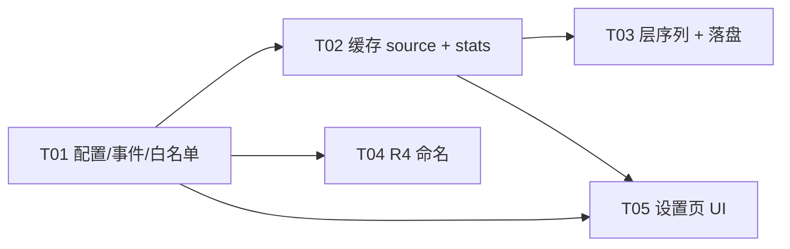

# 曲栏 Barline — v1.8.0 增量架构设计：歌词查询顺序可切换 · 落盘补齐 · 缓存可见

| 项目 | 内容 |
| --- | --- |
| 版本 | `v1.8.0`（新增能力 + 新增配置项） |
| 设计范围 | 只覆盖 `docs/PRD-v1.8.0-歌词顺序与落盘.md` 的 R1–R4；其余行为沿用 `docs/ARCHITECTURE.md` §12.4–12.6 与 v1.7.0 口径 |
| 前提 | Rust 2021 + windows-rs 0.62 + Direct2D + WebView2；`#![deny(warnings)]` |
| 本文件性质 | **纯设计文档**。不改任何源码、不改 PRD、不改 `progress.md`、不动 `deliverables/` |
| 依据基线 | `src/lyric/service.rs`（1102 行）、`src/lyric/cache.rs`（611）、`src/lyric/writeback.rs`（600）、`src/lyric/locate.rs`（363）、`src/settings/bridge.rs`（548）、`assets/ui/index.html`（831） |

---

## 0. 口径裁决与冲突申报（先读这一节）

### 0.1 我落地的顺序口径（与 team-lead 指令一致，与 PRD 正文不一致 → 必须申报）

team-lead 明确本轮用户最新裁决为：

```
local_first = true  →  本地 → 内存 → 磁盘缓存 → 负缓存 → 在线
local_first = false →  内存 → 磁盘缓存 → 本地 → 负缓存 → 在线（= v1.7.0 现状）
```

但 `docs/PRD-v1.8.0-歌词顺序与落盘.md:65` 写的是「`true`：内存 → **本地** → 磁盘 → 负缓存 → 在线」，且 `:283`（风险 6.7）整段论证都是建立在「内存排在最前、因此同一会话内手改 `.lrc` 不生效、需用户二次确认」之上。

**这是本轮唯一一处真正的口径冲突，且是「PRD 落后于用户最新裁决」而非设计分歧。** 处置：

1. 设计按 team-lead 转述的最新裁决落地（**本地排到内存之前**）；
2. 该裁决把 PRD `:283` 的风险 6.7 **直接消解**：本地层在内存层之前，所以「手改 `.lrc` 立刻生效，含正在播放的那首」成立，不再需要「重启后生效」的让步文案；
3. PRD 正文（§2 R1 第 4 条 + §6.7）需由主理人在验收后同步更新 —— 我不改 PRD；
4. 因此 `lyrics.local_first.desc` 文案（PRD §4 `:235`）在「On」分支可以照抄，**不需要**加「重启后生效」字样。文案本身与最终行为一致，无需改字。

### 0.2 我裁定、不再上抛的三件事

| # | 问题 | 裁决 | 一句话理由 |
| --- | --- | --- | --- |
| 1 | 缓存 `source` 怎么透出 | **改签名**（`get_mem`/`get_disk` 返回 `Option<Hit>`），**不加 `*_src` 变体** | 见 §3.1：加变体会让旧函数在非 test 构建里无人调用 → `dead_code` → `deny(warnings)` 直接挂构建 |
| 2 | R2 统计挂哪 | **新增动作 `lyricsCacheStats` + 新消息类型 `cacheStats` + 新方法 `SettingsService::post()`**，**不进 `state`** | 见 §5.2：`state_json` 是纯函数且每次 `set` 都推，把它变成 IO 会污染热路径；更致命的是 `SettingsService::push()` 会覆写 `last_state`（`src/settings/mod.rs:220`），拿它推统计会把窗口重建后的补推内容换掉 |
| 3 | 名字算法放哪 | **放 `writeback::display_stem`，不加 `locate::display_candidates`** | `locate.rs` 本轮必须零 diff（它是「查找侧语义不变」的红线）；命名是落盘侧的事 |

---

## 1. 变更点清单（30 处，按层分组）

> 格式：`文件:行号` → 改什么 → 为什么。行号均为当前工作区实测行号。

### 1.1 配置层（3 处）

| # | 位置 | 改什么 | 为什么 |
| --- | --- | --- | --- |
| C-1 | `src/config/mod.rs:113`（`write_back` 之后） | 新增 `pub local_first: bool` 字段 + 文档注释（默认 false = 磁盘缓存优先；true = 本地文件先查） | R1 需要一个可持久化开关 |
| C-2 | `src/config/defaults.rs:429`（`write_back: true` 之后） | 新增 `local_first: false` | `LyricsConfig` 上有容器级 `#[serde(default)]`（`src/config/mod.rs:99`），serde 用 `Self::default()` 逐字段兜底缺失字段 → 旧 `config.json` 删掉该行后落到 `false` 且不报错（A1.1）。与 `write_back` 同款机制 |
| C-3 | `src/config/defaults.rs:26`（`WRITE_BACK_DEDUP_CAP` 之后） | 新增 `pub const CACHE_STATS_MAX_ENTRIES: usize = 5000;` | R2 的扫描上限。本仓规矩「任何魔法数不许散落」（`src/config/defaults.rs:3-4`），必须进 `limits` |

### 1.2 缓存层（7 处）

| # | 位置 | 改什么 | 为什么 |
| --- | --- | --- | --- |
| K-1 | `src/lyric/cache.rs:190` | `map: HashMap<String, Arc<Lyrics>>` → `HashMap<String, Entry>`；新增私有 `struct Entry { lyrics: Arc<Lyrics>, source: String }` 与公开 `pub struct Hit { pub lyrics: Arc<Lyrics>, pub source: String }` | 内存条目必须记住「这条是从哪来的」；这是 R3「来源为 local 的缓存命中不落盘」（A6.6）的唯一可行来源 |
| K-2 | `src/lyric/cache.rs:209-216` `get_mem` | 返回 `Option<Hit>` | 见 §3 |
| K-3 | `src/lyric/cache.rs:218-230` `get_disk` | 返回 `Option<Hit>`；**回填内存时把 `disk.source` 一起带进 `Entry`** | `DiskLyrics.source` 本来就落盘了（`cache.rs:87-88`，带 `#[serde(default)]`）。若回填时不带 source，第二次播放的内存命中会拿到空 source → 被判为「非本地」→ 又一次落盘，A6.6 失效 |
| K-4 | `src/lyric/cache.rs:233-241` `put` | 内存侧改存 `Entry { lyrics: Arc::new(lyrics.clone()), source: source.to_string() }`；磁盘侧 `DiskLyrics::from_lyrics` 调用**不变** | 保持磁盘格式零变化（`DiskLyrics` 已有 `source` 字段），旧缓存文件继续可读 |
| K-5 | `src/lyric/cache.rs:320-339` `insert_mem` | 入参改 `Entry`；字节核算改 `approx_bytes(&entry.lyrics)`（两处：`:322`、`:336`） | 512 KB 预算与 LRU 淘汰口径不变（`MEM_BUDGET_BYTES`，`cache.rs:62`） |
| K-6 | `src/lyric/cache.rs:361` 之后（`impl Cache` 末尾） | 新增 `pub fn dir() -> PathBuf`（= `crate::platform::data_dir().join("lyrics-cache")`）、`pub struct Stats { dir, files, bytes, truncated }`、`pub fn stats() -> Stats`、`fn collect_stats(dir: &Path, cap: usize) -> (u64, u64, bool)` | R2：路径与占用**同源**。把 `data_dir().join("lyrics-cache")` 收成唯一出处后，`service.rs:203` 与设置页统计不可能漂移（A4.3 的机械保证）；`collect_stats` 可传 `cap` 便于单测用小上限 |
| K-7 | `src/lyric/cache.rs:491`（测试 `roundtrip_through_disk_preserves_everything`） | `let got = c2.get_disk("k1").expect(...)` → `let got = c2.get_disk("k1").expect(...).lyrics;` | 签名变更的连带修改（见 §6.2） |

### 1.3 查询层（7 处）

| # | 位置 | 改什么 | 为什么 |
| --- | --- | --- | --- |
| Q-1 | `src/event.rs:252`（`write_back` 之后） | `LyricRequest` 新增 `pub local_first: bool` | 歌词线程看不到 `Config`，开关必须随请求带过去（与 `write_back` 同款） |
| Q-2 | `src/lyric/service.rs:43` | `use crate::lyric::cache::Cache;` → `use crate::lyric::cache::{self, Cache, Hit};` | 需要 `cache::dir()` 与 `Hit` |
| Q-3 | `src/lyric/service.rs:203` | `Cache::new(crate::platform::data_dir().join("lyrics-cache"))` → `Cache::new(cache::dir())` | 与 R2 统计同源（A4.3） |
| Q-4 | `src/lyric/service.rs:294-382` `query_fast_path` | **层序列 + 单循环**改造（完整伪代码见 §2）；新增模块级 `enum Step { Mem, Disk, Local }`；三个落盘调用点 | R1（两条顺序）+ R3（三条落盘路径），且**禁止复制两份逻辑** |
| Q-5 | `src/lyric/service.rs:478-500` `maybe_write_back` | **签名不变**（`source: &str`），只更新注释：它是落盘唯一收口（`source=="local"` 早退 + `!write_back` 早退 + `wrote` 去重 + `save`） | A7.3 要求「判定收口在单一入口，三个调用点不得各自复制 `if !write_back`」。保持 `&str` 还能让既有 `s4` 测试（`service.rs:1068-1081`）零改动 |
| Q-6 | `src/lyric/service.rs:541-543`（`query_once`，`#[cfg(test)]`） | `if let Some(l) = cache.get_mem(&key) { return (Some((*l).clone()), ...) }` → `if let Some(h) = ... { ... (*h.lyrics).clone() ... }` | 签名变更连带 |
| Q-7 | `src/lyric/service.rs:645-659`（`request_with_id`） | 结构体字面量新增 `local_first: false` | 签名变更连带（`LyricRequest` 只有这一个测试构造点） |

### 1.4 落盘层（6 处）

| # | 位置 | 改什么 | 为什么 |
| --- | --- | --- | --- |
| W-1 | `src/lyric/writeback.rs:54-68` `enum Skip` | 新增变体 `Unsearchable` | 「不变式在极端输入下不成立时宁可 Skip，也不写一个永远命中不了的死文件」的机械落点（§4.3 边界 13）；**同时新增 `check_stem`（`:186`）作为主路径与 title-only 回退路径共用的校验体，回退规则见 §4.1** |
| W-2 | `src/lyric/writeback.rs:44-50`（`Target` 之前） | 新增 `const ILLEGAL: [char; 9] = ['\\','/',':','*','?','"','<','>','|'];` 与私有 `fn sanitize(s: &str) -> String` | 与 `locate::normalize_name`（`locate.rs:52`）用同一套非法字符集，避免两处分叉 |
| W-3 | `src/lyric/writeback.rs:98-126` | `file_name_for` 保留签名（`Option<String>`），改为 `display_stem(track).ok().map(|s| format!("{s}.lrc"))`；`build_file_name` 整体重写为调用新的 `pub fn display_stem(track: &Track) -> Result<String, Skip>` | R4 命名算法抽成**纯函数**并暴露给测试；`file_name_for` 的旧签名保住，既有 W3/W4/W5/W11/W12/W15 大量断言可零改动存活 |
| W-4 | `src/lyric/writeback.rs:144-176` `render_lrc` | **零改动** | A8.5：内容规则不变 |
| W-5 | `src/lyric/writeback.rs:86-96` `resolve_target_dir` / `:188-233` `save` | **零改动**（`save` 内部仍走 `resolve_target` → `build_file_name`，只是名字来源换成 `display_stem`） | 「只新建不覆盖」「惰性建目录」「超长放弃不截断」全部沿用 |
| W-6 | `src/lyric/writeback.rs:293-311`（测试 W1/W2） | 改口径（详见 §6.2） | R4 换名 |

### 1.5 桥接与 UI 层（8 处）

| # | 位置 | 改什么 | 为什么 |
| --- | --- | --- | --- |
| B-1 | `src/settings/bridge.rs:142`（`lyrics.write_back` 分支之后） | 新增 `"lyrics.local_first" => { let Some(v) = value.as_bool() else { return false }; cfg.lyrics.local_first = v; true }` | 白名单是**显式 match 非反射**（`bridge.rs:12-13`），不加就静默拒绝 → 开关永远无效且不报错（v1.7.0 已踩过，见 `bridge.rs:391-393` 注释） |
| B-2 | `src/settings/bridge.rs:67` 之后 | 新增 `pub fn cache_stats_json(st: &crate::lyric::cache::Stats) -> String` | JSON 组装集中在 bridge（与 `state_json`/`toast_json` 同层），可在纯函数级测试 |
| B-3 | `src/settings/mod.rs:224`（`push` 之后） | 新增 `pub fn post(&mut self, json: &str)`：**只** `wv.post(json)`，**不碰** `last_state` | 见 §5.2。这是本轮最容易写错的一处 |
| B-4 | `src/app.rs:1442`（`lyric_request` 内） | 新增 `local_first: self.config.lyrics.local_first,` | 每首歌重建请求（`app.rs:1471`）→ 改动即时生效、无需重启（A2.4） |
| B-5 | `src/app.rs:1749`（`openLogDir` 分支之后） | 新增两个动作分支：`"lyricsCacheStats"`（统计一次并 `settings.post`）与 `"openLyricsCacheDir"`（`ShellExecuteW` 打开 `cache::dir()`） | R2 |
| B-6 | `assets/ui/index.html:273` 之后 | 新增 `local_first` 开关行（`id="lyrics-local-first"`，带 `data-dep="lyrics"`）+ 说明段（`lyrics.local_first.desc`） | R1 的 UI |
| B-7 | `assets/ui/index.html:282` 之后（目录卡片之后） | 新增只读缓存卡片：`lyrics.cache` 标题、`lyrics.cache.path` + 可点路径 `<span class="link" id="lyrics-cache-dir">`、`lyrics.cache.usage`（**不带 `data-i18n`**，见 §5.3 陷阱）、`lyrics.cache.desc` | R2 的 UI |
| B-8 | `index.html:519-526`（nav click）/ `:571-578`（render 歌词段）/ `:654`（`syncLyricsDeps`）/ `:788`（bind）/ `:813-825`（消息处理）/ `:406-414`+`:451-459`（i18n） | 导航切到歌词分区时 `post({type:"action",payload:"lyricsCacheStats"})`；render 里补 `lyrics-local-first` 勾选 + `renderCacheStats()`；新开关 id 进 disabled 列表；`bind` 一行；`cacheStats` 消息分支；zh/en 各 9 条新词条 + 2 条改文案 | 见 §5 |

> 版本号 5 处 + `Cargo.lock:7` 的同步沿用既有出包 SOP（`progress.md:189` 记录），不属于设计变更，由工程师按 T03 执行。

---

## 2. `query_fast_path` 改造后的伪代码与三条硬约束

### 2.1 最小 diff 清单（改前 → 改后）

| 改前（v1.7.0） | 改后（v1.8.0） |
| --- | --- |
| `service.rs:308` `emit(LyricLoading)` 之后直接进第 1 层 | 同一位置 `emit(LyricLoading)`，**紧随其后插入层序列表**（约 8 行） |
| `service.rs:310-318` 内存命中块（`if let` + log + emit + return，9 行） | 删除，并入循环 `Step::Mem` 分支（约 7 行） |
| `service.rs:320-328` 磁盘命中块（9 行） | 删除，并入循环 `Step::Disk` 分支（约 7 行） |
| `service.rs:330-334` `let lq = LyricQuery{..}`（无条件） | 移进循环的 `Step::Local` 分支（**无副作用，等价**） |
| `service.rs:336-348` 本地命中块（13 行） | 删除，并入循环 `Step::Local` 分支（约 15 行） |
| 无 | 循环出口后新增 4 行：`emit(LyricReady)` + `maybe_write_back(...)` + `return` |
| `service.rs:350-358` 负缓存块 | **逐字节不变**（位置仍在三层之后） |
| `service.rs:360-381` 在线派发块 | **逐字节不变** |
| `service.rs:300-306` title 判空 | **逐字节不变** |

净增约 15 行、净删约 31 行（`service.rs` 从 1102 → ≈1086 行）。`maybe_write_back`（`:478-500`）、`on_online`（`:384-476`）、`on_tick`（`:502-521`）全部零改动。

### 2.2 伪代码

```rust
/// v1.8.0：查询层的三个「层」，顺序由 `LyricRequest.local_first` 决定。
/// 存在的唯一理由：两条顺序不许写成两份逻辑（复制粘贴必然漂移）。
#[derive(Clone, Copy, PartialEq, Eq)]
enum Step { Mem, Disk, Local }

fn query_fast_path(&mut self, req: LyricRequest, attempt: u8) {
    let t0 = Instant::now();
    let track_id = req.track_id;
    let key = query::cache_key(&req.track);

    // ① 元数据不足（顺序与 v1.7.0 一致：最先判）
    if req.track.title.trim().is_empty() {
        self.out.emit(AppEvent::LyricMissing { track_id, reason: LyricMissReason::InsufficientMetadata });
        return;
    }
    self.out.emit(AppEvent::LyricLoading { track_id });

    // ② 层序列：一个数组表达一条顺序，逻辑只写一份
    let steps: [Step; 3] = if req.local_first {
        [Step::Local, Step::Mem, Step::Disk]   // 本地优先：手改 .lrc 立刻生效（含正在播放那首）
    } else {
        [Step::Mem, Step::Disk, Step::Local]   // v1.7.0 原序：省时优先
    };

    for step in steps {
        let got: Option<Hit> = match step {
            Step::Mem => {
                let h = self.cache.get_mem(&key);
                if h.is_some() {
                    crate::log_info!("歌词内存命中：{key} 耗时={}ms", t0.elapsed().as_millis());
                }
                h
            }
            Step::Disk => {
                let h = self.cache.get_disk(&key);   // 命中会回填内存并带上 source
                if h.is_some() {
                    crate::log_info!("歌词磁盘命中：{key} 耗时={}ms", t0.elapsed().as_millis());
                }
                h
            }
            Step::Local => {
                let lq = LyricQuery {
                    track: &req.track,
                    local_dirs: &req.local_dirs,
                    online_enabled: req.online_enabled,
                };
                match LocalProvider.fetch(&lq) {
                    Ok(l) => {
                        // ③ 本地内容写回缓存（source="local"）——这是「手改立刻生效」的持久化保证，
                        //    且必须先 put 再 emit（与 v1.7.0 的 service.rs:339-345 同序）。
                        self.cache.put(&key, &l, "local");
                        crate::log_info!("歌词本地命中：{key} 耗时={}ms", t0.elapsed().as_millis());
                        Some(Hit { lyrics: Arc::new(l), source: String::from("local") })
                    }
                    Err(e) => {
                        crate::log_debug!("本地未命中：{}", e.as_str());
                        None
                    }
                }
            }
        };
        let Some(hit) = got else { continue };

        // ④ 先显示：整条快路径最多一次 LyricReady（落盘绝不额外发事件）
        self.out.emit(AppEvent::LyricReady { track_id, lyrics: Arc::clone(&hit.lyrics) });
        // ⑤ 再落盘：单一收口（source=="local" 或 write_back=false 在这里早退）
        self.maybe_write_back(&req, &hit.lyrics, &hit.source);
        return;
    }

    // ⑥ 负缓存（位置与 v1.7.0 一致：三层之后、在线之前）
    if let Some(reason) = self.cache.miss_reason(&key) {
        crate::log_info!("歌词负缓存命中（{reason:?}），{}h 内不再请求：{key}", limits::LYRIC_MISS_TTL_HOURS);
        self.out.emit(AppEvent::LyricMissing { track_id, reason });
        return;
    }

    // ⑦ 在线（逐字节沿用 service.rs:360-381）
    if !req.online_enabled {
        self.out.emit(AppEvent::LyricMissing { track_id, reason: LyricMissReason::OnlineDisabled });
        return;
    }
    let keywords = query::search_keywords(&req.track.title, &req.track.artist);
    let job = OnlineJob { req, attempt, keywords };
    if let Err(e) = (self.dispatch)(job) {
        crate::log_err!("在线歌词线程启动失败：{e}");
        self.out.emit(AppEvent::LyricMissing { track_id, reason: LyricMissReason::NetworkError });
    }
}
```

**借用检查要点**（工程师第一次写必卡这里）：`self.cache.get_mem/get_disk` 返回的是**独占拥有**的 `Hit`（内部 `Arc` clone），调用结束即结束对 `self.cache` 的可变借用；因此循环体内随后 `self.out.emit`（`&self.out`）与 `self.maybe_write_back`（`&mut self`）都不冲突。`Step::Local` 分支里 `lq` 借的是 `req`（局部变量）而非 `self`，与 `self.cache.put` 也不冲突。

### 2.3 三条硬约束（顺序 + 守卫）

| 约束 | 落点 | 为什么不能挪 |
| --- | --- | --- |
| **emit 必须先于落盘** | 循环内 ④ 在 ⑤ 之前；`on_online` 里 `:413-416` 在 `:419` 之前 | 落盘是几 KB 同步 IO（杀软环境下可能几 ms），在**歌词线程**上；先显示后落盘 → UI 无感（A6.7）。反过来写会让「歌词晚出一拍」 |
| **落盘必须收口在 `maybe_write_back`** | 三个调用点（mem / disk / online）都只调这一个函数 | A7.3：`write_back=false` 的判定只允许存在一份。三处各写一遍 `if !req.write_back { return }` 是必被 QA 打回的形态 |
| **代次守卫** | `query_fast_path` 的落盘**不需要新守卫**，但**禁止把落盘搬出去** | `on_request`（`service.rs:286-291`）在调用前已写 `current_track = req.track_id`；`on_tick`（`:502-521`）在调用前已校验 `p.track_id == self.current_track`。worker 单线程、函数内无 await/无重入 → 落盘时刻 `req` 必为当前代次。**一旦有人把落盘挪到 `dispatch` 之后或另起线程，就必须重新引入 `track_id == current_track` 判定** —— 这句话要写进代码注释 |

### 2.4 正面回答：v1.7.0 的「逐字节零改动」承诺失效后，靠什么保证等价

v1.7.0 QA 用 `query_fast_path` 新旧 SHA256 相同（`progress.md:190`，`e9b50990…` / 2877 字符）来证明零改动。本轮该断言**必然失效**（PRD A1.3 的「允许新增 `if` 包裹，不允许改写既有行先后」在字面上也被打破）。替代回归项 = 「逐分支行为等价」六条 + 三项结构红线：

**等价六条（必须逐条有测试或读码证据）**

| E# | 等价内容 | 证据形式 |
| --- | --- | --- |
| E1 | 七处 `emit` 的种类与先后：`LyricMissing(InsufficientMetadata)` → `LyricLoading` → （命中）`LyricReady` → 否则 `LyricMissing(负缓存 reason)` → `LyricMissing(OnlineDisabled)` → 否则派发/`LyricMissing(NetworkError)` | 事件序列断言（`Collector` 已按序记录，`service.rs:570-607`） |
| E2 | 三条命中日志的**文本逐字符不变**：`歌词内存命中：{key} 耗时={}ms` / `歌词磁盘命中：…` / `歌词本地命中：…` | 读码 + 人工 grep；改动后 QA 用 `grep -c` 对照三串 |
| E3 | `耗时` 全部取自同一个 `t0`（循环不重置计时器；`Step::Local` 的日志仍在 `put` 之后） | 读码（§2.2 ②③④） |
| E4 | `LyricLoading` 仍在 title 判空**之后**、层序列**之前** | 读码 |
| E5 | 任何一次调用最多一次 `LyricReady`；落盘不产生任何事件（`maybe_write_back` 只有日志） | `s1`（`service.rs:995`）沿用；新增 S6/S7 同款断言 |
| E6 | `false` 分支的层序列数组**字面**就是 `[Mem, Disk, Local]`，与 v1.7.0 的语句先后一一对应 | 读码 + 数组字面量可被直接审查（这就是「一个数组表达一条顺序」的收益：等价性从「31 行对照」降级为「3 个元素对照」） |

**结构三红线（替代 v1.7.0 的全仓零 diff，必须重跑）**

| R# | 红线 | 判定方式 |
| --- | --- | --- |
| S1 | `src/lyric/locate.rs`、`provider.rs`、`parser.rs`、`query.rs`、`interp.rs`、`src/render/`、`src/platform/`、`src/media/` **零 diff** | `git diff --stat` 逐文件核 |
| S2 | `locate::candidates` 顺序与 `normalize_name` 语义零改动 | 同上（`locate.rs` 零 diff 即自动成立） |
| S3 | `render_lrc`（`writeback.rs:144-176`）零改动、`Cache` 磁盘 JSON 格式零改动 | diff + `roundtrip_through_disk_preserves_everything`（`cache.rs:485`）仍绿 |

---

## 3. `source` 透传：签名变更与逐个调用点

### 3.1 为什么「改签名」而不是「加 `*_src` 变体」

这是 team-lead 要我裁定的第一条。**结论：改签名。支持的论据只有下面两条**，其余一律不成立（见 §3.1.1 更正说明）。

1. **测试伤害面本来就极小 —— 这是主要论据。** 全部 `get_mem`/`get_disk` 调用点仅 8 行（`cache.rs:210,219,491,510,511,608`、`service.rs:311,321,541,833,861`），其中 4 处是 `is_none()/is_some()`，对 `Option<Hit>` **天然不变**；真正需要动的只有 3 处（`cache.rs:491`、`service.rs:541`、`service.rs` 循环内两处），且都不改断言语义（逐条见 §3.3）。改签名的成本 = 3 行，收益 = 全仓再也不会有人拿到「不带 source 的歌词」。
2. **一次改对、语义不分叉。** 若保留 `get_mem` 并新增 `get_mem_src`，两条路径的 `source` 语义就分叉了：`get_mem_src` 返回 source、`get_mem` 不返回，日后必然有人（包括下一轮的我自己）用错那个「不带 source 的」，而用错的后果是「来源为 local 的缓存命中被落盘」——A6.6 静默失效、只多一份副本，**测试还绿**。改签名把这条错误的可能性从「靠人记住」变成「编译期不可能」。

### 3.1.1 更正说明（旧论据作废，防止下轮被误引）

本文档初版曾把「`deny(warnings)` 会打死变体方案」列为第 1 条论据，**该论据是错的，已删除**：

- 工程师核实 `src/main.rs:22` 有 `#![allow(dead_code)]`（全局、且与 `#![deny(warnings)]` 并存时 `allow` 优先），所以「保留旧 `get_mem` 只给测试用」**不会**触发 `dead_code`，更不会挂构建。本仓历史上正是靠这条 `allow` 留着一批待清理的死码（`#![allow(dead_code)]` 上方注释写着「M5 收尾时应移除本行」）。
- 因此「构建会挂」**不构成**理由。若下轮有人引用这句话去论证「必须删旧 API」，会得出错误结论（真实情况是：删不删旧 API 取决于 §3.1 那两条，而不是编译器）。
- 结论不变：**仍选改签名**，依据只剩上面两条。

### 3.2 新签名（`src/lyric/cache.rs`）

```rust
/// 缓存命中：歌词本体 + 来源标识（v1.8.0）。
///
/// `source` 是写这条缓存时的 provider 名（`"local"` / `"lrclib"` / `"netease"` / `"test"`），
/// 也兼容 v1.7.0 之前没有该字段的老缓存文件（`#[serde(default)]` → 空串）。
/// 判定规矩只有一条：`source == "local"` 表示「歌词来自用户自己的 .lrc」，
/// 落盘必须跳过；其余一律落盘。
pub struct Hit {
    pub lyrics: Arc<Lyrics>,
    pub source: String,
}

pub fn get_mem(&mut self, key: &str) -> Option<Hit>;
pub fn get_disk(&mut self, key: &str) -> Option<Hit>;
```

### 3.3 受影响调用点逐个列出

| # | 位置 | 现状 | 改法 | 是否破坏既有断言 |
| --- | --- | --- | --- | --- |
| 1 | `src/lyric/service.rs:311` | `if let Some(l) = self.cache.get_mem(&key)` → 用于 `lyrics: l` | 并入 §2.2 循环 `Step::Mem` | 是（本就在改） |
| 2 | `src/lyric/service.rs:321` | 同上（disk） | 并入循环 `Step::Disk` | 是（本就在改） |
| 3 | `src/lyric/service.rs:541-543` | `if let Some(l) = cache.get_mem(&key) { return (Some((*l).clone()), NotFound) }` | `(*h.lyrics).clone()` | 否（行为不变） |
| 4 | `src/lyric/service.rs:833` | `assert!(w.cache.get_mem(&key).is_none(), ...)` | 不动 | 否 |
| 5 | `src/lyric/service.rs:861` | `assert!(w.cache.get_mem(&...).is_some())` | 不动 | 否 |
| 6 | `src/lyric/cache.rs:491` | `let got = c2.get_disk("k1").expect("磁盘未命中");` 随后用 `got.lines` / `got.kind` / `got.title` | `...expect("磁盘未命中").lyrics;` | 否（本地变量改一处） |
| 7 | `src/lyric/cache.rs:510,511` | `is_none()` / `is_some()` | 不动 | 否 |
| 8 | `src/lyric/cache.rs:608` | `assert!(c.get_disk("bad").is_none())` | 不动 | 否 |

结论：**8 个调用点里只有 3 个需要动，且都不改变断言语义**。这是「改签名」而非「加变体」的第三个理由。

### 3.4 `source` 的取值与判定表

| 写入点 | `source` | 语义 | 落盘？ |
| --- | --- | --- | --- |
| `service.rs:339`（本地命中） | `"local"` | 用户自己的 `.lrc` | ❌ 永不 |
| `service.rs:404`（在线命中） | `query_parallel` 给的 provider 名（`"lrclib"` / `"netease"`，`provider.rs:117`） | 网络来源 | ✅（`write_back` 开时） |
| `service.rs:556`（`query_once`，仅测试） | `"test"` | 测试 | ✅ |
| 老缓存文件（v1.7.0 前，无 `source` 字段） | `""` | 未知来源 | ✅（按「非 local 即落盘」） |

---

## 4. R4：`display_stem` 算法、不变式推导、边界表

### 4.1 算法伪代码（`src/lyric/writeback.rs`）

```rust
/// 落盘文件名主干：`{歌名} - {歌手}`（保留原始大小写/全角），无歌手时退化为 `{歌名}`。
///
/// 四条铁律：
/// 1. 非法字符与控制字符 → **空格**（绝不是 `_`）；
/// 2. 保留设备名 / 主干 >120 码元 → Skip（不截断）；
/// 3. 归一化后必须落在 `locate::candidates(track)` 里（否则 `Skip::Unsearchable`）；
/// 4. **`Unsearchable` 且 artist 非空时，回退到 `{歌名}` 主干再校验一遍**
///    （出包前追加裁决：那是 v1.7.0 的既有行为，也是 `candidates` 的第 3 项）。
///    `Reserved` / `TooLong` **不回退**——title 自己就有问题，换成 title-only 也救不了。
pub fn display_stem(track: &Track) -> Result<String, Skip> {
    let cands = locate::candidates(track);        // 查找侧口径，用它做最终校验
    if cands.is_empty() {
        return Err(Skip::NoName);                 // title 归一化后为空（含 "／" 这类被折成空串的）
    }
    let title = sanitize(&track.title);
    if title.is_empty() {
        return Err(Skip::NoName);
    }
    let artist = sanitize(&track.artist);
    if artist.is_empty() {
        check_stem(&title, &cands)?;              // 无歌手 → 只写歌名，不产出 " - 歌名"
        return Ok(title);
    }

    let stem = format!("{title} - {artist}");     // 连字符两侧各一空格（R4）
    match check_stem(&stem, &cands) {
        Ok(()) => Ok(stem),
        // 唯一允许回退的失败原因：名字本身合法，只是「写出去搜不到」
        Err(Skip::Unsearchable) => { check_stem(&title, &cands)?; Ok(title) }
        // Reserved / TooLong：title 自己有问题，回退成 title-only 也救不了
        Err(other) => Err(other),
    }
}

/// 主干校验：保留设备名 / 长度上限 / 命名不变式。
/// **主路径与 title-only 回退路径共用这一份**（`writeback.rs` 只有一个地方定义「什么算合法主干」）。
fn check_stem(stem: &str, cands: &[String]) -> Result<(), Skip> {
    if is_reserved_name(&stem.to_ascii_uppercase()) { return Err(Skip::Reserved); }  // CON / NUL / COM1-9 …
    if stem.encode_utf16().count() > MAX_STEM_UTF16 { return Err(Skip::TooLong); }   // 120
    // 硬不变式兜底：写出去必须能被 locate::find 命中
    let norm = locate::normalize_name(stem);
    if !cands.iter().any(|c| c == &norm) { return Err(Skip::Unsearchable); }
    Ok(())
}

/// 与 `locate::normalize_name` 用**同一套**非法字符集，但保留大小写与全角。
/// 只做两件事：① 非法字符 + 控制字符 U+0000–U+001F → 空格；② 空白折叠 + 首尾 trim。
fn sanitize(s: &str) -> String {
    let mut out = String::with_capacity(s.len());
    let mut last_space = false;
    for c in s.chars() {
        // ① 非法字符（与 locate.rs:52 同一集合）+ 控制字符 → 空格
        let c = if ILLEGAL.contains(&c) || (c as u32) < 0x20 { ' ' } else { c };
        // ② 空白折叠（含 U+3000 / NBSP / \t / \n，覆盖 char::is_whitespace 全序）
        if c.is_whitespace() {
            if !last_space && !out.is_empty() { out.push(' '); last_space = true; }
        } else {
            out.push(c);
            last_space = false;
        }
    }
    while out.ends_with(' ') { out.pop(); }     // 首部空白天然被 "!out.is_empty()" 挡掉
    out
}
```

> 落地状态（已实现，本文档对齐代码）：`src/lyric/writeback.rs:147-170`（`display_stem` 含回退）、`:186`（`check_stem`）。回退**不是免检通道**：回退后要再走一遍同一个 `check_stem`，仍不成立就 Skip（`W26` 钉住 `title="a\u{1}b"` → `Skip::Unsearchable` 且 `Barline/` 里 0 文件、连目录都不建）。

`file_name_for` 保持旧签名：`display_stem(track).ok().map(|s| format!("{s}.lrc"))`。

### 4.2 不变式推导（逐步骤对照 `normalize_name`，`locate.rs:41-73`）

设 `n(x)` = `normalize_name(x)`，`S(x)` = `sanitize(x)`。要证：

> **I1（等式版）**：artist 非空时 `n(S(title) + " - " + S(artist)) == n(title) + " - " + n(artist)`，而右侧正是 `candidates(track)[1]`（`locate.rs:87`）。
> **I2（无歌手版）**：artist 为空时 `n(S(title)) == n(title)`，即 `candidates(track)[0]`（`locate.rs:89`）。

**第一步：单侧引理 `n(S(x)) == n(x)`（x 不含控制字符时成立）。**

`n` 的四个动作：① 全角 `U+FF01..=U+FF5E` → 半角、`U+3000` → 空格（`locate.rs:47-48`）；② 非法字符 `\ / : * ? " < > |` → 空格（`:52`）；③ `is_whitespace` → 折叠成单个空格、且「输出已非空才写」（`:57-61`）；④ 其余字符 `to_lowercase()` 展开（`:63-65`）；最后 ⑤ 去掉尾部空格（`:69-71`），开头由 `s.trim()`（`:44`）保证。

`S` 与 `n` 的差别只有两处：`S` **不做**①②④（全角折叠、非法字符替换、小写化），`S` **额外**把控制字符变空格。于是：

- ①③④：`S` 完全没动这些字符，`n` 在 `S` 的输出上再做一遍，与直接在 `x` 上做结果相同（这些映射都是逐字符的，且折叠/trim 幂等）。
- ②：两边把**同一集合**映射成空格（`ILLEGAL` 与 `locate.rs:52` 字面一致）。这是 v1.7.0 踩过的坑（换成 `_` 就永远命中不了，`progress.md:181`），本轮继续用空格。
- ③的「输出已非空才写」：`S` 已 trim 掉首部空白，`S(x)` 的首字符必然非空白 → `n` 处理时 `out` 非空与「首字符写入」同时发生，不产生偏移。
- ⑤：`S` 已 trim 尾部空白，`n` 的尾部裁剪成为 no-op。
- 全角斜杠 `／`（U+FF0F）：`S` **保留**它（它不在 `ILLEGAL` 里，是合法文件名字符）；`n` 的处理顺序是「先全角→半角（变 `/`），再非法→空格」，所以 `n(S(x))` 里它是空格，`n(x)` 里它也是空格 —— **两边一致**。这就是「文件名保留全角、命中却不受影响」的机械原因，也是 A8.2 不变式能成立的关键。

∴ 引理得证（x 不含控制字符）。

**第二步：拼接引理。** `S(title)`、`S(artist)` 均已 trim 且内部无连续空白。`n` 处理 `A + " - " + B` 时：A 段逐字符走完（无首空白、无连续空白）；随后空格（out 非空 → 写一个）、`-`（写）、空格（`last_space` 为 false → 写一个）；B 段逐字符走完；尾部无空白需裁。故 `n(A + " - " + B) == n(A) + " - " + n(B)`。

**第三步：合成。** `n(stem) = n(S(title) + " - " + S(artist)) = n(S(title)) + " - " + n(S(artist)) = n(title) + " - " + n(artist)`。而 `candidates(track)` 在 `title`、`artist` 双非空时推入 `format!("{artist} - {title}")` 与 `format!("{title} - {artist}")`（`:86-87`），**第 2 项（0-based `[1]`）正是 `{title} - {artist}`**。∴ I1 成立，I2 由引理第一步直接得出。

**第四步：I1/I2 什么时候**不**成立（必须诚实列出）。**

| 破坏者 | 机理 | 处置 |
| --- | --- | --- |
| `title`/`artist` 含**非空白控制字符**（U+0001–U+0008、U+000E–U+001F） | `n` 不认识它们（既非空白也不在非法表里，`:52-56` 原样保留），`S` 把它们换成空格 → `n(stem)` 侧是空格、`n(x)` 侧是控制字符 → 不等 | Windows 文件名本来就禁止 1–31，无法两全 → `Skip::Unsearchable`（兜底一击） |
| `n(artist) == n(title)` 且双非空（如《晴天》/ 歌手「晴天」） | `candidates` 的 `dedup()`（`:90`）把重复的 `"{artist} - {title}"` 与 `"{title} - {artist}"` 折成一项 → 数组变成 `["晴天 - 晴天", "晴天"]`，`[1]` 不再是 `"{title} - {artist}"` | 命中不受影响（`n(stem)` 仍在候选集合里）→ **强断言放宽为「∈ candidates」**，测试里单独列这一例 |
| `n(title)` 为空但 `S(title)` 非空（如 title 就是 `／`） | `S` 保留 `／`，`n` 把它折成空格再裁空 | 第一条检查 `cands.is_empty()` → `Skip::NoName`（因为 `candidates` 对空 title 直接返回空 vec，`locate.rs:82-84`） |
| `n(artist)` 为空但 `S(artist)` 非空（artist 只有标点：`／` `?` `-` 之类） | 主路径 `{title} - {artist}` 的 `n()` 尾部被裁成 `"{title} -"`，而 `candidates` 里 artist 归一后为空 → 只剩 `["{title}"]` → 主路径 `Unsearchable` | **不是破坏者，是已裁决的回退路径**：`Unsearchable` 且 artist 非空 → 回退 `sanitize(title)` 主干，再走同一个 `check_stem` → 通过就写 `歌名.lrc`（v1.7.0 既有行为 = `candidates` 第 3 项，`W22` 闭环断言钉住）。回退仍不过则 Skip（`W26`） |
| （曾怀疑、实测**不成立**的） title 以 `" - "` 结尾 | `S` trim 掉尾随空格得到 `"晴天 -"`；`n("晴天 - ")` 也 trim 成 `"晴天 -"` → 两边一致，`n(stem) == candidates[1]` | **不是破坏者**。我原假设它会破，逐字符推演后证伪：`n` 的尾部裁剪（`locate.rs:69`）与 `S` 的 trim 作用在同一处空格上 |

### 4.3 边界表（落盘命名全量对照）

| # | `title` / `artist`（原始） | `display_stem` | `n(stem)` | `candidates(track)` | 不变式 | 磁盘文件名 |
| --- | --- | --- | --- | --- | --- | --- |
| 1 | `晴天` / ``（空 artist） | `晴天` | `晴天` | `["晴天"]` | `== [0]` ✅ | `晴天.lrc` |
| 2 | `Hello World` / `Adele` | `Hello World - Adele` | `hello world - adele` | `["adele - hello world","hello world - adele","hello world"]` | `== [1]` ✅ | `Hello World - Adele.lrc`（大小写保留） |
| 3 | `晴天 `（尾空格）/ `周杰伦` | `晴天 - 周杰伦` | `晴天 - 周杰伦` | `["周杰伦 - 晴天","晴天 - 周杰伦","晴天"]` | `== [1]` ✅ | `晴天 - 周杰伦.lrc` |
| 4 | `A/B:C*D` / `X` | `A B C D - X` | `a b c d - x` | `["x - a b c d","a b c d - x","a b c d"]` | `== [1]` ✅ | `A B C D - X.lrc`（无 `_`、无 `/` `:` `*`） |
| 5 | `A／B`（全角 U+FF0F）/ `` | `A／B` | `a b` | `["a b"]` | `== [0]` ✅ | `A／B.lrc`（全角斜杠**保留**，仍能命中） |
| 6 | `第一行\n第二行` / `X` | `第一行 第二行 - X` | `第一行 第二行 - x` | `[…," 第一行 第二行 - x",…]` | `== [1]` ✅ | `第一行 第二行 - X.lrc` |
| 7 | `CON` / `` | — | — | `["con"]` | **Skip::Reserved** | 不写 |
| 8 | `CON` / `X` | `CON - X` | `con - x` | `["x - con","con - x","con"]` | `== [1]` ✅ | `CON - X.lrc`（只有裸 `CON` 是保留名，`CON - X` 合法） |
| 9 | `"a"×120` / `` | 120 码元 | — | — | Ok（恰好 120） | `aaa….lrc` |
| 10 | `"a"×121` / `` | — | — | — | **Skip::TooLong** | 不写 |
| 11 | `"a"×120` / `X` | 124 码元 | — | — | **Skip::TooLong**（v1.7.0 下能写，本轮不能 → 记为已接受退化） | 不写 |
| 12 | `晴天（Live）` / `周杰伦` | `晴天（Live） - 周杰伦` | `晴天(live) - 周杰伦` | `[…,"晴天(live) - 周杰伦",…]` | `== [1]` ✅ | 全角括号保留 |
| 13 | `a\u{1}b` / `X` | 主路径 `a b - X`；回退 `a b` | `a b - x` / `a b` | `["x - a\u{1}b","a\u{1}b - x","a\u{1}b"]` | ❌ 主路径与**回退都不成立** → **Skip::Unsearchable**（`W26`） | 不写（宁可不写也不写死文件；连 `Barline/` 目录都不建） |
| 14 | `晴天` / `"   "`（纯空白） | `晴天` | `晴天` | `["晴天"]` | `== [0]` ✅ | `晴天.lrc` |
| 15 | `晴天` / `／`（artist 只含标点） | 主路径 `晴天 - ／` → `Unsearchable` → **回退 `晴天`** | `晴天` | `["晴天"]` | `== [0]` ✅（回退路径） | **`晴天.lrc`**（v1.7.0 既有行为，`W22` 闭环断言：落盘后 `locate::find` 命中同一路径） |
| 16 | `晴天` / `晴天` | `晴天 - 晴天` | `晴天 - 晴天` | `["晴天 - 晴天","晴天"]`（dedup） | `∈` ✅（`== [0]`，≠ `[1]`） | `晴天 - 晴天.lrc` |
| 17 | `abc...` / `` | `abc...` | `abc...` | `["abc..."]` | `== [0]` ✅ | `abc....lrc`（尾点**不裁**，v1.7.0 W5 教训） |
| 18 | `晴天 - ` / `周杰伦` | `晴天 - - 周杰伦` | 同左 | `["周杰伦 - 晴天 -","晴天 - - 周杰伦","晴天 -"]` | `== [1]` ✅（§4.2 第四步已推演） | `晴天 - - 周杰伦.lrc` |
| 19 | `晴天` / `Adele`，且目标目录极长 | — | — | — | **Skip::TooLong**（`save` 内 `MAX_PATH_UTF16`=259，`writeback.rs:202`） | 不写 |

> 落盘位置不变：`local_dirs[0]/Barline/`（`writeback.rs:86-96`）；内容规则不变（`render_lrc` 零改动，A8.5）。

### 4.4 必须落成测试的那一条（A8.3）

**不是比字符串，是闭环找回来**：

```
save(&t, &dirs, &lyrics) 返回 Written(path)
  → 立刻 locate::find(&t, &dirs) 必须是 Some(hit)
  → 且 hit.path == path            ← 逐字节路径相等
```

理由：`locate::find_in`（`locate.rs:131-142`）拿 `index_dir` 建的 `n(file_stem) → path` 索引去查 `candidates`，所以「命中同一路径」等价于「我写名字时用的归一化口径与查找侧完全一致」——这正是 v1.7.0 W5/W15 闭环断言的加强版（`writeback.rs:337-366`、`573-590`）。

---

## 5. 设置页桥接与 UI

### 5.1 `lyrics.local_first` 白名单

```rust
// src/settings/bridge.rs，接在 "lyrics.write_back" 分支（:137-142）之后
// v1.8.0：歌词查询顺序（false = 磁盘缓存优先，保持 v1.7.0 现状；true = 本地文件优先）
"lyrics.local_first" => {
    let Some(v) = value.as_bool() else { return false };   // 只认 JSON 布尔
    cfg.lyrics.local_first = v;
    true
}
```

`as_bool()` 语义（A3.4）：只有 JSON `true` / `false` 通过；`"yes"`、`"true"`、`1`、`0`、`null` 全部 `None` → 走 `return false` → **配置不变**、`apply_set` 返回 `false` → `app.rs:1661-1663` 直接 `return Vec::new()`（不保存、不重推 state）。与 `write_back` 用例同款（`bridge.rs:391-403`）。

### 5.2 R2：新增动作 + 新消息类型（裁定，附「为什么不选另一种」）

**裁定：新动作 `lyricsCacheStats` + 新消息类型 `cacheStats` + 新方法 `SettingsService::post()`。**

为什么不复用 `state` 增字段，三条硬理由：

1. **`state_json` 是纯函数且是热路径。** `bridge::state_json(cfg, version, conflicts)`（`bridge.rs:51`）被 `app.rs:1620/1695/1790/1838/1859/1975` 六处调用，其中 `:1695` 是**每一次** `set` 之后。往里塞 `read_dir` = 用户拨滑条时扫目录；`state_json_contains_config_and_version`（`bridge.rs:538`）也不再是纯测试。A5.3 明确禁止。
2. **`push()` 会覆写 `last_state`。** `src/settings/mod.rs:219-224`：`push` 先 `self.last_state = Some(json)` 再转发。若把统计结果当普通消息 `push` 进去，`last_state` 就变成 `cacheStats`；下次窗口重建时 `push_last()`（`mod.rs:227-231`）会把 `cacheStats` 当状态补推 → 页面永远收不到 `state`（所有控件空白）。**所以必须新增不碰 `last_state` 的 `post()`**。
3. **统计与状态生命周期不同。** state 是「配方的全量快照」，cacheStats 是「一次点查的结果」，两者重推语义不同：state 要缓存重推，cacheStats 绝不能重推（否则窗口重建时会凭空多一次扫描，A5 的数次会飘）。

实现（`src/app.rs`，接在 `openLogDir` 分支 `:1734-1749` 之后）：

```rust
"lyricsCacheStats" => {
    // 只数顶层文件、上限 CACHE_STATS_MAX_ENTRIES；不建目录、不递归、不改任何文件
    let st = crate::lyric::cache::stats();
    crate::log_info!(
        "设置页：统计歌词缓存 {} → {} 个文件 / {} 字节{}",
        st.dir.display(), st.files, st.bytes,
        if st.truncated { "（已达上限，早停）" } else { "" }
    );                                   // ← A5.2「恰好一次扫描日志」的判定依据
    self.settings.post(&crate::settings::bridge::cache_stats_json(&st));
}
"openLyricsCacheDir" => {
    let dir = crate::lyric::cache::dir();          // 与歌词线程同源
    let w = to_wide(&dir.to_string_lossy());
    // SAFETY: w 以 NUL 结尾且在本调用期间存活（与 :1737-1747 同款）
    unsafe { windows::Win32::UI::Shell::ShellExecuteW(/* … 同 openLogDir … */); }
    crate::log_info!("设置页：打开歌词缓存目录 {}", dir.display());
}
```

`cache::stats()` 的契约（放 `src/lyric/cache.rs`）：

```rust
pub fn stats() -> Stats { let d = dir(); let (f, b, t) = collect_stats(&d, limits::CACHE_STATS_MAX_ENTRIES); Stats { dir: d, files: f, bytes: b, truncated: t } }
// collect_stats：read_dir 只读顶层；目录不存在 → (0,0,false)，不报错不建目录（A4.4）；
// 达到 cap 立即停止并把 truncated 置 true（A5.6）
```

消息形状（PRD `:104` 已定，不增字段）：

```json
{"type":"cacheStats","payload":{"dir":"E:\\…\\数据目录\\lyrics-cache","files":93,"bytes":421888,"truncated":false}}
```

`dir` 由 Rust 组装下发 → JS **不拼路径**（A4.3；`index.html` 内不得出现 `lyrics-cache` 字面量）。

### 5.3 HTML 侧控件与词条

**新增 1 个开关行 + 1 张只读卡片 + 9 条新词条 + 2 条改文案。**

控件（`index.html:273` 之后、`:282` 之后）：

```html
<!-- 1) local_first 开关行（放在「歌词保存到本地」之后，二者语义相邻） -->
<div class="row" data-dep="lyrics">
  <div><div class="label" data-i18n="lyrics.local_first">本地歌词文件优先</div>
    <div class="desc" data-i18n="lyrics.local_first.desc">…（见 PRD §4 :235 全文）…</div></div>
  <div class="right"><label class="switch"><input type="checkbox" id="lyrics-local-first"><span class="track"></span><span class="knob"></span></label></div>
</div>

<!-- 2) 只读缓存卡片（放在「本地歌词目录」卡片之后；data-dep 让它随「显示歌词」置灰） -->
<div class="card" id="lyrics-cache-card" data-dep="lyrics">
  <h2 data-i18n="lyrics.cache">歌词磁盘缓存</h2>
  <div class="row">
    <div><div class="label" data-i18n="lyrics.cache.path">缓存位置</div>
      <div class="desc link" id="lyrics-cache-dir" title="">—</div></div>
    <button class="btn" id="lyrics-cache-open" data-i18n="lyrics.cache.open.hint">点击打开文件夹</button>
  </div>
  <div class="row">
    <div><div class="label" data-i18n="lyrics.cache.usage">…</div>
      <div class="desc" data-i18n="lyrics.cache.desc">…（见 PRD §4 :242）…</div></div>
    <div class="right"><span id="lyrics-cache-usage">—</span></div>
  </div>
</div>
```

> ⚠ 注意上面两处**都不是最终形态**：`lyrics.cache.usage` 这一行的 label 只放静态部分，**动态占用文本必须放在不带 `data-i18n` 的 `#lyrics-cache-usage`**；`#lyrics-cache-dir` 同理由 JS 填。

**⚠ 本轮第二大陷阱（工程师必踩）：`render()` 会抹掉动态文本。**
`index.html:557-559` 对**所有** `[data-i18n]` 元素做 `el.textContent = t(...)`。若把占用文本塞进带 `data-i18n="lyrics.cache.usage"` 的元素，则用户在歌词分区里拨任何一个开关 → `state` 回推 → `render()` → 占用文本被打回成含 `{files}` `{size}` 的**原始模板字串**（A5.3 要求的「不重新统计」做到了，但显示会变成乱码）。正确做法：

```js
let cacheStats = null;            // {dir, files, bytes, truncated}；JS 侧唯一真相

function fmtSize(bytes) {         // 人类可读：B / KB / MB，1 位小数
  if (bytes < 1024) return bytes + " B";
  if (bytes < 1024 * 1024) return (bytes / 1024).toFixed(1) + " KB";
  return (bytes / 1024 / 1024).toFixed(1) + " MB";
}
function renderCacheStats() {     // 纯格式化，零 IO；render() 与消息处理各调一次
  const dirEl = document.getElementById("lyrics-cache-dir");
  const useEl = document.getElementById("lyrics-cache-usage");
  if (!cacheStats) { dirEl.textContent = "—"; useEl.textContent = t("lyrics.cache.scanning"); return; }
  dirEl.textContent = cacheStats.dir;
  dirEl.title = cacheStats.dir;
  const key = cacheStats.truncated ? "lyrics.cache.usage.more" : "lyrics.cache.usage";
  useEl.textContent = t(key)
    .replace("{files}", String(cacheStats.files))
    .replace("{size}", fmtSize(cacheStats.bytes));
}
```

于是：语言切换（`state` → `render()` → `renderCacheStats()`）只重排文字、**不重扫**；`cacheStats` 到达时覆盖 `cacheStats` 变量再调一次 → 天然幂等覆盖（A5.2 的「重推时直接覆盖」）。

**扫描触发（恰好三处，别处一律不许）：**

```js
// ① 导航点击（覆盖 A5.2 的「首次点歌词」与 A5.4 的「切走再切回」）
document.querySelectorAll("nav button").forEach((btn) => {
  btn.addEventListener("click", () => {
    … 现有高亮切换 …
    if (btn.dataset.group === "group-lyrics") requestCacheStats();
  });
});
// ② 打开设置页时若初始落在歌词分区（当前默认是外观 → 正常路径不触发，A5.1 零扫描）
//    放在首次 state 渲染之后：
let firstState = true;
// message 分支里：if (msg.type === "state") { state = msg.payload; render();
//   if (firstState) { firstState = false;
//     const g = document.querySelector("nav button.active")?.dataset.group;
//     if (g === "group-lyrics") requestCacheStats(); } }
function requestCacheStats() {
  cacheStats = null;                                  // 立刻回「统计中…」
  renderCacheStats();
  post({ type: "action", payload: "lyricsCacheStats" });
}
```

**明令禁止（A5.5）**：`setInterval` / `setTimeout` 轮询、后台线程、`WM_TIMER`、`render()` 内重扫。`toast()`（`index.html:510-516`）里已有 `setTimeout`（1400ms 自动隐藏），与统计**无关**，QA grep 时必须能区分——所以统计相关代码里**不许出现**任何 `setTimeout`。

**词条（zh 追加到 `:437` 前，en 追加到 `:482` 前）：**

| 键 | zh | en |
| --- | --- | --- |
| `lyrics.local_first` | 本地歌词文件优先 | Prefer local lyric files |
| `lyrics.local_first.desc` | PRD §4 `:235` 全文（关=磁盘缓存优先…开=每次切歌先扫本地目录…） | 同 PRD 英文 |
| `lyrics.cache` | 歌词磁盘缓存 | Lyric disk cache |
| `lyrics.cache.path` | 缓存位置 | Cache folder |
| `lyrics.cache.open.hint` | 打开文件夹 | Open folder |
| `lyrics.cache.usage` | `{files} 个文件 · {size}` | `{files} files · {size}` |
| `lyrics.cache.usage.more` | `{files}+ 个文件 · {size}` | `{files}+ files · {size}` |
| `lyrics.cache.scanning` | 统计中… | Counting… |
| `lyrics.cache.desc` | PRD §4 `:242` 全文 | 同 PRD 英文 |

**改文案（`lyrics.writeback` 与 `lyrics.writeback.desc`，zh `:413` / en `:458`，HTML 里 `:270-271` 同步）**：换成 PRD §4 `:244` 的版本（标签「歌词保存到本地」+ 说明覆盖三条来源 + 文件名规则 + 顺序说明）。`lyrics.sub`（zh `:406` / en `:451`）换成 PRD §4 `:245`。**这两处必须改**：R3 之后旧文案「在线歌词保存到本地 / 在线命中的歌词会保存…」与实际行为不符。

**其余 JS 接线 4 行**：
- `:788` 之后：`bind("lyrics-local-first", "lyrics.local_first", "bool");`
- `:654` 的 disabled 数组加 `"lyrics-local-first"`；
- `:571-578` render 歌词段加 `document.getElementById("lyrics-local-first").checked = c.lyrics.local_first;` 与 `renderCacheStats();`
- `:813-825` 消息分支加 `else if (msg.type === "cacheStats") { cacheStats = msg.payload; renderCacheStats(); }`
- 新增 `#lyrics-cache-open` 的 click → `post({type:"action", payload:"openLyricsCacheDir"})`

---

## 6. 测试计划

### 6.1 新增用例（编号 + 断言内容）

**缓存层（`src/lyric/cache.rs`，C 系列）**

| 编号 | 断言 |
| --- | --- |
| C1 `get_mem_returns_source` | `put("k",&l,"lrclib")` → `get_mem("k")` 的 `hit.source == "lrclib"` |
| C2 `get_disk_returns_source_and_backfill_keeps_it` | `put` 后**新建** `Cache` 实例 → `get_disk` 的 source == `"lrclib"`；**紧接着 `get_mem` 仍为 `"lrclib"`**（回填不丢 source —— A6.6 二次播放的命门） |
| C3 `legacy_disk_file_without_source_is_empty` | 手写不含 `source` 的 JSON → `get_disk` 的 source == `""`，不 panic（`DiskLyrics.source` 的 `#[serde(default)]`，`cache.rs:87-88`） |
| C4 `stats_counts_top_level_only` | 临时目录 3 个文件 + 1 个子目录（内含 1 文件）→ `collect_stats(dir, 5000)` == `(3, 3 文件和, false)`；目录不存在 → `(0,0,false)`（A4.4） |
| C5 `stats_truncates_at_cap` | `collect_stats(dir, 3)` 对 7 个文件 → `(3, …, true)`（用小 cap 测，别真造 5007 个文件） |

**落盘层（`src/lyric/writeback.rs`，W 系列续编）**

| 编号 | 断言 |
| --- | --- |
| W16 `display_stem_title_dash_artist_table` | 表驱动 A8.1 四条：`晴天/周杰伦`→`晴天 - 周杰伦`；`Hello World/Adele`→`Hello World - Adele`；`A/B:C*D/X`→`A B C D - X`；`晴天/""`→`晴天` |
| W17 `display_stem_keeps_case_and_fullwidth` | `hello world/adele` 输入**大小写原样**；`晴天（Live）` 的全角括号原样保留（`n()` 折平但文件名不动） |
| W18 `display_stem_sanitizes_illegal_and_control` | `A/B:C*D?E"F<G>H\|I` → 空格分隔且**不含 `_`**；`\u{1}`、`\t`、`\r\n` → 空格；连续空白折叠成 1 个 |
| W19 `display_stem_reserved_and_length` | `CON`/`nul`/`com1`/`lpt9` → `Err(Reserved)`；`com0`/`lpt0` → Ok；120 通过、121 → `Err(TooLong)`（沿用 W3/W4 语义） |
| W20 `display_stem_invariant_membership` | 12 组输入（§4.3 表 1/2/3/4/5/6/8/12/14/16/17/18）断言 `candidates(t).iter().any(\|c\| c == &normalize_name(&stem))`；当 `n(title) != n(artist)` 时**额外**断言 `normalize_name(&stem) == candidates(t)[1]`（第 16 行「晴天/晴天」仅走 membership） |
| W21 `saved_file_found_at_same_path` | **A8.3 闭环**，表驱动 8 组（大小写 / 全角斜杠 / 全角冒号 / U+3000 / 尾点 / 全角括号 / 空 artist / 长名恰好 120）→ `save` 为 `Written` → `locate::find` 命中且 `hit.path == 落盘 path` |
| W22 `artist_only_punctuation_falls_back_to_title` | **出包前追加裁决的闭环断言**（已实现，`writeback.rs:911`）：`title="晴天" artist="／"` → `display_stem == Ok("晴天")`、`file_name_for == Some("晴天.lrc")`；`save` 为 `Written` 且 `locate::find` 命中**同一路径**。比「文件名等于 `晴天.lrc`」强：同时证明回退出来的名字能被查找侧认出来 |
| W23 `fullwidth_solidus_kept_but_still_hits` | `title="A／B"` → 磁盘文件名含 `／`，且 `locate::find` 命中同一路径（证明「保留全角不影响命中」） |
| W24 `old_style_name_still_hits` | 目录里只有 `周杰伦 - 晴天.lrc` → `locate::find` 命中（A8.4；`candidates[0]` 口径未变） |
| W25 `no_dead_file_when_invariant_breaks` | 泛化保护：断言 Skip 路径**不写 `wrote` 集合**、日志为 `歌词不落盘：Unsearchable`（`wrote` 在 `save` 之前记账，Skip 后不得残留） |
| W26 `title_with_control_char_still_skips` | **回退不是免检通道**（已实现，`writeback.rs:946`）：`title="a\u{1}b" artist="X"` → 主路径与回退路径都过不了 `check_stem` → `Err(Unsearchable)`；`save` 为 `Skipped(Unsearchable)` 且 `Barline/` 里 0 文件、**连目录都不建**。若有人为「尽量落一份」放宽校验，这里会写出 `a b.lrc` 死文件 |

**查询层（`src/lyric/service.rs`，S 系列续编）**

| 编号 | 断言 |
| --- | --- |
| S6 `mem_hit_writes_back` | **A6.2 / v1.7.0 的缺口**：先在线命中落盘一次 → 删 `Barline/` → 同曲再 `on_request`（内存命中）→ 文件重新出现 1 个，事件仍只有 1 个 `LyricReady` |
| S7 `disk_hit_writes_back` | **A6.3 且反转旧 s5**：预置 `cache.put(...,"lrclib")`（新 `Cache` 实例模拟重启）→ `on_request` → 磁盘命中 → 落盘 1 个 |
| S8 `cache_hit_with_local_source_never_writes_back` | **A6.6**：预置 `put(...,"local")` → 内存命中与磁盘命中**两条路径**各断言 `Barline/` 为空且 `w.wrote` 为空 |
| S9 `local_first_true_prefers_local_over_memory` | **A2.1/A2.3 的进程内版**：cache 里放 `BBB`(source=lrclib)，本地放 `zz测试曲.lrc` 内容含 `AAA` → `local_first=true` → 事件里的歌词文本是 `AAA`，且 cache 的 `get_mem().source == "local"`、磁盘 JSON 的 `source` 也是 `"local"` |
| S10 `local_first_false_prefers_cache` | 同前置、`local_first=false` → 显示 `BBB`（证明层序未错排；同时证明 `false` 时本地层没被提前） |
| S11 `local_hit_never_writes_back` | **A6.5**：只有本地文件、cache 空、`write_back=true`、两种 `local_first` 各跑一遍 → `Barline/` 不新增 |
| S12 `write_back_off_writes_nothing_all_paths` | **A7.1**：`write_back=false` × {内存命中, 磁盘命中, 在线命中} → `Barline/` 目录**不存在或为空** |
| S13 `emit_precedes_writeback` | 给 `Collector` 加一个 `probe: Option<PathBuf>`：在 `emit` 回调里记下 `read_dir(probe/Barline).count()`。断言该值为 **0**（即 emit 那一刻文件还没写）→ A6.7 的机械证明（不需要读日志文件） |
| S14 `stale_generation_still_does_not_write` | 沿用并加强 `s3`（`service.rs:1036-1064`）：旧代不落盘、不记账 —— 确认循环改造没把守卫绕掉 |

**桥接/配置层**

| 编号 | 断言 |
| --- | --- |
| B1 `apply_set_lyrics_local_first` | `apply_set(…,"lyrics.local_first",&json!(true))` → true 且字段为 true；`json!(false)` → false；`json!("yes")` → 返回 false 且字段**不变**（A3.4） |
| B2 `cache_stats_json_shape` | `cache_stats_json(&Stats{..})` 解析回来：`type=="cacheStats"`，`payload.files/bytes/truncated` 类型正确，`payload.dir` 非空 |
| P1 `config_without_local_first_defaults_false` | 反序列化一份**不含** `local_first` 的 `LyricsConfig`/`Config` JSON（或写临时 config.json 走 `Config::load`）→ `local_first == false`、无 serde 错误（A1.1） |

**只能人工验收（无自动化，写进 QA 清单）**：A4.2（改数据目录后路径跟随）、A5.1–A5.4（零/一次/不新增/再扫一次）、A3.2–A3.3（双语无裸键、1280×800 不截断）、A2.4（切歌即时生效）。

### 6.2 因签名/口径变更必须同步修改的既有测试（逐个文件:行号）

| # | 位置 | 用例 | 改什么 | 依据 |
| --- | --- | --- | --- | --- |
| M1 | `src/lyric/cache.rs:491` | `roundtrip_through_disk_preserves_everything` | `.expect("磁盘未命中")` 后加 `.lyrics` | 签名变更 |
| M2 | `src/lyric/service.rs:541-543` | `query_once`（helper） | `(*l).clone()` → `(*h.lyrics).clone()` | 签名变更 |
| M3 | `src/lyric/service.rs:645-659` | `request_with_id` | 字面量加 `local_first: false` | 结构体新增字段 |
| M4 | `src/lyric/service.rs:998-1005` | `s1_online_hit_writes_back_and_emits_one_ready` | 文件名断言从 `candidates()[0] + ".lrc"` 改为 `writeback::file_name_for(&req.track)`（**并注明「v1.8.0 R4 改口径」**） | A8.6 |
| M5 | `src/lyric/service.rs:1084-1101` | `s5_disk_cache_hit_does_not_write_back` | **语义反转**：改名为 `s7_disk_cache_hit_does_write_back`（= 新增 S7），原文件注释「防止有人把钩子塞进 query_fast_path」**必须改写**，否则注释与本轮设计直接矛盾 | R3 / A6.3 |
| M6 | `src/lyric/writeback.rs:294-300` | `w1_file_name_equals_first_candidate` | 改为断言 `晴天 - 周杰伦.lrc`（= `candidates[1]`），注明改口径 | A8.1/A8.6 |
| M7 | `src/lyric/writeback.rs:302-311` | `w2_illegal_chars_become_spaces_not_underscores` | `assert_eq!(name, format!("{}.lrc", first))` 改为断言 `name == "A B C D E.lrc"`；保留「不得含 `_`」「必须含空格」两条 | A8.1/A8.6 |

**明确不需要改（我逐条核过，这是省钱的地方）**：`w3`（保留名）、`w4`（120/121）、`w5`（尾点，`abc...` 无 artist → 名字仍是 `abc....lrc`，其断言 `== format!("{}.lrc", candidates[0])` 依然成立）、`w6`–`w15`、`s2`/`s3`/`s4`、`cache.rs:510/511/608`、`bridge.rs` 全部既有用例、`query.rs`/`locate.rs`/`parser.rs` 全部用例（这两文件零 diff，断言自然不动）。

**版本号**：`Cargo.toml` / `main.rs` 等 5 处 + `Cargo.lock:7` 按既有 SOP 升 `1.8.0`（`progress.md:189` 有清单），不属本设计。

---

## 7. 风险、行为矩阵与回退

### 7.1 行为矩阵（缓存来源 × 本地文件 × 是否落盘 × 显示哪一份）

设：`src` = 命中缓存条目的 `source`；「本地有文件」= `local_dirs[*]` 或 `%LOCALAPPDATA%\Barline\lyrics` 或 `%USERPROFILE%\Music` 里存在可命中的 `.lrc`（`locate.rs:95-114`）。

**`local_first = false`（默认，= v1.7.0 顺序）**

| # | 内存 | 磁盘 | src | 本地有文件 | 显示 | 落盘（write_back=true） |
| --- | --- | --- | --- | --- | --- | --- |
| F1 | 命中 | — | ≠local | 任意 | 内存内容 | ✅ 一次 |
| F2 | 命中 | — | `local` | 任意 | 内存里的旧本地内容 | ❌ |
| F3 | 未命中 | 命中 | ≠local | 任意 | 磁盘内容 | ✅ 一次 |
| F4 | 未命中 | 命中 | `local` | 任意 | 磁盘内容 | ❌（A6.6） |
| F5 | 未命中 | 未命中 | — | **有** | 本地文件 | ❌（A6.5） |
| F6 | 未命中 | 未命中 | — | 无 | 在线内容 | ✅ 一次（A6.1） |
| F7 | 未命中 | 未命中 | — | 无、在线关闭 | `LyricMissing(OnlineDisabled)` | ❌ |
| F8 | 未命中 | 负缓存命中 | — | 有 | **`LyricMissing(reason)`**（负缓存挡在本地之前，`service.rs:350-358`） | ❌ |

> **F1/F3 的产品隐患（必须留档）**：`src≠local` 而用户自己在 `local_dirs[1]` 里已有 `.lrc` 时，仍会往 `local_dirs[0]/Barline/` 写一份副本 —— 因为缓存优先、本地层根本没被查。PRD R3 的判定是「来源 ≠ 本地就落盘」，方案 (a) 已被明确排除（team-lead 裁定：不许命中后再跑一次 `locate::find`）。**本轮接受**：单份几 KB，且用户只要开 `local_first` 就自动消失。

> **F8 是 v1.7.0 就存在的语义**（负缓存排在本地之后），本轮层序列调换**不影响**它：`local_first=true` 时本地层提前 → 本地命中会先赢过负缓存，这是顺序切换的合理副作用（本地有文件却说「暂无歌词」才是错的）。

**`local_first = true`（新顺序）**

| # | 本地有文件 | 缓存 | src | 显示 | 落盘 |
| --- | --- | --- | --- | --- | --- |
| T1 | **有**（即使缓存里有别的版本） | 任意 | 任意 | **本地文件（最新手改）** | ❌ 且 `cache.put(...,"local")` 覆盖缓存（A2.3） |
| T2 | 无 | 内存命中 | ≠local | 内存内容 | ✅ |
| T3 | 无 | 内存命中 | `local` | 内存里的旧本地内容 | ❌（就地「自愈」不了，见 §7.2 风险 4） |
| T4 | 无 | 磁盘命中 | ≠local | 磁盘内容 | ✅ |
| T5 | 无 | 磁盘命中 | `local` | 磁盘内容 | ❌ |
| T6 | 无 | 全未命中 | — | 在线 | ✅ |
| T7 | **有**（只有 `%USERPROFILE%\Music` 里有） | 任意 | — | 本地文件（可能不在 `local_dirs` 内 → 落盘目标仍是 `local_dirs[0]`） | ❌ |

**所有行的共同前置**：`write_back=false` → 落盘列全部变 `❌`（判定收口在 `maybe_write_back`，`service.rs:483-485`）；`title` 空 → 直接 `LyricMissing(InsufficientMetadata)`，不进任何层。

### 7.2 风险与已知取舍（8 条，全部有处置）

| # | 风险 | 影响 | 处置 |
| --- | --- | --- | --- |
| 1 | **`local_first=true` 时每次切歌多一次 `index_dir`**（深 ≤4、条 ≤5000，`locate.rs:23-25`/`:147-188`） | 歌词线程上几十~上百 ms；不卡 UI（UI 只收事件），但该首歌词晚出，且延后同线程下一请求 | 文案已写「目录越大越慢」。**注意本轮比 v1.7.0 更重**：即使内存命中也要先付这笔扫描费，这正是「手改立刻生效」的价格 |
| 2 | **`R4` 换名后 v1.7.0 写下的旧文件永不再被写、且优先生效** | `Barline/` 里可能同时有 `周杰伦 - 晴天.lrc`（旧）与 `晴天 - 周杰伦.lrc`（新）；`candidates[0]` 是 `歌手 - 歌名` → **旧文件在 `locate::find` 里胜出** | 两者内容通常一致；若用户手改过旧文件，恰好是用户想要的。不做迁移/删除（绝不删用户目录文件）。留档即可 |
| 3 | **长名退化**：`title` 恰好 120 码元时，追加 ` - artist` 后超限 → `Skip::TooLong` | v1.7.0 能写、本轮不写 | 不截断（截断必产生死文件，v1.7.0 已论证）。`Skip::TooLong` 只落 `log_debug`，用户无感 |
| 4 | **`src=local` 的缓存条目在本地文件被删后不会自愈**（T3/T5） | 用户删了 `.lrc`，缓存里还留着它的内容且标 `local` → 不落盘重建；要等 30 天 TTL（`limits::LYRIC_DISK_TTL_DAYS`）或清缓存 | 本轮不修（要修得引入「缓存里的 local 是否仍对应磁盘文件」的校验 = 又一次扫盘）。留档为下一轮候选 |
| 5 | **控制字符标题永不落盘**（§4.3 第 13 行，**含 title-only 回退路径**） | 极罕见，且 Win32 本来禁止 1–31 | `Skip::Unsearchable` + `log_debug`。**这是刻意的：宁可不写，也不写一个永远命中不了的死文件**。回退不是免检通道（`W26`） |
| 6 | **R3 让 `Barline/` 增长更快且只增不减** | 听 1000 首约几十 MB（`progress.md:193` 已接受） | 无配额、无清理 UI（本轮不做）。文案说明可安全删除 |
| 7 | **R3 增加歌词线程同步 IO 次数** | 缓存命中也会各尝试一次 `create_new`（同会话被 `wrote` 去重）。文件不存在时真写几 KB | 全部在歌词线程，`emit` 已先发，UI 无感。`WRITE_BACK_DEDUP_CAP=64` 沿用 |
| 8 | **B 站类标题落盘名与候选名不等**（PRD `:271-272`，缓存键摘平台后缀但落盘名用原始 `track`） | 上报风格变化时命中不了，且「只新建不覆盖」→ 无效文件永久留存 | 本轮不修（修它要破坏「落盘名与查找侧机械等价」这条更重要的性质）。W20/W21 的不变式把「与当前 track 一致」锁死 |

### 7.3 回退方案（三条，按代价从小到大）

| 级别 | 动作 | 效果 |
| --- | --- | --- |
| 回退 1（零代码） | 用户在设置页把「本地歌词文件优先」关掉 | 回到 v1.7.0 层序（`[Mem, Disk, Local]`），其余新能力（三条落盘 + 新文件名 + 缓存可见）全部保留 |
| 回退 2（单点开关） | `write_back` 关掉 | 三路径零落盘（`maybe_write_back` 收口保证），`R4` 命名也不生效 |
| 回退 3（发版级） | `git revert` 本轮提交 | 因 `locate.rs`/`provider.rs`/`parser.rs`/`query.rs`/`render/` 全程零 diff，revert 不会连带其它模块；唯一的跨版本遗留是 `Barline/` 里可能已有新式命名文件（`locate` 靠 `candidates` 也能命中，**无需清理**）——这正是不在 `locate.rs` 里加 `display_candidates` 的额外收益 |

---

## 8. 本轮必须重新回归的范围（v1.7.0 零改动承诺已失效）

### 8.1 失效的旧断言（必须撤销，不能"保留着看看"）

| 旧断言 | 出处 | 处置 |
| --- | --- | --- |
| `query_fast_path` 新旧 SHA256 相同（`e9b50990…`，2877 字符） | `progress.md:190` | **作废**，替换为 §2.4 的 E1–E6 + S1–S3 |
| `locate/provider/cache/parser/query/interp` + `render/platform/media/main` **全部零 diff** | 同上 | **收窄**：`cache.rs` 必然改（K 系列）；其余 8 个模块仍须零 diff（S1） |
| 「既有 472 条断言零放宽」 | `progress.md:189` | **例外**：M1–M7 七条按 §6.2 修改，其中 M5 是语义反转。其余断言一条不得放宽（A8.6 的同款纪律） |
| `s5_disk_cache_hit_does_not_write_back` | `service.rs:1084` | **反转**（见 M5）。这是本轮最容易「测试还绿但功能没做」的地方 |

### 8.2 必须重跑/加强的既有断言

1. **全量 `cargo test`**：基线 494（493 passed + 1 ignored，`progress.md:4`）→ 预期 494 − 0 + 新增 ≈ 26 条 ≈ **520**；`check`/`clippy`/`build` 全绿、clippy 0 警告（`deny(warnings)` 下 `Skip::Unsearchable` 必须真有构造路径，否则直接编译失败）。
2. **`s1`–`s5` 全部重跑**（`service.rs:976-1101`）：其中 `s5` 反转、`s1` 换断言、`s2`/`s3`/`s4` 应原样通过 —— **`s4` 原样通过是「`maybe_write_back` 签名没动」的证明**。
3. **`w1`–`w15` 全部重跑**：`w3`/`w4`/`w5`/`w6`–`w15` 应原样通过（§6.2 已逐条论证），`w1`/`w2` 按新口径改。若 `w5` 挂了，说明有人又在 `display_stem` 里加了尾点裁剪 —— 立刻打回。
4. **`cache.rs` 全部 9 条重跑**：`memory_lru_evicts_beyond_capacity`（`:502`，用 `c.map.len()`）与 `memory_cache_respects_byte_budget`（`:517`，用 `c.mem_bytes`）必须在 `Entry` 改造后仍绿 —— 这两条是「512 KB 预算没被改坏」的唯一证据。
5. **`bridge.rs` 全部重跑** + 新增 B1/B2：`state_json_contains_config_and_version`（`:538`）必须绿，证明**没有**往 `state` 里塞统计字段。
6. **QA 独立复核四项**（读码即可判定）：
   - a. `maybe_write_back` 仍是**唯一**判定点：`grep -n "write_back" src/lyric/service.rs` 只应命中 `:483` 与测试；
   - b. 循环里 `emit` 在 `maybe_write_back` **之前**（§2.2 ④⑤）；
   - c. `lyrics-cache` 字面量在 `assets/ui/index.html` 里**零出现**，且 `data_dir().join("lyrics-cache")` 全仓**只出现一次**（`cache::dir()`）；
   - d. 统计代码里**零** `setTimeout`/`setInterval`，且 `SettingsService::push` 的调用点没有新增（统计走 `post`）。
7. **真机 12 项人工验收**（A1.1 / A2.1–A2.4 / A3.1–A3.3 / A4.1–A4.4 / A5.1–A5.4 / A6.1–A6.7 / A7.1–A7.2 / A8.4）：其中 A6.2（内存命中落盘）与 A6.6（local 命中的缓存不落盘）是**本轮唯二的两条新行为**，必须真机各跑一遍；其余是既有行为的回归。

---

## 9. 工程师最容易做错的两处（给 team-lead 的对话摘要用）

1. **`Cache::get_disk` 回填内存时丢掉 `source`**（`cache.rs:227-228`）。写完 `insert_mem(key, lyrics)` 却忘了带 `source` → 第一次播放（磁盘命中）落盘正常，**第二次播放**（内存命中）source 变空串 → 被判「非 local」→ 又落盘一次；A6.6 的场景（`put(...,"local")` → 重启 → 磁盘命中 → 再播 → 内存命中）会**先对后错**，测试若只跑一遍就漏掉。C2 专门锁这一条。

2. **拿 `SettingsService::push()` 推 `cacheStats`**（`mod.rs:219`）。`push` 会覆写 `last_state`，于是窗口重建后 `push_last()` 补推的是 `cacheStats` 而非 `state` → 设置页所有控件空白，而且**只在"关掉设置窗口再打开"时复现**，正常 QA 顺序（开着窗测）照样全绿。必须用新增的 `post()`。

---

## 10. 任务分解（供工程师排期，≤5 个任务）

| Task | 名称 | 源文件 | 依赖 | 优先级 |
| --- | --- | --- | --- | --- |
| T01 | 配置层 + 事件层 + 桥接白名单（`local_first` 全链打通到线程） | `src/config/mod.rs`、`src/config/defaults.rs`、`src/event.rs`、`src/settings/bridge.rs`、`src/app.rs:1434-1442` | — | P0 |
| T02 | 缓存层 `source` 透传 + `cache::dir()/stats()` | `src/lyric/cache.rs`、`src/lyric/service.rs:43/203/541-543` | T01 | P0 |
| T03 | `query_fast_path` 层序列改造 + 三路径落盘 + 测试改造 | `src/lyric/service.rs:294-382` + `:976-1101` | T02 | P0 |
| T04 | R4 命名：`display_stem` + `sanitize` + `check_stem` + `Skip::Unsearchable` + **title-only 回退** + W 系列测试（含 W22 闭环 / W26 回退失败仍 Skip） | `src/lyric/writeback.rs` | T01 | P0 |
| T05 | 设置页：`post()` + 两个新动作 + HTML/i18n + 版本号 5 处 | `src/settings/mod.rs`、`src/app.rs:1749`、`assets/ui/index.html`、`Cargo.toml`、`Cargo.lock` | T01,T02 | P0 |

依赖图：



---

## 11. 假设与不确定项（无一是"建议进一步评估"，全部给了处置）

| # | 事项 | 我的处置 |
| --- | --- | --- |
| A-1 | `collect_stats` 的"文件数"是否含负缓存文件（`miss-*.json`） | **含**。PRD `:102` 说「缓存目录是平铺的 `<hex>.json` / `miss-<hex>.json`」并只要求"顶层文件数 + 总字节"，与 `sweep` 的口径一致（`cache.rs:277-316` 也把两类一起算）。若 QA 用 PowerShell 数文件对照，两边都会数到 `miss-*` |
| A-2 | 体积文本在 Rust 还是 JS 格式化 | **JS**（`fmtSize`）。PRD 的 payload 已定 `bytes` 为数字（`:104`），且 i18n 模板 `{files} 个文件 · {size}` 由 JS 渲染；`KB/MB` 本身是跨语言通用单位，不必进 i18n |
| A-3 | `local_first` 是否也影响 `query_once`（测试 helper） | **不影响**。它只用于 `local_file_hit_never_touches_network` 等纯 provider 链测试，与层序列无关；保持现状可让该测试零改动 |
| A-4 | 循环里 `Step::Local` 的 `lq` 从"无条件构造"改成"分支内构造"是否改变行为 | **不改变**。`LyricQuery` 只持有三个借用（`provider.rs:26-34`），构造无副作用；`LocalProvider::fetch`（`provider.rs:83-101`）才做 IO |
| A-5 | 是否要给 `Lyrics` 结构体加 `source` 字段 | **不加**。`source` 是"缓存条目的属性"不是"歌词的属性"；加进 `Lyrics` 会波及 `parser`/`interp`/`DiskLyrics` 三处序列化（S1 红线） |
