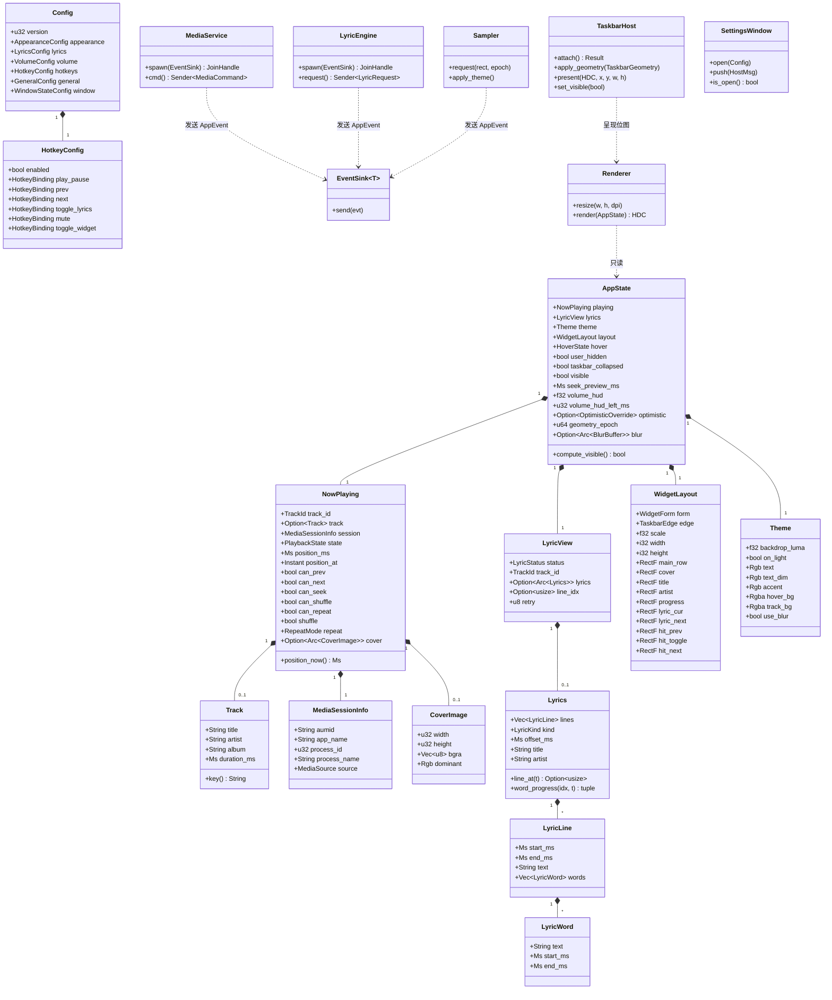
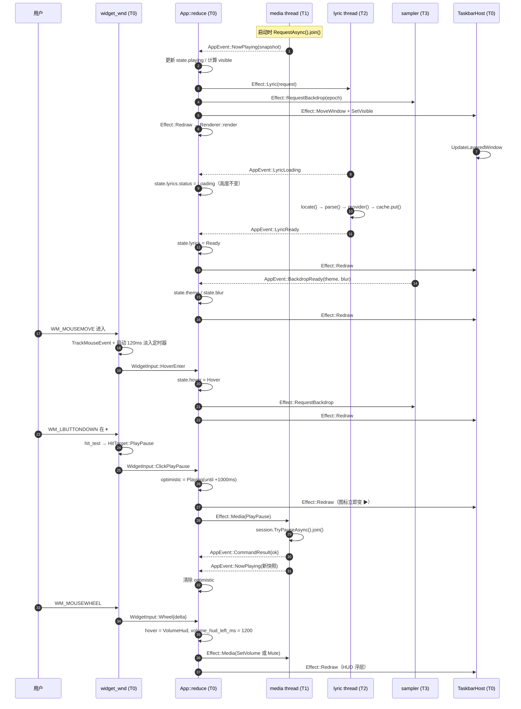
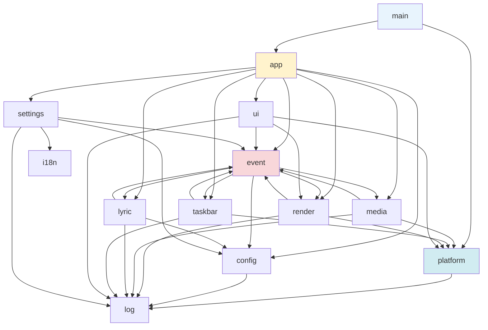

# 曲栏 Barline — 系统架构设计

| 项目 | 内容 |
| --- | --- |
| 文档 | `docs/ARCHITECTURE.md` |
| 版本 | v1.0（对应 PRD v0.0.1） |
| 作者 | 高见远（架构师） |
| 上游输入 | `docs/PRD.md`（501 行 / 30 条需求 / P0 16 条） |
| 下游产出 | `docs/TASKS.md`（20 个任务 / 5 个里程碑） |
| 语言/框架 | Rust 2021 + `windows` 0.62.2 + `webview2-com` 0.39.1 |
| 交付形态 | 便携版单 exe，目标 ≤ 8 MB，硬上限 10 MB，常驻 ≤ 40 MB |

> 本文档中所有 Win32 / WinRT / COM 签名均已在 **windows 0.62.2 与 webview2-com-sys 0.39.1 的
> 真实源码**中逐条核对（见 §2.3 验证清单），不是凭记忆书写。标注 `【实测】` 的结论有编译/运行证据。

---

## 目录

1. [设计前提与已锁定决策](#1-设计前提与已锁定决策)
2. [实测验证记录](#2-实测验证记录)
3. [实现路径与难点分析](#3-实现路径与难点分析)
4. [体积与内存预算](#4-体积与内存预算)
5. [模块划分与文件树](#5-模块划分与文件树)
6. [线程模型与 COM 初始化](#6-线程模型与-com-初始化)
7. [核心数据结构](#7-核心数据结构)
8. [消息枚举（模块间唯一耦合点）](#8-消息枚举模块间唯一耦合点)
9. [关键 Win32 / WinRT API 清单](#9-关键-win32--winrt-api-清单)
10. [任务栏内嵌技术方案](#10-任务栏内嵌技术方案)
11. [渲染管线、亮度自适应与悬停模糊](#11-渲染管线亮度自适应与悬停模糊)
12. [歌词引擎](#12-歌词引擎)
13. [WebView2 设置页桥接](#13-webview2-设置页桥接)
14. [横切关注点](#14-横切关注点)
15. [构建链路与 Git Bash 坑](#15-构建链路与-git-bash-坑)
16. [风险清单](#16-风险清单)
17. [待确认与假设](#17-待确认与假设)

---

## 1. 设计前提与已锁定决策

以下为**不可推翻**的约束，本设计全部据此展开，不再讨论替代方案。

| # | 项 | 决策 |
| --- | --- | --- |
| D1 | 语言/框架 | Rust 2021 edition，`windows` crate 0.62.2 |
| D2 | 小组件渲染 | Direct2D + DirectWrite 逐像素透明自绘；`WS_EX_LAYERED` + `UpdateLayeredWindow` |
| D3 | 小组件定位 | 覆盖在任务栏条带内、贴 `TrayNotifyWnd` 左侧 8px；**不是浮窗、不是 deskband** |
| D4 | 设置主页面 | WebView2 + 本地 HTML/CSS（Fluent 风格，中英双语） |
| D5 | 媒体识别 | SMTC 为主 + WASAPI 会话枚举兜底 |
| D6 | 歌词 | 本地 .lrc 优先 → lrclib.net → 行内插值逐字 |
| D7 | 交付 | 便携版单 exe，≤ 8 MB（硬上限 10 MB），常驻 ≤ 40 MB |
| D8 | 开机自启 | HKCU Run 键（Win32 Registry API，**不用 `reg.exe`**） |
| D9 | 快捷键 | `RegisterHotKey`，6 组可自定义 |

主理人对 PRD §10 待确认问题的拍板（已转化为设计约束）：

| # | 拍板结论 | 落地方式 |
| --- | --- | --- |
| R1 | 在线歌词仅 lrclib.net，必须抽象 `LyricProvider` trait | §12.4，默认 `LrclibProvider`，失败降级"暂无歌词"，不阻塞 UI |
| R2 | WebView2 缺失 → 小组件照常工作；打开设置页时弹原生提示框引导下载；**绝不内置运行时** | §13.6，`GetAvailableCoreWebView2BrowserVersionString` 预检 |
| R3 | 点击封面回退 → 内置主流播放器映射表（AUMID + 进程名双路），未命中走 Bing 兜底 | §14.5 |
| R4 | 快捷键冲突 → 提示标红但允许保留 | §14.6 |
| R5 | 体积目标 8 MB，硬上限 10 MB | §4 |

---

## 2. 实测验证记录

### 2.1 环境

| 项 | 值 |
| --- | --- |
| Rust | 1.99.1，`stable-x86_64-pc-windows-msvc` |
| Cargo registry | `rsproxy-sparse` 镜像（`D:\APP\Rust\cargo`） |
| MSVC | BuildTools `14.44.35207`，`C:\Program Files (x86)\Microsoft Visual Studio\2022\BuildTools` |
| Windows SDK | `10.0.26100.0` |
| WebView2 Runtime | `156.0.4314.58`（`GetAvailableCoreWebView2BrowserVersionString` 实测返回） |
| 主屏 | 2560×1440 |

### 2.2 关键实测结论【实测】

1. **`IAsyncOperation::get()` 在 0.62.2 中不存在。** `windows` 0.62 把异步类型迁到了独立 crate
   `windows-future` 0.3.2，阻塞取值的方法叫 **`.join()`**，不是 `.get()`。
   > `impl<T: RuntimeType> IAsyncOperation<T> { pub fn join(&self) -> Result<T> }`
   > 内部实现：若状态为 `Started`，创建一个 COM 可等待事件 + `SetCompleted` 回调，然后阻塞等待。
   > **这条是本项目最容易踩的第一个坑**——网上 90% 的 SMTC 示例代码用的是 `get()`，直接抄会编译不过。
2. **事件订阅方法不带 `Add` 前缀。** 是 `PlaybackInfoChanged(handler)` / `MediaPropertiesChanged(handler)`
   / `CurrentSessionChanged(handler)` / `SessionsChanged(handler)`，不是 `AddPlaybackInfoChanged`。
3. **`webview2-com-sys` 在 MSVC 下静态链接 `WebView2LoaderStatic`**（`src/lib.rs` 里
   `link(name = "WebView2LoaderStatic", kind = "static")`）→ **不需要外带 `WebView2Loader.dll`**，
   便携单 exe 成立。所有 WebView2 API 都在 `webview2_com_sys::Microsoft::Web::WebView2::Win32::*`
   路径下，不是 crate 根。
4. **`webview2-com` 的 COM 方法名是 PascalCase，不是 `get_/put_`**：
   `CoreWebView2()`、`SetBounds(rect)`、`SetIsVisible(bool)`、`SetParentWindow(hwnd)`、`Close()`。
5. **体积实测**：把本设计要用的**全部** windows feature + `webview2-com` + `serde` + `serde_json`
   写进一个冒烟程序，用本文 §4.3 的 release profile 编译 → **`featcheck.exe` = 143,360 字节（140 KB）**。
   → 8 MB 预算有 ~55 倍余量，**体积不是本项目的真实瓶颈**，工程重点应放在渲染流畅度与稳定性上。
6. **SMTC 实跑通过**：同一冒烟程序成功 `RequestAsync().join()` 拿到 manager，读到当前曲目标题
   （实跑时读到 "爱不会绝迹"），说明 `Media_Control` feature 与 MTA 线程模型成立。
7. **D2D / DWrite / WIC 全部实跑通过**：`D2D1CreateFactory`、`DWriteCreateFactory`、
   `CoCreateInstance(&CLSID_WICImagingFactory)` 均成功。
8. **`vswhere.exe` 在本机查不到任何 VS 实例**（`-products *` 返回空，因为 BuildTools 未写入
   VS Installer 数据库 / `%ProgramData%\Microsoft\VisualStudio\Packages` 为空）。
   → 构建脚本**不能**依赖 vswhere 作为主路径，必须用目录探测。见 §15。
9. **`CreateWicBitmapRenderTarget` 需要额外开 `Win32_Graphics_Dxgi_Common` feature**，
   否则该方法整个不存在（源码上是 `#[cfg(all(feature="Win32_Graphics_Direct2D_Common",
   feature="Win32_Graphics_Dxgi_Common", feature="Win32_Graphics_Imaging"))]`）。
10. **`HWND` 不实现 `Send`/`Sync`**（`#[repr(transparent)] pub struct HWND(pub *mut c_void)`，
    只有 `Clone/Copy/Debug/PartialEq/Eq`）。跨线程持有窗口句柄必须自己包一层 newtype + `unsafe impl Send`。

### 2.3 已逐条核对的 API 签名

见 §9 完整清单。核对方式：直接读取
`D:\APP\Rust\cargo\registry\src\rsproxy.cn-*\windows-0.62.2\src\Windows\...\mod.rs` 与
`webview2-com-sys-0.39.1\src\bindings.rs` 中的真实生成代码。

---

## 3. 实现路径与难点分析

### 3.1 核心难点（按风险降序）

| # | 难点 | 本质 |
| --- | --- | --- |
| H1 | **在任务栏条带内做逐像素透明自绘，且不能遮挡托盘图标** | 任务栏是 Explorer 的私有窗口，没有任何官方"插件位"；只能做 top-level 分层窗口覆盖上去，并实时跟随托盘区几何 |
| H2 | **分层窗口无法用 DWM acrylic 做模糊背景** | `SetWindowCompositionAttribute` 的 ACCENT_ENABLE_ACRYLICBLURBEHIND 对 `UpdateLayeredWindow` 窗口无效（该路径要求窗口有 DWM 背景，分层窗口没有）。必须自己在 CPU 上抓屏 + box blur 出背景图 |
| H3 | **亮度自适应时抓屏会抓到自己** | `GetDC(NULL)` + `BitBlt` 拿到的是**已合成**的桌面，包含我们自己的文字与封面。直接取平均亮度会被自己的内容污染 |
| H4 | **`WS_EX_NOACTIVATE` 窗口收不到滚轮消息** | `WM_MOUSEWHEEL` 按焦点路由，不激活的窗口拿不到 |
| H5 | **WinRT 异步 + COM 套间** | SMTC 的 `RequestAsync().join()` 会阻塞调用线程；在 STA（UI 线程）上阻塞会卡死消息泵 |
| H6 | **Explorer 重启 / 托盘图标增减 / 任务栏四方位 / 自动隐藏 / 多 DPI** 的组合爆炸 | 几何探测必须做成"任何输入变化 → 重新计算 → 幂等应用"的纯函数 |
| H7 | **体积与内存** | 已实测证明体积充裕（140 KB）；内存才是真约束（D2D/WIC 资源 + 封面缓存 + 歌词缓存 + WebView2 峰值 150 MB） |

### 3.2 技术选择与理由

| 能力 | 选择 | 理由 / 排除项 |
| --- | --- | --- |
| 窗口与系统 API | `windows` 0.62.2 | 唯一官方绑定；按 feature 裁剪可把未用 API 全部编掉（实测 140 KB 含全部所需 feature） |
| 逐像素透明 | `WS_EX_LAYERED` + `UpdateLayeredWindow` | 唯一能同时做到「真逐像素 alpha」+「alpha=0 处鼠标穿透」的方案。排除 `SetLayeredWindowAttributes`（只支持整窗 alpha 或色键，做不出抗锯齿圆角与柔边） |
| 绘制 | Direct2D（`ID2D1RenderTarget` from WIC bitmap）+ DirectWrite | 硬件加速抗锯齿文字/图形；`CreateWicBitmapRenderTarget` 直接画进一张 32bpp 位图，正好喂给 `UpdateLayeredWindow` 的 `hdcSrc` |
| 封面解码 | WIC（`IWICImagingFactory`） | 系统自带，零体积。排除 `image`/`imageproc`（+1.5 MB 且需自己实现缩放） |
| 模糊 | 自研 3 次 box blur（可分离，整数累加） | 分层窗口用不了 acrylic（H2）。box blur ×3 ≈ 高斯，CPU 成本可忽略（见 §11.4） |
| 媒体 | SMTC（`Windows.Media.Control`）+ WASAPI | 唯一能拿到全系统任意播放器元数据 + 播控的官方通道 |
| 网络 | WinHTTP（`Win32_Networking_WinHttp`） | 系统自带、支持系统代理、零体积。排除 `reqwest`（+tokio + TLS 栈，+3 MB） |
| JSON | `serde` + `serde_json` | 配置 + lrclib 响应 + WebView2 桥接协议三处共用，一套就够 |
| 设置页 | WebView2 + 内联 HTML/CSS/JS | 系统自带运行时（Win11 预装），`webview2-com-sys` 静态链接 loader，零外部 DLL |
| 单实例 | `CreateMutexW` 命名互斥体 + `FindWindowW` + `PostMessageW` | 跨会话隔离用 `Local\` 前缀（PRD P0-13 要求"跨会话不互相干扰"） |
| 热键 | `RegisterHotKey` | 系统级、零轮询、零 CPU |
| 自启 | `RegSetValueExW` / `RegDeleteValueW`（HKCU） | 无需管理员；本机 `reg.exe` 被沙箱禁，必须走 API |

### 3.3 架构模式

**分层 + 单向数据流（Elm 风格）**，而不是 MVC/MVVM：

```
   ┌──────────── 采集层（工作线程，只产出事实） ────────────┐
   │  media::smtc   media::wasapi   lyric::*   taskbar::watcher  │
   └───────────────────────┬──────────────────────────────┘
                           │ AppEvent（std::sync::mpsc）
                           ▼
   ┌──────────── 状态层（UI 线程，唯一真相源） ──────────────┐
   │  app::App::state: AppState   （纯数据，无 Win32 句柄）      │
   │  app::App::reduce(evt) -> Vec<Effect>                    │
   └───────────────────────┬──────────────────────────────┘
                           │ Effect（需要产生副作用时才出现）
                           ▼
   ┌──────────── 表现层（UI 线程，有句柄，无状态） ───────────┐
   │  render::painter   ui::widget_wnd   settings::*  ui::tray  │
   └──────────────────────────────────────────────────────┘
```

- **状态层**只做纯计算：`AppState` 里没有任何 `HWND`/COM 指针，可单测。
- **表现层**接收 `&AppState` 后渲染，不持有业务状态。
- **采集层**只发事件，不知道 UI 存在。
- 唯一跨模块耦合点是 `AppEvent`（§8）与 `AppState`（§7）。

**为什么不用 MVVM**：没有 XAML、没有数据绑定引擎，引入 ViewModel 层只是多一层转发。
**为什么不用 actor 模型**：线程只有 4 条，`mpsc` + 单一消息枚举足够，额外抽象只增加体积与心智负担。

---

## 4. 体积与内存预算

### 4.1 依赖白名单（最终版）

```toml
[dependencies]
windows        = "0.62.2"   # 必须，feature 按 §4.2 精确裁剪
webview2-com   = "0.39.1"   # 设置页；间接依赖 webview2-com-sys（静态链接 WebView2Loader）
serde          = { version = "1", features = ["derive"] }
serde_json     = "1"

[build-dependencies]
embed-resource = "3.0.12"   # 编译 assets/barline.rc（图标 + VERSIONINFO + manifest）
```

**不加**（本设计已证明不需要）：

| 候选 | 结论 | 原因 |
| --- | --- | --- |
| `once_cell` / `parking_lot` | 不加 | `std::sync::OnceLock`（1.70+）与 `std::sync::Mutex` 已足够；`parking_lot` 只省几 ns，对 60 fps 自绘无意义 |
| `anyhow` / `thiserror` | 不加 | 内部错误用 `Result<T, AppError>`（自定义枚举）+ `windows::core::Error`，日志只需 `Display` |
| `log` / `tracing` | 不加 | 自研 `log.rs`（约 120 行）写 `%LOCALAPPDATA%\Barline\barline.log`，可控轮转 |
| `rand` | 不加 | 不需要随机数 |
| `unicode-width` / `unicode-segmentation` | 不加 | 歌词切分只需"CJK 单字 / 拉丁词"两级判断，`char::is_ascii_alphabetic` + 码点区间足够（§12.3） |

### 4.2 `windows` feature 清单（已核对存在性）

```toml
windows = { version = "0.62.2", features = [
  # ---- 基础 ----
  "Win32_Foundation",
  "Win32_System_Threading",
  "Win32_System_LibraryLoader",
  "Win32_System_SystemInformation",

  # ---- COM / WinRT ----
  "Win32_System_Com",
  "Win32_System_Com_StructuredStorage",   # PROPVARIANT（IMMDevice::Activate 需要）
  "Win32_System_Ole",
  "Win32_System_Variant",
  "Win32_System_WinRT",

  # ---- 窗口 / 任务栏 ----
  "Win32_UI_WindowsAndMessaging",
  "Win32_UI_Shell",
  "Win32_UI_Shell_Common",
  "Win32_UI_HiDpi",
  "Win32_UI_Input_KeyboardAndMouse",      # RegisterHotKey / HOT_KEY_MODIFIERS
  "Win32_UI_Accessibility",               # SetWinEventHook / WINEVENTPROC

  # ---- 图形 ----
  "Win32_Graphics_Gdi",                   # BitBlt / CreateDIBSection / BLENDFUNCTION
  "Win32_Graphics_Dwm",                   # DwmFlush / DwmGetWindowAttribute
  "Win32_Graphics_Direct2D",
  "Win32_Graphics_Direct2D_Common",
  "Win32_Graphics_Dxgi_Common",           # 【必需】CreateWicBitmapRenderTarget 的 cfg 条件
  "Win32_Graphics_DirectWrite",
  "Win32_Graphics_Imaging",               # WIC

  # ---- 音频 ----
  "Win32_Media_Audio",                    # IMMDeviceEnumerator / IAudioSessionManager2 / IAudioSessionControl2
  "Win32_Media_Audio_Endpoints",          # IAudioEndpointVolume / IAudioMeterInformation

  # ---- 网络 / 注册表 ----
  "Win32_Networking_WinHttp",
  "Win32_System_Registry",

  # ---- WinRT ----
  "Foundation",
  "Foundation_Collections",
  "Media",
  "Media_Control",
  "Storage",
  "Storage_Streams",
  "Graphics_Imaging",
] }
```

> **不要**开 `Win32_UI_Controls`、`Win32_Graphics_Direct3D*`、`Win32_Media_MediaFoundation`、
> `Web_*`、`Data_*`、`Devices_*`。每多开一个顶层 feature，编译期与二进制都会长。
> 校验方法：`cargo tree -e features -p windows` 确认没有意外引入。

### 4.3 `Cargo.toml` 全文

```toml
[package]
name         = "barline"
version      = "0.0.1"
edition      = "2021"
rust-version = "1.82"
description  = "曲栏 Barline — Windows 11 任务栏媒体播控小组件"
authors      = ["Barline"]

[[bin]]
name = "barline"
path = "src/main.rs"

[dependencies]
windows = { version = "0.62.2", features = [
  # ...（同 §4.2，此处省略以节省篇幅，实际文件必须逐条列全）
] }
webview2-com = "0.39.1"
serde        = { version = "1", features = ["derive"] }
serde_json   = "1"

[build-dependencies]
embed-resource = "3.0.12"

[profile.release]
opt-level     = "s"      # 见下方说明
lto           = "fat"
codegen-units = 1
panic         = "abort"
strip         = true
incremental   = false
overflow-checks = false

[profile.release.package."*"]
opt-level = "s"

[profile.dev]
opt-level = 0
debug     = 1            # 行号级调试信息，不进 release
```

**`opt-level` 选型结论：用 `"s"` 而不是 `"z"`。**

理由（基于实测，不是偏好）：
- 实测全 feature 冒烟程序在 `"z"` + `lto=fat` + `codegen-units=1` + `panic=abort` + `strip` 下是 **140 KB**。
- 真实程序预计 600 KB – 1.2 MB（多出的是业务逻辑 + 内联 HTML/CSS/JS 约 60–80 KB + 图标 20 KB），
  距离 8 MB 有 7 倍以上余量。
- 本项目 CPU 热点是**每秒 30–60 次的 D2D 绘制**与**每帧的歌词插值二分查找**，`"z"` 会关闭向量化并
  倾向体积优化，对浮点布局计算有可感知损失；`"s"` 在体积上只比 `"z"` 大 3–8%，但运行时明显更好。
- **降级预案**：若 M5 实测 > 8 MB（极不可能），把 `opt-level` 改 `"z"` 即可回退，无需改架构。

**`panic = "abort"`**：本项目无 `catch_unwind` 需求，abort 省掉 unwind 表（约 100–200 KB）。
注意：所有可能 panic 的位置（`unwrap`）在代码规范里被禁止（§4.6）。

### 4.4 内存预算分解（常驻 ≤ 40 MB 的达成路径）

| 项 | 预算 | 说明 |
| --- | --- | --- |
| 进程基线（Rust runtime + 已加载 DLL 私有页） | 3–5 MB | 无 GC、无运行时 |
| Direct2D / DirectWrite 工厂 + 文本格式 | 2–4 MB | 工厂全局单例；`IDWriteTextFormat` 只建 4 个（标题/歌手/歌词/按钮） |
| 双缓冲位图（最大 340×90 @ 150% = 510×135 × 4B × 2） | 0.6 MB | 只在尺寸变化时重建 |
| 封面位图缓存 | ≤ 1.5 MB | 64×64 BGRA × 8 张 = 128 KB + WIC 解码器开销 |
| 模糊背景缓冲 | ≤ 0.5 MB | 降采样后 170×45 |
| 歌词内存 LRU | ≤ 1 MB | 8 首 × 平均 60 行 × ~80 B |
| 采样 DIB | 0.2 MB | 复用同一块 |
| 栈 × 4 线程 | 4 MB | 媒体/歌词线程显式 `stack_size(256 * 1024)` |
| **小计（设置页未开）** | **≈ 12–16 MB** | 目标 40 MB，余量充足 |
| WebView2 进程（设置页打开时，独立进程） | 80–140 MB | **不计入常驻**（PRD P0-14 允许峰值 ≤ 150 MB，且 WebView2 是独立进程） |

**关键约束**：
- 设置窗口关闭时必须 `controller.Close()` + 释放全部 WebView2 COM 引用 + 删除宿主窗口，
  确保下一次打开是冷启动而不是泄漏累积。**不允许**隐藏窗口保留 WebView2 实例（会常驻 80 MB+）。
- 封面位图与歌词缓存都必须走 LRU，容量写死为常量（§7.6）。

### 4.5 禁用清单（硬性）

| 禁用 | 原因 |
| --- | --- |
| `reqwest` / `hyper` / `tokio` / `async-std` / `futures` | +2–4 MB，且引入完整 async 运行时；本项目只有 1 个 HTTP GET，WinHTTP 足够 |
| `image` / `imageproc` / `png` / `jpeg-decoder` | +1.5 MB；WIC 已覆盖全部格式 |
| `wry` / `tao` / `egui` / `slint` / `iced` / `druid` / `fltk` | 体积杀手（wry ≈ +3 MB，egui ≈ +2 MB），且与本项目的分层窗口自绘模型冲突 |
| `windows-sys` | 与 `windows` 重复绑定，二者不可混用（符号冲突 + 双份体积） |
| `rayon` / `crossbeam` | 4 条线程用 `std::sync::mpsc` 足够 |
| `rodio` / `cpal` | 不需要播放音频 |
| `dirs` / `directories` | 路径拼接用 `SHGetKnownFolderPath`（已在 `Win32_UI_Shell` 内） |
| `regex` | 歌词解析用手写状态机（§12.1），比 regex 快且省 ~300 KB |
| 任何 GUI 框架 | 小组件是 D2D 自绘，设置页是 WebView2 |

### 4.6 代码规范（体积与稳定性）

1. **禁止 `unwrap()` / `expect()`**（`main` 启动期与测试除外）。统一用 `?` + `AppError`。
2. **禁止 `format!` 在渲染热路径**（每帧字符串分配会拖 GC-free 的优势）。歌词文本在解析期就切成 `Vec<LyricWord>`，渲染期只做切片。
3. **禁止在 `WM_PAINT` / 定时器回调里做 IO**。
4. 所有 `unsafe` 块必须带 `// SAFETY:` 注释说明不变式。
5. 单文件 ≤ 500 行；超过就拆（§5 已按此切分）。

---

## 5. 模块划分与文件树

```text
曲栏Barline/
├── Cargo.toml
├── Cargo.lock
├── build.rs                          # embed-resource 编译 barline.rc
├── rust-toolchain.toml               # channel = "stable-x86_64-pc-windows-msvc"
├── .gitignore
├── assets/
│   ├── barline.rc                    # 图标 + VERSIONINFO + manifest 引用
│   ├── app.manifest                  # supportedOS / DPI 声明 / 长路径
│   ├── icon.ico                      # 多尺寸 16/20/24/32/48/256
│   └── ui/
│       ├── index.html                # 内联 CSS/JS 的 Fluent 设置页（include_str!）
│       └── (style.css / app.js 可选拆分，构建期拼成单文件)
├── scripts/
│   ├── build.ps1                     # 【已交付】MSVC 环境注入 + cargo + 体积报告
│   └── size-report.ps1               # 发布前体积/内存核对
├── docs/
│   ├── PRD.md
│   ├── ARCHITECTURE.md               # 本文
│   └── TASKS.md
└── src/
    ├── main.rs                       # 入口：DPI、单实例、COM、消息泵、异常兜底
    ├── app.rs                        # AppState + reduce() + Effect 执行
    ├── event.rs                      # AppEvent / MediaCommand / EventSink
    ├── log.rs                        # 文件日志 + 轮转 + panic hook
    ├── i18n.rs                       # 中英词条表 + 系统语言探测
    │
    ├── config/
    │   ├── mod.rs                    # Config 结构 + load/save + 原子写
    │   ├── defaults.rs               # 全部默认值（含 6 组默认热键）
    │   └── autostart.rs              # HKCU Run 读写（Win32 Registry API）
    │
    ├── platform/
    │   ├── mod.rs                    # 重导出
    │   ├── com.rs                    # CoInitializeEx 封装 + WinRT join 封装
    │   ├── wide.rs                   # &str ↔ Vec<u16> / PCWSTR 工具
    │   ├── dpi.rs                    # DPI_AWARENESS_CONTEXT、缩放换算、显示器枚举
    │   ├── wake.rs                   # WakeHwnd（Send 包装）+ EventSink 唤醒
    │   └── single_instance.rs        # CreateMutexW + 唤起已有实例
    │
    ├── media/
    │   ├── mod.rs                    # MediaService 线程入口
    │   ├── smtc.rs                   # SMTC manager、事件订阅、轮询、命令执行
    │   ├── wasapi.rs                 # 会话枚举兜底 + 系统/应用音量 + peak 门控
    │   ├── cover.rs                  # SMTC 缩略图 → BGRA + 主色提取
    │   ├── launch.rs                 # 点击封面：激活播放器窗口
    │   └── player_map.rs             # AUMID / 进程名 → 播放器信息映射表
    │
    ├── taskbar/
    │   ├── mod.rs                    # TaskbarService 门面
    │   ├── geometry.rs               # 纯函数：探测 → TaskbarGeometry
    │   ├── host.rs                   # 分层窗口创建/挂载/移动/显隐
    │   └── watcher.rs                # SetWinEventHook + 500ms 轮询 + TaskbarCreated
    │
    ├── render/
    │   ├── mod.rs                    # Renderer 门面：present(&AppState)
    │   ├── d2d.rs                    # D2D/DWrite 工厂与设备资源生命周期
    │   ├── text.rs                   # 文本格式、测量、省略号截断、逐字切片
    │   ├── layout.rs                 # 纯函数：AppState + 尺寸 + DPI → WidgetLayout
    │   ├── painter.rs                # 按 WidgetLayout 绘制各元素
    │   ├── cover_cache.rs            # WIC 解码 + D2D 位图缓存（LRU 8）
    │   ├── sampler.rs                # BitBlt 采样 → 亮度 → Theme（含自遮挡剔除）
    │   ├── blur.rs                   # 3×box blur + 边缘填充
    │   └── theme.rs                  # Theme 结构与对比度计算
    │
    ├── lyric/
    │   ├── mod.rs                    # LyricEngine 线程入口 + 状态机
    │   ├── parser.rs                 # LRC / 增强 LRC 解析（手写状态机）
    │   ├── interp.rs                 # 逐字切分与时间插值
    │   ├── provider.rs               # LyricProvider trait + 调度
    │   ├── lrclib.rs                 # LrclibProvider 实现
    │   ├── net.rs                    # WinHTTP GET 封装
    │   ├── cache.rs                  # 内存 LRU + 磁盘缓存 + 负缓存
    │   └── locate.rs                 # 本地 .lrc 查找（歌词目录匹配）
    │
    ├── ui/
    │   ├── mod.rs
    │   ├── widget_wnd.rs             # 小组件窗口过程（消息分发）
    │   ├── hit.rs                    # 纯函数：点 → HitTarget
    │   ├── interaction.rs            # 悬停/拖动/HUD/双击防抖 状态机
    │   ├── tray.rs                   # 托盘图标 + 消息处理
    │   ├── menu.rs                   # 右键菜单构建与命令映射
    │   └── hotkey.rs                 # RegisterHotKey 注册/注销/冲突检测
    │
    └── settings/
        ├── mod.rs                    # SettingsService 门面
        ├── window.rs                 # 设置宿主窗口 + 布局 + 关闭语义
        ├── webview.rs                # WebView2 环境/控制器初始化与预检
        ├── bridge.rs                 # JS↔Rust 消息协议（serde）
        └── assets.rs                 # 内嵌 HTML 组装（含 i18n 注入）
```

### 5.1 每个文件的职责（摘要）

| 文件 | 职责 | 预估行数 |
| --- | --- | --- |
| `main.rs` | `SetProcessDpiAwarenessContext` → 日志 → 单实例 → `CoInitializeEx(STA)` → 构建 `App` → `GetMessageW` 泵 | 160 |
| `app.rs` | 持有 `AppState`，`reduce(AppEvent) -> Vec<Effect>`，执行 Effect（调渲染/调服务/存配置） | 420 |
| `event.rs` | `AppEvent` / `MediaCommand` / `LyricRequest` / `Effect` 定义；`EventSink` 封装 mpsc + PostMessage 唤醒 | 200 |
| `log.rs` | 全局 `OnceLock<Mutex<File>>`，`log_info!/log_warn!/log_err!` 宏，10 MB 轮转，panic hook 落盘 | 140 |
| `i18n.rs` | `Lang` 枚举、`t(key)` 查表、`detect_system_lang()` | 120 |
| `config/mod.rs` | `Config::load()`（缺失/损坏 → 默认值 + 备份损坏文件）、`save()`（写 `.tmp` 后 `MoveFileExW` 原子替换） | 200 |
| `config/defaults.rs` | 所有 `Default` 实现 + 6 组默认热键 + 版本迁移 | 180 |
| `config/autostart.rs` | `RegOpenKeyExW(HKCU, Run)` / `RegSetValueExW` / `RegDeleteValueW` / `RegQueryValueExW` 校验真实状态 | 110 |
| `platform/com.rs` | `ComApartment`（RAII，Drop 时 `CoUninitialize`）、`winrt_join()` 薄封装 + 超时日志 | 90 |
| `platform/wide.rs` | `to_wide(&str) -> Vec<u16>`、`from_wide(&[u16]) -> String`、`pcwstr!` | 60 |
| `platform/dpi.rs` | `EnumDisplayMonitors` → `Vec<MonitorInfo>`、`GetDpiForWindow`、`scale_for(dpi)` | 130 |
| `platform/wake.rs` | `WakeHwnd(HWND)` + `unsafe impl Send/Sync`、`EventSink::send()` | 70 |
| `platform/single_instance.rs` | `CreateMutexW(Local\Barline.SingleInstance)`、`ERROR_ALREADY_EXISTS` → 找已有窗口 → `PostMessageW(WM_BARLINE_SHOW_SETTINGS)` → 退出 | 100 |
| `media/smtc.rs` | MTA 线程主循环：manager 获取、4 个事件订阅、500ms 轮询、命令执行、元数据 diff | 460 |
| `media/wasapi.rs` | 会话枚举、`GetProcessId` → 进程名、peak 门控、系统/应用音量设置 | 300 |
| `media/cover.rs` | `IRandomAccessStreamReference::OpenReadAsync().join()` → `DataReader` → `Vec<u8>` → WIC 缩放解码 → BGRA + 主色 | 240 |
| `media/launch.rs` | AUMID/进程名 → 枚举顶层窗口（`EnumWindows` + `GetWindowThreadProcessId`）→ `ShowWindow(SW_RESTORE)` + `SetForegroundWindow`；失败 → Bing | 200 |
| `media/player_map.rs` | 静态映射表（AUMID、进程名、显示名、回退 URL） | 120 |
| `taskbar/geometry.rs` | 纯函数 `probe() -> Option<TaskbarGeometry>`（含四方位、自动隐藏、DPI、多屏） | 260 |
| `taskbar/host.rs` | 窗口类注册、`CreateWindowExW`、`UpdateLayeredWindow` 呈现、定位、显隐、z-order 维持 | 320 |
| `taskbar/watcher.rs` | `SetWinEventHook(EVENT_OBJECT_LOCATIONCHANGE)` + `SetTimer(500ms)` + `TaskbarCreated` 处理 | 220 |
| `render/d2d.rs` | 工厂单例、WIC bitmap render target 创建/重建、资源释放顺序 | 260 |
| `render/text.rs` | 4 个 `IDWriteTextFormat`、`measure()`、`ellipsis()`、`slice_by_word()` | 240 |
| `render/layout.rs` | 纯函数布局（三种形态 + 四方位旋转矩阵 + 命中区外扩） | 340 |
| `render/painter.rs` | 逐元素绘制（封面/标题/歌手/按钮/进度/歌词扫光/HUD/占位） | 480 |
| `render/cover_cache.rs` | `HashMap<CoverKey, ID2D1Bitmap>` + LRU 淘汰 | 180 |
| `render/sampler.rs` | 抓屏、自遮挡剔除（alpha 掩码）、加权亮度、300ms 节流 | 260 |
| `render/blur.rs` | 可分离 box blur ×3、掩码空洞填充 | 160 |
| `render/theme.rs` | `Theme` 计算、WCAG 对比度、强调色回退 | 140 |
| `lyric/mod.rs` | 请求代次管理、状态机（Loading/Ready/Missing/Failed）、重试退避 | 300 |
| `lyric/parser.rs` | LRC 状态机（行标签/字标签/多标签/offset/元数据） | 320 |
| `lyric/interp.rs` | 切分单元、等分插值、二分查找当前行/当前字 | 220 |
| `lyric/provider.rs` | `LyricProvider` trait、`ProviderChain` | 90 |
| `lyric/lrclib.rs` | `/api/get` 请求构造 + 响应解析 + 错误分类 | 180 |
| `lyric/net.rs` | WinHTTP：open/connect/openrequest/send/receive/read + 超时 + UA | 220 |
| `lyric/cache.rs` | 内存 LRU(8) + 磁盘 `%LOCALAPPDATA%\Barline\lyrics` + 负缓存 24h | 240 |
| `lyric/locate.rs` | 歌词目录扫描、文件名归一化匹配 | 160 |
| `ui/widget_wnd.rs` | WndProc：鼠标/滚轮/定时器/`WM_APP_BARLINE`/`TaskbarCreated` | 420 |
| `ui/hit.rs` | 纯函数 `hit_test(&WidgetLayout, x, y) -> HitTarget` | 90 |
| `ui/interaction.rs` | Hover/Seeking/VolumeHUD/双击防抖 状态机 | 260 |
| `ui/tray.rs` | `Shell_NotifyIconW` 增删改 + `WM_APP` 回调分发 | 220 |
| `ui/menu.rs` | `CreatePopupMenu` + `TrackPopupMenuEx` + 命令映射 + i18n | 180 |
| `ui/hotkey.rs` | 注册 6 组、注销、冲突检测（`RegisterHotKey` 返回 `Err` 判定） | 180 |
| `settings/window.rs` | 宿主窗口、`WM_SIZE` → `SetBounds`、关闭即销毁 | 260 |
| `settings/webview.rs` | 预检 → 环境 → 控制器 → 导航 → 事件挂载 | 300 |
| `settings/bridge.rs` | `SettingsMsg` / `HostMsg` serde 定义 + 双向收发 + 校验 | 280 |
| `settings/assets.rs` | `include_str!` 拼装 HTML、注入初始配置与语言 | 100 |

**总计约 11,000 行 Rust + 约 1,200 行 HTML/CSS/JS。**

---

## 6. 线程模型与 COM 初始化

### 6.1 线程清单（共 4 条）

| # | 名称 | 套间 | 职责 | 生命周期 |
| --- | --- | --- | --- | --- |
| T0 | `main` / UI | **STA**（`COINIT_APARTMENTTHREADED`） | 消息泵、所有窗口（小组件/消息窗/托盘/设置）、D2D 渲染、采样、交互状态机、配置读写 | 进程全程 |
| T1 | `media` | **MTA**（`COINIT_MULTITHREADED`） | SMTC manager 持有、事件订阅回调、500ms 轮询、播控命令执行、WASAPI 会话枚举与音量 | 进程全程，`stack_size(512 KB)` |
| T2 | `lyric` | **MTA** | 本地 .lrc 扫描、WinHTTP 请求、解析、缓存读写 | 进程全程，`stack_size(256 KB)` |
| T3 | `bg-sample` | **MTA** | 抓屏 + 亮度 + 模糊背景生产（仅在"需要背景"时活跃） | 进程全程，`stack_size(256 KB)`，空闲时 `recv()` 阻塞（0 CPU） |

**为什么 T0 必须是 STA**：WebView2 的 `ICoreWebView2Controller` 要求宿主线程是 STA，
且必须与承载窗口在同一线程（`SetParentWindow` 与消息泵耦合）。SMTC 若也在 STA 上
`join()` 会死锁（见 H5），所以媒体必须独立到 MTA。

**为什么 T3 单独存在**：`BitBlt` 全屏区域 + box blur 单次约 0.3–0.8 ms，但会**阻塞 UI 线程**。
放在独立线程后，UI 线程只做 `UpdateLayeredWindow`，帧时间稳定。T3 通过 `EventSink` 回送
`AppEvent::BackdropReady`。

### 6.2 线程间通信

```
                 ┌──────────────────────────────┐
   T1 media ────►│                              │
   T2 lyric ────►│   EventSink (mpsc + PostMessage)  ───► T0 UI 线程
   T3 sample ───►│                              │
   T0 自身 ─────►│                              │
                 └──────────────────────────────┘

   T0 ──(MediaCommand mpsc)──► T1
   T0 ──(LyricRequest mpsc)──► T2
   T0 ──(SampleRequest mpsc)─► T3
```

**关键设计：mpsc 无法唤醒消息泵**，所以每条回传通道都要"投递 + PostMessage"：

```rust
// src/platform/wake.rs
use std::sync::mpsc::{channel, Receiver, Sender};
use windows::Win32::Foundation::{HWND, LPARAM, WPARAM};
use windows::Win32::UI::WindowsAndMessaging::{PostMessageW, WM_APP};

pub const WM_BARLINE_WAKE: u32 = WM_APP + 1;

/// HWND 不实现 Send/Sync（见 §2.2 第 10 条），必须显式包装。
/// SAFETY: PostMessageW 是线程安全 API，Windows 保证可跨线程向窗口投递消息；
/// 句柄失效（窗口销毁）时 PostMessageW 返回 Err，调用方忽略即可。
#[derive(Clone, Copy)]
pub struct WakeHwnd(pub HWND);
unsafe impl Send for WakeHwnd {}
unsafe impl Sync for WakeHwnd {}

#[derive(Clone)]
pub struct EventSink<T: Send + 'static> {
    tx: Sender<T>,
    wake: WakeHwnd,
}

impl<T: Send + 'static> EventSink<T> {
    pub fn new(wake: WakeHwnd) -> (Self, Receiver<T>) {
        let (tx, rx) = channel();
        (Self { tx, wake }, rx)
    }

    /// 从任意线程投递事件并唤醒 UI 线程。永不 panic。
    pub fn send(&self, evt: T) {
        if self.tx.send(evt).is_err() {
            return; // UI 线程已退出，静默丢弃
        }
        // SAFETY: 见 WakeHwnd 注释
        unsafe {
            let _ = PostMessageW(Some(self.wake.0), WM_BARLINE_WAKE, WPARAM(0), LPARAM(0));
        }
    }
}
```

UI 线程侧：建一个 `HWND_MESSAGE` 的隐藏消息窗（`CreateWindowExW(.., HWND_MESSAGE, ..)`），
它的 WndProc 收到 `WM_BARLINE_WAKE` 时执行 `while let Ok(e) = rx.try_recv() { app.reduce(e) }`。

### 6.3 COM 初始化与 `join()` 的正确位置

| 线程 | 初始化 | 释放 |
| --- | --- | --- |
| T0 | `CoInitializeEx(None, COINIT_APARTMENTTHREADED)` | 消息泵退出后 `CoUninitialize()` |
| T1 | `CoInitializeEx(None, COINIT_MULTITHREADED)` | 线程结束前 `CoUninitialize()` |
| T2 | 不需要 COM（WinHTTP 不是 COM） | — |
| T3 | `CoInitializeEx(None, COINIT_MULTITHREADED)`（WIC 需要） | 线程结束前 |

**规则（写进代码注释，工程师必须遵守）：**

1. **`IAsyncOperation::join()` 只允许在 MTA 线程调用。**
   - 允许：T1（SMTC `RequestAsync` / `TryGetMediaPropertiesAsync` / `TryPlayAsync`…）、T3（WIC 异步操作）。
   - **禁止**：T0。在 STA 上 `join()` 会等待一个需要消息泵派发的完成回调 → 死锁。
2. 若 T0 必须发起 WinRT 异步（例如 WebView2 的 `CreateCoreWebView2EnvironmentWithOptions`），
   **不要用 `join()`**，改用 WebView2 的完成回调 handler（`ICoreWebView2CreateCoreWebView2EnvironmentCompletedHandler`），
   它在 STA 上通过消息泵自然回调——这是 WebView2 设计的用法。
3. `join()` 外层必须包一层计时日志：若单次 > 2s 记 `WARN`，> 5s 视为异常（见 §16 风险 R6）。
4. SMTC 的事件回调（`TypedEventHandler`）由系统线程池在 **MTA** 上派发，因此回调里可以安全地
   读取属性并发事件；**但不要在回调里做重活**（> 1 ms），只投递事件，重活在 T1 主循环做。

### 6.4 媒体线程主循环伪代码

```text
fn media_thread(cmd_rx, evt) {
    let _com = ComApartment::mta();
    let mgr  = loop {                       // 启动重试，最多 5 次指数退避
        match GlobalSystemMediaTransportControlsSessionManager::RequestAsync() {
            Ok(op) => match op.join() { Ok(m) => break m, Err(e) => { log_warn!(e); sleep(backoff) } },
            Err(e) => { log_warn!(e); sleep(backoff) }
        }
    };
    // 事件订阅（4 个），回调内只 send(AppEvent::SessionDirty)
    mgr.CurrentSessionChanged(handler_a)?;
    mgr.SessionsChanged(handler_b)?;
    // 会话级事件在会话出现/切换时挂载/卸载

    let mut last_poll = Instant::now();
    loop {
        match cmd_rx.recv_timeout(Duration::from_millis(50)) {
            Ok(MediaCommand::Quit) => break,
            Ok(cmd)                => execute(cmd, &mgr, &evt),   // 乐观更新已在 T0 做
            Err(RecvTimeoutError::Timeout) => {}
            Err(RecvTimeoutError::Disconnected) => break,
        }
        if last_poll.elapsed() >= Duration::from_millis(500) {
            last_poll = Instant::now();
            poll_once(&mgr, &evt);            // 读 PlaybackInfo / Timeline / 必要时 MediaProperties
        }
    }
}
```

`poll_once` 只在**字段实际变化**时发事件（diff），避免 500ms 一次的无意义重绘。

---

## 7. 核心数据结构

> **以下代码块是跨模块契约，工程师必须逐字段照抄，不得改名、不得改类型、不得省略字段。**
> 所有结构均放在对应模块的 `pub` 位置，`src/app.rs` 统一 `pub use`。

### 7.1 基础类型与媒体模型（`src/event.rs` 与 `src/media/mod.rs`）

```rust
use std::sync::Arc;
use std::time::Instant;

/// 毫秒。全项目时间统一用 i64 毫秒，禁止混用秒/f32。
pub type Ms = i64;

/// 曲目代次。单调递增，用于丢弃过期的歌词/封面异步结果。
pub type TrackId = u64;

#[derive(Debug, Clone, Copy, PartialEq, Eq, Default)]
pub enum PlaybackState {
    #[default]
    NoSession, // 无会话：小组件完全隐藏
    Paused,    // 暂停：保持显示，进度与扫光静止
    Playing,   // 播放中
    Fallback,  // 仅 WASAPI：显示"正在播放"+来源应用名，播控置灰
}

#[derive(Debug, Clone, Copy, PartialEq, Eq, Default)]
pub enum MediaSource {
    #[default]
    None,
    Smtc,
    Wasapi,
}

#[derive(Debug, Clone, Copy, PartialEq, Eq, Default)]
pub enum RepeatMode {
    #[default]
    None,
    Track,
    List,
}

/// 曲目元数据。作为歌词缓存 key 使用（见 key()）。
#[derive(Debug, Clone, Default, PartialEq, Eq, Hash)]
pub struct Track {
    pub title: String,
    pub artist: String,
    pub album: String,
    /// 总时长；0 表示播放器未上报
    pub duration_ms: Ms,
}

impl Track {
    /// 缓存键：时长按 3 秒粒度取整，避免不同播放器上报 ±1s 造成缓存击穿。
    pub fn key(&self) -> String {
        format!(
            "{}|{}|{}|{}",
            self.title.trim().to_lowercase(),
            self.artist.trim().to_lowercase(),
            self.album.trim().to_lowercase(),
            self.duration_ms / 3000
        )
    }

    pub fn is_empty(&self) -> bool {
        self.title.is_empty()
    }
}

/// 会话来源信息（用于"来自网易云音乐"与点击封面激活）。
#[derive(Debug, Clone, Default)]
pub struct MediaSessionInfo {
    /// SMTC 的 SourceAppUserModelId，例如 "CloudMusic.exe"
    pub aumid: String,
    /// 由 player_map 解析出的显示名，例如 "网易云音乐"
    pub app_name: String,
    /// 进程 id（WASAPI 兜底时必填；SMTC 时由 aumid 反查，可能为 0）
    pub process_id: u32,
    /// 进程名，例如 "cloudmusic.exe"（小写）
    pub process_name: String,
    pub source: MediaSource,
}

/// 封面位图（预乘 alpha 的 BGRA，行紧密排列）。
#[derive(Debug, Clone)]
pub struct CoverImage {
    pub width: u32,
    pub height: u32,
    /// len == width * height * 4，预乘 alpha，BGRA 顺序
    pub bgra: Vec<u8>,
    /// 从封面提取的主色（用于进度条与悬停背景）
    pub dominant: Rgb,
}

#[derive(Debug, Clone, Copy, PartialEq, Eq, Default)]
pub struct Rgb {
    pub r: u8,
    pub g: u8,
    pub b: u8,
}

impl Rgb {
    pub const fn new(r: u8, g: u8, b: u8) -> Self {
        Self { r, g, b }
    }
    pub const SYSTEM_ACCENT_FALLBACK: Rgb = Rgb::new(0x00, 0x78, 0xD4);
}

/// 小组件渲染所需的完整"当前播放"快照。UI 线程只读它，不再访问 COM。
#[derive(Debug, Clone)]
pub struct NowPlaying {
    pub track_id: TrackId,
    /// Fallback 态为 None
    pub track: Option<Track>,
    pub session: MediaSessionInfo,
    pub state: PlaybackState,
    /// 采样时刻的播放位置
    pub position_ms: Ms,
    /// 采样时刻（单调时钟），用于 UI 线程线性外推
    pub position_at: Instant,
    pub can_prev: bool,
    pub can_next: bool,
    pub can_seek: bool,
    pub can_shuffle: bool,
    pub can_repeat: bool,
    pub shuffle: bool,
    pub repeat: RepeatMode,
    pub cover: Option<Arc<CoverImage>>,
}

impl Default for NowPlaying {
    fn default() -> Self {
        Self {
            track_id: 0,
            track: None,
            session: MediaSessionInfo::default(),
            state: PlaybackState::NoSession,
            position_ms: 0,
            position_at: Instant::now(),
            can_prev: false,
            can_next: false,
            can_seek: false,
            can_shuffle: false,
            can_repeat: false,
            shuffle: false,
            repeat: RepeatMode::None,
            cover: None,
        }
    }
}

impl NowPlaying {
    /// UI 线程使用：按单调时钟外推到"此刻"的播放位置。
    /// 暂停/兜底态直接返回采样值，保证扫光停住（PRD P0-09）。
    pub fn position_now(&self) -> Ms {
        if self.state != PlaybackState::Playing {
            return self.position_ms;
        }
        let dur = self.track.as_ref().map(|t| t.duration_ms).unwrap_or(0);
        let elapsed = self.position_at.elapsed().as_millis() as Ms;
        let p = self.position_ms + elapsed;
        if dur > 0 { p.min(dur) } else { p }
    }
}
```

### 7.2 歌词模型（`src/lyric/mod.rs`）

```rust
#[derive(Debug, Clone, Copy, PartialEq, Eq, Default)]
pub enum LyricKind {
    /// 无歌词（占位）
    #[default]
    None,
    /// 行级时间戳，逐字靠插值
    Line,
    /// 增强 LRC，带字级时间戳，真逐字
    Word,
}

#[derive(Debug, Clone, Default)]
pub struct LyricWord {
    /// 该字/词的文本（已切分，不含分隔符；分隔符并入前一个 unit）
    pub text: String,
    pub start_ms: Ms,
    pub end_ms: Ms,
}

#[derive(Debug, Clone, Default)]
pub struct LyricLine {
    pub start_ms: Ms,
    /// 下一行的 start_ms；最后一行 = start_ms + 5000
    pub end_ms: Ms,
    /// 整行纯文本（用于无扫光时的静态显示与测量）
    pub text: String,
    /// 切分后的单元序列。Word 类型来自 LRC 字标签；Line 类型由 interp 生成。
    pub words: Vec<LyricWord>,
}

#[derive(Debug, Clone, Default)]
pub struct Lyrics {
    pub lines: Vec<LyricLine>,
    pub kind: LyricKind,
    /// 来自 [offset:] 标签，单位毫秒（正值表示歌词提前）
    pub offset_ms: Ms,
    pub title: String,
    pub artist: String,
    pub album: String,
    pub by: String,
}

impl Lyrics {
    /// 二分查找当前行下标。t 已含 offset。
    /// 返回 None 表示还没到第一行。
    pub fn line_at(&self, t: Ms) -> Option<usize> {
        if self.lines.is_empty() {
            return None;
        }
        let idx = self.lines.partition_point(|l| l.start_ms <= t);
        if idx == 0 { None } else { Some(idx - 1) }
    }

    /// 当前行的扫光进度 0.0..=1.0，以及当前字下标。
    /// 逐字：找到 start_ms <= t 的最后一个 word。
    pub fn word_progress(&self, line_idx: usize, t: Ms) -> (f32, usize) {
        let Some(line) = self.lines.get(line_idx) else { return (0.0, 0) };
        if line.words.is_empty() {
            let span = (line.end_ms - line.start_ms).max(1) as f32;
            let p = ((t - line.start_ms) as f32 / span).clamp(0.0, 1.0);
            return (p, 0);
        }
        let wi = line.words.partition_point(|w| w.start_ms <= t);
        let cur = wi.saturating_sub(1);
        let w = &line.words[cur];
        let span = (w.end_ms - w.start_ms).max(1) as f32;
        let frac = ((t - w.start_ms) as f32 / span).clamp(0.0, 1.0);
        // 总进度 = (已完成的字数 + 当前字内进度) / 总字数
        let total = line.words.len() as f32;
        ((cur as f32 + frac) / total, cur)
    }
}

#[derive(Debug, Clone, Copy, PartialEq, Eq, Default)]
pub enum LyricStatus {
    #[default]
    Idle,
    Loading,
    Ready,
    NotFound,
    NetworkError,
}

/// UI 线程持有的歌词状态。高度由 mode 决定，与 status 无关（PRD P0-16 无抖动）。
#[derive(Debug, Clone)]
pub struct LyricView {
    pub status: LyricStatus,
    pub track_id: TrackId,
    pub lyrics: Option<Arc<Lyrics>>,
    pub line_idx: Option<usize>,
    /// 已尝试重试次数（0..=3）
    pub retry: u8,
}
```

### 7.3 布局模型（`src/render/layout.rs`）

```rust
#[derive(Debug, Clone, Copy, PartialEq, Default)]
pub struct RectF {
    pub x: f32,
    pub y: f32,
    pub w: f32,
    pub h: f32,
}

impl RectF {
    pub const fn new(x: f32, y: f32, w: f32, h: f32) -> Self { Self { x, y, w, h } }
    pub fn right(&self)  -> f32 { self.x + self.w }
    pub fn bottom(&self) -> f32 { self.y + self.h }
    pub fn center(&self) -> (f32, f32) { (self.x + self.w * 0.5, self.y + self.h * 0.5) }
    pub fn contains(&self, px: f32, py: f32) -> bool {
        px >= self.x && px < self.right() && py >= self.y && py < self.bottom()
    }
    pub fn inset(&self, d: f32) -> Self {
        Self::new(self.x + d, self.y + d, (self.w - 2.0 * d).max(0.0), (self.h - 2.0 * d).max(0.0))
    }
}

#[derive(Debug, Clone, Copy, PartialEq, Eq, Default)]
pub enum TaskbarEdge {
    #[default]
    Bottom,
    Top,
    Left,
    Right,
}

#[derive(Debug, Clone, Copy, PartialEq, Eq, Default)]
pub enum LyricMode {
    Off,
    #[default]
    TwoLine,
    OneLine,
}

/// 小组件形态：决定歌词区宽度（v1.1 起不再决定高度——高度恒为条带厚度）
#[derive(Debug, Clone, Copy, PartialEq, Eq, Default)]
pub enum WidgetForm {
    /// 无歌词：歌词区宽度 = 0（小组件不加长）
    Compact,
    /// 单行歌词：只显示当前行，歌词区宽 = 160 * scale
    OneLine,
    /// 双行歌词：当前行 + 下一行，歌词区宽 = 160 * scale
    #[default]
    TwoLine,
}

/// 布局结果。所有坐标都是**窗口客户区逻辑坐标**（未乘 DPI 的部分已乘好 scale）。
/// 当任务栏在左右两侧时，逻辑坐标仍是"水平布局"，由渲染层施加旋转变换。
#[derive(Debug, Clone, Default)]
pub struct WidgetLayout {
    pub form: WidgetForm,
    pub edge: TaskbarEdge,
    pub scale: f32,
    /// 逻辑宽高（已含 scale），= 物理像素尺寸（因为 DPI 感知下 1 逻辑像素 = 1 物理像素）
    pub width: i32,
    pub height: i32,
    /// 主行区域（封面+标题+按钮）
    pub main_row: RectF,
    pub cover: RectF,
    pub title: RectF,
    pub artist: RectF,
    pub btn_prev: RectF,
    pub btn_toggle: RectF,
    pub btn_next: RectF,
    /// 进度条（悬停时 4px，否则 2px；这里给的是悬停态完整矩形，绘制时按高度收缩）
    pub progress: RectF,
    /// 歌词当前行 / 下一行（横向块，位于文本区与上一首按钮之间；
    /// form == Compact 或宽度动画未展开时二者为空矩形）
    pub lyric_cur: RectF,
    pub lyric_next: RectF,
    /// 命中区（比视觉区大，保证 ≥ 28×28 * scale，PRD §4.3 通用误触保护）
    pub hit_prev: RectF,
    pub hit_toggle: RectF,
    pub hit_next: RectF,
    pub hit_progress: RectF,
    pub hit_cover: RectF,
}
```

### 7.4 主题与背景（`src/render/theme.rs`、`src/render/sampler.rs`）

```rust
#[derive(Debug, Clone, Copy, PartialEq, Default)]
pub struct Rgba {
    pub r: u8,
    pub g: u8,
    pub b: u8,
    pub a: u8,
}

impl Rgba {
    pub const TRANSPARENT: Rgba = Rgba { r: 0, g: 0, b: 0, a: 0 };
    pub const fn new(r: u8, g: u8, b: u8, a: u8) -> Self { Self { r, g, b, a } }
    pub fn from_rgb(c: Rgb, a: u8) -> Self { Self { r: c.r, g: c.g, b: c.b, a } }
}

#[derive(Debug, Clone, Copy, PartialEq, Eq, Default)]
pub enum BackgroundMode {
    #[default]
    Blur,
    Translucent,
}

#[derive(Debug, Clone, Copy, PartialEq, Default)]
pub struct Theme {
    /// 背景平均相对亮度（0..=1），调试用
    pub backdrop_luma: f32,
    /// 背景偏亮 → 文字/图标用深色
    pub on_light: bool,
    /// 主文字色（纯黑 0x0A0A0A 或纯白 0xFAFAFA）
    pub text: Rgb,
    /// 次要文字色（歌手、占位、非当前歌词）
    pub text_dim: Rgb,
    /// 强调色（封面主色或系统强调色或自定义）
    pub accent: Rgb,
    /// 悬停背景色（含 alpha）
    pub hover_bg: Rgba,
    /// 进度条轨道色
    pub track_bg: Rgba,
    /// 是否使用模糊背景
    pub use_blur: bool,
}

/// 背景模糊结果。由 T3 生产，UI 线程只读。
#[derive(Debug, Clone)]
pub struct BlurBuffer {
    pub width: u32,
    pub height: u32,
    /// 预乘 alpha 的 BGRA，尺寸 = 窗口物理尺寸（未降采样，模糊后再放大）
    pub bgra: Vec<u8>,
    /// 该缓冲对应的曲目/几何代次，避免用到过期背景
    pub geometry_epoch: u64,
}
```

### 7.5 配置（`src/config/mod.rs`）

```rust
use serde::{Deserialize, Serialize};

#[derive(Debug, Clone, Serialize, Deserialize)]
#[serde(default)]
pub struct Config {
    /// 配置结构版本，用于未来迁移
    pub version: u32,
    pub appearance: AppearanceConfig,
    pub lyrics: LyricsConfig,
    pub volume: VolumeConfig,
    pub hotkeys: HotkeyConfig,
    pub general: GeneralConfig,
    pub window: WindowStateConfig,
}

#[derive(Debug, Clone, Serialize, Deserialize)]
#[serde(default)]
pub struct AppearanceConfig {
    pub background_mode: BackgroundMode,
    /// 强调色来源：封面 / 系统 / 自定义
    pub accent_source: AccentSource,
    /// 自定义强调色，形如 "#0078D4"
    pub accent_custom: String,
    /// 界面缩放：1.0 / 1.1 / 1.25
    pub ui_scale: f32,
    /// 显示显示器：0 = 主显示器，否则为显示器序号
    pub monitor_index: u32,
}

#[derive(Debug, Clone, Copy, PartialEq, Eq, Default, Serialize, Deserialize)]
#[serde(rename_all = "snake_case")]
pub enum AccentSource {
    #[default]
    Cover,
    System,
    Custom,
}

#[derive(Debug, Clone, Serialize, Deserialize)]
#[serde(default)]
pub struct LyricsConfig {
    pub enabled: bool,
    pub mode: LyricModeSerde,
    pub karaoke_sweep: bool,
    pub online_enabled: bool,
    /// 本地歌词搜索目录（绝对路径）。空数组表示只用默认目录。
    pub local_dirs: Vec<String>,
}

/// 独立的 serde 枚举，避免 render 层类型泄漏到配置层
#[derive(Debug, Clone, Copy, PartialEq, Eq, Default, Serialize, Deserialize)]
#[serde(rename_all = "snake_case")]
pub enum LyricModeSerde {
    #[default]
    TwoLine,
    OneLine,
}

#[derive(Debug, Clone, Serialize, Deserialize)]
#[serde(default)]
pub struct VolumeConfig {
    pub wheel_enabled: bool,
    pub scope: VolumeScope,
    /// 每格步进：0.01 / 0.02 / 0.05
    pub step: f32,
    /// HUD 停留时长（毫秒）：800 / 1200 / 2000
    pub hud_ms: u32,
}

#[derive(Debug, Clone, Copy, PartialEq, Eq, Default, Serialize, Deserialize)]
#[serde(rename_all = "snake_case")]
pub enum VolumeScope {
    #[default]
    System,
    CurrentPlayer,
}

/// 一组热键绑定。modifiers 使用 MOD_* 位；vk 为虚拟键码；两者都为 0 表示未绑定。
#[derive(Debug, Clone, Copy, PartialEq, Eq, Default, Serialize, Deserialize)]
pub struct HotkeyBinding {
    pub modifiers: u32,
    pub vk: u32,
}

impl HotkeyBinding {
    pub const NONE: Self = Self { modifiers: 0, vk: 0 };
    pub fn is_bound(&self) -> bool { self.vk != 0 }
}

#[derive(Debug, Clone, Serialize, Deserialize)]
#[serde(default)]
pub struct HotkeyConfig {
    pub enabled: bool,
    pub play_pause: HotkeyBinding,
    pub prev: HotkeyBinding,
    pub next: HotkeyBinding,
    pub toggle_lyrics: HotkeyBinding,
    pub mute: HotkeyBinding,
    pub toggle_widget: HotkeyBinding,
}

#[derive(Debug, Clone, Serialize, Deserialize)]
#[serde(default)]
pub struct GeneralConfig {
    pub autostart: bool,
    pub language: LangSerde,
    /// 用户隐藏小组件（PRD 机器 B 门控 1，跨会话记忆）
    pub widget_hidden: bool,
}

#[derive(Debug, Clone, Copy, PartialEq, Eq, Default, Serialize, Deserialize)]
#[serde(rename_all = "snake_case")]
pub enum LangSerde {
    #[default]
    System,
    Zh,
    En,
}

/// 记忆的窗口/交互状态，重启后恢复
#[derive(Debug, Clone, Serialize, Deserialize)]
#[serde(default)]
pub struct WindowStateConfig {
    pub settings_w: i32,
    pub settings_h: i32,
    pub settings_x: i32,
    pub settings_y: i32,
    pub lyrics_visible: bool,
    pub lyrics_two_line: bool,
}
```

### 7.6 容量常量（写死，禁止散落魔法数）

```rust
// src/config/defaults.rs
pub mod limits {
    /// 封面解码目标尺寸（超过则缩放）。64×64 BGRA = 16 KB
    pub const COVER_DECODE_PX: u32 = 64;
    /// 封面位图缓存条数
    pub const COVER_CACHE_CAP: usize = 8;
    /// 歌词内存 LRU 条数
    pub const LYRIC_LRU_CAP: usize = 8;
    /// 磁盘歌词缓存保留天数
    pub const LYRIC_DISK_TTL_DAYS: i64 = 30;
    /// 负缓存保留小时数（PRD 6.2：同一曲目失败后 24h 内不再请求）
    pub const LYRIC_MISS_TTL_HOURS: i64 = 24;
    /// 在线歌词重试退避（毫秒）
    pub const LYRIC_RETRY_BACKOFF_MS: [u64; 3] = [5_000, 15_000, 60_000];
    /// 小组件宽度范围（100% DPI 逻辑像素）
    pub const WIDGET_MIN_W: f32 = 200.0;
    pub const WIDGET_MAX_W: f32 = 340.0;
    /// 与托盘区左边缘的间距
    pub const TRAY_GAP: f32 = 8.0;
    /// 歌词区固定宽度（逻辑像素，v1.1：歌词区内嵌条带，开歌词整体加长此宽）
    pub const LYRIC_W: f32 = 160.0;
    /// 歌词区单行矩形高度（逻辑像素；48px 条带 = 2 + 22 + 22 + 2 双行压缩）
    pub const LYRIC_LINE_H: f32 = 22.0;
    /// 歌词区上下边距（逻辑像素）
    pub const LYRIC_PAD: f32 = 2.0;
    /// 命中区最小边长
    pub const HIT_MIN: f32 = 28.0;
    /// 双击判定窗口
    pub const DOUBLE_CLICK_MS: u64 = 250;
    /// 拖动进入 Seeking 的阈值
    pub const SEEK_DRAG_PX: f32 = 3.0;
    pub const SEEK_DRAG_MS: u64 = 100;
    /// 背景采样节流
    pub const SAMPLE_THROTTLE_MS: u64 = 300;
    /// 任务栏轮询兜底周期
    pub const TASKBAR_POLL_MS: u32 = 500;
    /// 媒体轮询周期
    pub const MEDIA_POLL_MS: u64 = 500;
    /// 日志单文件上限
    pub const LOG_MAX_BYTES: u64 = 10 * 1024 * 1024;
}
```

### 7.7 应用状态（`src/app.rs`）

```rust
use crate::lyric::LyricView;
use crate::render::theme::Theme;
use crate::render::sampler::BlurBuffer;
use crate::render::layout::WidgetLayout;

#[derive(Debug, Clone, Copy, PartialEq, Eq, Default)]
pub enum HoverState {
    #[default]
    Idle,
    Hover,
    Seeking,
    VolumeHud,
}

#[derive(Debug, Clone, Default)]
pub struct AppState {
    pub playing: NowPlaying,
    pub lyrics: LyricView,
    pub theme: Theme,
    pub layout: WidgetLayout,
    /// 交互修饰态（PRD 机器 C）
    pub hover: HoverState,
    /// 用户是否隐藏（PRD 机器 B 门控 1）
    pub user_hidden: bool,
    /// 任务栏自动隐藏且已收起（门控 2）
    pub taskbar_collapsed: bool,
    /// 最终可见性
    pub visible: bool,
    /// 拖动中的临时位置（毫秒），仅 Seeking 态有意义
    pub seek_preview_ms: Ms,
    /// 音量 HUD 当前值 0..=1
    pub volume_hud: f32,
    /// 音量 HUD 剩余毫秒
    pub volume_hud_left_ms: u32,
    /// 乐观更新的临时覆盖（1s 内未收到会话更新则回滚）
    pub optimistic: Option<OptimisticOverride>,
    /// 几何代次，尺寸/位置变化时 +1，用于丢弃过期背景
    pub geometry_epoch: u64,
    /// 模糊背景（仅 Hover 且 mode=Blur 时非 None）
    pub blur: Option<Arc<BlurBuffer>>,
}

#[derive(Debug, Clone, Copy, PartialEq, Eq)]
pub struct OptimisticOverride {
    pub kind: OptimisticKind,
    pub until_ms: u64, // 相对于启动的单调毫秒
}

#[derive(Debug, Clone, Copy, PartialEq, Eq)]
pub enum OptimisticKind {
    Playing,
    Paused,
    NextTrack,
    PrevTrack,
}

impl AppState {
    /// PRD 5.2 可见性门控，优先级从高到低
    pub fn compute_visible(&self) -> bool {
        if self.user_hidden { return false; }
        if self.taskbar_collapsed { return false; }
        if self.playing.state == PlaybackState::NoSession { return false; }
        true
    }
}
```

### 7.8 类图



---

## 8. 消息枚举（模块间唯一耦合点）

### 8.1 `AppEvent`（所有工作线程 → UI 线程）

```rust
// src/event.rs
use std::sync::Arc;
use crate::config::Config;
use crate::lyric::{LyricMissReason, Lyrics};
use crate::media::{NowPlaying, FallbackInfo};
use crate::render::sampler::BlurBuffer;
use crate::render::theme::Theme;
use crate::taskbar::geometry::TaskbarGeometry;
use crate::event::TrackId;

#[derive(Debug, Clone)]
pub enum AppEvent {
    // ---------------- 媒体（T1 → T0） ----------------
    /// 当前播放快照变化（已做 diff，字段无变化不会发）
    NowPlaying(Box<NowPlaying>),
    /// 会话全部消失
    SessionCleared,
    /// WASAPI 兜底会话出现
    FallbackSession(Box<FallbackInfo>),
    /// 播控命令执行结果（用于回滚乐观更新）
    CommandResult {
        kind: MediaCommandKind,
        ok: bool,
    },

    // ---------------- 歌词（T2 → T0） ----------------
    LyricLoading { track_id: TrackId },
    LyricReady { track_id: TrackId, lyrics: Arc<Lyrics> },
    LyricMissing { track_id: TrackId, reason: LyricMissReason },
    /// 重试计时到点，需要重新请求
    LyricRetryDue { track_id: TrackId },

    // ---------------- 背景（T3 → T0） ----------------
    BackdropReady {
        epoch: u64,
        theme: Theme,
        blur: Option<Arc<BlurBuffer>>,
    },

    // ---------------- 任务栏（watcher → T0） ----------------
    TaskbarGeometry(TaskbarGeometry),
    /// 收到 TaskbarCreated 广播（Explorer 重启），需要重新挂载
    TaskbarCreated,
    /// 显示配置变化（分辨率/DPI/显示器增删）
    DisplayChanged,

    // ---------------- 用户输入 ----------------
    Hotkey(HotkeyAction),
    TrayCommand(TrayCommand),
    /// 小组件窗口内产生的交互（由 widget_wnd 内部状态机产出）
    WidgetInput(WidgetInput),

    // ---------------- 配置 / 设置页 ----------------
    ConfigChanged(Box<Config>),
    /// 设置页请求打开/关闭
    SettingsOpenRequest,
    SettingsClosed,

    // ---------------- 生命周期 ----------------
    /// 第二个实例启动，要求唤起设置页
    SecondInstanceLaunched,
    /// 低频心跳（500ms），驱动进度外推与歌词推进的脏标记
    Tick,
    Quit,
}

#[derive(Debug, Clone, Copy, PartialEq, Eq)]
pub enum HotkeyAction {
    PlayPause,
    Prev,
    Next,
    ToggleLyrics,
    Mute,
    ToggleWidget,
}

#[derive(Debug, Clone, Copy, PartialEq, Eq)]
pub enum TrayCommand {
    OpenSettings,
    ToggleWidget,
    Quit,
}

/// 小组件窗口内部状态机产出、需要进入 reduce 的语义化输入
#[derive(Debug, Clone, Copy, PartialEq)]
pub enum WidgetInput {
    HoverEnter,
    HoverLeave,
    ClickPlayPause,
    ClickPrev,
    ClickNext,
    ClickCover,
    SeekBegin,
    SeekPreview(f32),   // 0.0..=1.0
    SeekCommit(f32),
    SeekCancel,
    Wheel { delta: i32 },
    VolumeHudExpired,
    ToggleLyricsFromMenu,
    SetLyricMode(crate::render::layout::LyricMode),
    SetBackgroundMode(crate::config::BackgroundMode),
    ShowAbout,
}

#[derive(Debug, Clone, Copy, PartialEq, Eq)]
pub enum MediaCommandKind {
    PlayPause,
    Next,
    Prev,
    Seek,
}

#[derive(Debug, Clone, Copy, PartialEq, Eq)]
pub enum LyricMissReason {
    /// 本地与在线都没有
    NotFound,
    /// 网络失败（会重试）
    NetworkError,
    /// 用户关闭了在线歌词且无本地文件
    OnlineDisabled,
    /// 播放器未上报足够元数据（无标题/无时长）
    InsufficientMetadata,
}

/// WASAPI 兜底会话信息
#[derive(Debug, Clone)]
pub struct FallbackInfo {
    pub process_id: u32,
    pub process_name: String,
    pub display_name: String,
    /// 该会话的 peak 值，用于判断是否真的在出声
    pub peak: f32,
}
```

### 8.2 `Effect`（UI 线程需要产生的副作用）

`reduce()` 保持纯函数，返回 `Vec<Effect>` 由 `App::apply()` 执行。

```rust
#[derive(Debug, Clone)]
pub enum Effect {
    /// 重新计算并应用布局 + 重绘
    Relayout,
    /// 只重绘（布局不变）
    Redraw,
    /// 应用窗口可见性
    SetVisible(bool),
    /// 把窗口移到新位置/新尺寸
    MoveWindow { x: i32, y: i32, w: i32, h: i32 },
    /// 重建 D2D 目标（尺寸或 DPI 变化）
    ResizeTarget { w: i32, h: i32, dpi: u32 },
    /// 请求背景采样
    RequestBackdrop { epoch: u64 },
    /// 释放模糊背景
    DropBackdrop,
    /// 向媒体线程发命令
    Media(MediaCommand),
    /// 向歌词线程发请求
    Lyric(LyricRequest),
    /// 保存配置（带 300ms 去抖）
    SaveConfig(Box<Config>),
    /// 向设置页推送
    SettingsPush(HostMsg),
    /// 打开/关闭设置页
    OpenSettings,
    CloseSettings,
    /// 重新注册热键
    RebindHotkeys,
    /// 更新托盘菜单语言
    RefreshTrayMenu,
    /// 退出进程
    Quit,
}

#[derive(Debug, Clone, Copy, PartialEq, Eq)]
pub enum MediaCommand {
    PlayPause,
    Next,
    Prev,
    Seek(Ms),
    /// 强制重新读取一次会话（用于乐观更新回滚校验）
    Refresh,
    Mute,
    Quit,
}

#[derive(Debug, Clone)]
pub struct LyricRequest {
    pub track_id: TrackId,
    pub track: crate::media::Track,
    /// 已知的本地歌词目录（来自 Config）
    pub local_dirs: Vec<String>,
    pub online_enabled: bool,
    /// 是否为重试
    pub retry: bool,
}
```

### 8.3 事件流总览



---

## 9. 关键 Win32 / WinRT API 清单

> 全部签名来自 `windows-0.62.2` 与 `webview2-com-sys-0.39.1` 生成源码，**已核对**。
> 表中 `feature` 列是使用该 API 必须开启的 `windows` feature。

### 9.1 任务栏几何

| 能力 | API | 签名要点 | feature |
| --- | --- | --- | --- |
| 找任务栏 | `FindWindowW(Some(w!("Shell_TrayWnd")), PCWSTR::null())` | 返回 `Result<HWND>` | `Win32_UI_WindowsAndMessaging` |
| 找托盘区 | `FindWindowExW(Some(tray), None, w!("TrayNotifyWnd"), PCWSTR::null())` | `P2,P3: Param<PCWSTR>`，返回 `Result<HWND>` | 同上 |
| 任务栏矩形 | `GetWindowRect(tray_or_taskbar, &mut RECT)` | `-> Result<()>` | 同上 |
| 任务栏方位/自动隐藏 | `SHAppBarMessage(ABM_GETTASKBARPOS, &mut abd)` → `abd.uEdge`、`abd.rc`；`SHAppBarMessage(ABM_GETSTATE, &mut abd)` → `ABS_AUTOHIDE`(1) / `ABS_ALWAYSONTOP`(2) | `APPBARDATA { cbSize, hWnd, uCallbackMessage, uEdge, rc, lParam }`，**必须先 `cbSize = size_of::<APPBARDATA>()`** | `Win32_UI_Shell` |
| 显示器信息 | `MonitorFromWindow` / `MonitorFromPoint` / `GetMonitorInfoW(hmon, &mut MONITORINFO)` | `MONITORINFO.cbSize` 必须设置 | `Win32_Graphics_Gdi` |
| DPI | `GetDpiForWindow(hwnd) -> u32`；`GetDpiForMonitor` | — | `Win32_UI_HiDpi` |
| 进程 DPI 感知 | `SetProcessDpiAwarenessContext(DPI_AWARENESS_CONTEXT_PER_MONITOR_AWARE_V2) -> Result<()>` | 必须在创建任何窗口前调用 | `Win32_UI_HiDpi` |
| 窗口物理边界（无 DWM 阴影） | `DwmGetWindowAttribute(hwnd, DWMWA_EXTENDED_FRAME_BOUNDS, ptr, 16)` | — | `Win32_Graphics_Dwm` |

### 9.2 分层窗口与呈现

| 能力 | API | 签名要点 |
| --- | --- | --- |
| 创建窗口 | `CreateWindowExW(exstyle, class, name, style, x, y, w, h, parent: Option<HWND>, hmenu: Option<HMENU>, hinst: Option<HINSTANCE>, lpparam: Option<*const c_void>) -> Result<HWND>` | 返回 `Result`，非空指针 |
| 呈现 | `UpdateLayeredWindow(hwnd, hdcdst: Option<HDC>, pptdst: Option<*const POINT>, psize: Option<*const SIZE>, hdcsrc: Option<HDC>, pptsrc: Option<*const POINT>, crkey: COLORREF, pblend: Option<*const BLENDFUNCTION>, dwflags: UPDATE_LAYERED_WINDOW_FLAGS) -> Result<()>` | **`crkey` 不是 Option**；`dwflags = ULW_ALPHA`(2) |
| 混合函数 | `BLENDFUNCTION { BlendOp: AC_SRC_OVER(0), BlendFlags: 0, SourceConstantAlpha: 255, AlphaFormat: AC_SRC_ALPHA(1) }` | `AC_SRC_ALPHA = 1u32`，字段是 `u8` |
| 窗口样式常量 | `WS_POPUP`、`WS_EX_LAYERED`、`WS_EX_TOOLWINDOW`、`WS_EX_NOACTIVATE`、`WS_EX_TOPMOST`、`WS_EX_TRANSPARENT`(不用) | `WINDOW_EX_STYLE` / `WINDOW_STYLE` newtype |
| z-order 维持 | `SetWindowPos(hwnd, Some(HWND_TOPMOST), x, y, cx, cy, flags) -> Result<()>` | `SET_WINDOW_POS_FLAGS`，用 `SWP_NOACTIVATE \| SWP_SHOWWINDOW \| SWP_NOMOVE \| SWP_NOSIZE` 组合 |
| 鼠标追踪 | `TrackMouseEvent(&mut TRACKMOUSEEVENT { cbSize, dwFlags: TME_LEAVE, hwndTrack, dwHoverTime })` | 收到 `WM_MOUSELEAVE` 后需重新调用 |
| 消息投递 | `PostMessageW(Option<HWND>, msg, WPARAM, LPARAM) -> Result<()>` | 跨线程安全 |
| 广播注册 | `RegisterWindowMessageW(w!("TaskbarCreated")) -> u32` | 返回 0 表示失败 |
| 长指针 | `GetWindowLongPtrW(hwnd, GWLP_USERDATA) -> isize` / `SetWindowLongPtrW` | 用 `GWLP_USERDATA` 存 `*mut App` |

### 9.3 Direct2D / DirectWrite / WIC

| 能力 | API | 签名要点 |
| --- | --- | --- |
| D2D 工厂 | `D2D1CreateFactory::<ID2D1Factory>(D2D1_FACTORY_TYPE_SINGLE_THREADED, None)` | 也可用 `D2D1CreateFactory(D2D1_FACTORY_TYPE_SINGLE_THREADED, None)` 带类型注解 |
| DWrite 工厂 | `DWriteCreateFactory(DWRITE_FACTORY_TYPE_SHARED) -> Result<IDWriteFactory>` | — |
| 文本格式 | `factory.CreateTextFormat(font_family: PCWSTR, font_collection: Option<IDWriteFontCollection>, weight, style, stretch, size: f32, locale: PCWSTR) -> Result<IDWriteTextFormat>` | 注意 `localename` 是 `PCWSTR`（`w!("zh-CN")`） |
| 文本测量 | `IDWriteTextLayout::GetMetrics(&mut DWRITE_TEXT_METRICS)` | 用于省略号与宽度自适应 |
| WIC 工厂 | `CoCreateInstance::<_, IWICImagingFactory>(&CLSID_WICImagingFactory, None, CLSCTX_INPROC_SERVER)` | — |
| WIC 从内存流解码 | `wic.CreateDecoderFromStream(stream: &IStream, vendor: *const GUID (可 null), WICDecodeMetadataCacheOnLoad) -> Result<IWICBitmapDecoder>` | 配合 `SHCreateMemStream(Some(&bytes)) -> Option<IStream>` |
| WIC 格式转换 | `wic.CreateFormatConverter() -> Result<IWICFormatConverter>` → `Initialize(src, &GUID_WICPixelFormat32bppPBGRA, WICBitmapDitherTypeNone, None, 0.0, WICBitmapPaletteTypeCustom)` | **必须转成 PBGRA（预乘）**，否则 D2D 颜色发灰 |
| WIC 缩放 | `wic.CreateBitmapScaler()` → `Initialize(src, COVER_DECODE_PX, COVER_DECODE_PX, WICBitmapInterpolationModeFant)` | — |
| 渲染目标位图 | `wic.CreateBitmap(w, h, &GUID_WICPixelFormat32bppPBGRA, WICBitmapCacheOnLoad) -> Result<IWICBitmap>` | — |
| WIC → D2D 渲染目标 | `d2d_factory.CreateWicBitmapRenderTarget(&wic_bitmap, &D2D1_RENDER_TARGET_PROPERTIES { type_: D2D1_RENDER_TARGET_TYPE_DEFAULT, pixelFormat: D2D1_PIXEL_FORMAT { format: DXGI_FORMAT_B8G8R8A8_UNORM, alphaMode: D2D1_ALPHA_MODE_PREMULTIPLIED }, dpiX, dpiY, usage: D2D1_RENDER_TARGET_USAGE_NONE, minLevel: D2D1_FEATURE_LEVEL_DEFAULT }) -> Result<ID2D1RenderTarget>` | **需要 `Win32_Graphics_Dxgi_Common`**（见 §2.2 第 9 条） |
| 画封面 | `rt.CreateBitmapFromWicBitmap(&wic_bmp, None) -> Result<ID2D1Bitmap>` | 缓存在 `cover_cache` |
| 画文字 | `rt.DrawText(string: &[u16], &text_format, &layout_rect, &brush, D2D1_DRAW_TEXT_OPTIONS_CLIP, DWRITE_MEASURING_MODE_NATURAL)` | **`string` 是 `&[u16]`**，不是 `&HSTRING` |
| 圆角矩形 | `rt.FillRoundedRectangle(&D2D1_ROUNDED_RECT { rect: D2D_RECT_F, radiusX, radiusY }, &brush)` | — |
| 裁剪 | `rt.PushAxisAlignedClip(&rect, D2D1_ANTIALIAS_MODE_PER_PRIMITIVE)` / `PopAxisAlignedClip()` | 歌词扫光用 |
| 清屏 | `rt.Clear(Some(&D2D1_COLOR_F { r:0.,g:0.,b:0.,a:0. }))` | **必须 clear 成全透明**，否则有残影 |

### 9.4 SMTC（`Windows.Media.Control`）

| 能力 | API | 签名要点 |
| --- | --- | --- |
| 取 manager | `GlobalSystemMediaTransportControlsSessionManager::RequestAsync() -> Result<IAsyncOperation<Manager>>` | 静态方法 |
| **阻塞取值** | **`op.join() -> Result<Manager>`** | **不是 `.get()`**（§2.2 第 1 条） |
| 当前会话 | `mgr.GetCurrentSession() -> Result<Session>` | 无会话时返回 `Err` |
| 全部会话 | `mgr.GetSessions() -> Result<IVectorView<Session>>` | 需要 `Foundation_Collections` |
| 会话变化事件 | `mgr.CurrentSessionChanged(TypedEventHandler::new(..)) -> Result<i64>` | **无 `Add` 前缀** |
| 会话列表变化 | `mgr.SessionsChanged(..)` | — |
| 媒体属性变化 | `session.MediaPropertiesChanged(..)` | 会话级 |
| 播放状态变化 | `session.PlaybackInfoChanged(..)` | 会话级 |
| 时间轴变化 | `session.TimelinePropertiesChanged(..)` | 会话级 |
| 取元数据 | `session.TryGetMediaPropertiesAsync() -> Result<IAsyncOperation<MediaProperties>>` → `.join()` | `Title()`, `Artist()`, `AlbumTitle()`, `AlbumArtist()`, `TrackNumber()`, `Thumbnail()` 均返回 `Result<HSTRING>` / `Result<IRandomAccessStreamReference>` |
| 取播放信息 | `session.GetPlaybackInfo() -> Result<PlaybackInfo>` | `PlaybackStatus()` → `GlobalSystemMediaTransportControlsSessionPlaybackStatus`；常量是 **`Self::Playing`/`Self::Paused`/`Self::Closed`/`Self::Opened`/`Self::Changing`/`Self::Stopped`**（PascalCase！不是 `PLAYING`） |
| 取时间轴 | `session.GetTimelineProperties() -> Result<TimelineProperties>` | `StartTime()`/`EndTime()`/`Position()`/`MinSeekTime()`/`MaxSeekTime()` 均返回 `Result<TimeSpan>`；**`TimeSpan.Duration` 是 100ns 单位**，转 ms 要 `/ 10_000` |
| 能力探测 | `playback_info.Controls()?` → `IsPlayPauseToggleEnabled()` / `IsNextEnabled()` / `IsPreviousEnabled()` / `IsShuffleEnabled()` / `IsRepeatEnabled()` | 用于置灰按钮（PRD P1-04） |
| 随机/循环 | `playback_info.IsShuffleActive() -> Result<IReference<bool>>`；`AutoRepeatMode() -> Result<IReference<MediaPlaybackAutoRepeatMode>>`；`MediaPlaybackAutoRepeatMode::{None, Track, List}` | `IReference` 用 `Value()?` 取值 |
| 播控 | `session.TryPlayAsync()` / `TryPauseAsync()` / `TryTogglePlayPauseAsync()` / `TrySkipNextAsync()` / `TrySkipPreviousAsync()` / `TryChangePlaybackPositionAsync(position: i64 /*100ns*/) -> Result<IAsyncOperation<bool>>` | 全部 `.join()`，返回 `bool` 表示播放器是否接受 |
| 来源 AUMID | `session.SourceAppUserModelId() -> Result<HSTRING>` | 用于 player_map |
| 封面流 | `props.Thumbnail()?.OpenReadAsync()?.join()?` → `IRandomAccessStreamWithContentType` → `DataReader::CreateDataReader(&stream)?` → `reader.LoadAsync(size)?.join()` → `reader.ReadBytes(&mut buf)` | 见 §9.7 |

### 9.5 WASAPI

| 能力 | API | feature |
| --- | --- | --- |
| 设备枚举器 | `CoCreateInstance::<_, IMMDeviceEnumerator>(&MMDeviceEnumerator, None, CLSCTX_ALL)` | `Win32_Media_Audio` + `Win32_System_Com` |
| 默认渲染设备 | `enumerator.GetDefaultAudioEndpoint(eRender, eMultimedia) -> Result<IMMDevice>` | 同上 |
| 激活会话管理器 | `device.Activate::<IAudioSessionManager2>(CLSCTX_ALL, None) -> Result<IAudioSessionManager2>` | 签名 `Activate<T>(dwclsctx: CLSCTX, pactivationparams: Option<*const PROPVARIANT>)` |
| 枚举会话 | `mgr2.GetSessionEnumerator() -> Result<IAudioSessionEnumerator>` → `GetCount(&mut i32)` / `GetSession(i, &mut IAudioSessionControl)` | — |
| 会话状态 | `ctrl.cast::<IAudioSessionControl2>()` → `GetState() -> Result<AudioSessionState>`（`AudioSessionStateActive = 1`） | — |
| 会话进程 | `ctrl2.GetProcessId(&mut u32)` → `OpenProcess(PROCESS_QUERY_LIMITED_INFORMATION)` → `QueryFullProcessImageNameW` | `Win32_System_Threading` |
| 会话峰值 | `ctrl.cast::<IAudioMeterInformation>()?.GetPeakValue(&mut f32)` | `Win32_Media_Audio_Endpoints` |
| 应用音量 | `ctrl.cast::<ISimpleAudioVolume>()?.SetMasterVolume(v, ptr::null())` / `GetMasterVolume` | — |
| 系统音量 | `device.Activate::<IAudioEndpointVolume>(CLSCTX_ALL, None)` → `SetMasterVolumeLevelScalar(f32, ptr::null())` / `GetMasterVolumeLevelScalar` | `Win32_Media_Audio_Endpoints` |
| 静音 | `IAudioEndpointVolume::SetMute(bool, ptr::null())` | — |
| 会话事件 | `mgr2.RegisterSessionNotification(IAudioSessionNotification impl)` | 需要自己实现 COM 接口（`windows::core::implement`），**本项目改用 2s 轮询**，避免实现 COM 类的复杂度与体积 |

> **设计决策**：WASAPI 兜底**不实现 `IAudioSessionNotification`**（需 `#[implement]` 宏 + 手写 vtable，
> 增加复杂度与风险），改用 **2 秒轮询**（仅在无 SMTC 会话时启用，此时 CPU 成本可忽略）。
> PRD P1-08 要求"2 秒内出现"，轮询周期正好 2s，满足。

### 9.6 WinHTTP / 注册表 / 热键 / 事件钩子

| 能力 | API | 签名要点 |
| --- | --- | --- |
| 会话 | `WinHttpOpen(agent: PCWSTR, WINHTTP_ACCESS_TYPE_AUTOMATIC_PROXY, None, None, 0) -> *mut c_void` | 返回裸指针，`null` 为失败 |
| 连接 | `WinHttpConnect(session, host: PCWSTR, INTERNET_DEFAULT_HTTPS_PORT(443), 0) -> *mut c_void` | — |
| 请求 | `WinHttpOpenRequest(conn, verb: PCWSTR, path: PCWSTR, None, None, ptr::null(), WINHTTP_FLAG_SECURE) -> *mut c_void` | — |
| 发送 | `WinHttpSendRequest(req, None, None, 0, 0, 0) -> Result<()>` | — |
| 接收 | `WinHttpReceiveResponse(req, ptr::null_mut()) -> Result<()>` | — |
| 读 | `WinHttpReadData(req, buf.as_mut_ptr() as *mut c_void, buf.len() as u32, &mut read) -> Result<()>` | 循环到 `read == 0` |
| 状态码 | `WinHttpQueryHeaders(req, WINHTTP_QUERY_STATUS_CODE \| WINHTTP_QUERY_FLAG_NUMBER, PCWSTR::null(), Some(&mut code as *mut _ as *mut c_void), &mut len, ptr::null_mut()) -> Result<()>` | — |
| 超时 | `WinHttpSetTimeouts(session, resolve, connect, send, receive)` | 建议 3000/3000/3000/5000 |
| 关句柄 | `WinHttpCloseHandle(h) -> BOOL` | 顺序：request → connect → session |
| 注册表开 | `RegOpenKeyExW(HKEY_CURRENT_USER, w!("Software\\Microsoft\\Windows\\CurrentVersion\\Run"), 0, KEY_READ \| KEY_WRITE, &mut hkey) -> WIN32_ERROR` | 返回 `WIN32_ERROR`，需 `is_ok()` 判定 |
| 写值 | `RegSetValueExW(hkey, w!("Barline"), 0, REG_SZ, Some(bytes), bytes.len() as u32) -> WIN32_ERROR` | — |
| 读值 | `RegQueryValueExW(hkey, w!("Barline"), None, Some(&mut ty), Some(buf.as_mut_ptr()), &mut len)` | 用于校验真实状态（PRD P1-06 最后一条） |
| 删值 | `RegDeleteValueW(hkey, w!("Barline"))` | — |
| 热键注册 | `RegisterHotKey(Some(hwnd), id: i32, fsmodifiers: HOT_KEY_MODIFIERS, vk: u32) -> Result<()>` | `MOD_ALT=0x0001`、`MOD_CONTROL=0x0002`、`MOD_SHIFT=0x0004`、`MOD_WIN=0x0008`、`MOD_NOREPEAT=0x4000` |
| 热键注销 | `UnregisterHotKey(Some(hwnd), id) -> Result<()>` | — |
| 事件钩子 | `SetWinEventHook(EVENT_OBJECT_LOCATIONCHANGE, EVENT_OBJECT_LOCATIONCHANGE, None, Some(cb), explorer_pid, 0, WINEVENT_OUTOFCONTEXT) -> HWINEVENTHOOK` | 回调签名 `WINEVENTPROC = Option<unsafe extern "system" fn(HWINEVENTHOOK, u32, HWND, i32, i32, u32, u32)>`；`EVENT_OBJECT_LOCATIONCHANGE = 32779` 在 `Win32_UI_WindowsAndMessaging`，`SetWinEventHook` 在 `Win32_UI_Accessibility` |
| 撤销钩子 | `UnhookWinEvent(hook)` | — |

### 9.7 封面字节读取链路（完整）

```rust
// src/media/cover.rs —— 签名全部已核对
unsafe fn read_thumbnail_bytes(
    props: &GlobalSystemMediaTransportControlsSessionMediaProperties,
) -> windows::core::Result<Vec<u8>> {
    use windows::Storage::Streams::{DataReader, IRandomAccessStreamWithContentType};
    use windows::Storage::Streams::InputStreamOptions;

    let reference = props.Thumbnail()?;                       // IRandomAccessStreamReference
    let stream: IRandomAccessStreamWithContentType = reference.OpenReadAsync()?.join()?;
    let size = stream.GetSize()? as u32;
    if size == 0 || size > 8 * 1024 * 1024 {
        return Ok(Vec::new());
    }
    let reader = DataReader::CreateDataReader(&stream)?;
    reader.LoadAsync(size)?.join()?;                          // DataReaderLoadOperation
    let mut buf = vec![0u8; size as usize];
    reader.ReadBytes(&mut buf)?;
    Ok(buf)
}

// 然后：SHCreateMemStream(Some(&bytes)) -> IStream
//       wic.CreateDecoderFromStream(&istream, ptr::null(), WICDecodeMetadataCacheOnLoad)
//       -> CreateBitmapScaler -> CreateFormatConverter(PBGRA) -> IWICBitmap
//       -> 逐行 CopyPixels 到 Vec<u8>（BGRA 预乘）
```

**注意**：`OpenReadAsync()` 返回 `IAsyncOperation`，必须在 **MTA 线程** `.join()`（T1），不能放 T0。

---

## 10. 任务栏内嵌技术方案

### 10.1 窗口样式与创建

```rust
// src/taskbar/host.rs
const CLASS_NAME: windows::core::PCWSTR = windows::core::w!("BarlineWidgetWnd");

let ex_style = WS_EX_LAYERED      // 逐像素 alpha + UpdateLayeredWindow
             | WS_EX_TOOLWINDOW   // 不出现在 Alt+Tab / 任务视图
             | WS_EX_NOACTIVATE   // 点击不抢焦点（关键：不打断用户当前输入）
             | WS_EX_TOPMOST;     // 与任务栏同层，保证在上

let style = WS_POPUP;             // 无边框、无标题

let hwnd = CreateWindowExW(
    ex_style,
    CLASS_NAME,
    windows::core::w!("曲栏"),
    style,
    x, y, w, h,
    None,                          // 无父窗口（必须是 top-level 才能收到 TaskbarCreated 广播）
    None, None,
    Some(&context as *const _ as *const c_void),
)?;
```

**为什么必须是 top-level 而不是 `SetParent(taskbar)` 的子窗口**：
1. 子窗口会被 Explorer 的布局逻辑干扰（任务栏会重排子窗口位置）。
2. 子窗口收不到 `TaskbarCreated` 广播（该广播只发给 top-level 窗口）。
3. 子窗口无法使用 `WS_EX_LAYERED` 做逐像素透明（分层窗口必须是 top-level 或 popup）。
4. 子窗口会被任务栏裁剪，无法在任务栏动画时保持稳定。

**"不是 deskband"**：Deskband 是 IE 时代的 `IBandSite` COM 组件，Win11 已完全移除支持，
且需要注册 COM、需要 Explorer 加载 DLL。本方案是纯 Win32 覆盖窗口，零注册、零安装。

### 10.2 不抢焦点

| 手段 | 说明 |
| --- | --- |
| `WS_EX_NOACTIVATE` | 点击窗口不会激活它，焦点保持在用户当前应用 |
| `WM_MOUSEACTIVATE` → 返回 `MA_NOACTIVATE` | 双保险（某些输入法会绕过 `WS_EX_NOACTIVATE`） |
| 所有按钮用 `WM_LBUTTONDOWN/UP` 自绘，不用系统按钮控件 | 系统控件会尝试 `SetFocus` |
| 显示/移动时用 `SetWindowPos(.., SWP_NOACTIVATE)` | 避免移动操作激活窗口 |
| `ShowWindow(SW_SHOWNOACTIVATE)` 而非 `SW_SHOW` | — |
| 从不调用 `SetForegroundWindow(自己)` | — |

### 10.3 几何探测（纯函数）

```rust
// src/taskbar/geometry.rs
#[derive(Debug, Clone, Copy, PartialEq)]
pub struct TaskbarGeometry {
    pub edge: TaskbarEdge,
    /// 任务栏整条带的屏幕矩形（物理像素）
    pub bar_rect: RECT,
    /// 托盘图标区（TrayNotifyWnd）的屏幕矩形
    pub tray_rect: RECT,
    /// 目标显示器的屏幕矩形
    pub monitor_rect: RECT,
    pub dpi: u32,
    /// 任务栏是否设为自动隐藏
    pub auto_hide: bool,
    /// 当前是否已收起（自动隐藏且不可见）
    pub collapsed: bool,
    /// 小组件应放置的屏幕矩形（物理像素，未含宽度自适应）
    pub target: RECT,
    /// 几何代次
    pub epoch: u64,
}

pub fn probe() -> Option<TaskbarGeometry> { /* 见下方算法 */ }
```

**算法（幂等，任何输入变化都重算）**：

```
1. tray = FindWindowW("Shell_TrayWnd")
   若失败 → None（Explorer 重启中，等 TaskbarCreated）
2. notify = FindWindowExW(tray, None, "TrayNotifyWnd", None)
   若失败 → 退回用 tray 自身的右边缘（某些系统版本托盘类名不同）
3. GetWindowRect(notify) -> tray_rect
4. abd = APPBARDATA { cbSize: size_of, .. }; SHAppBarMessage(ABM_GETTASKBARPOS, &mut abd)
   edge = match abd.uEdge { 0 => Left, 1 => Top, 2 => Right, 3 => Bottom, _ => Bottom }
   （ABE_LEFT=0, ABE_TOP=1, ABE_RIGHT=2, ABE_BOTTOM=3）
5. state = SHAppBarMessage(ABM_GETSTATE, &mut abd)
   auto_hide = (state & ABS_AUTOHIDE) != 0
6. collapsed 判定：
   若 auto_hide 为真：
     monitor = MonitorFromWindow(tray, MONITOR_DEFAULTTONEAREST); GetMonitorInfoW -> mi.rcMonitor
     按 edge 比较：Bottom → tray_rect.bottom <= mi.rcMonitor.top + 4 视为已收起
                    Top    → tray_rect.top    >= mi.rcMonitor.bottom - 4
                    Left   → tray_rect.right  <= mi.rcMonitor.left + 4
                    Right  → tray_rect.left   >= mi.rcMonitor.right - 4
   否则 collapsed = false
7. dpi = GetDpiForWindow(tray)（任务栏的 DPI 就是该显示器的 DPI）
8. 目标矩形（以 Bottom 为例，其余方位见 §10.4）：
     w = clamp(内容自然宽度 * scale, 200*scale, 340*scale) + 歌词区宽（开歌词 +160*scale）
     h = bar_rect.height          ← v1.1：高度恒为条带厚度，歌词区双行压缩在条带内
     x = tray_rect.left - round(8 * scale) - w
     y = bar_rect.top
     若 x < bar_rect.left → 说明空间不足，把 w 收缩到 bar_rect.left..x 之间（最小 120*scale），
        仍然不足则 x = bar_rect.left，w = max(0, tray_left - bar_left - gap)
9. epoch += 1
```

**托盘图标区动态变化监听（双通道）**：

| 通道 | 实现 | 覆盖场景 |
| --- | --- | --- |
| 主：WinEvent 钩子 | `SetWinEventHook(EVENT_OBJECT_LOCATIONCHANGE, EVENT_OBJECT_LOCATIONCHANGE, None, cb, explorer_pid, 0, WINEVENT_OUTOFCONTEXT)`；回调里判 `hwnd == notify_hwnd` 才触发重算 | 微信图标出现/消失导致 `TrayNotifyWnd` 变宽（左边缘左移）→ 立刻贴合 |
| 兜底：500ms 轮询 | `SetTimer(widget_hwnd, TIMER_GEOM, 500, None)` → 重新 `probe()`，与上次比较（含 `RECT` 与 `edge`），不同才应用 | 钩子失效、第三方任务栏工具（TranslucentTB/ExplorerPatcher）改动布局、WinEvent 漏报 |

**去抖**：轮询发现变化后不立即 `SetWindowPos`，而是 `SetTimer(TIMER_APPLY, 16ms)` 合并连续变化
（托盘图标连续增删时避免窗口抖动）。

### 10.4 四方位坐标换算

任务栏条带是"沿某条边的一条带"，托盘区永远紧贴条的末端（时钟在最外侧）。

| 方位 | 任务栏条带 | 托盘区位置 | 小组件摆放 | 内容方向 |
| --- | --- | --- | --- | --- |
| `Bottom` | 屏底横条 | 条带右端 | 托盘区**左侧** 8px，高度 = 条高 | 水平（不旋转） |
| `Top` | 屏顶横条 | 条带右端 | 托盘区**左侧** 8px，高度 = 条高 | 水平（不旋转） |
| `Right` | 屏右竖条 | 条带**下端** | 托盘区**上侧** 8px，宽度 = 条宽 | **顺时针旋转 90°** |
| `Left` | 屏左竖条 | 条带**下端** | 托盘区**上侧** 8px，宽度 = 条宽 | **逆时针旋转 90°** |

实现方式：**布局永远在"逻辑水平空间"计算**（`WidgetLayout` 的 `width`/`height` 是水平语义：
`width` 是长边、`height` 是短边），然后在 `painter` 里对渲染目标施加变换：

```rust
// 逻辑坐标 -> 物理坐标
let (cw, ch) = match edge {
    TaskbarEdge::Bottom | TaskbarEdge::Top => (layout.width as f32, layout.height as f32),
    TaskbarEdge::Left | TaskbarEdge::Right => (layout.height as f32, layout.width as f32),
};
rt.SetTransform(&Matrix3x2::rotation(angle, cw * 0.5, ch * 0.5));
// angle: Right => +90.0, Left => -90.0, 其余 0.0
```

物理窗口尺寸与屏幕位置由 `geometry` 直接给出，**不经过旋转**——旋转只发生在绘制阶段。

> **工程提示（写进注释）**：Windows 11 已**移除**任务栏左右方位的用户设置（只能在注册表或
> 第三方工具下出现）。左右分支必须实现（PRD P0-15 要求）但优先级低于上下，M4 里最后做，
> 且允许"内容旋转但可读性降级"作为可接受结果。

### 10.5 Explorer 重启后的重新挂载

```text
1. 启动时：taskbar_created_msg = RegisterWindowMessageW(w!("TaskbarCreated"));
   在 widget_wnd 的 WndProc 里：
     if msg == taskbar_created_msg { evt.send(AppEvent::TaskbarCreated); }

2. 收到 TaskbarCreated：
   a. 丢弃旧的 tray/notify 句柄（已失效）
   b. 重新 probe() 拿新几何
   c. SetWindowPos(HWND_TOPMOST, 新位置)   ← 必须重新置顶，
      因为新任务栏是新建的 topmost 窗口，会盖在我们上面
   d. 重新 SetTimer 轮询
   e. 重新 SetWinEventHook（explorer pid 变了）

3. 若 probe() 返回 None（Explorer 还没起来）：
   启动 500ms 重试定时器，最多 60 次（30s），期间窗口隐藏。
```

**z-order 维持**：任务栏与小组件同为 `WS_EX_TOPMOST`。同层窗口按"最近被激活/置顶"排序。
由于小组件从不激活，它会被后来置顶的窗口压住。对策：
- 在 `WM_WINDOWPOSCHANGING` 里不干预；
- 每次几何变化、每次 Explorer 广播、以及**每次点击任务栏空白区后**（轮询发现 `GetForegroundWindow` 变化）
  重新 `SetWindowPos(HWND_TOPMOST, SWP_NOACTIVATE | SWP_NOMOVE | SWP_NOSIZE)`；
- 频率限制：最多每 500ms 一次，避免与系统争夺 z-order 造成闪烁。

### 10.6 自动隐藏跟随

- `auto_hide == true && collapsed == true` → `Effect::SetVisible(false)`。
- `collapsed` 由 500ms 轮询 + WinEvent 双重检测。
- PRD P1-09 要求"任务栏滑出时小组件同步出现（延迟 ≤ 100ms）"。500ms 轮询达不到，
  因此**自动隐藏时必须启用 WinEvent 钩子监听任务栏位置变化**（`EVENT_OBJECT_LOCATIONCHANGE`
  对 `Shell_TrayWnd` 也订阅），钩子回调延迟 < 30ms，满足 100ms。
- 动画过程中不重绘：任务栏滑出动画约 200ms，期间我们只跟随位置、不重算布局
  （尺寸不变，只变 y/x），避免残影。

### 10.7 命中测试与鼠标穿透

**关键机制**：`WS_EX_LAYERED` + `UpdateLayeredWindow` 的窗口，**鼠标命中和 alpha 值绑定**——
alpha == 0 的像素让鼠标消息穿透到下层窗口。这正好实现"透明背景不挡任务栏"。

但视觉元素（16×16 图标）比命中区（28×28）小，所以：

```text
在绘制命中区时，先填充一个 alpha = 1 的矩形（视觉上不可见，人眼阈值约 alpha=2），
再在上面绘制真正的图标（alpha 更高）。
→ 命中区 28×28 全部可点，而视觉上仍完全透明。
```

这是本项目的一个关键技巧，必须写进 `painter.rs` 注释。

**拖动进度条**：`WM_LBUTTONDOWN` 命中 `hit_progress` → `SetCapture(hwnd)`。
捕获期间所有鼠标消息都归我们，天然满足"拖动中屏蔽按钮事件"（PRD P0-10）。
`WM_LBUTTONUP` → `ReleaseCapture()` + 提交。

**滚轮（难点 H4）**：`WS_EX_NOACTIVATE` 窗口拿不到 `WM_MOUSEWHEEL`。
方案：**仅在指针位于小组件内时，安装 `WH_MOUSE_LL` 低级鼠标钩子**。

```text
WM_MOUSEMOVE 首次进入（TrackMouseEvent 已注册 TME_LEAVE）
  → SetWindowsHookExW(WH_MOUSE_LL, proc, None, 0)
  → 钩子里判 wParam == WM_MOUSEWHEEL && 光标在我们窗口矩形内
      → evt.send(WidgetInput::Wheel { delta })
      → return LRESULT(1)   // 吞掉，不传给任务栏（PRD P1-01）
  → 其他消息 return CallNextHookEx
WM_MOUSELEAVE
  → UnhookWindowsHookEx（必须卸载，否则全局钩子常驻会被安全软件盯上）
```

低级钩子只在悬停期间存在，开销可忽略，且不需要管理员权限（`WH_MOUSE_LL` 是用户态钩子）。

### 10.8 双击防抖（PRD §4.3）

```text
WM_LBUTTONDOWN → 记录 down_time/down_pos，启动 TIMER_CLICK(250ms)，不立即执行动作
WM_LBUTTONUP   → 记录 up_pos，若位移 < 3px 且仍在同一命中区，标记 pending_click
TIMER_CLICK 到点 → 若 pending_click 且未收到第二次 DOWN → 执行动作
期间收到第二次 WM_LBUTTONDOWN（< 250ms 且位移 < 3px）→ 取消 pending_click，什么都不做
```

这保证双击不会触发两次单击，且双击本身无动作（PRD 明确"双击不绑定任何动作"）。

---

## 11. 渲染管线、亮度自适应与悬停模糊

### 11.1 渲染管线

```text
                    ┌─────────────────────────────────────┐
AppState (只读)  →  │ 1. layout::compute(state, dpi)       │ → WidgetLayout
                    │ 2. 若尺寸变化 → d2d::resize_target() │
                    │ 3. rt.BeginDraw()                    │
                    │ 4. rt.Clear(全透明)                  │  ← 必须，防残影
                    │ 5. 若有 blur → 画背景层（alpha 按淡入进度）│
                    │ 6. 画命中区 alpha=1 占位（不可见但可点）│
                    │ 7. 画封面 / 标题 / 歌手               │
                    │ 8. 画按钮（含 disabled 态）           │
                    │ 9. 画进度条（悬停 4px / 静止 2px）     │
                    │ 10. 画歌词（当前行扫光 + 下一行）      │
                    │ 11. 画 HUD / Seeking 气泡（浮层）      │
                    │ 12. rt.EndDraw()                     │
                    │ 13. wic_bitmap 锁定 → 取 BGRA 指针     │
                    │ 14. UpdateLayeredWindow(hdcMem)      │
                    └─────────────────────────────────────┘
```

**双缓冲**：两张 `IWICBitmap`（A/B）轮换。这样第 13 步读取 A 的像素时，若第 14 步
`UpdateLayeredWindow` 阻塞，下一次绘制可以写 B，不会撕裂。

**脏矩形**：本项目窗口最大 510×135 物理像素，全量重绘成本 < 0.5 ms，**不做脏矩形**
（做脏矩形会引入状态机复杂度与 bug 风险，收益为负）。用**帧率上限**控制 CPU：
- `Playing` 且歌词可见 → 16 ms 定时器（约 60 fps），实际只在有变化时 present。
- `Playing` 但歌词关闭 → 33 ms。
- `Paused` → 只在事件驱动时重绘（无定时器）。
- `Hover` 淡入/淡出期间 → 16 ms；结束后回到事件驱动。
- `NoSession`（窗口隐藏）→ **无定时器，零 CPU**（PRD P0-14）。

**present 去重**：计算一个 `frame_hash`（`AppState` 的关键字段 + `position_now()/100`），
与上次相同则跳过整个绘制。这是"空闲 CPU ≈ 0"的关键。

### 11.2 亮度自适应（难点 H3 的解法）

**问题**：`GetDC(NULL)` + `BitBlt` 拿到的是**已合成**的桌面，包含我们自己的文字与封面。
直接取平均亮度会被自己的内容污染——而文字颜色恰恰是我们想决定的输出。

**解法：alpha 掩码剔除（自遮挡剔除）**

```text
前提：我们完全知道自己上一帧画了什么 —— 我们有 WIC 位图的 BGRA 数据。

采样流程（T3 线程）：
1. 拿到上一帧的 WIC 位图 BGRA（Arc<Vec<u8>> 快照，由 T0 在 present 后共享）
2. 对该 BGRA 按 4×4 块降采样，得到两样东西：
   a. coverage[blk] = 该块内 alpha > 8 的像素占比
   b. 屏幕采样：BitBlt 抓取窗口区域到 32bpp DIB，同样按 4×4 降采样得到 avg_bgra[blk]
3. 计算背景亮度，只统计 coverage < 0.10 的块（即"我们几乎没画东西"的区域）：
     luma_blk = 0.2126*R_lin + 0.7152*G_lin + 0.0722*B_lin   （先做 sRGB -> 线性）
     backdrop_luma = Σ(luma_blk * w_blk) / Σ(w_blk)
   权重 w_blk：文本区域（title/artist/lyric 矩形覆盖的块）权重 ×3，
               其余 ×1（PRD 要求"按文本区域加权"）
4. 若有效块占比 < 30%（极端情况：布局密集）→ 退回全块平均（此时误差可接受）
5. on_light = backdrop_luma > 0.5
   text     = if on_light { Rgb(0x0A,0x0A,0x0A) } else { Rgb(0xFA,0xFA,0xFA) }
   text_dim = 按 60% 不透明度混到 text 与背景之间
6. 对比度校验（WCAG AA，PRD P0-07 要求 ≥ 4.5:1）：
     contrast = (L1 + 0.05) / (L2 + 0.05)
     若 contrast < 4.5 → 把 text 向极端方向推（on_light 时更黑、否则更白）直到达标
     若推到纯黑/纯白仍不达标（背景正好是中灰）→ 给文字加 1px 描边（alpha 60% 的反色）
7. 发 AppEvent::BackdropReady { theme, blur }
```

**为什么不用 `WDA_EXCLUDEFROMCAPTURE`**：`SetWindowDisplayAffinity(hwnd, WDA_EXCLUDEFROMCAPTURE)`
会让我们的窗口在截图中变成**纯黑**，反而污染采样。掩码剔除是唯一正确解。

**刷新触发时机（PRD P0-07 要求 300ms 内完成黑白切换）**：
| 触发 | 处理 |
| --- | --- |
| `WM_SETTINGCHANGE` 且 `wParam == SPI_SETDESKWALLPAPER` | 立即请求采样 |
| `WM_THEMECHANGED` / 系统强调色变化 | 立即请求采样 |
| `WM_DISPLAYCHANGE` / DPI 变化 | 重建目标 + 请求采样 |
| 窗口移动/尺寸变化 | 请求采样（epoch +1） |
| 前台窗口变化（`EVENT_SYSTEM_FOREGROUND`） | 请求采样（背后窗口变了） |
| 悬停进入 | 请求采样（要算模糊背景） |
| 兜底 | 500ms 心跳里若 `epoch` 未变但距上次采样 > 2000ms 且窗口可见 → 请求采样 |

**节流**：采样请求进入一个"最新覆盖"槽（不是队列），300ms 内多次请求只保留最后一次
（`SAMPLE_THROTTLE_MS`）。保证"300ms 内刷新"与"不会采样风暴"两个目标同时成立。

### 11.3 悬停模糊（难点 H2 的解法）

分层窗口**无法**使用 DWM acrylic（`SetWindowCompositionAttribute` + `ACCENT_ENABLE_ACRYLICBLURBEHIND`
要求窗口有 DWM 背景，`UpdateLayeredWindow` 窗口没有）。因此自己在 CPU 上做：

```text
1. 抓屏：BitBlt(GetDC(NULL), 窗口屏幕矩形) → 32bpp DIB（BGRA）
2. 掩码填充：对 coverage > 0.10 的块（我们自己的文字/封面位置），
   用同行最近的非覆盖块颜色填充（水平扫描一次 + 垂直扫描一次，两次即可覆盖绝大多数空洞）
   —— 避免"自己的文字被模糊成一团灰影"
3. 降采样 2×（面积平均）→ 约 255×68
4. box blur ×3，半径 r（可分离：先横后纵，整数累加 + 滑动窗口，O(n)）
   r 取 6（在 2× 降采样空间里 ≈ 12 物理像素的模糊半径，视觉接近 acrylic）
5. 放大回窗口尺寸（双线性），乘一层"色调层"：
   - mode == Blur：背景 = 模糊结果，叠加 accent 色调 alpha=0x1A，整体 alpha 由淡入进度控制
   - mode == Translucent：不用模糊，直接 Rgba(背景色取 theme 基色, alpha=0xB3)
6. 打包成 BlurBuffer { width, height, bgra, geometry_epoch }，发 AppEvent::BackdropReady
```

**性能**：255×68 = 17,340 px，box blur ×3 可分离 ≈ 6 次遍历 × 17k ≈ 10 万次整数运算，**< 0.3 ms**。
抓屏 `BitBlt` 340×90 区域 ≈ 0.1–0.3 ms。整体远低于 16 ms 帧预算。

**淡入淡出**（PRD：淡入 120ms / 淡出 200ms）：
不在 T3 做，由 T0 在 `painter` 里用 `hover_alpha` 插值（0→255），16 ms 定时器推进。
这样淡出时不需要重新抓屏（复用同一 `BlurBuffer`，只是 alpha 递减），200ms 后丢弃。

**刷新时机**：
- 悬停进入 → 请求一次（立即）
- 悬停持续 → 每 250 ms 重新抓屏（背景可能在变：视频播放、窗口动画）
- 悬停离开 → 不请求，走淡出
- `geometry_epoch` 不匹配的 `BlurBuffer` 直接丢弃（尺寸变了，模糊图对不上）

### 11.4 封面主色提取

```text
1. WIC 解码到 32×32 BGRA（比 64×64 快 4 倍，取色足够）
2. 转 HSV，过滤：
   - 明度 V < 0.15 或 > 0.95 的像素丢弃（黑边/白边）
   - 饱和度 S < 0.12 的像素丢弃（灰色）
3. 剩余像素按色相分 12 个桶，每桶累加权重 S * V
4. 取权重最大的桶，桶内像素的加权平均色 → accent
5. 若有效像素 < 总数 8%（纯白/纯灰封面，PRD P1-05）→ 回退系统强调色
6. 亮度归一化：若 accent 的相对亮度 < 0.25 或 > 0.85，把 V 拉到 0.35..0.80 区间，
   保证进度条在任何封面上都可见
```

系统强调色：`HKCU\Software\Microsoft\Windows\DWM\AccentColor`（DWORD，ABGR 顺序），
或 `DwmGetColorizationColor`。用注册表读（`RegQueryValueExW`），避免额外 COM。

---

## 12. 歌词引擎

### 12.1 LRC 解析规则（手写状态机，不用 regex）

**支持的标签**：

| 形式 | 含义 |
| --- | --- |
| `[mm:ss.xx]` | 行级时间，`xx` 为 1–2 位（百分秒） |
| `[mm:ss.xxx]` | 行级时间，3 位（毫秒） |
| `[mm:ss]` | 行级时间，无小数 |
| `[mm:ss:xx]` | 容错：把最后一个 `:` 当小数点（部分国内歌词站导出） |
| `[mm:ss.xx][mm:ss.yy]歌词` | **多个时间标签共用一行** → 展开为多条 `LyricLine` |
| `<mm:ss.xx>字` | 字级时间（增强 LRC），可连续多个 |
| `[ti:...]` `[ar:...]` `[al:...]` `[by:...]` `[offset:±ms]` | 元数据；`offset` 正值表示歌词提前 |
| `[00:00.00]` 空行 | 保留为 `text == ""` 的行（用于间奏显示空白） |

**解析算法**：

```rust
pub fn parse(src: &str, kind_hint: LyricKind) -> Lyrics {
    let mut meta = Meta::default();
    let mut raw: Vec<(Ms, String, Vec<(Ms, String)>)> = Vec::new(); // (start, text, words)

    for line in src.lines() {
        let line = line.trim_start_matches('\u{feff}').trim_end();
        if line.is_empty() { continue; }

        // 1) 连续吃掉行首的 [..] 标签
        let mut cursor = 0usize;
        let mut stamps: Vec<Ms> = Vec::new();
        loop {
            let rest = &line[cursor..];
            if !rest.starts_with('[') { break; }
            let Some(close) = rest.find(']') else { break };
            let inner = &rest[1..close];
            if let Some(ms) = parse_time_tag(inner) {
                stamps.push(ms);
                cursor += close + 1;
            } else if let Some((k, v)) = parse_meta(inner) {
                meta.apply(k, v);              // ti/ar/al/by/offset
                cursor += close + 1;
            } else {
                break;                          // 未知标签，停止（可能是歌词正文里的 [xx]）
            }
        }
        let body = &line[cursor..];
        if stamps.is_empty() { continue; }       // 纯元数据行

        // 2) 解析正文里的字级标签 <mm:ss.xx>
        let (plain, words) = split_word_tags(body);

        // 3) 多标签展开
        for st in stamps {
            raw.push((st, plain.clone(), words.clone()));
        }
    }

    // 4) 排序 + 去重（同一时间戳只留第一条）
    raw.sort_by_key(|r| r.0);
    raw.dedup_by_key(|r| r.0);

    // 5) 计算 end_ms
    let n = raw.len();
    let mut lines = Vec::with_capacity(n);
    for i in 0..n {
        let (start, ref text, ref words) = raw[i];
        let end = if i + 1 < n { raw[i + 1].0 } else { start + 5000 };
        let (words, kind) = if words.len() >= 2 {
            (fill_word_ends(words.clone(), end), LyricKind::Word)
        } else {
            (interp::split_units(text, start, end), LyricKind::Line)
        };
        lines.push(LyricLine { start_ms: start, end_ms: end, text: text.clone(), words });
    }

    // 6) 应用 offset
    let off = meta.offset_ms;
    if off != 0 {
        for l in &mut lines {
            l.start_ms -= off;      // offset 正值 = 歌词提前
            l.end_ms   -= off;
            for w in &mut l.words { w.start_ms -= off; w.end_ms -= off; }
        }
    }

    Lyrics { lines, kind: if meta.has_word_tags { LyricKind::Word } else { LyricKind::Line },
             offset_ms: off, title: meta.ti, artist: meta.ar, album: meta.al, by: meta.by }
}
```

**`parse_time_tag` 规则**：

```text
输入形如 "00:12.34" / "00:12.345" / "00:12" / "01:02:34"
1. 按 ':' 切分。若 3 段且第 3 段长度 <= 2 → 视为 [mm:ss:xx] 容错，合并为 mm:ss.xx
2. 前两段必须全为数字；mm 可为 0–999（有的歌词 mm 超过 59），ss 必须 0–59
3. 小数部分：长度 1 → *100，长度 2 → *10，长度 3 → *1（得到毫秒）
4. 返回 mm*60_000 + ss*1000 + frac
5. 任何一段非数字 → None（不是时间标签）
```

**容错**：解析失败的行**直接跳过**，不 panic、不中断。整首解析失败（`lines.is_empty()`）
→ 视为 `NotFound`。

### 12.2 逐字切分（`interp::split_units`）

```rust
/// 把一行文本切成"扫光单元"：CJK 逐字，拉丁按词，标点/空格并入前一个单元。
pub fn split_units(text: &str, start_ms: Ms, end_ms: Ms) -> Vec<LyricWord> {
    #[derive(PartialEq)]
    enum Cls { Cjk, Latin, Digit, Space, Punct }

    fn classify(c: char) -> Cls {
        let u = c as u32;
        // CJK 统一表意文字 + 扩展 A + 兼容 + 假名 + 谚文
        let is_cjk = matches!(u,
            0x3040..=0x30FF | 0x3400..=0x4DBF | 0x4E00..=0x9FFF |
            0xF900..=0xFAFF | 0xAC00..=0xD7AF | 0x20000..=0x2FA1F);
        if is_cjk { Cls::Cjk }
        else if c.is_ascii_alphabetic() || c == '\'' || c == '\u{2019}' { Cls::Latin }
        else if c.is_ascii_digit() { Cls::Digit }
        else if c.is_whitespace() { Cls::Space }
        else { Cls::Punct }
    }

    let mut units: Vec<String> = Vec::new();
    let mut cur = String::new();
    let mut cur_cls = Cls::Space;

    for c in text.chars() {
        let cls = classify(c);
        match (cls, &cur_cls) {
            // CJK / 标点 / 空格：总是结束当前单元
            (Cls::Cjk, _) | (Cls::Punct, _) | (Cls::Space, _) => {
                if !cur.is_empty() { units.push(std::mem::take(&mut cur)); }
                if cls == Cls::Punct {
                    // 标点并入前一个单元（中文标点通常跟在前字后面）
                    if let Some(last) = units.last_mut() { last.push(c); }
                    else { units.push(c.to_string()); }
                } else if cls == Cls::Space {
                    // 空格并入前一个单元，保持宽度感
                    if let Some(last) = units.last_mut() { last.push(c); }
                }
                cur_cls = cls;
            }
            // 拉丁 / 数字：同类的连续字符累积成一个词
            _ => {
                if cur_cls != cls && !cur.is_empty() { units.push(std::mem::take(&mut cur)); }
                cur.push(c);
                cur_cls = cls;
            }
        }
    }
    if !cur.is_empty() { units.push(cur); }

    // 等分时长（PRD 6.1 第 4 条："按每行字符数等分"）
    let n = units.len().max(1);
    let span = (end_ms - start_ms).max(n as Ms);
    let step = span / n as Ms;
    units.into_iter().enumerate().map(|(i, t)| LyricWord {
        text: t,
        start_ms: start_ms + step * i as Ms,
        end_ms:   if i + 1 == n { end_ms } else { start_ms + step * (i as Ms + 1) },
    }).collect()
}
```

**为什么不用 `unicode-segmentation`**：本项目只需要"CJK 单字 / 拉丁词 / 其余"三级，
上面的实现 60 行、零依赖、行为可预测。`unicode-segmentation` 会把中文按"词"切
（需要词典），不符合"中文按字"的要求。

### 12.3 当前行定位与扫光（已给在 §7.2 `Lyrics::line_at` / `word_progress`）

- **二分查找**：`partition_point(|l| l.start_ms <= t)`，O(log n)。
- **行切换**：`line_idx` 变化时触发一次"上移动画"（150ms 缓动，PRD §4.1）。
- **暂停**：`position_now()` 在 `Paused` 态直接返回采样值 → `t` 不变 → 扫光自然停住（PRD P0-09）。
- **拖动进度**：`Seeking` 态用 `seek_preview_ms` 代替 `position_now()`。

### 12.4 `LyricProvider` 抽象（R1 拍板）

```rust
// src/lyric/provider.rs
pub struct LyricQuery<'a> {
    pub track: &'a Track,
}

pub trait LyricProvider: Send + Sync {
    /// 提供者名字，用于日志与缓存分区
    fn name(&self) -> &'static str;
    /// 是否可用（在线源可检查"用户已关闭在线歌词"）
    fn is_enabled(&self) -> bool;
    /// 同步查询。实现内部自己用 WinHTTP，超时 5s。
    fn fetch(&self, q: &LyricQuery<'_>) -> Result<Lyrics, ProviderError>;
}

#[derive(Debug, Clone)]
pub enum ProviderError {
    NotFound,          // 404 / 无结果 → 负缓存 24h，不重试
    Network(String),   // 超时 / 连接失败 → 指数退避重试 3 次
    Parse(String),     // 返回了但解析不出歌词 → 视为 NotFound
    Disabled,          // 用户关闭
}

/// 有序链：本地 → 在线。任一成功即返回。
pub struct ProviderChain {
    providers: Vec<Box<dyn LyricProvider>>,
}

impl ProviderChain {
    pub fn query(&self, q: &LyricQuery<'_>) -> (Option<Lyrics>, LyricMissReason) {
        for p in &self.providers {
            if !p.is_enabled() { continue; }
            match p.fetch(q) {
                Ok(l) if !l.lines.is_empty() => return (Some(l), LyricMissReason::NotFound),
                Ok(_) => continue,
                Err(ProviderError::NotFound) | Err(ProviderError::Parse(_)) => continue,
                Err(ProviderError::Network(e)) => {
                    log_warn!("provider {} network: {}", p.name(), e);
                    // 网络失败不短路：继续尝试下一个 provider（未来加备用源时有用）
                    continue;
                }
                Err(ProviderError::Disabled) => continue,
            }
        }
        (None, LyricMissReason::NotFound)
    }
}
```

**`LrclibProvider` 实现**：

```text
GET https://lrclib.net/api/get?track_name=<t>&artist_name=<a>&album_name=<al>&duration=<sec>
  - 所有参数 percent-encode（UTF-8 后逐字节 %XX，空格用 %20）
  - 请求头：User-Agent: Barline/0.0.1 (+https://github.com/barline)
  - 200 → JSON { syncedLyrics: Option<String>, plainLyrics: Option<String>, ... }
      优先 syncedLyrics（带时间戳）；为空则 plainLyrics 视为无歌词（无时间轴无法扫光）
  - 404 → ProviderError::NotFound
  - 5xx / 超时 → ProviderError::Network
  - duration 缺失（Track::duration_ms == 0）→ 不带 duration 参数
```

> **本地歌词的现实约束（重要，见 §17 假设 A1）**：SMTC **不暴露音频文件路径**。
> 因此"与音频同目录同名"无法直接实现。本设计的替代方案：
> 在 `%USERPROFILE%\Music`、exe 同级 `lyrics\`、以及用户在设置里添加的目录中，
> 按 `<title>.lrc` 与 `<artist> - <title>.lrc`（大小写不敏感、全角/半角归一化、
> 去除 `\/:*?"<>|`）递归查找（深度上限 4 层、总条目上限 5000，避免卡顿）。
> 命中即用，不发网络请求（满足 PRD P0-08 的"抓包验证无请求"）。

### 12.5 缓存策略

| 层 | 位置 | 容量 / TTL | 结构 |
| --- | --- | --- | --- |
| 内存 LRU | `lyric/cache.rs` | 8 条 | `HashMap<String, Arc<Lyrics>>` + `VecDeque<String>` 顺序表 |
| 磁盘正缓存 | `%LOCALAPPDATA%\Barline\lyrics\<fnv1a64(key)>.json` | 30 天 | `{ key, saved_at, source, kind, offset_ms, lines: [{s,e,t,w:[[s,e,t]]}] }` |
| 磁盘负缓存 | `%LOCALAPPDATA%\Barline\lyrics\miss-<fnv1a64(key)>.json` | 24 小时（PRD 6.2） | `{ key, at, reason }` |

**文件名**：`fnv1a64(track.key())` 转 16 位小写十六进制，例如 `a3f19c2b7d4e5061.json`。
不用原始标题做文件名（避免非法字符、路径长度、编码问题）。

**原子写**：写 `<name>.json.tmp` → `MoveFileExW(tmp, dst, MOVEFILE_REPLACE_EXISTING)`。

**启动清理**：T2 线程启动时扫一次目录，删除超过 TTL 的文件；总大小超 5 MB 时按 `saved_at`
从旧到新删。

**为什么不用 SQLite**：+800 KB，且本项目只需要键值存取，JSON 文件足够。

### 12.6 歌词状态机与无抖动保证

```text
                      ┌────────────────────────────────────────┐
   TrackChanged ─────►│ LyricLoading（高度 = 设定值，文案"♪ 歌词加载中…"）│
                      └───────────────┬────────────────────────┘
                                      │
              ┌───────────────────────┼────────────────────────┐
              ▼                       ▼                        ▼
        LyricReady              LyricMissing            LyricMissing
        （淡入 120ms）      (reason=NotFound)        (reason=NetworkError)
              │                       │                        │
              │                 保持占位，不重试          保持占位 + 退避重试
              │                 "♪ 暂无歌词"           5s / 15s / 60s，最多 3 次
              │                       │                        │
              │                       │                  3 次后 → NotFound
              ▼                       ▼                        ▼
           （稳定）                （稳定）                 （稳定）
```

**高度不变保证（PRD P0-16，v1.1 修订）**：
- 小组件高度恒为任务栏条带厚度，**与 `LyricStatus`、`LyricMode` 都无关**；
  歌词开/关只改变歌词区宽度（0 ↔ 160 * scale，200ms 缓动）与总宽。
- `LyricLoading` / `NotFound` / `NetworkError` 都渲染同一占位文案（歌词区宽度不变）。
- 切歌时：旧歌词淡出 120ms → 立即切到 `Loading` 占位 → 新歌词淡入（歌词区尺寸全程不变）。
- 唯一的几何变化路径是歌词开/关，走 200ms **宽度**缓动（v1.1 起取代旧的 200ms 高度缓动）。

---

## 13. WebView2 设置页桥接

### 13.1 初始化流程（STA，T0）

```text
SettingsService::open(config)
  1. 预检（R2 拍板）：
     GetAvailableCoreWebView2BrowserVersionString(PCWSTR::null(), &mut ver)
       Err 或 ver 为空 → MessageBoxW(原生提示框,
            "未检测到 WebView2 运行时。\n曲栏的小组件可正常使用，但设置页需要它。\n是否打开下载页面？")
         → 是 → ShellExecuteW 打开 https://developer.microsoft.com/microsoft-edge/webview2/
         → 返回，不创建窗口（小组件继续工作）
     注意：API 在 webview2_com_sys::Microsoft::Web::WebView2::Win32::*（§2.2 第 3 条）
  2. 若已有打开的设置窗口 → SetForegroundWindow 并返回
  3. 创建宿主窗口（普通 WS_OVERLAPPEDWINDOW，尺寸取 config.window.settings_*）
  4. CreateCoreWebView2EnvironmentWithOptions(
        None,                                  // 用系统安装的运行时
        Some(user_data_folder),                // %LOCALAPPDATA%\Barline\WebView2
        None,                                  // 默认 options（可加 additional args 关 GPU 省内存）
        handler)                               // 完成回调，不走 join()（§6.3 规则 2）
  5. 回调里：environment.CreateCoreWebView2Controller(hwnd, handler2)
  6. handler2 里：
        controller.SetBounds(客户区 RECT)
        controller.SetIsVisible(true)
        let webview = controller.CoreWebView2()?
        webview.add_WebMessageReceived(handler3)
        controller.add_AcceleratorKeyPressed(handler4)   // 快捷键录制用
        webview.NavigateToString(&HSTRING::from(assets::build_html(&config, lang)))
  7. 关闭：controller.Close() → 释放所有 COM 引用 → DestroyWindow → 记录窗口尺寸到 config
```

**为什么用 `NavigateToString` 而不是自定义 scheme**：
- 自定义 scheme（`AddWebResourceRequestedFilter` + `add_WebResourceRequested`）需要处理
  MIME、CORS、缓存，约 200 行额外代码 + 更多出错面。
- 我们把 HTML/CSS/JS 在构建期拼成一个字符串（`settings/assets.rs` 里 `include_str!` + 拼接），
  一次性 `NavigateToString` 即可。体积约 60–80 KB（未压缩），远低于 8 MB 预算。
- 代价：`about:blank` 源导致 `localStorage` 不可用 —— 我们不需要（配置在 Rust 侧）。

**内存优化**：`AdditionalBrowserArguments` 加 `--disable-gpu --disable-features=msWebOOUI,msPdfOOUI`
可把 WebView2 进程内存从 ~140 MB 降到 ~90 MB。

### 13.2 消息协议（`{type, payload}`）

**JS → Rust**（`window.chrome.webview.postMessage(JSON.stringify({type, payload}))`）

| `type` | `payload` | 说明 |
| --- | --- | --- |
| `ready` | `null` | 页面加载完成，请求初始配置 |
| `set` | `{ "path": "appearance.ui_scale", "value": 1.25 }` | 单字段更新（点路径） |
| `set_many` | `{ "patch": { ... } }` | 批量更新（如导入配置） |
| `reset` | `{ "section": "hotkeys" }` | 重置某分组为默认 |
| `hotkey_record` | `{ "action": "play_pause", "phase": "start" \| "stop" }` | 开始/结束录制 |
| `hotkey_apply` | `{ "action": "play_pause", "modifiers": 3, "vk": 80 }` | 应用新绑定 |
| `open_log_dir` | `null` | 打开日志目录（`ShellExecuteW` 打开文件夹） |
| `open_url` | `{ "url": "https://lrclib.net" }` | 打开外部链接（**白名单校验**） |
| `close` | `null` | 关闭设置窗口 |
| `restart_hint` | `null` | 用户点了"需要重启才能生效"的项（本项目全部即时生效，保留占位） |

**Rust → JS**（`webview.PostWebMessageAsJson(&HSTRING::from(json))`）

| `type` | `payload` | 说明 |
| --- | --- | --- |
| `init` | `{ config, runtime: { version, webview2, monitors: [...], taskbar_edge }, i18n: {...} }` | 首次全量 |
| `patch` | `{ path, value }` | 单字段变更（外部改了配置，如热键被系统占用后回滚） |
| `hotkey_captured` | `{ action, modifiers, vk, label }` | 录制到组合键，回显 |
| `hotkey_conflict` | `{ action, conflicts_with: "prev" \| "system" }` | 冲突标红（R4：**不阻止保存**） |
| `toast` | `{ level: "info" \| "warn" \| "error", text }` | 轻提示 |
| `state` | `{ taskbar_edge, monitor_count, lyrics_status, webview2_ok }` | 运行时状态刷新 |

**安全**：
- `open_url` 只允许 `https://` 且 host 在白名单（`lrclib.net`、`developer.microsoft.com`、
  `github.com`），否则丢弃并记日志。
- `set` 的 `path` 用白名单枚举（`match path { "appearance.ui_scale" => ..., _ => return }`），
  **不用反射/动态字段名**，避免越权写。
- `set` 的值做类型与范围校验（`ui_scale` 只允许 1.0/1.1/1.25；`step` 只允许 0.01/0.02/0.05）。

### 13.3 快捷键录制（`add_AcceleratorKeyPressed`）

```text
1. JS 点"录制" → hotkey_record{phase:"start"}
2. Rust：ui::hotkey::suspend_all()（注销全部 RegisterHotKey，PRD P1-02 要求）
3. 用户在 WebView 里按键 → AcceleratorKeyPressed 事件（在 WebView 处理前触发）：
     args.KeyKind() == CoreWebView2KeyEventKind::KeyDown
     vk = args.VirtualKey()
     若是修饰键本身（VK_CONTROL/SHIFT/MENU/LWIN/RWIN）→ 忽略，继续等
     否则：modifiers 从 GetKeyState 读（VK_CONTROL/VK_SHIFT/VK_MENU/VK_LWIN）
           args.SetHandled(true)     // 阻止 WebView 处理（避免输入框被写入）
           → HostMsg::HotkeyCaptured { action, modifiers, vk, label }
4. JS 收到后显示组合键，用户点"应用" → hotkey_apply
5. Rust：先试 RegisterHotKey 检测冲突
     Ok  → 保存到 config，UnregisterHotKey 试注册（因为稍后要全量重绑）
     Err → HostMsg::HotkeyConflict（标红，R4：**允许保留**，用户可再点"仍然使用"）
6. 关闭录制 / 窗口失焦 → hotkey_record{phase:"stop"} → resume_all()
```

**冲突检测的两类**：
- 与系统/其他程序冲突：`RegisterHotKey` 返回 `Err`（`ERROR_HOTKEY_ALREADY_REGISTERED`）。
- 与本程序其他动作重复：本地比较 `(modifiers, vk)` 是否与 `HotkeyConfig` 其他字段相同。

### 13.4 设置变更即时生效

```text
JS set → bridge 校验 → AppEvent::ConfigChanged(new_config)
  → App::reduce:
      diff(old, new) 决定需要哪些 Effect：
        appearance.*        → Relayout + Redraw + RequestBackdrop
        lyrics.*            → Relayout + Redraw（+ 若 online_enabled 从 false→true 则重发 LyricRequest）
        volume.*            → 无（只在滚轮时读）
        hotkeys.*           → RebindHotkeys
        general.autostart   → 写 HKCU Run
        general.language    → RefreshTrayMenu + SettingsPush(init)
        general.widget_hidden → SetVisible
        window.*            → 无
      → SaveConfig（300ms 去抖后写盘）
      → SettingsPush(patch) 回推规范化后的值（例如 ui_scale 被 clamp）
```

**去抖**：拖动取色器会连续产生几十个 `set`。`SaveConfig` 用 300ms 去抖（`SetTimer`），
但 **`ConfigChanged` 的处理（视觉更新）立即执行**——用户要即时反馈。

---

## 14. 横切关注点

### 14.1 配置持久化

| 项 | 方案 |
| --- | --- |
| 路径 | `%LOCALAPPDATA%\Barline\config.json`（用 `SHGetKnownFolderPath(FOLDERID_LocalAppData)`，不用 `%LOCALAPPDATA%` 环境变量，避免被篡改） |
| 格式 | 单行压缩 JSON（`serde_json::to_vec`），约 2 KB |
| 读 | 不存在 → 默认值并写盘；解析失败 → 备份为 `config.bad.<ts>.json`，用默认值并写盘，记 `ERROR` |
| 写 | 写 `config.json.tmp` → `MoveFileExW(tmp, dst, MOVEFILE_REPLACE_EXISTING)`（原子，断电不损坏） |
| 版本迁移 | `Config.version`；`load()` 后若 `< CURRENT` 走迁移函数链 |
| 去抖 | 300ms |

### 14.2 单实例（PRD P0-13）

```text
1. CreateMutexW(None, FALSE, w!("Local\\Barline.SingleInstance.v1"))
   → 用 "Local\" 前缀：只在当前登录会话内生效，跨用户/跨 RDP 会话互不干扰（PRD 要求）
2. GetLastError() == ERROR_ALREADY_EXISTS
   → 已有实例：
       FindWindowW(w!("BarlineWidgetWnd"), None)   // 找小组件窗口
       或 FindWindowW(w!("BarlineSettingsWnd"), None)
       → PostMessageW(hwnd, WM_BARLINE_SHOW_SETTINGS, 0, 0)
       → 立即 ExitProcess(0)（1 秒内退出，满足 PRD）
   → 否则：本进程是主实例，继续
3. 注意：互斥体句柄必须在进程生命周期内保持打开（不要 drop），
   否则第二个进程会误判为"没有实例"。
```

### 14.3 托盘（PRD P0-12）

```text
Shell_NotifyIconW(NIM_ADD, &NOTIFYICONDATAW {
    cbSize, hWnd: 消息窗, uID: 1,
    uFlags: NIF_ICON | NIF_MESSAGE | NIF_TIP,
    uCallbackMessage: WM_APP_TRAY,          // WM_APP + 2
    hIcon: LoadIconW(hInstance, MAKEINTRESOURCE(1)),
    szTip: "曲栏 Barline",
})
```

| 事件 | 处理 |
| --- | --- |
| `WM_APP_TRAY` + `lParam == WM_RBUTTONUP` | `TrackPopupMenuEx`（必须先 `SetForegroundWindow(hwnd)`，否则菜单不消失） |
| `WM_APP_TRAY` + `lParam == WM_LBUTTONDBLCLK` | 打开设置页 |
| 菜单项 | 显示设置 / 显示隐藏小组件（勾选态） / 退出 |
| 语言切换 | `NIM_MODIFY` 更新 `szTip` + 下次打开菜单用新语言 |
| 退出 | `NIM_DELETE` 后 `PostQuitMessage` |
| Explorer 重启 | 收到 `TaskbarCreated` 后重新 `NIM_ADD`（**必做**，否则图标消失） |

### 14.4 快捷键（PRD P1-02）

```text
默认绑定：
  play_pause    = Ctrl+Alt+P    (MOD_CONTROL|MOD_ALT, 0x50)
  prev          = Ctrl+Alt+Left (MOD_CONTROL|MOD_ALT, VK_LEFT  = 0x25)
  next          = Ctrl+Alt+Right(MOD_CONTROL|MOD_ALT, VK_RIGHT = 0x27)
  toggle_lyrics = Ctrl+Alt+L    (MOD_CONTROL|MOD_ALT, 0x4C)
  mute          = Ctrl+Alt+M    (MOD_CONTROL|MOD_ALT, 0x4D)
  toggle_widget = Ctrl+Alt+H    (MOD_CONTROL|MOD_ALT, 0x48)

注册：RegisterHotKey(Some(msg_hwnd), id, modifiers | MOD_NOREPEAT, vk)
  id = 1..=6（固定映射）
处理：WndProc 收到 WM_HOTKEY，wParam = id → evt.send(AppEvent::Hotkey(action))
重绑：先 UnregisterHotKey 全部，再逐个注册；失败的记入 Vec<(action, 原因)> 回推设置页
```

> **PRD 不一致提醒**：PRD §7.4 写"5 行"，但同一处列了 6 个动作；§4.3 也列了 6 组。
> 本设计按 **6 组**实现（与主理人 §一 的"6 组可自定义"一致）。

### 14.5 点击封面激活播放器（R3 拍板，PRD P0-11）

```text
1. 取 session.aumid（如 "CloudMusic.exe"）与 session.process_name
2. player_map 双路匹配（AUMID 优先，进程名兜底）：
     网易云音乐  CloudMusic.exe              / cloudmusic.exe     → 网易云音乐
     QQ 音乐     QQMusic.exe / Tencent.QQMusic / qqmusic.exe       → QQ 音乐
     Spotify     Spotify.exe / SpotifyABBuild / Spotify.exe        → Spotify
     汽水音乐    Qishui.exe / DouyinMusic                          → 汽水音乐
     酷狗        KuGou.exe                                         → 酷狗音乐
     酷我        KuwoMusic.exe / KWMusic.exe                       → 酷我音乐
     Foobar2000  foobar2000.exe                                    → Foobar2000
     PotPlayer   PotPlayerMini64.exe / PotPlayerMini.exe           → PotPlayer
     Edge        MSEdge.exe / MicrosoftEdge                        → Edge
     默认        —                                                 → 未知
3. 激活策略（按序尝试）：
   a. EnumWindows 枚举顶层可见窗口，找 GetWindowThreadProcessId == session.process_id
      且 IsWindowVisible 且 GetWindow(hwnd, GW_OWNER) == None 且标题非空
      → ShowWindow(hwnd, SW_RESTORE)（若 IsIconic）
      → SetForegroundWindow(hwnd)
      → 成功（前台窗口变成它）→ 结束
   b. process_id == 0（SMTC 没给）→ 用 process_name 反查：
      CreateToolhelp32Snapshot(TH32CS_SNAPPROCESS) → Process32FirstW/NextW 找同名进程
      拿到 pid 后回到 a
   c. 仍未找到 → 打开回退 URL：
      ShellExecuteW(None, w!("open"), url, None, None, SW_SHOWNORMAL)
      url 来自 player_map（如 "https://music.163.com"），未知播放器 →
      "https://www.bing.com/search?q=<percent-encoded app_name + 官网>"
4. 全流程 ≤ 1s（PRD 要求）；SetForegroundWindow 可能因前台锁失败，
   重试 3 次（间隔 50ms），仍失败则退到 c 但不报错。
```

**为什么 `SetForegroundWindow` 会失败**：Windows 限制"非前台进程不能抢前台"。
我们是被用户点击触发的，通常有前台权限；但若失败，用
`AttachThreadInput(GetCurrentThreadId(), target_tid, true)` → `SetForegroundWindow` →
`AttachThreadInput(..., false)` 可绕过。这是标准做法，写进 `launch.rs`。

### 14.6 i18n

```rust
// src/i18n.rs
#[derive(Debug, Clone, Copy, PartialEq, Eq, Default)]
pub enum Lang { #[default] Zh, En }

pub fn detect_system_lang() -> Lang {
    // GetUserDefaultUILanguage() -> LANGID
    // PRIMARYLANGID == LANG_CHINESE (0x04) → Zh，否则 En
}

/// 词条表：编译期数组，二分查找（key 已排序）或 match。
/// 托盘菜单、右键菜单、原生提示框、HUD 文案走这里。
/// 设置页的文案在 HTML 里自带 i18n 字典（避免 200+ 词条跨语言重复维护）。
pub fn t(lang: Lang, key: &str) -> &'static str { /* match */ }
```

### 14.7 日志

```text
路径：%LOCALAPPDATA%\Barline\barline.log
格式：2025-11-01 19:45:12.345 [INFO ] [media] session changed: aumid=CloudMusic.exe
轮转：单文件 > 10 MB → 重命名为 barline.1.log（最多保留 3 个）
写入：全局 OnceLock<Mutex<BufWriter<File>>>，flush 由 500ms 心跳触发（不每条 flush）
panic hook：std::panic::set_hook → 写 ERROR + backtrace（若 RUST_BACKTRACE）→ 保留现场
级别：release 默认 INFO，debug 默认 DEBUG；可用 BARLINE_LOG=debug 覆盖
```

---

## 15. 构建链路与 Git Bash 坑

### 15.1 问题

在 Git Bash / MSYS2 下执行 `cargo build` 时，`PATH` 中的
`C:\Program Files\Git\usr\bin\link.exe`（GNU coreutils 的 `link`）会**先于** MSVC 的
`link.exe` 被解析到，导致链接阶段报：

```text
link: extra operand '...'
Try 'link --help' for more information.
```

或 `LNK1181: 无法打开输入文件"kernel32.lib"`（当 `LIB` 未设置时）。

### 15.2 解法：`scripts/build.ps1`

已交付并**实测通过**（从零 `cargo build --release` 成功产出 exe）。设计要点：

1. **不依赖 `vswhere`**（本机实测 `vswhere -products *` 返回空，见 §2.2 第 8 条），
   主路径是**目录探测**：
   - `%ProgramFiles%` 与 `%ProgramFiles(x86)%` 下的
     `Microsoft Visual Studio\{2022,2019}\{BuildTools,Community,Professional,Enterprise}`
   - `VC\Tools\MSVC\<ver>\bin\Hostx64\x64\link.exe` 存在即视为有效（按版本号降序取最新）
   - `vswhere` 作为兜底补充
2. **Windows SDK 版本目录陷阱**（已踩过）：SDK 布局是
   `<root>\Lib\<version>\um\x64` 与 `<root>\Include\<version>\um`，
   **不是** `<root>\<version>\Lib\um\x64`。脚本按 `Lib` 子目录下的 `10.*` 版本号降序取最新。
3. **环境注入顺序敏感**：
   ```powershell
   $env:PATH    = "$msvcBin;$sdkLibUm;$sdkLibUcrt;" + $oldPath   # MSVC bin 必须最前
   $env:LIB     = "$sdkLibUm;$sdkLibUcrt;$msvcLib"              # um 在 ucrt 之前
   $env:INCLUDE = "$msvcInc;$sdkIncUm;$sdkIncUcrt;$sdkIncShared;$sdkIncWinrt"
   ```
4. **自检**：脚本结束前用 `Get-Command link.exe` 确认解析到的是 MSVC 的，否则 `WARN`。
5. **文件编码**：`.ps1` 必须存为 **UTF-8 with BOM**，否则 Windows PowerShell 5.1
   按 ANSI(GBK) 解码，中文字符串会破坏语法（**这个坑我实际踩了，脚本已修为带 BOM**）。
6. 支持 `BARLINE_MSVC_ROOT` / `BARLINE_SDK_ROOT` 环境变量覆盖（CI 用）。
7. `-Task release` 后自动打印 `target/release/barline.exe` 体积并与 8 MB 比较（绿/红）。

### 15.3 使用方式

```bash
# Git Bash / PowerShell 均可
powershell -ExecutionPolicy Bypass -File scripts/build.ps1
powershell -ExecutionPolicy Bypass -File scripts/build.ps1 -Task run -Profile debug
powershell -ExecutionPolicy Bypass -File scripts/build.ps1 -Task check
```

### 15.4 已知环境限制（写进文档，避免工程师浪费时间）

| 限制 | 影响 | 对策 |
| --- | --- | --- |
| `reg.exe` 在本机沙箱被禁 | 不能用 `reg add/query` 调试自启 | 用 Win32 Registry API（本来就是设计要求）；调试时用 PowerShell `Get-ItemProperty HKCU:\...\Run` |
| `vswhere` 查不到实例 | 不能靠 vswhere 定位工具链 | 目录探测（§15.2） |
| `cmd.exe` 在部分沙箱不可用 | 不能用 `cmd /c "vcvars64.bat && set"` 导入环境 | 用 PowerShell 原生注入（`build.ps1` 已如此实现） |

---

## 16. 风险清单

| # | 风险 | 触发条件 | 影响 | 缓解方案 |
| --- | --- | --- | --- | --- |
| **R1** | 小组件被任务栏盖住（z-order 丢失） | 用户点击任务栏空白区、打开开始菜单、任务栏刷新 | 小组件不可见，核心体验失效 | 500ms 轮询 `GetForegroundWindow` 变化后 `SetWindowPos(HWND_TOPMOST, SWP_NOACTIVATE)`；Explorer 广播时强制重新置顶；**不**用 `WS_EX_TRANSPARENT`（会导致鼠标穿透过度） |
| **R2** | 托盘图标增减导致小组件与系统图标重叠 | 微信/QQ 图标出现或消失，`TrayNotifyWnd` 左边缘移动 | 遮挡系统图标（PRD P0-05 直接失败） | 双通道监听（WinEvent 钩子 + 500ms 轮询）+ 16ms 去抖合并；几何计算做成纯函数便于单测；宽度自适应收缩（§10.3 第 8 步） |
| **R3** | 透明度失效，出现"灰底方块" | `UpdateLayeredWindow` 参数错误、`Clear` 未置全透明、双缓冲读到旧帧 | 壁纸美化党（重要用户群）直接弃用 | 每次 `BeginDraw` 后强制 `Clear(a=0)`；`D2D1_ALPHA_MODE_PREMULTIPLIED` + `GUID_WICPixelFormat32bppPBGRA` 必须一致；M2 加"截屏逐像素比对"自动化检查（PRD P0-07 验收方法） |
| **R4** | 亮度自适应算错，文字看不清 | 掩码剔除失效（有效块 < 30%）、壁纸为纯中灰 | 对比度 < 4.5:1，PRD P0-07 失败 | 三重兜底：① 有效块不足退回全平均 ② 对比度校验 + 极端化 ③ 仍不达标加 1px 反色描边；M2 用纯白/纯黑/纯灰三张壁纸做回归 |
| **R5** | 抓屏采到自己的内容（H3） | 直接对窗口区域 `BitBlt` 求平均 | 文字颜色趋同于背景，形成"自我强化"错误 | alpha 掩码剔除（§11.2）；这是本设计的核心技巧，必须有单测（构造已知 alpha 图 + 已知屏幕图，验证只统计非覆盖区） |
| **R6** | `join()` 死锁或长时间阻塞 | 在 STA 上调用；或 SMTC 服务无响应 | UI 卡死（表现为小组件不动、设置页无响应） | ① 硬性规定 `join()` 只在 MTA 调用（§6.3）② 计时日志 > 2s WARN / > 5s ERROR ③ M4 加"SMTC 服务被杀后重启"的恢复测试 |
| **R7** | 滚轮事件收不到或被任务栏吞掉 | `WS_EX_NOACTIVATE` 窗口无焦点（H4） | PRD P1-01 滚轮调音量完全不可用 | 悬停期间安装 `WH_MOUSE_LL` 低级钩子并在钩子里 `return 1` 吞掉（§10.7）；离开立即卸载，避免常驻被安全软件告警 |
| **R8** | Explorer 重启后小组件消失或错位 | 用户重启 Explorer、系统更新、安装软件触发 | 小组件永久消失，用户以为崩溃 | 监听 `RegisterWindowMessageW("TaskbarCreated")` 广播 + 重新置顶 + 重新挂载钩子 + `NIM_ADD` 重建托盘图标（§10.5、§14.3） |
| **R9** | SMTC 元数据质量差导致进度/歌词错位 | 部分播放器只上报标题、不上报时长或位置 | 进度条乱跳、歌词不同步（PRD 风险提示 3） | ① `duration_ms == 0` 时隐藏进度条而非画 0% ② `position_at` 外推仅在 `Playing` 且 `duration > 0` 时启用 ③ 歌词侧：`duration == 0` 时用行级时间戳自身推进（不依赖总时长）④ 在"关于"页标注各播放器支持等级 |
| **R10** | 体积超 8 MB | 意外引入大依赖、内联资源过大 | 交付指标失败（硬上限 10 MB） | 实测基线 140 KB（§2.2 第 5 条）；`build.ps1` 每次 release 打印体积并红/绿提示；CI 加 `size` gate；降级手段：`opt-level="z"`、移除 HTML 中未用的图标字体 |
| **R11** | 内存超 40 MB | 封面/歌词缓存无上限、WebView2 实例未销毁、渲染目标泄漏 | 常驻指标失败 | 所有缓存容量写死常量（§7.6）；设置窗口关闭必须 `controller.Close()` + 释放引用；M5 用任务管理器 + `Get-Process` 采样 10 分钟 |
| **R12** | 设置页 WebView2 缺失导致崩溃 | Win11 精简版 / Server / 用户卸载了 Edge | 打开设置页直接闪退 | 预检 `GetAvailableCoreWebView2BrowserVersionString` → 原生 `MessageBoxW` 提示（R2 拍板）；小组件功能完全不受影响 |
| **R13** | 左右方位任务栏布局错乱 | 用户用 ExplorerPatcher 把任务栏放侧面 | 内容旋转后不可读 | 逻辑水平布局 + 渲染期旋转变换（§10.4）；Win11 已移除该设置，实际概率极低；M4 最后实现，允许降级为"封面+播放键"紧凑态 |
| **R14** | 多显示器不同 DPI 时错位 | 用户在 150% 与 100% 屏间移动任务栏 | 尺寸不对、模糊 | `SetProcessDpiAwarenessContext(PER_MONITOR_AWARE_V2)` + 按 `GetDpiForWindow(taskbar)` 取 DPI + `WM_DPICHANGED` 时重建渲染目标；**不用** `GetDeviceCaps(LOGPIXELSX)`（在 DPI 感知进程里不可靠） |

---

## 17. 待确认与假设

### 17.1 本设计所做的假设（若与主理人预期不符请纠正）

| # | 假设 | 影响面 | 若不成立怎么办 |
| --- | --- | --- | --- |
| **A1** | **SMTC 不暴露音频文件路径**，因此"本地 .lrc 同目录同名"改为"歌词搜索目录 + 文件名匹配"（§12.4） | 歌词链路第一步（P0-08） | 若主理人能提供具体播放器的本地文件路径获取方案（如读 Foobar2000 的窗口标题），作为额外 `LyricProvider` 插入链首 |
| **A2** | PRD §7.4 的"5 行"是笔误，实际是 **6 组**热键（与主理人 §一"6 组可自定义"一致） | 设置页布局、`HotkeyConfig` 字段数 | 若确为 5 组，删掉 `mute` 或 `toggle_widget` 之一即可（改 3 个文件） |
| **A3** | Win11 任务栏实际上只有**上/下**两个方位（左右已被系统移除） | P0-15 的四方位实现优先级 | 左右分支按 §10.4 实现但排到最后（M4 末尾），允许降级 |
| **A4** | 悬停背景的"模糊"用**自研 CPU box blur**，不是 DWM acrylic（分层窗口用不了） | P0-07 悬停视觉 | 若必须用真 acrylic，需要改用 `WS_EX_NOREDIRECTIONBITMAP` + DirectComposition 方案，工作量 +2 周且体积 +300 KB，**不建议** |
| **A5** | 歌词区尺寸只由 `LyricMode` 决定，与加载状态无关（保证 P0-16 零抖动）；**v1.1 起歌词区为条带内固定 160px 宽横向块，开关只做 200ms 宽度过渡，高度恒为条带厚度** | P0-16 | 无替代方案，这是唯一能同时满足"无抖动"与"有占位文案"的做法 |
| **A6** | 设置页 HTML 在构建期内联为单文件，用 `NavigateToString` | 设置页体积与实现复杂度 | 若将来需要多页面/资源，改自定义 scheme（约 +200 行） |
| **A7** | WASAPI 兜底用 **2 秒轮询**而不是 `IAudioSessionNotification` 事件 | P1-08 的 2s 时限 | 若轮询 CPU 不可接受（实测不会），再实现 COM 通知接口 |
| **A8** | 托盘菜单与右键菜单用原生 Win32 菜单（`CreatePopupMenu`），不是自绘 | 视觉一致性（Fluent 风格） | 原生菜单在 Win11 下自动是 Fluent 圆角风格，与系统一致；自绘菜单不值得 |

### 17.2 需要在 M1 结束时向主理人确认的事项

1. **A1 的本地歌词查找策略**是否可接受？（这是 P0-08 的实现基础）
2. **A2 的 6 组热键**是否确认？
3. **exe 文件名**：PRD P1-10 要求 `曲栏_Barline_v0.0.1`，但 Cargo 的 `[[bin]] name` 只能是
   ASCII（`barline`）。**本设计采取**：`Cargo.toml` 里 `name = "barline"`，构建后由
   `scripts/build.ps1` 重命名为 `曲栏_Barline_v0.0.1.exe`，同时 VERSIONINFO 的
   `FileDescription` 写 `曲栏 Barline`。是否接受这种"构建期改名"？
4. **"关于"页的开源许可**：本项目依赖 MIT/Apache-2.0（`windows`、`webview2-com`、`serde`），
   是否需要生成 `THIRD_PARTY_NOTICES`？

### 17.3 明确不在本设计范围内（P2，本期不做）

- 安装版打包（MSI/EXE）
- 多显示器同时显示小组件
- 歌词手动偏移校准（±0.5s）
- 双击手势自定义
- 备用歌词源 / 自建代理
- 自动更新

---

## 附录 A：模块依赖关系



**规则**：
- `event` 只能依赖数据定义（`config` / `media` / `lyric` / `render` / `taskbar` 的**类型**），
  不能依赖它们的**实现**。
- `render` / `ui` / `settings` 不得依赖 `media` / `lyric` 的内部实现（只读 `AppState`）。
- `platform` 是最底层，只能被依赖，不依赖任何业务模块。
- `log` 与 `i18n` 是无依赖叶子。

---

## 附录 B：M1 验收所需的"最小可观察链路"

```text
1. scripts/build.ps1 从零构建成功，无 warning（deny warnings）
2. 双击 target/release/barline.exe：
   - 任务栏托盘区左侧出现一个 200×48（100% DPI）的圆角胶囊
   - 胶囊内有一行占位文字 "曲栏 Barline"
   - 任务栏其他图标位置不变、可正常点击
3. 打开任意播放器播放音乐（如网易云 / Edge 网页播放）：
   - 日志出现 [media] session changed: aumid=... title=... artist=... duration=...
   - 胶囊内文字变为歌曲标题
4. 关闭播放器：
   - 日志出现 [media] session cleared
   - 胶囊保持显示但显示"无播放"（M1 阶段允许不隐藏，M2 实现门控）
5. 点击胶囊空白区：任务栏行为正常（鼠标穿透生效）
6. 任务管理器查看：进程内存 < 25 MB，CPU 0.0%
```

---

*文档结束。任务分解见 `docs/TASKS.md`。*
