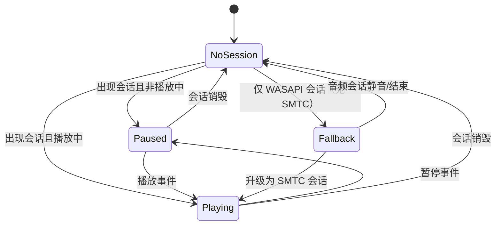
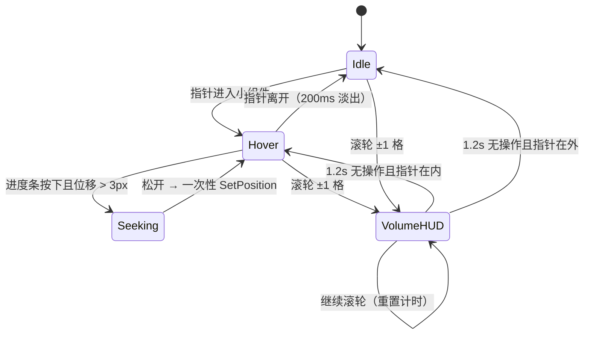

# 曲栏 Barline — 产品需求文档（PRD）

| 项目 | 内容 |
| --- | --- |
| 产品名称 | 曲栏 / Barline |
| 版本号 | `曲栏_Barline_v0.0.1`（开发期从 0.0.1 起；核心功能全部完成后跳 1.0.0） |
| 文档类型 | 简单版 PRD（需求确认阶段，可直接作为架构设计输入） |
| 交付形态 | 便携版单 exe（Windows 11 桌面端） |
| 技术栈前提 | Rust + windows-rs；小组件 Direct2D 逐像素透明自绘；设置页 WebView2 + HTML/CSS |
| 语言 | 中文（设置页与托盘菜单中英双语，默认中文） |

---

## 1. 产品定义

### 1.1 一句话定位

在 **Windows 11 系统任务栏条带内部**内嵌一个 Fluent 原生风格的媒体播控小组件（不是浮窗、不是托盘菜单），自动跟随系统内任意播放器正在播放的音乐，显示封面 / 歌名 / 歌手 / 逐字歌词，并提供完整播控。

### 1.2 产品目标

1. **零配置跟随**：用户不需要指定播放器、不需要切窗口，只要系统里有音乐在放，任务栏里就有曲栏；停止就收起。覆盖网易云音乐、QQ 音乐、Spotify、PotPlayer、浏览器等所有走 Windows 全局媒体会话（SMTC）的应用。
2. **不打断沉浸**：小组件默认背景完全透明（直接透出壁纸），只保留封面与文字，视觉上像任务栏的一部分而非一个 App 窗口；文字与图标随背后壁纸亮度自动黑白，任何壁纸下都清晰可读。
3. **任务栏级别的轻量**：便携版单 exe ≤ 8 MB，常驻内存 ≤ 40 MB，空闲 CPU ≈ 0，开机自启不弹窗、不占管理员权限。

### 1.3 非目标（明确不做）

- 不做任何非官方音乐平台接口（网易云 KRC、QQ 音乐 QRC 等一律不接）。
- 不做音乐库管理、不做播放器本身、不做在线搜索/下载。
- 本期不做安装版（MSI/EXE 安装包），只交付便携版 exe。
- 不做 macOS / Windows 10 及以下适配。

---

## 2. 目标用户与场景

| 用户 | 场景 | 关键诉求 |
| --- | --- | --- |
| 桌面办公者（主力） | 一边写代码/写文档一边听歌，播放器常年最小化 | 不切窗口就能看歌名、切歌、暂停；不想多一个悬浮窗挡内容 |
| 壁纸美化党（重要） | 用 TranslucentTB 把任务栏做成全透明，配动态壁纸 | 小组件必须和透明任务栏融为一体，不能出现一块"灰底方块" |
| 多显示器 / 高分屏用户 | 2K/4K 屏 + 125%~200% 缩放，任务栏居中或左对齐 | 位置精准贴托盘区左侧，不遮挡系统图标，不模糊 |
| 键盘党 | 手不离键盘 | 全局快捷键控制播放/切歌/歌词开关 |

---

## 3. 用户故事

1. **作为**桌面办公者，**我想要**在任务栏里直接看到当前播放的封面、歌名和歌手，**以便**不用切回播放器就知道在放什么。
2. **作为**听歌的用户，**我想要**在任务栏小组件上直接点上一首/暂停/下一首，**以便**在专注工作时用一次点击完成操作。
3. **作为**喜欢看歌词的用户，**我想要**歌词跟着进度逐字扫光高亮，**以便**获得卡拉 OK 式的沉浸感。
4. **作为**壁纸美化党，**我想要**鼠标不在小组件上时背景完全透明、文字自动黑白，**以便**它看起来是任务栏原生的一部分。
5. **作为**键盘党，**我想要**用全局快捷键控制播放与歌词开关，**以便**不离开键盘就能操作。
6. **作为**多屏用户，**我想要**小组件贴在我指定的显示器任务栏托盘区左侧且不遮挡系统图标，**以便**它在任何布局下都不破坏任务栏。
7. **作为**第一次使用的用户，**我想要**双击 exe 就能用、不装运行时、不要管理员权限，**以便**零成本试用。

---

## 4. 界面与交互稿描述

### 4.1 小组件布局（单行大字歌词形态，v1.1.1）

```
                                              ← 任务栏条带（高度 = 任务栏高度 40~48px）
┌──────────────────────────────────────────────────────────┐
│ ▢ 歌名歌名歌名歌名…  歌手名·网易云    ⏮   ⏸   ⏭        │  上行：歌名 + 歌手（同排）
│ ━━━━━━●───────────────────────────────────────────────  │  下行：单行歌词（扫光）
└──────────────────────────────────────────────────────────┘
   ↑ 信息区宽 = max(歌名+歌手自然宽, 160px)，小组件整体随之自适应
   ↑ 基础固定件（边距+封面+间距+三键）≈ 162px；右边缘贴托盘图标区左侧，间距 8px
```

**尺寸规范（100% DPI，v1.1.1 裁决）**

| 元素 | 规格 |
| --- | --- |
| 小组件总高 | **恒等于任务栏高度（40–48px）**——歌词开/关不改变高度；两行结构（上行歌名歌手、下行歌词）全部压在条带内，小组件任何形态都不超出任务栏条带 |
| 信息区宽 | `max(歌名+歌手自然宽, 160px)`，上限 340px；歌词开关时做 200ms 宽度过渡（0 ↔ 160 最小宽）+ 同步淡入淡出 |
| 封面 | 32×32px，圆角 4px，缺封面时显示渐变占位 + 音符图标 |
| 歌名 | 12px / SemiBold / 单行省略（上行左侧，视觉主导） |
| 歌手 | 10px / Regular / 主题灰度 / 单行省略（**紧凑排列**：左缘 = 歌名右缘 + 6px，v1.1.2 起不再锚定信息区右端；仅紧凑总宽超上限时歌名省略、歌手钳到一半保持可见） |
| 按钮 | 3 个，图标 16×16px，命中区 28×28px，间距 6px |
| 进度条 | 未悬停 2px 纯色（强调色），悬停 4px，拖动时右侧浮现 `01:12 / 03:45` 气泡 |
| 歌词 | **单行**（v1.1.1 起删除双行显示，设置页与右键菜单不再有行数项）：11px、位于歌名歌手行下方（整体上移 3.5px，v1.1.4）、逐字扫光保留 |
| 长歌词滚动 | v1.1.2 新增（默认开，可在设置关闭）；**v1.1.4 改行时间窗口驱动**：歌词超宽时按该行演唱时间窗口匀速滚动，比「最后一个字唱完」提前 ≤1.2s（且 ≤ 演唱窗口 25%）滚到尾，行尾 + 行间间歇留给读尾；时间基准与扫光一致（播放位置外推），暂停冻结、拖动跟随；滚动窗口 <1.5s 的短行不滚只显示行首。**v1.1.4 删除右缘 24px 渐隐带**：关闭滚动时行首硬截断。扫光高亮与滚动位移叠加，码元映射不受位移影响 |

### 4.2 透明与配色策略

- **静止态**：默认完全透明，直接看到壁纸；也可选半透明底色（不透明度可调）。封面、文字、按钮始终可见。
- **悬停态**：背景变为半透明纯色（不透明度可调，默认 70%）或保持透明，两种模式在设置里切换，淡入 120ms / 淡出 200ms（v1.1.12：常规态同样可选；v1.1.11 起移除模糊背景）。
- **亮度自适应**：对小组件所在屏幕区域做实时采样（壁纸或背后窗口），计算平均相对亮度，文字/图标在纯黑与纯白之间切换，对比度 ≥ 4.5:1（WCAG AA）。采样请求 300ms 内发出；**判定带迟滞**（深色 ≤0.12 / 浅色 ≥0.25，中间死区保持现状）与**连续 2 次确认**，因此壁纸切换约 1 秒完成翻色、阈值附近的抖动完全不翻（v1.2.0 修订，原「300ms 内刷新」表述作废）。中灰带（对比度 4.36:1）不再画描边。
- **强调色**：从封面主色提取，应用于进度条填充与悬停背景色调。

### 4.3 交互明细

| 操作 | 响应 | 说明 / 防误触 |
| --- | --- | --- |
| 鼠标悬停进入 | 背景淡入（半透明，透明模式无背景），进度条由 2px 增高到 4px | 按钮始终可见，不因悬停才出现 |
| 鼠标离开 | 背景 200ms 淡出，恢复完全透明 | 指针在小组件内移动不重复触发动画 |
| 单击封面 | 激活当前播放器主窗口并置前；最小化 / 最小化到托盘则还原显示（v1.1.16：隐藏窗口也参与查找） | 找不到窗口只记日志，**不再打开网页回退**（v1.1.16 删除，避免误开浏览器）。响应 ≤ 1s |
| 单击 ⏮ / ⏭ | 立即发 SMTC 上一首/下一首 | 200ms 内 UI 乐观更新；1s 内未收到会话更新则回滚 |
| 单击 ⏸/▶ | 切换播放暂停 | 同上乐观更新 + 回滚策略 |
| 单击进度条 | 跳转到点击位置 | 位移 < 3px 判为单击 |
| 按住进度条拖动 | 进入 Seeking 态：暂停进度推进与歌词滚动，显示时间气泡；**不暂停音频** | 位移 > 3px 且持续 > 100ms 才进入 Seeking；松开后一次性 SetPosition，误差 ≤ 1s |
| 拖动中经过其他按钮 | 完全屏蔽按钮事件 | 防止拖进度时误触切歌 |
| 滚轮 | 音量 ±1 格（默认 2%），浮现音量条 HUD，1.2s 后消失；连续滚动重置计时 | 滚轮事件必须吞掉，不传递给任务栏；滚轮永不触发切歌。「仅当前播放器」范围内 HUD 显示的是**该播放器的会话音量**（v1.1.16）；找不到会话时不弹 HUD、不动系统音量 |
| 右键小组件 | 上下文菜单：显示/隐藏歌词、背景模式、打开设置、关于、退出（v1.1.1 起无单行/双行项） | — |
| 双击 | **不绑定任何动作**；仅用于防止双击被识别成两次单击（250ms 单击判定延迟） | 双击手势自定义列为 P2 增强项 |
| 托盘图标右键 | 显示设置 / 显示隐藏小组件 / 退出 | — |
| 托盘图标双击 | 打开设置窗口 | — |
| 快捷键 | Ctrl+Alt+P 播放暂停、Ctrl+Alt+←/→ 上/下一首、Ctrl+Alt+L 歌词开关、Ctrl+Alt+M 静音、Ctrl+Alt+H 显示/隐藏小组件 | 设置页录制快捷键时挂起全局热键；输入框聚焦时不响应 |

**通用误触保护**

- 所有可点元素命中区 ≥ 28×28px（DPI 缩放后），相邻元素间距 ≥ 6px。
- 按钮只在 mousedown 与 mouseup 命中同一元素时触发。
- Seeking 态下屏蔽所有按钮与滚轮事件。
- 音量 HUD 显示期间不改变小组件布局高度（HUD 为浮层，叠加在进度条位置）。

---

## 5. 状态机

### 5.1 机器 A：会话与播放态（决定"显示什么"）



| 状态 | 小组件表现 | 可用能力 |
| --- | --- | --- |
| `NoSession` | 完全隐藏，不占任务栏空间 | — |
| `Paused` | 显示封面/歌名/歌手/按钮；进度条静止；歌词停在当前行，不扫光 | 全部播控可用 |
| `Playing` | 显示全部；进度与歌词随播放推进，逐字扫光运行 | 全部播控可用 |
| `Fallback`（WASAPI 兜底） | 显示"正在播放" + 来源应用名，无封面/歌名/歌手，无歌词 | **播控按钮置灰不可点**（WASAPI 无法控制播放）；滚轮调应用音量可用 |

### 5.2 机器 B：可见性门控（决定"是否显示"）

最终可见性 = 会话态 ≠ `NoSession` **且** 未被用户隐藏 **且** 任务栏未自动隐藏。

优先级从高到低：

| 优先级 | 门控条件 | 结果 |
| --- | --- | --- |
| 1 | 用户 Ctrl+Alt+H 或托盘"隐藏小组件" | 隐藏，直到用户再次触发（该开关跨会话记忆） |
| 2 | 任务栏设为自动隐藏且已收起 | 跟随隐藏；任务栏滑出时立即跟随显示 |
| 3 | 会话态 = `NoSession` | 隐藏 |
| 4 | 其他 | 显示 |

### 5.3 机器 C：交互修饰态（叠加在 A/B 之上，不改变播放态）



**跨状态约束**

- 从 `Playing` 切到 `Paused` 时，若正处于 `Seeking`，保持 `Seeking` 不打断拖动。
- 切歌（曲目变化）时，强制退出 `Seeking` 与 `VolumeHUD`，回到 `Hover`/`Idle`。
- 小组件隐藏（门控 1/2/3）时，所有修饰态强制复位到 `Idle`。

---

## 6. 歌词链路与降级策略

### 6.1 加载优先级

1. 本地同名 `.lrc` / 增强 `.lrc`（与音频文件同目录、同名）→ 命中即用，**不发网络请求**。
2. 本地增强 `.lrc` 带字级时间戳 → 真逐字。
3. 无本地文件 → `lrclib.net` 公开 API 取行级 LRC。
4. 行级歌词 → 按每行字符数等分该行时长做插值，实现"伪逐字"扫光（中文按字、英文按词）。

### 6.2 降级表现（核心要求：**不能出现空白塌陷与抖动**）

| 情况 | 表现 |
| --- | --- |
| `LyricsLoading` | 歌词区显示 `♪ 歌词加载中…`（淡色，无扫光）；小组件高度与歌词区宽度保持设定值不变（高度恒为条带厚度，v1.1） |
| `LyricsNotFound` | 高度不变，显示 `♪ 暂无歌词`（淡色），不重试、不塌陷 |
| `LyricsNetworkError` | 同 `LyricsNotFound` 表现；后台指数退避重试 5s / 15s / 60s，最多 3 次；同一曲目失败后 24h 内不再请求，只读本地 |
| 离线 / 在线歌词被用户关闭 | 只走本地；无本地则直接进 `LyricsNotFound`，不发请求 |
| 歌词整体关闭（设置或 Ctrl+Alt+L） | 小组件高度不变，歌词区 200ms 平滑收合（宽度过渡），总宽相应缩短 160px |
| 切歌瞬间 | 旧歌词淡出 120ms → 立即显示 `加载中` 占位（高度不变），新歌词就绪后淡入 |

---

## 7. 设置页信息架构

独立设置窗口，Fluent 风格，左侧分组导航 + 右侧内容区。关闭窗口不退出程序。

### 7.1 外观 Appearance

| 控件 | 类型 | 默认值 |
| --- | --- | --- |
| 背景模式（常规 / 悬停） | 各自单选：透明 / 半透明，半透明不透明度滑条 1–100% | 常规=透明；悬停=半透明 70% |
| 强调色来源 | 单选：跟随封面取色 / 系统强调色 / 自定义 | 跟随封面取色 |
| 自定义强调色 | 取色器（仅上一项选"自定义"时启用） | #0078D4 |
| 界面缩放 | 100% / 110% / 125% | 100% |
| 显示显示器 | 下拉：列出所有显示器 | 主显示器 |
| 任务栏位置 | 只读文本：底部 / 顶部 / 左 / 右（自动检测） | — |

### 7.2 歌词 Lyrics

| 控件 | 类型 | 默认值 |
| --- | --- | --- |
| 显示歌词 | 开关 | 开 |
| 逐字扫光 | 开关 | 开 |
| 长歌词滚动 | 开关 | 开 |
| 在线歌词（lrclib.net） | 开关 | 开 |
| 歌词来源说明 | 只读文本：本地 .lrc 优先，其次在线 | — |

> v1.1.1 起删除「显示模式（行数）」项：歌词固定单行大字，旧配置里的行数字段读入时忽略。
> v1.1.2 新增「长歌词滚动」开关（`lyrics.scroll`，默认开；旧配置缺省亦为开）。

### 7.3 音量 Volume

| 控件 | 类型 | 默认值 |
| --- | --- | --- |
| 启用滚轮调音量 | 开关 | 开 |
| 作用范围 | 单选：系统主音量 / 仅当前播放器（**v1.1.17 暂禁用**：会话音量实测无效，见 progress.md 待办） | 系统主音量 |
| 每格步进 | 下拉：1% / 2% / 5% | 2% |
| HUD 停留时长 | 下拉：0.8s / 1.2s / 2.0s | 1.2s |

### 7.4 快捷键 Hotkeys

5 行，每行：动作名 + 当前绑定 + "录制"按钮 + "重置默认"。
动作：播放/暂停、上一首、下一首、歌词开关、静音、显示/隐藏小组件。
绑定新键时实时检测冲突：与系统或其他动作冲突则标红并阻止保存。

### 7.5 通用 General

| 控件 | 类型 | 默认值 |
| --- | --- | --- |
| 开机自启（HKCU Run，无需管理员） | 开关 | 关 |
| 语言 | 下拉：跟随系统 / 中文 / English | 中文 |
| 关闭设置窗口时最小化到托盘 | 开关（只读，固定开） | 开 |
| 单实例运行 | 只读说明 | — |

### 7.6 关于 About

版本号、打开日志目录、开源许可、歌词数据来源（lrclib.net）署名。

---

## 8. 需求池

> 优先级定义：**P0 = 必须实现（缺失则产品不成立）**；**P1 = 应该实现（本期交付）**；**P2 = 可选增强（本期不实现）**。

### 8.1 P0 — 必须实现（16 条）

#### P0-01 媒体会话自动识别（SMTC 主链路）

自动发现系统中任意应用正在播放的音乐，无需用户手动选择播放器。

**验收标准**
- 分别用网易云音乐、QQ 音乐、Spotify、PotPlayer、Edge（网页播放）播放音乐，**3 秒内**小组件出现，封面/歌名/歌手与播放器内显示一致。
- 在播放器内切歌，**1 秒内**小组件内容更新为新媒体信息。
- 关闭播放器 / 音乐停止，**3 秒内**小组件收起。

#### P0-02 显示与收起时机

**验收标准**
- 播放中 → 显示；暂停 → **保持显示**（不收起）。
- 完全无媒体会话 → 隐藏。
- 从"无会话"到"开始播放"，小组件在 3 秒内出现且不闪烁（无先闪一次错误内容）。

#### P0-03 小组件基础内容

封面 32px、歌名、歌手名、歌词区、上一首/暂停/下一首三键，按第 4.1 节尺寸规范渲染。

**验收标准**
- 100% DPI 下小组件高度与任务栏高度一致（误差 ≤ 1px）。
- 歌名/歌手超长时单行省略，不撑破布局、不换行。
- 无封面时显示渐变占位 + 音符图标，不出现白块或黑块。

#### P0-04 播控三键

**验收标准**
- 点击 ⏸/▶、⏮、⏭ 后，播放器状态在 **500ms 内**实际改变。
- 操作后 200ms 内按钮图标乐观更新；若 1s 内会话未变化则回滚为原状态。
- 连续快速点击下一首 5 次，不出现 UI 与实际曲目错位（最终一致）。

#### P0-05 任务栏内嵌定位

小组件贴在任务栏托盘图标区**左侧**，不遮挡任何系统图标。

**验收标准**
- 1920×1080@100%、任务栏居中与左对齐两种布局下，小组件右边缘与托盘图标区左边缘间距 = 8px（误差 ≤ 2px）。
- 系统托盘图标增减（如微信图标出现/消失）时，小组件在 1 秒内重新贴合，不重叠、不残留。
- 小组件**主行**（封面/歌名/歌手/三按钮/进度条）完全位于任务栏条带内，不超出任务栏上下边界。
- **（v1.1.1 修订）开启歌词后小组件高度不变，信息区（上行歌名+歌手、下行单行歌词）完全位于任务栏条带内**——小组件宽度随信息区自适应（最小 160px），任何形态（静止/悬停/歌词开关）都不超出任务栏条带。原「歌词区向桌面方向扩展」裁决自 v1.1 起作废。

#### P0-06 尺寸与布局自适应

**验收标准**
- **（v1.1.1 修订）小组件总高恒等于任务栏高度（误差 ≤ 2px），歌词开/关高度完全一致**；信息区宽 = max(歌名+歌手自然宽, 160px)（上限 340px），歌词开关做 200ms 宽度过渡（误差 ≤ 2px）。
- 基础宽度在 200–340px 区间随内容变化；极短歌名（如"雨"）时宽度不小于 200px。
- 开启/关闭歌词时**高度保持不变**，歌词区做平滑宽度过渡（200ms），无跳变。

#### P0-07 透明策略与亮度自适应

**验收标准**
- 指针不在小组件上时，背景完全透明：截屏比对小组件区域与相邻任务栏区域，像素差异仅出现在封面/文字/按钮处。
- 在纯白壁纸与纯黑壁纸下，文字与图标自动切换为黑/白，实测对比度 ≥ 4.5:1。
- 切换壁纸后 **300ms 内**完成黑白切换。
- 悬停时背景在 120ms 内淡入（常规→悬停两态之间插值，按设置），离开 200ms 内淡出回常规态。

#### P0-08 歌词加载链路

本地 `.lrc` / 增强 `.lrc` 优先，其次 lrclib.net 行级 LRC。

**验收标准**
- 音频同目录存在同名 `.lrc` 时，**不发任何网络请求**即可显示歌词（抓包验证）。
- 无本地文件时，lrclib.net 命中后 **2 秒内**（正常网络）显示歌词。
- 本地有歌词时不请求网络；本地无歌词才请求在线。

#### P0-09 逐字扫光与歌词滚动

**验收标准**
- 增强 `.lrc`（带字级时间戳）时，每个字的扫光起始时间与时间戳偏差 ≤ 100ms。
- 行级 LRC 时按字等分插值，扫光在该行时长内匀速完成，无跳跃、无回退。
- 歌词行切换时，当前行与进度对齐误差 ≤ 200ms。
- 暂停时扫光停止在当前字，恢复播放后继续。

#### P0-10 进度条与拖动跳转

**验收标准**
- 进度条位置与播放器实际进度偏差 ≤ 1s。
- 拖动到 50% 位置松开，播放器跳转到对应时间，误差 ≤ 1s。
- **拖动过程中不触发切歌、不触发暂停**（拖过按钮区域时按钮无响应）。
- 拖动时显示 `当前时间 / 总时长` 气泡，松开后 500ms 内消失。

#### P0-11 点击封面激活播放器

**验收标准**
- 播放网易云音乐时单击封面，**1 秒内**网易云主窗口置于前台。
- 播放器处于最小化时，单击封面后窗口还原到前台。
- 播放器无主窗口（如浏览器后台标签）时，只记日志并放弃，**不打开网页回退**（v1.1.16 用户裁决）。
- **汽水音乐（CEF/Electron 托盘恢复型）例外（v1.1.21 用户裁决搁置）**：窗口可见时正常激活；托盘隐藏态**不做激活**（不制造卡死窗口、不抢鼠标）。实测此类应用任何外部 `ShowWindow` 都会令 CEF 输入挂起（内容不可点击），托盘图标点击通道有效但抢鼠标，续修见 progress.md 待办 D。

#### P0-12 设置窗口与系统托盘

**验收标准**
- 设置窗口独立存在，关闭后进程不退出，小组件继续正常工作。
- 托盘图标常驻，右键菜单含"显示设置 / 显示隐藏小组件 / 退出"三项，均可正常执行。
- 设置页所有控件改动后**即时生效**（无需重启），重启程序后配置保留。
- 设置页为 Fluent 风格，中英双语可切换。

#### P0-13 单实例运行

**验收标准**
- 程序运行中再次双击 exe，第二个进程 **1 秒内**退出。
- 第二个进程退出时，已有实例的设置窗口被唤起并置前。
- 单实例判定跨会话（不同用户登录）不互相干扰。

#### P0-14 便携版与资源占用

**验收标准**
- 交付物为**单个 exe**，无需安装、无需管理员权限，复制到任意目录双击即可运行。
- Release 版 exe 体积 **≤ 8 MB**。
- 仅小组件运行、设置窗口未打开时，常驻工作集 **≤ 40 MB**；设置窗口打开时峰值允许 ≤ 150 MB。
- 播放中**无歌词扫光动画**时，平均 CPU ≤ 0.5%；**逐字扫光动画运行期间**允许 ≤ 2%（25fps 重绘的合理开销）；无播放（小组件隐藏）时 CPU ≈ 0。

#### P0-15 多显示器 / DPI / 任务栏方位适配

**验收标准**
- 在 100% / 125% / 150% / 200% 四档缩放下，小组件尺寸按比例缩放且文字不模糊、不裁切。
- 任务栏位于底部 / 顶部 / 左侧 / 右侧四种情况，小组件均正确贴靠且内容不旋转错乱。
- 双显示器（不同 DPI）下，按设置的显示器正确显示；切换显示器后 1 秒内重新定位。
- 主副屏 DPI 不同时，跨屏拖动窗口不导致小组件错位。

#### P0-16 歌词降级无抖动

**验收标准**
- 歌词加载中 / 未找到 / 网络失败三种情况，小组件总高度变化 = 0px（无塌陷、无跳动）。
- 断网状态下播放一首无本地歌词的歌曲，小组件正常显示封面与播控，歌词区显示占位文案，不出现空白区域或布局错位。
- 切歌瞬间不出现"旧歌词残留超过 200ms"或"空白超过 200ms"。

### 8.2 P1 — 本期实现（10 条）

#### P1-01 滚轮调音量 + HUD

**验收标准**
- 指针在小组件上滚动滚轮，音量按设置步进变化；HUD 浮现，1.2s（或设置值）后消失。
- 滚轮事件不传递给任务栏（不引起任务栏其他行为）。
- 切换到"仅当前播放器"模式后，滚动只改变该应用音量，系统主音量不变（音量合成器验证）。
- 连续滚动时 HUD 不闪烁、计时正确重置。

#### P1-02 全局快捷键

**验收标准**
- 5 组默认快捷键（Ctrl+Alt+P / ← / → / L / M / H）在任意前台应用下均生效。
- 设置页重新绑定后立即生效，旧绑定失效。
- 绑定时与系统或其他动作冲突会提示并阻止保存。
- 设置页录制快捷键期间，全局热键挂起，不会误触发。

#### P1-03 歌词开关（v1.1.1 起行数固定单行，原「单双行切换」作废）

**验收标准**
- Ctrl+Alt+L 或设置页开关，歌词行显示/隐藏，200ms 宽度过渡 + 淡入淡出，高度不变。
- 设置持久化，重启后保持；旧配置里的行数字段读入时忽略不报错。

#### P1-04 循环与随机（v1.1.16 已删除）

**结论**：右键菜单的「随机播放」「循环播放」两项已删除。SMTC 的远程循环/随机
变更（`TryChangeShuffleActiveAsync` / `TryChangeAutoRepeatModeAsync`）只是「请求」，
网易云、汽水等大量播放器声明了能力却不响应，功能形同虚设，Windows 无强制手段。
如需切换，请在播放器本体操作。

#### P1-05 封面取色强调色

**验收标准**
- 换歌后 1 秒内进度条与悬停背景色调切换为新封面的主色。
- 纯白/纯灰封面等无有效主色时，回退到系统强调色，不出现不可见颜色。

#### P1-06 开机自启

**验收标准**
- 开启后 `HKCU\Software\Microsoft\Windows\CurrentVersion\Run` 下出现对应项，无需管理员权限。
- 重启系统后自动启动，**不弹窗、不抢焦点**，直接静默驻留托盘。
- 关闭后注册表项被移除，重启不再自启。
- 用户手动删除注册表项后，设置页状态与真实状态一致（不显示虚假开启）。

#### P1-07 中英双语

**验收标准**
- 设置页与托盘菜单在中文/English 间切换后立即生效，无截断、无漏翻。
- "跟随系统"模式下随系统语言变化。
- 默认语言为中文。

#### P1-08 WASAPI 兜底

**验收标准**
- 对不走 SMTC 的应用（如部分游戏、小众播放器），**2 秒内**小组件出现，显示"正在播放"+ 来源应用名。
- 兜底态下播控按钮置灰不可点，滚轮调音量可用。
- 该应用开始走 SMTC 后，**1 秒内**自动升级为完整信息展示。

#### P1-09 任务栏自动隐藏跟随

**验收标准**
- 任务栏设为自动隐藏时，小组件随任务栏一起收起；任务栏滑出时小组件同步出现（延迟 ≤ 100ms）。
- 任务栏滑出/收起的动画过程中，小组件不出现残影或错位。

#### P1-10 版本号规范

**验收标准**
- exe 文件名与"关于"页版本号一致，格式 `曲栏_Barline_v0.0.1`。
- 开发期从 0.0.1 起递增；核心功能全部完成后为 1.0.0。

### 8.3 P2 — 可选增强（本期不实现，4 条）

| 编号 | 需求 | 说明 |
| --- | --- | --- |
| P2-01 | 安装版打包（MSI/EXE 安装包） | 待用户后续明确要求再做 |
| P2-02 | 多显示器同时显示小组件 | 当前仅单屏显示，可切换显示器 |
| P2-03 | 歌词手动偏移校准（±0.5s） | 应对部分 LRC 时间轴不准 |
| P2-04 | 双击手势自定义 | 当前双击不绑定动作 |

---

## 9. 技术前提（背景，不展开）

- Rust + windows-rs；小组件本体 Direct2D 逐像素透明自绘；设置主页面 WebView2 + HTML/CSS；便携版单 exe。
- 媒体识别：Windows 全局媒体会话 SMTC 为主链路，WASAPI 音频会话枚举作为兜底（兜底时只有"正在播放"状态与来源应用名，无歌曲元数据）。
- 歌词：本地同名 `.lrc` / 增强 `.lrc` 优先（带字级时间戳则真逐字）；无本地文件时走 lrclib.net 公开 API 取行级 LRC；行级歌词按字时长等分插值实现"伪逐字"扫光。
- 设置页依赖系统 WebView2 Runtime（Windows 11 自带）。

---

## 10. 待确认问题

1. **在线歌词单点依赖**：歌词在线源仅 lrclib.net 一个公开 API（无 SLA，可能限流或不可达）。是否接受"在线失败即降级为暂无歌词"，还是需要预留备用源/自建代理？
2. **WebView2 缺失时的降级边界**：Win11 精简版或 Server 可能没有 WebView2 Runtime。缺失时是"小组件照常工作、设置页不可用并提示下载"，还是必须保证设置页可用（则需内置固定版 WebView2，体积 +100MB 以上，与 ≤8MB 直接冲突）？
3. ~~点击封面回退的打开方式~~ **已裁决（v1.1.16）**：删除网页回退，找不到窗口只记日志。
4. **快捷键冲突处理强度**：Ctrl+Alt+←/→ 与部分 IDE、输入法的组合键存在冲突。冲突时是"提示但允许用户保留"，还是"强制阻止并回退默认"？
5. **体积/功能取舍优先级**：若最终 exe 超过 8 MB（例如 10–12 MB），优先保体积（裁功能）还是保功能（放宽体积）？请给一个可接受的上限。

---

## 11. 最大风险提示（供架构师优先评估）

1. **任务栏内嵌 + 逐像素透明自绘**是全项目最高风险点：需要在任务栏条带内部署子窗口并与托盘图标区动态避让，涉及任务栏重建（Explorer 重启）、多显示器不同 DPI、任务栏四个方位、自动隐藏等组合场景，任何一项失效都会导致"遮挡系统图标"或"黑底方块"，直接破坏核心体验。
2. **资源指标与实现手段存在张力**：≤ 8 MB 单 exe 与 ≤ 40 MB 常驻内存，叠加 Direct2D 自绘 + WebView2 设置页 + 歌词缓存，需要在架构阶段就锁定内存与体积预算。
3. **SMTC 元数据质量参差**：不同播放器对封面、时长、播放位置的暴露程度差异大（部分只给歌名），进度条与歌词对齐的精度下限取决于播放器上报质量，需要在验收时按播放器分别标注支持等级。
