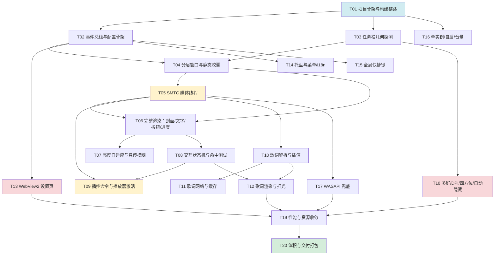

# 曲栏 Barline — 任务分解

| 项目 | 内容 |
| --- | --- |
| 文档 | `docs/TASKS.md` |
| 版本 | v1.0 |
| 作者 | 高见远（架构师） |
| 上游 | `docs/ARCHITECTURE.md`（模块/数据结构/API 契约）、`docs/PRD.md`（验收标准） |
| 任务数 | **20 个任务 / 5 个里程碑** |
| 排序原则 | 严格按依赖拓扑序；同一里程碑内的任务可批量写完再编译 |

## 阅读说明

- **规模**：`S` < 150 行；`M` = 150–400 行；`L` > 400 行（Rust 代码行数，不含注释与测试）。
- **验收方式** 分三级：
  - `[编译]` — 该任务结束时必须 `cargo build --release` 零 error 零 warning；
  - `[运行]` — 必须能启动并观察到指定现象；
  - `[测试]` — 必须有单元测试且 `cargo test` 通过。
- 每个任务的**涉及文件**都给出精确路径；未列出的文件**不要**在该任务里创建。
- 数据结构、`AppEvent`、API 签名**一律照抄** `ARCHITECTURE.md`，不得自行改名或改类型。
- 每个里程碑结束都有一个 **可观察成果（Milestone Gate）**，交付总监按此验收。

## 里程碑总览

| 里程碑 | 主题 | 任务 | 可观察成果（Gate） |
| --- | --- | --- | --- |
| **M1** | 骨架与任务栏胶囊 | T01–T05 | 能编译、能启动、任务栏里出现静态胶囊、能读到 SMTC 当前歌曲并打印日志 |
| **M2** | 完整小组件 | T06–T09 | 封面/文字/按钮/进度条全部到位；透明 + 亮度自适应 + 悬停模糊；播控可用；点封面能激活播放器 |
| **M3** | 歌词与设置页 | T10–T13 | 逐字扫光歌词 + 降级无抖动；WebView2 设置页可用且改配置即时生效 |
| **M4** | 系统集成 | T14–T18 | 托盘、6 组快捷键、单实例、开机自启、WASAPI 兜底、多屏/DPI/四方位/自动隐藏全部工作 |
| **M5** | 打磨与交付 | T19–T20 | 体积 ≤ 8 MB、常驻 ≤ 40 MB、空闲 CPU ≈ 0；交付便携单 exe + 验收清单 |

## 依赖图



**关键路径**：T01 → T02 → T04 → T06 → T08 → T09 → T19 → T20（8 个任务）。
**可并行**：T03 与 T02 并行；T10/T11 与 T06/T07 并行；T13 与 T12 并行；T14/T15/T16/T17 两两并行。

---

# M1 — 骨架与任务栏胶囊

> **Milestone Gate**：`scripts/build.ps1` 从零构建成功；双击 exe 后任务栏托盘区左侧出现静态圆角胶囊；
> 打开播放器后日志打印 `[media] session changed: aumid=... title=... artist=...`；
> 点击胶囊空白区鼠标穿透正常；进程内存 < 25 MB。

## T01 项目骨架与构建链路

| 项 | 内容 |
| --- | --- |
| 里程碑 | M1 |
| 规模 | **M** |
| 前置依赖 | 无 |
| 优先级 | P0 |

**目标**：建立可编译、可运行、可打日志的最小 Rust 工程；把 `build.ps1` 跑通；把窗口、DPI、单实例、日志的地基打好。

**涉及文件（全部新建）**

```text
Cargo.toml
rust-toolchain.toml
build.rs
.gitignore
assets/barline.rc
assets/app.manifest
assets/icon.ico                  （占位，16/20/24/32/48/256 多尺寸）
scripts/build.ps1                （已交付，纳入版本控制）
src/main.rs
src/log.rs
src/platform/mod.rs
src/platform/wide.rs
src/platform/com.rs
src/platform/dpi.rs
src/platform/wake.rs
src/platform/single_instance.rs
```

**实现要点**

1. `Cargo.toml` 严格照抄 `ARCHITECTURE.md` §4.3；`windows` feature 逐条照抄 §4.2
   （**必须包含 `Win32_Graphics_Dxgi_Common`**，否则 M2 会卡在 `CreateWicBitmapRenderTarget` 不存在）。
2. `build.rs`：`embed_resource::compile("assets/barline.rc", embed_resource::NONE)`。
3. `assets/barline.rc`：
   ```rc
   1 ICON "icon.ico"
   1 24 "app.manifest"
   ```
4. `assets/app.manifest`：`supportedOS` 声明 Win10/Win11 GUID；**不写** `dpiAware`（改用运行时 API，
   便于调试时切模式）。
5. `main.rs` 顺序（**顺序不能变**）：
   ```text
   log::init()                                   // 最先，后续任何失败都能记日志
   SetProcessDpiAwarenessContext(PER_MONITOR_AWARE_V2)
   single_instance::acquire()?                   // 已有实例 → 唤起并 ExitProcess(0)
   ComApartment::sta()                           // RAII，Drop 时 CoUninitialize
   App::new()?                                   // T02 里实现；此处先留 `todo!()` 或最小骨架
   message_loop()
   ```
6. `platform/wake.rs` 完整实现 `WakeHwnd` + `EventSink<T>`（照抄 `ARCHITECTURE.md` §6.2 代码）。
7. `platform/single_instance.rs`：`CreateMutexW(Local\Barline.SingleInstance.v1)`，
   **句柄必须保持存活**（存进 `OnceLock`，不能 drop）。
8. `log.rs`：`OnceLock<Mutex<BufWriter<File>>>`，`log_info!/log_warn!/log_err!` 宏，
   `%LOCALAPPDATA%\Barline\barline.log`，10 MB 轮转，`set_hook` 落盘 panic。

**验收方式**

- `[编译]` `powershell -ExecutionPolicy Bypass -File scripts/build.ps1` 成功，
  `target/release/barline.exe` 存在且体积 < 500 KB。
- `[运行]` 双击 exe：进程常驻不退出（此时无窗口，靠消息泵空转）；
  `%LOCALAPPDATA%\Barline\barline.log` 出现启动日志，包含 Rust 版本、DPI 感知设置结果、单实例结果。
- `[运行]` 再双击一次：第二个进程 1 秒内退出，日志记录"已有实例，已唤起"。
- `[测试]` `platform/wide.rs` 的 `to_wide`/`from_wide` 有往返测试（含中文、emoji、空串）。

**易错点**

- `.ps1` 必须 UTF-8 **with BOM**（否则 PS 5.1 按 GBK 解析，中文破坏语法——已实测踩坑）。
- `windows` crate 的 `HWND` 不实现 `Send`，`WakeHwnd` 的 `unsafe impl` 必须带 `// SAFETY:` 注释。

---

## T02 事件总线与配置骨架

| 项 | 内容 |
| --- | --- |
| 里程碑 | M1 |
| 规模 | **M** |
| 前置依赖 | T01 |
| 优先级 | P0 |

**目标**：建立 `AppEvent` / `Effect` / `AppState` / `Config` 全套类型，实现 `reduce()` 的骨架与消息窗唤醒机制，为后续所有任务提供骨架。

**涉及文件（全部新建）**

```text
src/event.rs
src/app.rs
src/config/mod.rs
src/config/defaults.rs
src/config/autostart.rs
src/i18n.rs
```

**实现要点**

1. `event.rs`：`AppEvent`、`Effect`、`MediaCommand`、`LyricRequest`、`HotkeyAction`、
   `TrayCommand`、`WidgetInput`、`MediaCommandKind`、`LyricMissReason`、`FallbackInfo`
   —— **逐字照抄** `ARCHITECTURE.md` §8。
2. `app.rs`：
   - `AppState` 逐字照抄 §7.7（`HoverState` / `OptimisticOverride` / `OptimisticKind` 一并）。
   - `App { state: AppState, config: Config, sink: EventSink<AppEvent>, ... }`
   - `fn reduce(&mut self, evt: AppEvent) -> Vec<Effect>`：本任务只实现 `ConfigChanged` /
     `Quit` / `Tick` 三个分支，其余 `match` 分支先 `log_debug!` 后返回空 `Vec`。
   - `fn apply(&mut self, effects: Vec<Effect>)`：本任务只实现 `SaveConfig` / `Quit`。
   - 创建 `HWND_MESSAGE` 消息窗，WndProc 处理 `WM_BARLINE_WAKE` → drain `Receiver` → `reduce` → `apply`。
3. `config/mod.rs`：`Config` 及全部子结构逐字照抄 §7.5；`load()` / `save()`（原子写）。
4. `config/defaults.rs`：全部 `Default` 实现 + `limits` 常量模块（§7.6 逐字）+ 6 组默认热键。
5. `config/autostart.rs`：`is_enabled()` / `set_enabled(bool)`，用 `RegOpenKeyExW` /
   `RegSetValueExW` / `RegQueryValueExW` / `RegDeleteValueW`。**禁止 `reg.exe`**。
6. `i18n.rs`：`Lang`、`detect_system_lang()`、`t(lang, key)`（先放 20 个词条够 M1 用）。

**验收方式**

- `[编译]` 零 warning（`#![deny(warnings)]` 在 `main.rs` 顶部，本任务起生效）。
- `[运行]` 首次启动在 `%LOCALAPPDATA%\Barline\` 生成 `config.json`（约 2 KB，字段齐全）。
- `[运行]` 手工把 `config.json` 改成非法 JSON 后重启：程序正常启动，生成
  `config.bad.<时间戳>.json` 备份，日志有 `ERROR` 记录。
- `[运行]` 从另一个线程 `sink.send(AppEvent::Tick)`，主线程日志立即出现（验证唤醒链路）。
- `[测试]` `Config` 序列化→反序列化往返相等；缺字段时用默认值（`#[serde(default)]` 生效）。

---

## T03 任务栏几何探测

| 项 | 内容 |
| --- | --- |
| 里程碑 | M1 |
| 规模 | **M** |
| 前置依赖 | T01 |
| 优先级 | P0 |

**目标**：实现纯函数 `probe()`，准确拿到任务栏矩形、托盘区矩形、方位、DPI、自动隐藏/收起状态，并把结果打日志。

**涉及文件（全部新建）**

```text
src/taskbar/mod.rs
src/taskbar/geometry.rs
```

**实现要点**

1. `TaskbarGeometry` 结构逐字照抄 `ARCHITECTURE.md` §10.3。
2. `probe() -> Option<TaskbarGeometry>` 严格按 §10.3 的 9 步算法实现。
3. `APPBARDATA.cbSize` **必须**设为 `size_of::<APPBARDATA>() as u32`，否则 `SHAppBarMessage` 静默失败。
4. `ABE_LEFT/TOP/RIGHT/BOTTOM` 是 0/1/2/3（注意不是 `ABS_*`）。
5. `collapsed` 判定：`auto_hide && 按 edge 比较 tray_rect 与 monitor_rect`（§10.3 第 6 步）。
6. 本任务**不做** `target` 矩形（M2 里随布局一起算），`target` 先填 `RECT::default()`。
7. 在 `main.rs` 加一个 1 秒定时器，每次 `probe()` 并把结果 `log_info!`，用于本任务验收；
   T18 会替换成正式的 watcher。

**验收方式**

- `[编译]` 零 warning。
- `[运行]` 日志每秒输出一行，包含：`tray_rect`、`bar_rect`、`edge`、`dpi`、`auto_hide`、`collapsed`。
- `[运行]` 手工核对：日志里的 `tray_rect.left` 与用 WinSpy/AutoHotkey 查到的 `TrayNotifyWnd`
  左边缘一致（误差 0）；`dpi` 在 2560×1440 主屏上为 96 或 120（取决于系统缩放设置）。
- `[运行]` 把任务栏设为自动隐藏 → 日志 `auto_hide=true`；任务栏滑出/收起时 `collapsed` 正确翻转。
- `[运行]` 插拔第二个显示器 / 改缩放比例 → 日志里的 `dpi` 与 `monitor_rect` 跟着变。
- `[测试]` 把"tray_rect + edge → target_rect"抽成纯函数 `compute_target()`，
  用 4 组构造数据（上下左右 × 托盘宽度不同）断言输出矩形。

---

## T04 分层窗口与静态胶囊

| 项 | 内容 |
| --- | --- |
| 里程碑 | M1 |
| 规模 | **L** |
| 前置依赖 | T02, T03 |
| 优先级 | P0 |

**目标**：在任务栏条带内创建 `WS_EX_LAYERED` 窗口，用 D2D 画一个圆角胶囊并通过
`UpdateLayeredWindow` 呈现；位置由 T03 的几何驱动；窗口不抢焦点、鼠标可穿透。

**涉及文件（全部新建）**

```text
src/render/mod.rs
src/render/d2d.rs
src/render/painter.rs        （最小版：清屏 + 圆角矩形 + 一行占位文字）
src/render/layout.rs         （最小版：只算 width/height/main_row）
src/render/text.rs           （最小版：1 个 IDWriteTextFormat + measure）
src/render/theme.rs          （最小版：固定深色主题）
src/taskbar/host.rs
src/ui/mod.rs
src/ui/widget_wnd.rs         （最小版：WndProc + WM_ERASEBKGND 返回 1）
```

**实现要点**

1. 窗口样式严格照抄 `ARCHITECTURE.md` §10.1：`WS_EX_LAYERED | WS_EX_TOOLWINDOW |
   WS_EX_NOACTIVATE | WS_EX_TOPMOST` + `WS_POPUP`；父窗口 `None`（必须是 top-level）。
2. `WM_MOUSEACTIVATE` 返回 `MA_NOACTIVATE`。
3. `d2d.rs`：
   - `D2D1CreateFactory(D2D1_FACTORY_TYPE_SINGLE_THREADED, None)`、
     `DWriteCreateFactory(DWRITE_FACTORY_TYPE_SHARED)`、`CoCreateInstance(CLSID_WICImagingFactory)` 全局单例。
   - 双缓冲两张 `IWICBitmap`（`GUID_WICPixelFormat32bppPBGRA`）+ 两个
     `ID2D1RenderTarget`（`CreateWicBitmapRenderTarget`）。
   - `resize(w, h, dpi)` 重建。
4. `painter.rs` 每次绘制**第一步必须** `rt.Clear(Some(&D2D1_COLOR_F { r:0.,g:0.,b:0.,a:0. }))`。
5. `UpdateLayeredWindow` 参数：
   ```rust
   let blend = BLENDFUNCTION {
       BlendOp: AC_SRC_OVER as u8,
       BlendFlags: 0,
       SourceConstantAlpha: 255,
       AlphaFormat: AC_SRC_ALPHA as u8,
   };
   UpdateLayeredWindow(hwnd, None, Some(&pt_dst), Some(&size),
                       Some(hdc_mem), Some(&pt_src), COLORREF(0),
                       Some(&blend), ULW_ALPHA)?;
   ```
   注意 `crkey` 是 `COLORREF` 不是 `Option`（§9.2）。
6. `layout.rs` 最小版：`width = clamp(200*scale, 200*scale, 340*scale)`（先固定 200），
   `height = bar_rect.height`；`WidgetForm::Compact`。
7. `host.rs`：`attach()` 创建窗口、`apply_geometry()` 用 `SetWindowPos(HWND_TOPMOST, SWP_NOACTIVATE)`、
   `present()` 走 `UpdateLayeredWindow`。
8. **命中区技巧**：在画圆角胶囊前，先在整个客户区填一个 `alpha = 1` 的矩形
   （视觉不可见，但让整块区域可接收鼠标）。**写注释说明原因**（§10.7）。

**验收方式**

- `[编译]` 零 warning。
- `[运行]` 任务栏托盘区左侧出现一个 200×48（100% DPI）的圆角胶囊，
  内含一行文字"曲栏 Barline"。
- `[运行]` **截屏比对**：胶囊内的背景像素与紧邻的任务栏区域像素**完全一致**
  （用画图/PS 取色器比对，验证真透明，不是"近黑"）。
- `[运行]` 点击胶囊内空白处：任务栏行为正常（鼠标穿透生效）；点击胶囊时有反应但不抢焦点
  （当前窗口的标题栏不失去激活色）。
- `[运行]` 胶囊不遮挡任务栏任何系统图标；胶囊右边缘距托盘图标区左边缘 8px（±2px）。
- `[运行]` Alt+Tab 里**看不到**"曲栏"窗口。
- `[运行]` 改变系统缩放 100%→125% → 胶囊尺寸等比放大（200→250），文字不模糊。

**易错点**

- `UpdateLayeredWindow` 的 `hdcdst` 传 `None` 时窗口位置由 `pptdst` 决定；两者混用会导致窗口跑到 (0,0)。
- `ID2D1RenderTarget` 必须在 `EndDraw` 后 `GetHwnd`/`ReleaseDC`；本方案用 WIC 位图，
  直接从 `IWICBitmap::Lock` 拿 `hdc`，用完必须 `Release`。

---

## T05 SMTC 媒体线程

| 项 | 内容 |
| --- | --- |
| 里程碑 | M1 |
| 规模 | **L** |
| 前置依赖 | T04 |
| 优先级 | P0 |

**目标**：MTA 线程拿到 SMTC manager，订阅事件，500ms 轮询当前会话，产出 `AppEvent::NowPlaying`，
并把歌名显示到胶囊上、把完整信息打日志。

**涉及文件（全部新建 / 修改）**

```text
src/media/mod.rs
src/media/smtc.rs
src/media/player_map.rs       （最小版：AUMID/进程名 → 显示名，20 条）
src/media/cover.rs            （骨架：先只返回 None，T06 补实现）
src/app.rs                    （修改：实现 NowPlaying / SessionCleared 分支）
src/render/painter.rs         （修改：标题/歌手文字来自 AppState）
src/main.rs                   （修改：启动 media 线程）
```

**实现要点**

1. **`join()` 不是 `get()`**（`ARCHITECTURE.md` §2.2 第 1 条）：
   ```rust
   let op = GlobalSystemMediaTransportControlsSessionManager::RequestAsync()?;
   let mgr = op.join()?;          // windows-future 0.3.2
   ```
2. 事件订阅方法名**无 `Add` 前缀**：`mgr.CurrentSessionChanged(handler)`、
   `mgr.SessionsChanged(handler)`、`session.MediaPropertiesChanged(handler)`、
   `session.PlaybackInfoChanged(handler)`、`session.TimelinePropertiesChanged(handler)`。
   回调里**只** `sink.send(AppEvent::SessionDirty)` 或设一个 `AtomicBool`，不做重活。
3. `PlaybackStatus` 常量是 **PascalCase**：`GlobalSystemMediaTransportControlsSessionPlaybackStatus::Playing`
   / `::Paused` / `::Closed` / `::Opened` / `::Changing` / `::Stopped`。
4. `TimeSpan.Duration` 是 **100ns** 单位 → `ms = duration / 10_000`。
5. 轮询循环照抄 `ARCHITECTURE.md` §6.4：`recv_timeout(50ms)` + 每 500ms `poll_once`。
6. `poll_once` **必须做 diff**：只有 `(title, artist, state, position 差 > 500ms, can_* 变化,
   shuffle, repeat)` 任一变化才 `send(NowPlaying)`，否则不发（避免无意义重绘）。
7. `position_at` 用 `Instant::now()`；`state != Playing` 时 UI 侧不外推（已在 `NowPlaying::position_now` 实现）。
8. `player_map.rs` 先做 20 条静态映射（网易云/QQ/Spotify/汽水/酷狗/酷我/Foobar/PotPlayer/Edge/Chrome…），
   同时按 AUMID 与进程名匹配（进程名从 AUMID 反查不到时留空，T09 补）。
9. 线程 `Builder::new().stack_size(512 * 1024).spawn()`；`ComApartment::mta()` RAII。
10. `cover.rs` 先返回 `Ok(None)`，把 `TryGetMediaPropertiesAsync().join()` 的调用点留好。

**验收方式**

- `[编译]` 零 warning。
- `[运行]` 用**网易云音乐**播放一首歌：日志出现
  `[media] session changed: aumid=CloudMusic.exe app=网易云音乐 title=... artist=... duration=183000`；
  胶囊上的文字变为歌名（歌手行在 M2 补）。
- `[运行]` 用 **Edge 网页播放**（YouTube/B站）：同样能读到（验证不依赖特定播放器）。
- `[运行]` 用 **Spotify**：同样能读到。
- `[运行]` 播放器内切歌：**1 秒内**日志出现新的 title（PRD P0-01）。
- `[运行]` 关闭播放器：**3 秒内**日志出现 `[media] session cleared`（PRD P0-01）。
- `[运行]` 暂停音乐：日志出现 `state=Paused`，胶囊**不消失**（PRD P0-02）。
- `[运行]` 播放中空闲 5 分钟：日志里 `NowPlaying` 事件**不再刷屏**（diff 生效）。

**易错点**

- 在 T0（STA）调用 `join()` 会死锁——本任务所有 `join()` 都在 T1。
- `TypedEventHandler::new` 的 handler 必须被持有（返回的 token 与 handler 都要保活），
  否则 GC 后回调不再触发。**做法**：把 handler 存进 `Vec<Box<dyn Fn>>` 或用 `Closure` 包装后保活。

---

# M2 — 完整小组件

> **Milestone Gate**：胶囊内有封面（32px 圆角）+ 歌名 + 歌手 + 三键 + 进度条；
> 静止时背景完全透明、文字随壁纸黑白；悬停时背景模糊淡入 120ms、进度条增高到 4px；
> 点 ⏸/⏮/⏭ 能控制播放器；拖进度条能跳转且不误触按钮；点封面能激活播放器窗口；
> 滚轮能调音量并显示 HUD。

## T06 完整渲染：封面 / 文字 / 按钮 / 进度条

| 项 | 内容 |
| --- | --- |
| 里程碑 | M2 |
| 规模 | **L** |
| 前置依赖 | T05 |
| 优先级 | P0 |

**目标**：把 `painter.rs` / `layout.rs` / `text.rs` / `cover_cache.rs` 补全，实现 PRD §4.1 全部视觉元素与尺寸规范。

**涉及文件（新建 / 修改）**

```text
src/render/layout.rs          （补全：三种形态 + 全部矩形 + 命中区）
src/render/text.rs            （补全：4 个 TextFormat + 省略号 + 逐字切片）
src/render/painter.rs         （补全：全部元素绘制）
src/render/cover_cache.rs     （新建）
src/media/cover.rs            （补全：WIC 解码 + 主色提取）
src/media/smtc.rs             （修改：拿到元数据后异步取封面并 send NowPlaying）
```

**实现要点**

1. `layout.rs` 严格实现 PRD §4.1 的尺寸表：
   - 封面 32×32（×scale），圆角 4；歌名 14px SemiBold；歌手 11px Regular @60% 不透明度；
   - 按钮图标 16×16，命中区 28×28（×scale），间距 6；进度条静止 2px / 悬停 4px；
   - 歌词区单行 26 / 双行 46（×scale）；
   - 总宽 `clamp(内容自然宽度, 200*scale, 340*scale)`，自然宽度 = 封面 + 间距 + 文本测量宽 + 按钮组宽。
2. `text.rs`：4 个 `IDWriteTextFormat`（标题/歌手/歌词当前/歌词次要），
   `ellipsis(text, max_w) -> String` 用 `IDWriteTextLayout::GetMetrics` 逐字回退。
3. `cover_cache.rs`：`HashMap<(TrackId, u32), ID2D1Bitmap>` + LRU 8（`limits::COVER_CACHE_CAP`）。
4. `media/cover.rs` 按 `ARCHITECTURE.md` §9.7 的完整链路实现；
   **格式转换必须到 `GUID_WICPixelFormat32bppPBGRA`**（预乘），否则 D2D 里颜色发灰。
5. 主色提取按 §11.4（12 个色相桶 + 饱和度/明度过滤 + 亮度归一化 + 系统强调色回退）。
6. 无封面时：渐变占位（从 `theme.accent` 到暗色）+ 音符图标（用 D2D 路径或几何图形拼，
   **不引入图标字体/PNG**）。
7. 进度条：`progress = position_now() / duration`；`duration == 0` 时**隐藏进度条**（风险 R9）。

**验收方式**

- `[编译]` 零 warning。
- `[运行]` 100% DPI 下胶囊高度与任务栏高度一致（误差 ≤ 1px）（PRD P0-03）。
- `[运行]` 长歌名（如"我的未来式（Live）"）单行省略，不撑破布局、不换行。
- `[运行]` 无封面歌曲显示渐变占位 + 音符图标，**不出现白块/黑块**。
- `[运行]` 换歌后 **1 秒内**封面更新（PRD P0-01）。
- `[运行]` 进度条位置与播放器实际进度偏差 ≤ 1s（PRD P0-10 前半）。
- `[运行]` 关闭歌词（暂时手工改 config）→ 高度 = 任务栏高；开单行 → +26px；开双行 → +46px
  （误差 ≤ 2px，PRD P0-06）。
- `[测试]` `layout::compute()` 是纯函数，用 3 组输入（三种 form × 2 档 DPI）断言
  全部矩形不重叠、命中区 ≥ 28*scale。

---

## T07 亮度自适应与悬停模糊

| 项 | 内容 |
| --- | --- |
| 里程碑 | M2 |
| 规模 | **L** |
| 前置依赖 | T06 |
| 优先级 | P0 |

**目标**：实现 `sampler.rs`（抓屏 + alpha 掩码剔除 + 加权亮度 + 对比度校验）、`blur.rs`（3×box blur）、
`theme.rs`（黑白切换 + 强调色），并在 T3 线程里跑起来。

**涉及文件（新建 / 修改）**

```text
src/render/sampler.rs
src/render/blur.rs
src/render/theme.rs           （补全）
src/app.rs                    （修改：BackdropReady 分支）
src/render/painter.rs         （修改：画模糊背景层 + 淡入淡出）
src/main.rs                   （修改：启动 T3 线程）
```

**实现要点**

1. **alpha 掩码剔除（核心技巧，见 `ARCHITECTURE.md` §11.2）**：
   - T0 在 `present()` 后把当前帧 BGRA 的 `Arc<Vec<u8>>` 存进一个 `Mutex<Option<...>>`。
   - T3 抓屏后，按 4×4 块统计"我们画过的比例"，**只统计 coverage < 0.10 的块**。
   - 文本区域（title/artist/lyric 矩形）覆盖的块权重 ×3。
   - 有效块 < 30% → 退回全块平均。
2. `sRGB → 线性` 再算 `0.2126R + 0.7152G + 0.0722B`，最后 `线性 → sRGB` 得 0..1 亮度。
3. 对比度校验（WCAG AA ≥ 4.5:1）：不达标就把文字色向极端推；推到纯黑/纯白仍不达标 → 加 1px 反色描边。
4. `blur.rs`：可分离 box blur ×3，先水平后垂直，滑动窗口整数累加；掩码空洞用同行/同列最近
   非覆盖像素填充（两遍扫描）。
5. 节流：请求进入"最新覆盖槽"（`Mutex<Option<Request>>`），300ms 内多次请求只保留最后一次。
6. 触发时机按 §11.2 的表格（`WM_SETTINGCHANGE` / `WM_THEMECHANGED` / `WM_DISPLAYCHANGE` /
   窗口移动 / `EVENT_SYSTEM_FOREGROUND` / 悬停进入 / 2s 兜底）。
7. 淡入淡出在 T0 做：`hover_alpha` 0→255 用 120ms，255→0 用 200ms，16ms 定时器推进。
   淡出**不重新抓屏**，复用同一 `BlurBuffer`。
8. `geometry_epoch` 不匹配的 `BlurBuffer` 直接丢弃。

**验收方式**

- `[编译]` 零 warning。
- `[运行]` 纯白壁纸 → 文字/图标变黑；纯黑壁纸 → 变白；切换壁纸后 **300ms 内**完成切换（PRD P0-07）。
- `[运行]` 纯中灰壁纸（#808080）→ 文字仍清晰可读（对比度校验 + 描边生效）。
- `[运行]` 悬停进入：背景在 **120ms 内**淡入模糊；离开 **200ms 内**淡出至完全透明（PRD P0-07）。
- `[运行]` 模糊背景里**不含我们自己的文字残影**（掩码填充生效，肉眼检查）。
- `[运行]` 设置 `background_mode = Translucent` → 悬停是半透明纯色，不是模糊。
- `[运行]` 悬停持续 5 秒：模糊每 250ms 刷新一次，不闪烁、不明显抖动。
- `[测试]` 构造"已知 alpha 掩码 + 已知屏幕图"的假数据，断言 `sampler` 只统计非覆盖块
  （这是风险 R5 的专项单测，**必须有**）。
- `[测试]` `blur::box_blur` 对常量图输入输出仍是常量；对单点脉冲输出能量守恒。

**易错点**

- 抓屏 `BitBlt` 必须在 DPI 感知进程里用**物理像素**坐标，`geometry` 给的已经是物理像素。
- `GetDC(NULL)` 后必须 `ReleaseDC(None, hdc)`，否则 GDI 句柄泄漏（每帧一个，几秒就耗尽）。

---

## T08 交互状态机与命中测试

| 项 | 内容 |
| --- | --- |
| 里程碑 | M2 |
| 规模 | **L** |
| 前置依赖 | T06 |
| 优先级 | P0 |

**目标**：实现悬停/拖动/HUD/双击防抖全套交互（PRD §4.3 与机器 C），包括 `WH_MOUSE_LL` 滚轮方案。

**涉及文件（新建 / 修改）**

```text
src/ui/hit.rs
src/ui/interaction.rs
src/ui/widget_wnd.rs          （补全：全部鼠标/定时器消息）
src/app.rs                    （修改：WidgetInput 全部分支）
src/render/painter.rs         （修改：HUD 浮层 + Seeking 气泡 + 按钮按下态）
```

**实现要点**

1. `hit.rs`：`hit_test(&WidgetLayout, x, y) -> HitTarget`，纯函数。
   `HitTarget { None, Cover, Prev, Toggle, Next, Progress }`。
   **顺序**：命中区（`hit_*`）优先于视觉区，且 Seeking 态下只返回 `Progress`。
2. 双击防抖严格按 `ARCHITECTURE.md` §10.8（250ms 定时器 + pending_click）。
3. Seeking：`WM_LBUTTONDOWN` 在 `hit_progress` → `SetCapture`；位移 > 3px 且持续 > 100ms
   才进入 `Seeking`；捕获期间屏蔽所有按钮（PRD P0-10）。
4. 滚轮：`WM_MOUSEMOVE` 首次进入时 `SetWindowsHookExW(WH_MOUSE_LL, ...)`，
   `WM_MOUSELEAVE` 时 `UnhookWindowsHookEx`。钩子里判 `WM_MOUSEWHEEL` + 光标在窗口矩形内
   → `send(Wheel{delta})` + `return LRESULT(1)` 吞掉（PRD P1-01）。
5. VolumeHUD：`volume_hud_left_ms = config.volume.hud_ms`，16ms 定时器递减，归零 → `VolumeHudExpired`。
   连续滚动重置计时（PRD P1-01）。
6. 跨状态约束（PRD §5.3）：`Playing→Paused` 时不打断 `Seeking`；切歌强制退出 `Seeking`/`VolumeHud`；
   隐藏时全部复位到 `Idle`。
7. `TrackMouseEvent(TME_LEAVE)` 每次 `WM_MOUSEMOVE` 后按需重设（收到 LEAVE 后需重新注册）。

**验收方式**

- `[编译]` 零 warning。
- `[运行]` 悬停进入/离开：背景淡入淡出正确，指针在内部移动**不重复触发**动画（PRD §4.3）。
- `[运行]` 三键点击：`mousedown` 与 `mouseup` 命中同一元素才触发；在 A 按下、B 松开 → 不触发。
- `[运行]` 拖进度条经过按钮区域：**不触发切歌/暂停**（PRD P0-10 核心验收）。
- `[运行]` 拖动时显示 `01:12 / 03:45` 气泡，松开 **500ms 内**消失。
- `[运行]` 双击胶囊：**无任何动作**，且不会触发两次单击（PRD §4.3）。
- `[运行]` 滚轮：音量按步进变化，HUD 浮现，1.2s 后消失；连续滚动计时重置且不闪烁。
- `[运行]` 滚轮时任务栏**没有**其他反应（事件被吞掉）。
- `[运行]` 快速连点 ⏭ 5 次：UI 与实际最终一致，不错位（PRD P0-04）。

**易错点**

- `SetCapture` 后必须处理 `WM_CAPTURECHANGED`（用户 Alt+Tab 走了），否则永久卡在 Seeking。
- `WH_MOUSE_LL` 钩子**必须**在离开时卸载；若程序崩溃未卸载，系统会自动清理，但下次启动
  可能残留（属正常）。不要忘记 `CallNextHookEx`。

---

## T09 播控命令与播放器激活

| 项 | 内容 |
| --- | --- |
| 里程碑 | M2 |
| 规模 | **M** |
| 前置依赖 | T05, T08 |
| 优先级 | P0 |

**目标**：把三键/进度/静音接到 SMTC，实现乐观更新与回滚；点封面激活播放器（含 Bing 兜底）。

**涉及文件（新建 / 修改）**

```text
src/media/launch.rs
src/media/player_map.rs       （补全：完整映射表 + 回退 URL）
src/media/smtc.rs             （修改：命令通道 execute）
src/app.rs                    （修改：乐观更新与回滚、ClickCover 分支）
```

**实现要点**

1. 乐观更新：`ClickPlayPause` → 立即设 `optimistic = Playing(until = now + 1000ms)` 并重绘；
   收到 `NowPlaying` 或 `CommandResult` 后清除。超时未收到 → 回滚（PRD P0-04）。
2. 命令执行：`session.TryPlayAsync()` / `TryPauseAsync()` / `TryTogglePlayPauseAsync()` /
   `TrySkipNextAsync()` / `TrySkipPreviousAsync()` → `.join()?` 返回 `bool`；
   `TryChangePlaybackPositionAsync(ms * 10_000)`（**100ns 单位**）→ `.join()?`。
3. 点击封面按 `ARCHITECTURE.md` §14.5 的 a→b→c 三级策略；
   `SetForegroundWindow` 失败时用 `AttachThreadInput` 绕过前台锁，重试 3 次。
4. 能力探测：`playback_info.Controls()` 的 `IsNextEnabled` 等 → 置灰按钮（`can_next == false`
   时按钮画 30% 透明度且点击无效）。
5. 静音：走 WASAPI 系统静音（T16 补），本任务先接 `IAudioEndpointVolume::SetMute` 的占位。

**验收方式**

- `[编译]` 零 warning。
- `[运行]` 点 ⏸：播放器 **500ms 内**实际暂停；按钮 **200ms 内**变 ▶（PRD P0-04）。
- `[运行]` 点 ⏭：播放器切歌；1 秒内胶囊内容更新。
- `[运行]` 播放器拒绝命令（如 Spotify 某些状态）→ 1s 后 UI 回滚到真实状态。
- `[运行]` 拖进度条到 50% 松开：播放器跳到对应时间，误差 ≤ 1s（PRD P0-10）。
- `[运行]` 播放网易云时点封面：**1 秒内**网易云主窗口到前台（PRD P0-11）。
- `[运行]` 网易云最小化时点封面：窗口还原到前台。
- `[运行]` 播放 Edge 网页时点封面：Edge 到前台。
- `[运行]` 播放器无主窗口（浏览器后台标签）→ 打开回退 URL，不报错、不静默失败。
- `[运行]` 未知播放器 → 打开 Bing 搜索结果页。

---

# M3 — 歌词与设置页

> **Milestone Gate**：有本地 .lrc 的歌曲不发网络请求即可显示歌词并逐字扫光；
> 无本地文件时 lrclib.net 命中后 2 秒内显示；断网时显示"暂无歌词"且**高度零变化**；
> 切歌不出现旧歌词残留或空白超过 200ms；设置页能打开、改任意设置即时生效、重启后保留。

## T10 歌词解析与插值

| 项 | 内容 |
| --- | --- |
| 里程碑 | M3 |
| 规模 | **L** |
| 前置依赖 | T05 |
| 优先级 | P0 |

**目标**：实现 `parser.rs`（LRC 状态机）、`interp.rs`（切分 + 等分插值）、`locate.rs`（本地查找）、
`Lyrics` 的二分查找与扫光进度。

**涉及文件（新建）**

```text
src/lyric/mod.rs
src/lyric/parser.rs
src/lyric/interp.rs
src/lyric/locate.rs
```

**实现要点**

1. `parser.rs` 严格按 `ARCHITECTURE.md` §12.1 的算法与 `parse_time_tag` 规则
   （含 `[mm:ss]` / `[mm:ss.xx]` / `[mm:ss.xxx]` / `[mm:ss:xx]` 容错 / 多标签展开 / `[offset:]`）。
2. `interp::split_units` 照抄 §12.2 的代码（CJK 逐字、拉丁按词、标点/空格并入前一单元）。
3. `locate.rs`：按 `ARCHITECTURE.md` §12.4 的说明实现
   （默认目录 `%USERPROFILE%\Music` + exe 同级 `lyrics\` + 用户配置目录；
   文件名 `<title>.lrc` / `<artist> - <title>.lrc`；大小写不敏感；非法字符归一化；
   深度 ≤ 4、条目 ≤ 5000）。
4. `Lyrics::line_at` / `word_progress` 照抄 §7.2（`partition_point` 二分）。
5. 解析失败不 panic：跳过错行；`lines.is_empty()` → `NotFound`。

**验收方式**

- `[编译]` 零 warning。
- `[测试]` 单元测试 ≥ 12 条：
  - `[00:12.34]` / `[00:12.345]` / `[00:12]` / `[01:02:34]` 四种标签解析正确；
  - 多标签 `[00:10.00][00:40.00]副歌` 展开为 2 行；
  - `<00:10.00>你<00:10.50>好` 得到 2 个 `LyricWord` 且 `kind == Word`；
  - `[offset:-500]` 让所有时间 +500ms；
  - 非法行（`[abc]`、`[99:99.99]`、空行）被跳过；
  - 中文行切分：`"我的心"` → 3 个单元；英文行：`"hello world"` → 2 个单元；
  - 标点：`"你好，世界"` → 3 个单元且逗号并入"好"；
  - `line_at` 边界：t < 第一行 → None；t 在行间 → 正确行；t > 最后一行 → 最后一行；
  - `word_progress` 单调不减、∈ [0,1]；
  - 空歌词 `line_at` 返回 None 不 panic。
- `[测试]` `locate` 用临时目录构造 3 个 `.lrc` 文件，断言能按 title 与 artist-title 命中。

---

## T11 歌词网络与缓存

| 项 | 内容 |
| --- | --- |
| 里程碑 | M3 |
| 规模 | **L** |
| 前置依赖 | T10 |
| 优先级 | P0 |

**目标**：实现 `LyricProvider` trait + `LrclibProvider` + WinHTTP 客户端 + 内存 LRU / 磁盘缓存 / 负缓存 / 退避重试。

**涉及文件（新建 / 修改）**

```text
src/lyric/provider.rs
src/lyric/lrclib.rs
src/lyric/net.rs
src/lyric/cache.rs
src/lyric/mod.rs              （补全：线程主循环 + 状态机 + 退避）
src/main.rs                   （修改：启动 T2 线程）
```

**实现要点**

1. `provider.rs`：`LyricProvider` trait / `LyricQuery` / `ProviderError` / `ProviderChain`
   逐字照抄 `ARCHITECTURE.md` §12.4。
2. `net.rs`：WinHTTP 完整链路（open → connect → openrequest → send → receive → read → close），
   超时 3000/3000/3000/5000，UA `Barline/0.0.1`。句柄用 RAII 包装保证 `WinHttpCloseHandle`。
3. `lrclib.rs`：URL 构造 + percent-encode（UTF-8 逐字节 `%XX`，空格 `%20`）；
   200 → 解析 `syncedLyrics`（优先）/ `plainLyrics`（无时间轴 → 视为 NotFound）；
   404 → `NotFound`；5xx/超时 → `Network`。
4. `cache.rs`：三层（内存 LRU 8 / 磁盘正缓存 30 天 / 负缓存 24h），
   文件名 `fnv1a64(track.key())` 的 16 位十六进制，原子写（`.tmp` + `MoveFileExW`），
   启动清理过期文件、总量 > 5 MB 按 `saved_at` 淘汰。
5. `lyric/mod.rs` 线程主循环：`recv_timeout(100ms)` 收 `LyricRequest`，
   代次校验（`track_id != state.track_id` 直接丢弃），发 `LyricLoading` → 查询 → 发结果。
6. 退避：`Network` 失败按 `limits::LYRIC_RETRY_BACKOFF_MS` 三次，用 `SetTimer` 式的
   `recv_timeout` 轮询实现（不用系统定时器，T2 无窗口）。

**验收方式**

- `[编译]` 零 warning。
- `[运行]` 有本地 `.lrc` 的歌曲：**不发任何网络请求**即可显示歌词
  （用 Fiddler/Windows 防火墙抓包验证，PRD P0-08）。
- `[运行]` 无本地文件的歌曲：lrclib.net 命中后 **2 秒内**显示歌词（PRD P0-08）。
- `[运行]` 断网状态播放无本地歌词的歌曲：显示"暂无歌词"，后台按 5s/15s/60s 重试 3 次后停止
  （日志可验证）。
- `[运行]` 关闭"在线歌词"设置：无本地文件时直接"暂无歌词"，**不发请求**。
- `[运行]` 同一首失败过的歌，24h 内再播：只读本地，不发请求（日志验证）。
- `[运行]` 磁盘出现 `%LOCALAPPDATA%\Barline\lyrics\<hash>.json` 与 `miss-<hash>.json`。
- `[测试]` `net` 的 percent-encode 覆盖中文/空格/`&`/`+`；`cache` 的 TTL 与 LRU 淘汰。

---

## T12 歌词渲染与扫光

| 项 | 内容 |
| --- | --- |
| 里程碑 | M3 |
| 规模 | **L** |
| 前置依赖 | T10, T08 |
| 优先级 | P0 |

**目标**：把歌词画到小组件上：当前行逐字扫光、下一行 30% 不透明度、切行 150ms 上移、
三种降级占位、开关与单双行切换的 200ms 高度过渡。

**涉及文件（新建 / 修改）**

```text
src/render/painter.rs         （修改：歌词区 + 扫光裁剪）
src/render/layout.rs          （修改：歌词区矩形 + 高度过渡插值）
src/app.rs                    （修改：Lyric* 分支 + 歌词状态机 + line_idx 推进）
src/ui/widget_wnd.rs          （修改：右键菜单项"显示/隐藏歌词""单行/双行"）
src/render/text.rs            （修改：按 word 边界切片测量）
```

**实现要点**

1. 扫光实现：`PushAxisAlignedClip` 分两段绘制同一行文本 —— 已扫部分用 `theme.text`，
   未扫部分用 `text_dim`。裁剪边界 = `line_x + total_width * progress`
   （用 `IDWriteTextLayout` 的 `HitTestTextPosition` 把字索引转 x 坐标）。
2. `LyricMode` 切换：`Effect::Relayout` + 200ms 高度缓动（`WidgetLayout` 里插值，
   渲染期不改 `AppState`）。
3. 三种占位（`Loading` / `NotFound` / `NetworkError`）**高度完全一致**，文案淡色无扫光。
4. 切歌：旧歌词 `lyric_fade_out` 120ms → 立即 `Loading` 占位 → 新歌词 `fade_in`。
5. 暂停时 `position_now()` 返回采样值 → 扫光自然停住（PRD P0-09）。
6. Seeking 时用 `seek_preview_ms` 代替 `position_now()`。
7. 行切换动画：`line_idx` 变化时记 `line_shift_start`，150ms 内 `lyric_cur` 的 y 做缓动偏移。

**验收方式**

- `[编译]` 零 warning。
- `[运行]` 增强 `.lrc`（带 `<mm:ss.xx>` 字标签）：每个字扫光起始时间与时间戳偏差 ≤ 100ms
  （PRD P0-09，用录屏逐帧核对）。
- `[运行]` 行级 LRC：扫光在该行时长内匀速完成，**无跳跃、无回退**。
- `[运行]` 歌词行切换与进度对齐误差 ≤ 200ms。
- `[运行]` 暂停：扫光停在当前字；恢复播放后继续（PRD P0-09）。
- `[运行]` 断网 + 无本地歌词：胶囊显示"♪ 暂无歌词"，**总高度变化 = 0px**（PRD P0-16，用截图比对）。
- `[运行]` 加载中 → 就绪：高度变化 = 0px，无空白塌陷。
- `[运行]` 连续快速切歌 5 次：不出现旧歌词残留 > 200ms，不出现空白 > 200ms。
- `[运行]` 右键菜单切换单行/双行：立即重排，当前行不丢失、不闪烁（PRD P1-03）。
- `[运行]` 关闭歌词：200ms 平滑收合到任务栏高度（PRD P0-06）。

---

## T13 WebView2 设置页

| 项 | 内容 |
| --- | --- |
| 里程碑 | M3 |
| 规模 | **L** |
| 前置依赖 | T02 |
| 优先级 | P0 |

**目标**：实现设置窗口 + WebView2 初始化 + 内联 HTML 设置页 + 双向消息协议；所有设置项即时生效并持久化。

**涉及文件（新建 / 修改）**

```text
src/settings/mod.rs
src/settings/window.rs
src/settings/webview.rs
src/settings/bridge.rs
src/settings/assets.rs
assets/ui/index.html          （内联 CSS/JS，Fluent 风格，中英双语）
src/app.rs                    （修改：ConfigChanged / SettingsOpenRequest / SettingsClosed）
src/main.rs                   （修改：初始化 SettingsService）
```

**实现要点**

1. 预检：`GetAvailableCoreWebView2BrowserVersionString`（在
   `webview2_com_sys::Microsoft::Web::WebView2::Win32::*` 下，**不是 crate 根**）；
   失败 → 原生 `MessageBoxW` 提示 + `ShellExecuteW` 打开下载页，**不创建窗口**（R2 拍板）。
2. 初始化严格按 `ARCHITECTURE.md` §13.1 的 7 步；**不用 `join()`**，全走完成回调（§6.3 规则 2）。
3. 方法名是 PascalCase：`controller.SetBounds(rect)` / `SetIsVisible(true)` /
   `controller.CoreWebView2()?` / `controller.SetParentWindow(hwnd)` / `controller.Close()`。
4. `NavigateToString(&HSTRING::from(assets::build_html(&config, lang)))`。
5. 消息协议照抄 §13.2 的 type 列表；`set` 的 `path` **用白名单 match**，不用反射；
   `open_url` 只允许 https + 域名白名单。
6. HTML 用 CSS 变量做 Fluent 主题（`--accent` 来自系统强调色）；左侧分组导航 + 右侧内容区；
   全部控件按 PRD §7.1–7.6 实现；i18n 用 JS 字典 `{zh:{...}, en:{...}}`。
7. 关闭窗口：`controller.Close()` → 释放全部 COM 引用 → `DestroyWindow` → 记录窗口尺寸。
   **不允许隐藏窗口保留实例**（内存风险 R11）。
8. `ConfigChanged` 的 diff 处理按 §13.4 的表格。

**验收方式**

- `[编译]` 零 warning。
- `[运行]` 能打开设置窗口，显示 Fluent 风格的 6 个分组（外观/歌词/音量/快捷键/通用/关于）。
- `[运行]` 改"界面缩放"100%→125% → 小组件**立即**放大，无需重启。
- `[运行]` 改"背景模式"模糊↔半透明 → 悬停效果**立即**变化。
- `[运行]` 改"显示歌词"开关 → 小组件高度**立即**平滑变化。
- `[运行]` 改"语言"中文↔English → 设置页文案**立即**切换，无截断、无漏翻（PRD P1-07）。
- `[运行]` 关闭设置窗口 → 进程不退出，小组件继续工作（PRD P0-12）。
- `[运行]` 重开设置窗口 → 所有改动保留。
- `[运行]` 任务管理器：设置窗口关闭后，WebView2 子进程**全部退出**（内存回到 < 40 MB）。
- `[运行]` 卸载/改名 WebView2 运行时目录后打开设置页 → 弹原生提示框，**程序不崩溃**，
  小组件继续工作（R2 拍板）。
- `[运行]` 在设置页里点 lrclib.net 署名链接 → 打开浏览器；点非法 URL（手工改 JS）→ 被拒绝并记日志。

---

# M4 — 系统集成

> **Milestone Gate**：托盘图标常驻且菜单三项可用；6 组快捷键在任意前台应用下生效；
> 再双击 exe 时旧实例唤起设置页、新进程 1 秒内退出；开机自启生效且不弹窗；
> 不走 SMTC 的应用（如部分游戏）2 秒内出现兜底态；多屏/DPI/四方位/自动隐藏全部正确；
> 杀掉 Explorer 后小组件自动恢复。

## T14 托盘与菜单 / i18n

| 项 | 内容 |
| --- | --- |
| 里程碑 | M4 |
| 规模 | **M** |
| 前置依赖 | T02 |
| 优先级 | P0 |

**目标**：托盘图标常驻、右键菜单三项、双击打开设置、Explorer 重启后重建图标；补齐 i18n 词条。

**涉及文件（新建 / 修改）**

```text
src/ui/tray.rs
src/ui/menu.rs
src/i18n.rs                   （补全：全部词条）
src/app.rs                    （修改：TrayCommand 分支）
```

**实现要点**

1. `Shell_NotifyIconW(NIM_ADD / NIM_MODIFY / NIM_DELETE)`，`hIcon` 从
   `LoadIconW(hInstance, MAKEINTRESOURCE(1))` 取（资源在 `barline.rc`）。
2. 右键菜单：**必须先 `SetForegroundWindow(hwnd)`** 再 `TrackPopupMenuEx`，否则菜单不消失。
3. 菜单项：显示设置 / 显示隐藏小组件（带勾选态 `MF_CHECKED`）/ 分隔线 / 退出。
4. `TaskbarCreated` 广播后重新 `NIM_ADD`（**必做**，否则 Explorer 重启后图标消失）。
5. `szTip` 与菜单文案走 `i18n::t(lang, key)`；语言切换后 `NIM_MODIFY` + 重建菜单。
6. 托盘图标双击 → `AppEvent::SettingsOpenRequest`。

**验收方式**

- `[编译]` 零 warning。
- `[运行]` 托盘图标常驻；右键出现三项菜单，全部可执行（PRD P0-12）。
- `[运行]` 双击托盘图标 → 打开设置窗口。
- `[运行]` 点"显示隐藏小组件" → 小组件隐藏/显示，菜单勾选态跟着变。
- `[运行]` 点"退出" → 进程干净退出（无残留进程、无残留托盘图标）。
- `[运行]` 任务管理器结束 `explorer.exe` 并重启 → 托盘图标自动恢复、小组件自动恢复。
- `[运行]` 语言切 English → 菜单与提示变英文；切回中文正常。

---

## T15 全局快捷键

| 项 | 内容 |
| --- | --- |
| 里程碑 | M4 |
| 规模 | **M** |
| 前置依赖 | T02 |
| 优先级 | P1 |

**目标**：6 组快捷键注册/重绑/冲突检测；设置页录制时挂起全局热键。

**涉及文件（新建 / 修改）**

```text
src/ui/hotkey.rs
src/settings/bridge.rs        （修改：hotkey_record / hotkey_apply / hotkey_conflict）
src/app.rs                    （修改：Hotkey / RebindHotkeys）
src/ui/widget_wnd.rs          （修改：WM_HOTKEY 分发）
```

**实现要点**

1. 6 组 id 固定 1..=6 映射到 `HotkeyAction`；`RegisterHotKey(Some(msg_hwnd), id,
   modifiers | MOD_NOREPEAT, vk)`。
2. 重绑流程：`UnregisterHotKey` 全部 → 逐个注册 → 收集失败项 `Vec<(HotkeyAction, 原因)>`。
3. 冲突两类：`RegisterHotKey` 返回 `Err`（系统/其他程序占用）、与本程序其他动作重复。
   **R4 拍板：提示标红但允许保留**（提供"仍然使用"按钮，此时不注册全局热键，仅记录）。
4. 录制：`add_AcceleratorKeyPressed` → 判 `KeyKind == KeyDown` → 读 `VirtualKey()` +
   `GetKeyState` 取修饰键 → `SetHandled(true)` 阻止 WebView 处理。
5. 录制期间 `suspend_all()`（注销全部），结束 `resume_all()`（PRD P1-02）。

**验收方式**

- `[编译]` 零 warning。
- `[运行]` 在记事本/浏览器/IDE 前台时按 Ctrl+Alt+P → 播放暂停生效（PRD P1-02）。
- `[运行]` Ctrl+Alt+←/→ → 上/下一首；Ctrl+Alt+L → 歌词开关；Ctrl+Alt+M → 静音；
  Ctrl+Alt+H → 显示隐藏小组件。
- `[运行]` 设置页重新绑定"上一首"为 Ctrl+Shift+Q → **立即**生效，旧的 Ctrl+Alt+← 失效。
- `[运行]` 绑一个已被系统占用的组合（如 Ctrl+Alt+Del 的近似或已被其他软件注册的）→ 标红提示，
  但仍可点"仍然使用"保留（R4）。
- `[运行]` 录制期间按 Ctrl+Alt+P → **不触发**播放暂停（全局热键已挂起）。
- `[运行]` 输入框聚焦时按快捷键 → 不响应（WebView 内部消化）。

---

## T16 单实例 / 开机自启 / 音量

| 项 | 内容 |
| --- | --- |
| 里程碑 | M4 |
| 规模 | **M** |
| 前置依赖 | T01 |
| 优先级 | P0（单实例）/ P1（自启、音量） |

**目标**：完善单实例唤起；实现 HKCU Run 自启（含真实状态校验）；实现滚轮调音量（系统/应用双范围）+ HUD + 静音。

**涉及文件（新建 / 修改）**

```text
src/platform/single_instance.rs   （补全：唤起已有实例）
src/config/autostart.rs           （补全：真实状态校验）
src/media/wasapi.rs               （新建：音量部分）
src/ui/interaction.rs             （修改：滚轮 → 音量）
src/app.rs                        （修改：Wheel / Mute 分支）
src/render/painter.rs             （修改：音量 HUD 绘制）
src/settings/bridge.rs            （修改：autostart 开关 + 状态回读）
```

**实现要点**

1. 单实例：`FindWindowW(w!("BarlineWidgetWnd"), None)` 或设置窗口类名 →
   `PostMessageW(hwnd, WM_BARLINE_SHOW_SETTINGS, 0, 0)` → `ExitProcess(0)`。
2. 自启：`RegSetValueExW` 写 `"<exe 绝对路径>" --autostart`（带引号，路径含空格）；
   `is_enabled()` 必须 `RegQueryValueExW` **读回比对**，而不是只记内存标志
   （PRD P1-06：用户手删注册表后状态要一致）。
3. 音量：`IAudioEndpointVolume::SetMasterVolumeLevelScalar`（系统）/
   `ISimpleAudioVolume::SetMasterVolume`（仅当前播放器，需先按 pid 找到会话）。
4. 滚轮一次 ±`config.volume.step`，clamp 0..1；HUD 显示百分比条 + 数值。
5. 静音：`SetMute(!current)`，图标切换为静音图标。

**验收方式**

- `[编译]` 零 warning。
- `[运行]` 程序运行中再双击 exe → 第二个进程 **1 秒内**退出，已有实例设置窗口被唤起并置前
  （PRD P0-13）。
- `[运行]` 用另一个 Windows 用户登录再双击 → **不互相干扰**（各自独立实例）。
- `[运行]` 设置页开"开机自启" → `HKCU\...\Run` 出现 `Barline` 项（用 PowerShell
  `Get-ItemProperty` 验证，**不用 reg.exe**）。
- `[运行]` 重启系统 → 自动启动，**不弹窗、不抢焦点**，静默驻留托盘（PRD P1-06）。
- `[运行]` 手工删除注册表项 → 设置页显示"关"（状态一致，PRD P1-06）。
- `[运行]` 滚轮 → 系统音量按 2% 步进变化，HUD 浮现 1.2s 后消失（PRD P1-01）。
- `[运行]` 切"仅当前播放器" → 滚轮只改该应用音量，系统主音量不变（音量合成器验证）。
- `[运行]` Ctrl+Alt+M → 静音/取消静音，图标同步。

---

## T17 WASAPI 兜底

| 项 | 内容 |
| --- | --- |
| 里程碑 | M4 |
| 规模 | **M** |
| 前置依赖 | T05 |
| 优先级 | P1 |

**目标**：对不走 SMTC 的应用，2 秒内出现兜底态（"正在播放"+来源应用名，播控置灰），
SMTC 出现后 1 秒内升级为完整信息。

**涉及文件（新建 / 修改）**

```text
src/media/wasapi.rs           （补全：会话枚举 + peak 门控 + 进程名解析）
src/media/mod.rs              （修改：2s 轮询调度，仅无 SMTC 会话时启用）
src/app.rs                    （修改：FallbackSession 分支 + 状态机 A 的 Fallback）
src/render/painter.rs         （修改：Fallback 态渲染 + 按钮置灰）
```

**实现要点**

1. 枚举：`IMMDeviceEnumerator` → `GetDefaultAudioEndpoint(eRender, eMultimedia)` →
   `Activate::<IAudioSessionManager2>(CLSCTX_ALL, None)` → `GetSessionEnumerator()`。
2. 过滤：`IAudioSessionControl2::GetState() == AudioSessionStateActive(1)` 且
   `IAudioMeterInformation::GetPeakValue() > 0.001`（避免"打开了但没出声"）。
3. 进程名：`GetProcessId` → `OpenProcess(PROCESS_QUERY_LIMITED_INFORMATION)` →
   `QueryFullProcessImageNameW` → 取文件名小写。
4. **只在无 SMTC 会话时轮询**（周期 2s），SMTC 一出现立即停用（省 CPU）。
5. `Fallback` 态：播控三键置灰不可点（PRD P1-08），滚轮调应用音量可用。
6. 升级：SMTC 会话出现 → 1 秒内切到完整展示（PRD P1-08）。

**验收方式**

- `[编译]` 零 warning。
- `[运行]` 用一个不走 SMTC 的应用出声（如某些游戏、foobar2000 关闭 SMTC 集成）→
  **2 秒内**胶囊出现，显示"正在播放 · <应用名>"（PRD P1-08）。
- `[运行]` 兜底态下三键置灰，点击无反应。
- `[运行]` 兜底态下滚轮调音量可用（改的是该应用音量）。
- `[运行]` 该应用开始走 SMTC（如切到网易云）→ **1 秒内**升级为完整信息。
- `[运行]` 兜底应用静音/退出 → 胶囊按门控隐藏。
- `[运行]` 无任何音频时：CPU ≈ 0（轮询未启用）。

---

## T18 多屏 / DPI / 四方位 / 自动隐藏 / Explorer 重启

| 项 | 内容 |
| --- | --- |
| 里程碑 | M4 |
| 规模 | **L** |
| 前置依赖 | T03 |
| 优先级 | P0 |

**目标**：把几何探测从"一次性"升级为"事件驱动 + 轮询兜底"的正式 watcher；补齐四方位旋转、
自动隐藏跟随、多屏选择、DPI 变化、Explorer 重启恢复。

**涉及文件（新建 / 修改）**

```text
src/taskbar/watcher.rs
src/taskbar/geometry.rs       （补全：四方位 target 计算 + collapsed）
src/taskbar/host.rs           （补全：旋转、重新置顶、显隐）
src/render/layout.rs          （补全：四方位旋转变换）
src/render/painter.rs         （修改：SetTransform 旋转）
src/app.rs                    （修改：TaskbarGeometry / TaskbarCreated / DisplayChanged）
src/platform/dpi.rs           （补全：显示器枚举 + WM_DPICHANGED）
```

**实现要点**

1. `SetWinEventHook(EVENT_OBJECT_LOCATIONCHANGE, ...)` 同时监听 `TrayNotifyWnd` 与
   `Shell_TrayWnd`（自动隐藏滑出时任务栏位置变化 → 满足 PRD P1-09 的 100ms）。
2. 500ms `SetTimer` 轮询兜底；变化后 `SetTimer(TIMER_APPLY, 16ms)` 去抖合并。
3. `RegisterWindowMessageW("TaskbarCreated")` → 重新 `probe()` + `SetWindowPos(HWND_TOPMOST)`
   + 重装钩子（explorer pid 变了）+ 重试 60 次（30s）。
4. 四方位：布局仍在逻辑水平空间，`painter` 里 `rt.SetTransform(&Matrix3x2::rotation(angle, cx, cy))`；
   物理窗口尺寸/位置由 `geometry` 直接给（`Right/Left` 时宽高互换）。
5. z-order 维持：每 500ms 检查 `GetForegroundWindow` 变化，必要时
   `SetWindowPos(HWND_TOPMOST, SWP_NOACTIVATE | SWP_NOMOVE | SWP_NOSIZE)`。
6. 多屏：`EnumDisplayMonitors` → 按 `config.appearance.monitor_index` 选；
   `MonitorFromWindow` 找该显示器上的任务栏。
7. DPI：`WM_DPICHANGED` → 重建渲染目标 + 重算布局 + 重新采样。

**验收方式**

- `[编译]` 零 warning。
- `[运行]` 系统托盘图标增减（开关微信）→ **1 秒内**重新贴合，不重叠、不残留（PRD P0-05）。
- `[运行]` 任务栏居中与左对齐两种布局 → 右边缘距托盘区左边缘 8px（±2px）（PRD P0-05）。
- `[运行]` 任务栏设自动隐藏：小组件随任务栏收起；滑出时**同步**出现（延迟 ≤ 100ms，PRD P1-09）。
- `[运行]` 滑出/收起动画过程中无残影、无错位。
- `[运行]` 100%/125%/150%/200% 四档缩放：尺寸等比、文字不模糊、不裁切（PRD P0-15）。
- `[运行]` 双显示器（不同 DPI）：按设置的显示器显示；切换显示器后 **1 秒内**重新定位。
- `[运行]` 任务栏放顶部 → 小组件贴在顶部条带内、托盘区左侧，内容不旋转错乱。
- `[运行]` 任务栏放左侧/右侧（用 ExplorerPatcher 或注册表）→ 内容旋转 90° 后仍可读
  （允许降级为紧凑态，见 `ARCHITECTURE.md` §10.4 提示）。
- `[运行]` 结束并重启 `explorer.exe` → 小组件自动恢复，位置正确，日志有 `[taskbar] reattach ok`。

---

# M5 — 打磨与交付

> **Milestone Gate**：release exe ≤ 8 MB；常驻内存 ≤ 40 MB；播放中空闲 10 分钟平均 CPU ≤ 0.5%；
> 无播放时 CPU ≈ 0；全部 P0 验收项通过；交付单 exe + 验收清单 + 第三方许可说明。

## T19 性能与资源收敛

| 项 | 内容 |
| --- | --- |
| 里程碑 | M5 |
| 规模 | **M** |
| 前置依赖 | T12, T13, T17, T18 |
| 优先级 | P0 |

**目标**：把 CPU / 内存 / 句柄占用压到 PRD P0-14 指标内；补齐帧去重、定时器分级、缓存上限、日志轮转。

**涉及文件（修改）**

```text
src/render/mod.rs             （帧 hash 去重）
src/ui/widget_wnd.rs          （定时器分级：16/33/无）
src/app.rs                    （脏标记与重绘调度）
src/render/cover_cache.rs     （LRU 上限校验）
src/lyric/cache.rs            （磁盘总量上限 + 启动清理）
src/log.rs                    （轮转 + flush 策略）
src/settings/window.rs        （关闭彻底释放）
src/render/sampler.rs         （节流与"最新覆盖槽"）
```

**实现要点**

1. 帧去重：`frame_hash = hash(state 关键字段 + position_now()/100)`，相同则跳过整个绘制。
2. 定时器分级（`ARCHITECTURE.md` §11.1）：
   `Playing && 歌词可见` → 16ms；`Playing && 歌词关` → 33ms；`Paused` → 无定时器；
   `NoSession`（隐藏）→ **无定时器**（CPU 必须 ≈ 0）。
3. 所有缓存容量走 `limits::*` 常量，不得动态增长。
4. 设置窗口关闭：`controller.Close()` + 置空全部 `Option<ICoreWebView2*>` + `DestroyWindow`。
5. 日志：`BufWriter` + 500ms 心跳 flush（不每条 flush）。
6. GDI/COM 句柄审计：每次 `GetDC` 必 `ReleaseDC`，每次 `CreateCompatibleDC` 必 `DeleteDC`，
   每次 `CoCreateInstance` 的引用在作用域结束释放。

**验收方式**

- `[编译]` 零 warning。
- `[运行]` 播放中空闲 10 分钟：任务管理器平均 CPU ≤ 0.5%（PRD P0-14）。
- `[运行]` 无播放（小组件隐藏）10 分钟：CPU **0.0%**。
- `[运行]` 仅小组件运行、设置窗口未开：工作集 **≤ 40 MB**（PRD P0-14）。
- `[运行]` 设置窗口打开：峰值 ≤ 150 MB；关闭后回落到 ≤ 40 MB。
- `[运行]` 连续播放 2 小时：内存不增长（无泄漏）；GDI 对象数（任务管理器"详细信息"页）稳定。
- `[运行]` 反复开关设置窗口 20 次：内存回到基线，无累积。
- `[测试]` 帧 hash 去重：构造两次相同 state，断言第二次不调用 painter（用 mock 计数）。

---

## T20 体积与交付打包

| 项 | 内容 |
| --- | --- |
| 里程碑 | M5 |
| 规模 | **S** |
| 前置依赖 | T19 |
| 优先级 | P0 |

**目标**：把 release 体积压到 ≤ 8 MB，产物改名并补版本资源，输出验收清单与第三方许可。

**涉及文件（新建 / 修改）**

```text
scripts/size-report.ps1       （新建：体积 + 依赖树 + 内嵌资源明细）
scripts/build.ps1             （修改：构建后重命名 + 版本号注入）
assets/barline.rc             （补全 VERSIONINFO：FileDescription/ProductName/FileVersion）
docs/ACCEPTANCE.md            （新建：PRD 26 条 P0+P1 的逐条验收清单）
docs/THIRD_PARTY_NOTICES.md   （新建：依赖许可）
README.md                     （新建：使用说明 + 已知限制）
```

**实现要点**

1. 版本资源：`VERSIONINFO` 写 `FileDescription "曲栏 Barline"`、`ProductName "曲栏 Barline"`、
   `FileVersion 0.0.1.0`、`LegalCopyright`。
2. 产物重命名：`target/release/barline.exe` → `曲栏_Barline_v0.0.1.exe`
   （Cargo 的 `[[bin]] name` 只能 ASCII，改名在构建后做）。
3. `size-report.ps1` 输出：exe 体积、`cargo tree` 依赖数、各依赖 `opt-level` 生效情况、
   内嵌 HTML 大小、图标大小。
4. 若超 8 MB：按优先级降级 —— ① `opt-level` 改 `"z"` ② 精简 `windows` feature ③ 压缩内嵌 HTML。
5. `ACCEPTANCE.md` 按 PRD §8 逐条列出验收方法（可执行的具体步骤，不是复述需求）。
6. `THIRD_PARTY_NOTICES.md` 列 `windows`(MIT/Apache-2.0)、`webview2-com`(MIT)、
   `serde`/`serde_json`(MIT/Apache-2.0)、`embed-resource`(MIT)、lrclib.net 数据署名。

**验收方式**

- `[编译]` 零 warning。
- `[运行]` `scripts/build.ps1` 输出 `barline.exe = xxx KB (x.xx MB) / 目标 8 MB`，显示绿色。
- `[运行]` 产物为**单个 exe**，复制到任意空目录（如 U 盘）双击即可运行，**无需安装、无需管理员**
  （PRD P0-14）。
- `[运行]` 右键 exe → 属性 → 详细信息：产品名"曲栏 Barline"、文件版本 `0.0.1`、图标正确。
- `[运行]` 文件名 `曲栏_Barline_v0.0.1.exe` 与"关于"页版本号一致（PRD P1-10）。
- `[运行]` 在**未装 Rust / 未装 SDK** 的干净 Win11 上双击可运行（验证无运行时依赖）。
- `[文档]` `ACCEPTANCE.md` 覆盖 PRD 全部 16 条 P0 + 10 条 P1，每条有可执行步骤。
- `[文档]` `THIRD_PARTY_NOTICES.md` 覆盖全部直接与间接依赖。

---

## 附录 A：任务-需求覆盖矩阵

| PRD 需求 | 覆盖任务 |
| --- | --- |
| P0-01 媒体会话自动识别 | T05 |
| P0-02 显示与收起时机 | T05, T08 |
| P0-03 小组件基础内容 | T06 |
| P0-04 播控三键 | T09 |
| P0-05 任务栏内嵌定位 | T03, T04, T18 |
| P0-06 尺寸与布局自适应 | T06, T12 |
| P0-07 透明策略与亮度自适应 | T04, T07 |
| P0-08 歌词加载链路 | T10, T11 |
| P0-09 逐字扫光与歌词滚动 | T10, T12 |
| P0-10 进度条与拖动跳转 | T06, T08, T09 |
| P0-11 点击封面激活播放器 | T09 |
| P0-12 设置窗口与系统托盘 | T13, T14 |
| P0-13 单实例运行 | T16 |
| P0-14 便携版与资源占用 | T01, T19, T20 |
| P0-15 多显示器/DPI/任务栏方位 | T18 |
| P0-16 歌词降级无抖动 | T12 |
| P1-01 滚轮调音量 + HUD | T08, T16 |
| P1-02 全局快捷键 | T15 |
| P1-03 歌词开关与单双行切换 | T12 |
| P1-04 循环与随机 | T09（能力探测）+ T06（按钮） |
| P1-05 封面取色强调色 | T06 |
| P1-06 开机自启 | T16 |
| P1-07 中英双语 | T13, T14 |
| P1-08 WASAPI 兜底 | T17 |
| P1-09 任务栏自动隐藏跟随 | T18 |
| P1-10 版本号规范 | T20 |

## 附录 B：建议的开发节奏（供交付总监排期参考）

| 批次 | 任务 | 说明 |
| --- | --- | --- |
| 第 1 批 | T01 → T02 | 骨架必须先稳，后面所有任务都依赖它 |
| 第 2 批 | T03 ∥ T04 | T03 是纯探测可独立验证；T04 依赖 T02+T03 |
| 第 3 批 | T05 | 打通 SMTC，M1 Gate |
| 第 4 批 | T06 → T07 ∥ T08 | T06 是渲染地基；T07/T08 可并行 |
| 第 5 批 | T09 | M2 Gate |
| 第 6 批 | T10 → T11 ∥ T12 ∥ T13 | 歌词链与设置页可三线并行 |
| 第 7 批 | T14 ∥ T15 ∥ T16 ∥ T17 | 系统集成四项互不阻塞 |
| 第 8 批 | T18 | 最复杂，放最后（依赖前面全部稳定） |
| 第 9 批 | T19 → T20 | 收尾 |

## 附录 C：全局代码规范（每个任务都必须遵守）

1. **禁止 `unwrap()` / `expect()`**（`main` 启动期、单元测试除外）。统一 `?` + `AppError`。
2. 每个 `unsafe` 块必须有 `// SAFETY:` 注释说明不变式。
3. 每个模块顶部有 `//!` 文档注释，说明职责与不变量。
4. 渲染热路径禁止 `format!` / `String` 分配。
5. 所有常量进 `config/defaults.rs::limits`，禁止散落魔法数。
6. 单文件 ≤ 500 行；超过就按 `ARCHITECTURE.md` §5 的切分再拆。
7. 提交前必须 `cargo clippy -- -D warnings` 通过。
8. 数据结构、`AppEvent`、API 签名与 `ARCHITECTURE.md` **逐字一致**；若确需变更，
   先改 `ARCHITECTURE.md` 再改代码，不允许"代码先行"。

---

*文档结束。架构契约见 `docs/ARCHITECTURE.md`。*
